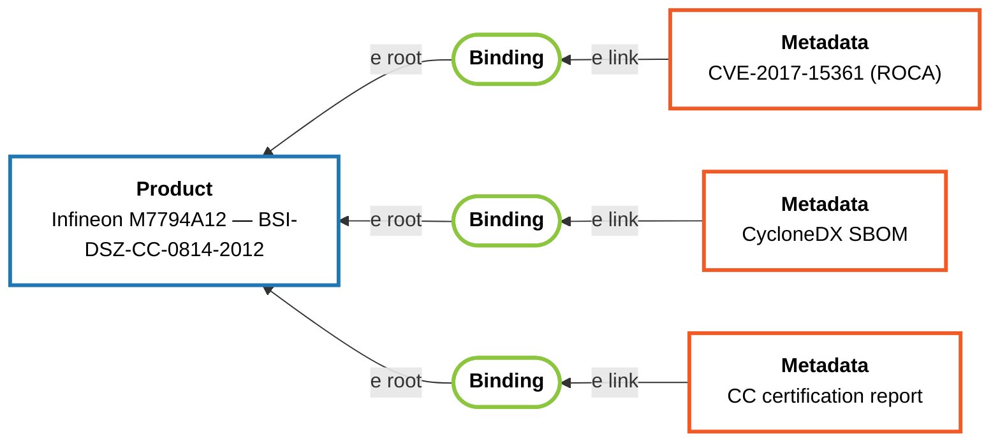

# SCRUTINY Fabric

A decentralized, permissionless **discovery layer** built on Nostr for binding security-relevant metadata to products. SCRUTINY Fabric exposes signed nodes (Products, Metadata) and signed edges (Bindings) — letting users find which security context (SBOMs, advisories, certifications, test reports, vulnerabilities) is about which products, and follow trust through who said so.

The protocol does **not** redefine SBOM or vulnerability formats. It points at them. Deep semantic interpretation of payloads is left to clients and agents reading them in their native formats.

## Why a discovery layer

Existing constructs — CycloneDX SBOMs, CSAF advisories, Common Criteria certificates, in-toto attestations — already define rich payload formats. The missing piece is a graph layer that lets users find *which payloads are about which products*, and follow trust through *who said so*.

SCRUTINY Fabric is that graph layer: permissionless, censorship-resistant, and auditable, so vendors and researchers can publish security context transparently and users can discover it without asking anyone's permission.

## The protocol in brief

All events are standard Nostr `kind:1` text notes, identified by `t` tags. Every event carries exactly one `["t","scrutiny-fabric"]` tag, exactly one version tag (`scrutiny-v<MAJOR>.<MINOR>.<PATCH>`, e.g. `scrutiny-v0.8.0`), and exactly one event-type tag.

| Event type | Role |
|---|---|
| **Product** | Identifies a product, hardware model, software package, or other security-relevant target |
| **Metadata** | An observation about a Product — finding, test result, certification, advisory, vulnerability, SBOM |
| **Binding** | An immutable signed edge, **Product ↔ Metadata only**: `e root` is the Product, `e link` is the Metadata |
| **Patch** | A git-style unified diff that evolves a Product or Metadata's `content` over time |

Patches authored by the root event's own author form the **canonical chain** — what that author is currently saying. Patches by anyone else are never folded into canonical content; they render as **overlays** (annotations or proposed changes) against the specific event they reply to. Deletion is NIP-09 `kind:5`; there is no SCRUTINY-specific retraction event.

Discovery is cheap for the common case: canonical identifiers in NIP-73 `i` tags (`cve:`, `cpe:`, `purl:`, `cc:`, `fips:`, …) make "all events about CVE-X" a single relay filter. Anything richer requires local processing — a deliberate trade-off.

Trust is entirely the user's: each user maintains a set of trusted pubkeys, and untrusted events are filtered at presentation time, after chain and overlay computation (TR-7). The trust mechanism itself is out of scope for the specification.

## Documentation

| Document | Contents |
|---|---|
| [docs/protocol-spec.md](docs/protocol-spec.md) | **The specification.** v0.8.0. Event types, diff format, trust admission, chain and overlay resolution, discovery patterns, indexer registry, and a flat registry of every normative rule (Appendix F) |
| [docs/threat-model.md](docs/threat-model.md) | Threat model: adversary capabilities, per-threat risk ratings, and residual risk |

The specification is the only normative source. Appendix F assigns every normative rule a stable mnemonic ID (`BD-3`, `T1`, `DEL-7`, …) so implementations and conformance tests can cite rules precisely.

> [!WARNING]
> **Work in progress — experimental.**
>
> The specification is a **draft at v0.8.0** and should not be relied on for production security decisions. Breaking changes are expected while the version remains below 1.0. Implementation feedback is actively shaping the specification, which is why the version number moves as often as it does.

## Status

The specification is complete enough to implement against, and is being implemented — that work surfaces gaps, which feed back here as amendments. Conformance vectors are published and digest-pinned in Appendix G (`vectors/`); `node tools/verify-corpus.mjs` checks the pins.

Known open items are tracked in the specification's own §11 rather than duplicated here.

## Contributing

Issues and pull requests are welcome, particularly:

- **Ambiguities.** Two implementers reading a rule differently is a specification bug, not an implementation bug. Report it as one.
- **Implementation experience.** If a rule is impractical, expensive, or unimplementable on real relays, that matters more than elegance.
- **Indexer prefixes.** The §9 registry is a baseline, not a closed set. New prefixes follow the convention "lowercase prefix, authority-canonical value."

When citing the specification, use the rule IDs from Appendix F.

## License

MIT — see [LICENSE](LICENSE).

Developed at the [Centre for Research on Cryptography and Security](https://crocs.fi.muni.cz/) (CRoCS), Faculty of Informatics, Masaryk University.
