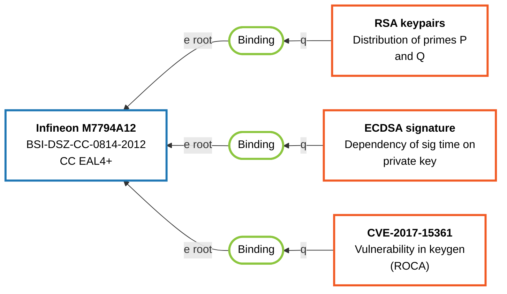

# SCRUTINY Fabric

A decentralized **discovery layer** built on Nostr for linking security-relevant metadata to products. SCRUTINY Fabric exposes signed nodes (Products, Metadata) and signed edges (Bindings) — letting users find which security context (SBOMs, advisories, certifications, test reports, vulnerabilities) is about which products, and follow trust through who said so. Deep semantic interpretation of payloads is delegated to AI agents and clients reading them in their native formats.



The protocol uses standard Nostr `kind:1` text notes identified by `t` tags (`scrutiny-fabric`, `scrutiny-product`, `scrutiny-metadata`, `scrutiny-binding`, `scrutiny-patch`) and NIP-73 canonical identifiers (`i` tags for CVE/CPE/PURL/CC/etc.) for cheap relay-side discovery. Updates are git-style patches with real unified-diff content, replies form chains, foreign-authored replies form disputes, and NIP-09 kind 5 events handle deletions — yielding a decentralized, auditable knowledge graph for security-critical products like smart cards, HSMs, cryptographic libraries, and hardware security modules.

> [!warning]
> **Work in Progress - Experimental Prototype**
>
> SCRUTINY Fabric is in early development and should not be used for production security decisions. The protocol specification and implementation are incomplete:
>
> - **Protocol**: Core specification defined (v0.5.0 — discovery-layer pivot) with all event types documented in `docs/protocol-spec.md`.
> - **Lens Apps**:
>   - `apps/scrutiny-lens`: current SvelteKit lens app (active development)
>   - `apps/lens-demo`: legacy POC React viewer retained for reference
> - **Event Publisher**: Outdated basic Svelte app for product events only; metadata and binding creation not yet implemented
> - **Python Tooling**: Outdated CLI tools for publishing events; basic tests included
>
> Features like full metadata publishing, binding creation, update/contestation UI, and relay optimizations are planned but not implemented. Expect breaking changes and use at your own risk. Contributions welcome!

## Quick Start

```bash
# Install dependencies (requires pnpm)
pnpm install

# Development
pnpm dev:pub      # Start event publisher (Svelte)
pnpm dev:lens     # Start scrutiny-lens (SvelteKit)
pnpm dev:lens-demo # Start legacy lens demo (React)

# Build for production
pnpm build
```

## Project Structure

```bash
scrutiny-nostr/
├── apps/
│   ├── event-publisher/     # Svelte publisher app
│   ├── scrutiny-lens/       # SvelteKit lens app (current)
│   └── lens-demo/           # React demo client (legacy)
├── docs/                    # Protocol specification
├── packages/
│   └── scrutiny-fabric/     # Core protocol TypeScript library (types, parsers, validators)
├── misc/                    # Python tooling and depracated cli
├── package.json             # Workspace configuration
└── pnpm-workspace.yaml
```

## Packages

### Core Protocol Library (`packages/scrutiny-fabric`)
A strictly-typed implementation of the SCRUTINY Fabric protocol in TypeScript. **Note:** the current package targets the prior v0.3.2 protocol; updating to v0.5.0 (current spec) is pending. Existing capabilities:
- **Type-safe Builders**: Event construction templates.
- **Strict Validation**: Parsing and validation with built-in defenses against adversarial inputs (e.g. tag-limit DoS protections).
- **Web-of-Trust (WoT) & Graph resolution**: Configurable N-hop bound Breadth-First Search (BFS) for endorsement aggregation and directed edge routing.
- **Secure Artifact Verification**: Memory-safe streaming architecture for safely hashing and validating NIP-92 `imeta` artifacts without risking Zip-bombs or memory exhaustion.

**Configuration:** The library uses a centralized factory pattern (`ScrutinyEngine`) allowing downstream apps to dial in their trust and strictness models:

```typescript
import { createScrutinyEngine, pubkey } from '@scrutiny-fabric/scrutiny-fabric';

const engine = createScrutinyEngine({
  trust: { 
    maxTrustHops: 3, // Enable 3-hop WoT graph resolution
    trustedPubkeys: new Set([pubkey('...')]) 
  },
  validation: {
    strictIdentifiers: false // Allow uppercase IDs like CPE:2.3:o:...
  }
});
```

### Event Publisher (`pnpm dev:pub`)
A SvelteKit web application for creating and publishing SCRUTINY Fabric events to Nostr relays. Users can define products (e.g., smart cards, HSMs), ~~metadata (test results, certifications, vulnerabilities), and create bindings that link them together~~ (planned for future releases).

Supports NIP-07 wallet integration for signing events and includes form validation for protocol compliance.

### SCRUTINY Lens (`pnpm dev:lens`)
A SvelteKit web application for exploring and visualizing SCRUTINY Fabric events from Nostr relays. It includes search, event detail views, graph visualization, trust-aware filtering, and publishing workflows for product/metadata/binding events.

### Lens Demo (`pnpm dev:lens-demo`)
A legacy React-based demo client retained for compatibility experiments and historical reference.

## Protocol

SCRUTINY Fabric (v0.5.0) defines four core event types as the discovery-layer graph:

- **Product Events**: Identify a specific product, hardware model, or software package.
- **Metadata Events**: Describe security-relevant observations, test results, certifications, or vulnerabilities (often with full payloads attached via NIP-92 `imeta` + Blossom).
- **Binding Events**: Immutable directional edges connecting two events (Product↔Metadata, Product↔Product, etc.) with a relationship described in `content` and optionally hinted via an `i` tag.
- **Patch Events**: Git-style unified-diff replies that evolve a Product or Metadata over time. Same-pubkey replies form the canonical chain; foreign-pubkey replies form disputes that overlay as opinions.

All events use Nostr `kind:1` notes with kebab-case `t` tags (`scrutiny-fabric`, `scrutiny-product`, `scrutiny-binding`, `scrutiny-patch`, etc.) for categorization. External identifiers use the canonical NIP-73 `i` tag (e.g., `cve:CVE-2017-15361`, `cpe:2.3:h:...`). Deletions use NIP-09 kind 5 events (no SCRUTINY-specific retraction event).

See [docs/protocol-spec.md](docs/protocol-spec.md) for the complete protocol specification.

## Requirements

- Node.js 20+
- pnpm 9.0.0+

## Known Issues & TODOs

- [ ] Lens demo is still pretty chatty in the console (debug `console.log` in event categorization/relationship mapping)
- [ ] Legacy event detection is best-effort (multiple historical tag variants exist in the wild); consider adding fixtures + tests
- [ ] Relay queries can get large (many `#t` variants + follow-up fetches); consider tuning filters/backoff for strict relays
- [ ] Implement full metadata event publishing in Event Publisher app
- [ ] Implement binding event creation in Event Publisher app
- [ ] Add interactions for update, contestation, and confirmation events in Event Publisher app
- [ ] Optimize relay queries and add caching for better performance
- [ ] Add CI to run:
	- `pnpm -r build` (apps)
	- `pnpm -r test` (where available)
	- `pytest` for `misc/tests`
- [ ] Add unit tests for `getLegacyScrutinyReason()` / legacy badge rendering
- [ ] Consider centralizing SCRUTINY tag variant lists (query + detection) to avoid drift
- [ ] Add linting for the Svelte app (and align repo-wide formatting/lint rules)
- [ ] Add NIP-03 - OpenTimestamps Attestations for Events

## License

MIT
