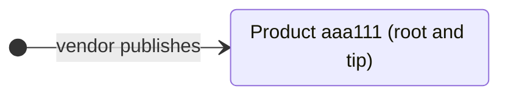
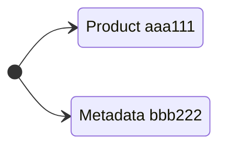

# Worked example

Six events, one story: a Product, a Metadata event, a Binding, a root-author patch, a foreign patch that becomes an overlay, and a deletion request. This page is not normative: [the specification](../protocol-spec.md) defines every behavior, and where this page and the specification disagree, the specification governs.

Pubkeys are abbreviated:

- `vendor_pk` is Infineon's hypothetical vendor key, the root author of the Product.
- `researcher_pk` is a security researcher, who publishes the Metadata event and the Binding.
- `auditor_pk` is a third-party auditor, who publishes a foreign patch.

Event IDs are short labels (`aaa111`) and the version tag appears in template form (`scrutiny-v<MAJOR>.<MINOR>.<PATCH>`); real events carry 64-character hex IDs and a concrete version. Each step ends with a diagram of the state after it.

## 1. Product (`aaa111`)

```json
{
  "id": "aaa111",
  "kind": 1,
  "pubkey": "vendor_pk",
  "created_at": 1714000000,
  "content": "Infineon M7794A12 — smartcard chip used in CC EAL4+ certified products (BSI-DSZ-CC-0814-2012).",
  "tags": [
    ["t", "scrutiny-fabric"],
    ["t", "scrutiny-product"],
    ["t", "scrutiny-v<MAJOR>.<MINOR>.<PATCH>"],
    ["i", "cpe:2.3:h:infineon:m7794a12:-:*:*:*:*:*:*:*"],
    ["k", "cpe"],
    ["i", "cc:BSI-DSZ-CC-0814-2012"],
    ["k", "cc"]
  ]
}
```

The vendor publishes the root of a chain. The chain has no patches yet, so the root is also its tip.



## 2. Metadata (`bbb222`)

```json
{
  "id": "bbb222",
  "kind": 1,
  "pubkey": "researcher_pk",
  "created_at": 1714000010,
  "content": "CVE-2017-15361 (ROCA): predictable RSA key generation in Infineon TPM/smartcards. Affected keys may be factorable using Coppersmith's attack on the public modulus.",
  "tags": [
    ["t", "scrutiny-fabric"],
    ["t", "scrutiny-metadata"],
    ["t", "scrutiny-v<MAJOR>.<MINOR>.<PATCH>"],
    ["i", "cve:CVE-2017-15361"],
    ["k", "cve"],
    ["i", "cwe:CWE-310"],
    ["k", "cwe"]
  ]
}
```

The researcher publishes a second, independent root. Nothing connects the two yet.



## 3. Binding (`ccc333`)

The researcher binds the two with a Binding that asserts the vulnerability connection.

```json
{
  "id": "ccc333",
  "kind": 1,
  "pubkey": "researcher_pk",
  "created_at": 1714000020,
  "content": "Vulnerability: ROCA affects this Infineon smartcard chip.",
  "tags": [
    ["t", "scrutiny-fabric"],
    ["t", "scrutiny-binding"],
    ["t", "scrutiny-v<MAJOR>.<MINOR>.<PATCH>"],
    ["e", "aaa111", "", "root", "vendor_pk"],
    ["e", "bbb222", "", "link", "researcher_pk"]
  ]
}
```

Once the Binding is admitted, users who trust the researcher, or who reach the Product by another trust path, can find the Product and the Metadata event and follow the connection.


## 4. Root-author patch (`ddd444`)

The vendor updates the Product's description with a firmware revision. The patch replies to the root through NIP-10 `e reply`.

```json
{
  "id": "ddd444",
  "kind": 1,
  "pubkey": "vendor_pk",
  "created_at": 1714000030,
  "content": "Update description with firmware revision.\n\n```diff\ndiff --git a/content b/content\n--- a/content\n+++ b/content\n@@ -1 +1 @@\n-Infineon M7794A12 — smartcard chip used in CC EAL4+ certified products (BSI-DSZ-CC-0814-2012).\n+Infineon M7794A12 — smartcard chip (firmware Rev B) used in CC EAL4+ certified products (BSI-DSZ-CC-0814-2012).\n```",
  "tags": [
    ["t", "scrutiny-fabric"],
    ["t", "scrutiny-patch"],
    ["t", "scrutiny-v<MAJOR>.<MINOR>.<PATCH>"],
    ["e", "aaa111", "", "root", "vendor_pk"],
    ["e", "aaa111", "", "reply", "vendor_pk"]
  ]
}
```

After `ddd444` applies, the canonical bytes of the Product carry the new description. The `i` tags stay as they were, because indexers are immutable after the root is published.


## 5. Foreign patch (`eee555`)

An auditor disputes the firmware wording: the chip was certified as Rev A, and Rev B was re-evaluated under a different certificate. The auditor publishes a foreign patch that replies to `ddd444`.

```json
{
  "id": "eee555",
  "kind": 1,
  "pubkey": "auditor_pk",
  "created_at": 1714000040,
  "content": "Disputing the implied scope: the original CC certificate (BSI-DSZ-CC-0814-2012) was issued against Rev A; Rev B underwent re-evaluation under a different certificate ID. Linking the two as a single product overstates the certification coverage.\n\n```diff\ndiff --git a/content b/content\n--- a/content\n+++ b/content\n@@ -1 +1 @@\n-Infineon M7794A12 — smartcard chip (firmware Rev B) used in CC EAL4+ certified products (BSI-DSZ-CC-0814-2012).\n+Infineon M7794A12 — smartcard chip. Firmware Rev A is covered by BSI-DSZ-CC-0814-2012; Rev B was re-evaluated under a separate certificate.\n```",
  "tags": [
    ["t", "scrutiny-fabric"],
    ["t", "scrutiny-patch"],
    ["t", "scrutiny-v<MAJOR>.<MINOR>.<PATCH>"],
    ["e", "aaa111", "", "root", "vendor_pk"],
    ["e", "ddd444", "", "reply", "vendor_pk"]
  ]
}
```

`eee555` is not part of the canonical chain, because `auditor_pk` differs from `vendor_pk`. A user sees it only if they trust `auditor_pk`. Then it renders as an overlay: its target is `ddd444`, so the client computes `ddd444`'s resolved content (root plus `ddd444`'s diff) and draws the auditor's proposed diff over it. `ddd444` is the tip and the hunk applies, so the overlay is `clean`. The canonical bytes stay primary, and the overlay appears beside them.


## 6. Deletion request (`fff666`)

The vendor decides that the wording in `ddd444` was misleading and retracts it with a NIP-09 deletion request.

```json
{
  "id": "fff666",
  "kind": 5,
  "pubkey": "vendor_pk",
  "created_at": 1714000050,
  "content": "Retracting — wording was ambiguous; will republish with clearer scope.",
  "tags": [
    ["e", "ddd444"],
    ["k", "1"]
  ]
}
```

What follows:

- `ddd444` leaves the canonical chain. Any root-author patch that replied to it would leave too; here there is none.
- The canonical bytes of the Product revert to the root: two indexers and the original description.
- `eee555` replied to `ddd444`, so it is now orphaned. If the client can still find `ddd444` (cached, on another relay, or through the "show deleted events" toggle), the overlay renders against `ddd444`'s resolved content (α). Otherwise it renders as a standalone artifact with its payload, author and target id (β). Either way the auditor's statement is kept.
- A SCRUTINY-aware relay keeps `ddd444`, `eee555` and `fff666`, so an audit-mode query can recover the history.

The vendor may later publish a new patch, with a new id, that replies to `aaa111` and states the firmware information more clearly. The auditor may republish their patch against the new event if they still object.


## What the example covers

Two principals publish their own roots, and a Binding joins them. The vendor evolves the Product through a root-author patch. An auditor adds a foreign patch that renders as an overlay against `ddd444`'s resolved content. The vendor retracts the patch, the canonical content reverts, and the overlay is orphaned and kept for audit. This exercises event types, the diff format, chain construction, overlay rendering, the deletion cascade and orphaned-overlay handling. Larger scenarios (self-forks, long chains, embedded SBOMs) are compositions of the same pieces.
