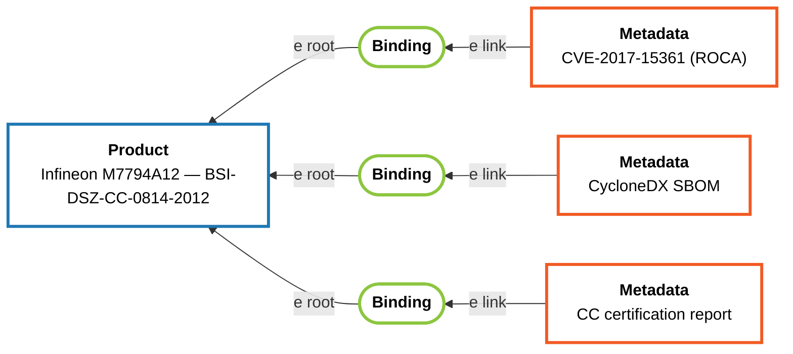
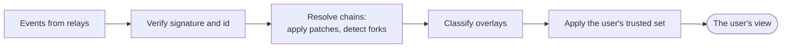

# SCRUTINY Fabric overview

SCRUTINY Fabric is a discovery layer for security metadata. It lets anyone publish a signed statement about a product, and lets a user find the statements about the products they care about and decide whose statements to see. It runs on Nostr, so there is no central server.

The [protocol specification](protocol-spec.md) is the only normative document.

## The problem

Formats for security information already exist: CycloneDX and SPDX for SBOMs, CSAF for advisories, Common Criteria certificates, in-toto attestations. What is missing is a way to answer "which of these documents are about the product I use?" and "who says so?". Vendors and researchers need a way to publish that context openly, and users need a way to find it without asking anyone's permission.

SCRUTINY Fabric answers those two questions by linking documents to products with signed events. An event carries the document as text or as an attached file; the protocol leaves the format to the publisher and does not parse it.

Nostr fits because events are signed by their author's key, relays are interchangeable, and a statement published to several relays is hard to suppress. Every SCRUTINY event is an ordinary Nostr `kind: 1` note, so generic Nostr clients display the text and ignore the rest.

## The four event types

All four are identified by `t` tags (`scrutiny-fabric`, a version, and one type tag).

- A **Product** names a thing: a smartcard chip, a software package, a device. It carries indexers such as a CPE, a PURL or a Common Criteria certificate number in `i` tags, so that a relay can answer "all events about this indexer" with one filter.
- **Metadata** says something about a Product: a vulnerability, an SBOM, a certification report, a test result. It has the same shape as a Product.
- A **Binding** connects one Metadata event to one Product. It is an immutable signed edge, and the signer takes responsibility for the connection. Anyone can publish a Binding; a user sees it only if the user's trusted set includes its author.
- A **Patch** proposes a change to the text of a Product or Metadata event, the way a commit changes a file. It carries a unified diff.

**Figure 1: Products, Bindings and Metadata.** Arrows run from a Metadata event through a Binding to a Product, which is the direction of the edge. Each label is the tag in the Binding that names the event at that end of the arrow. A Product can have many Bindings.

### Who may change what

The author of a Product or Metadata event owns its content. Patches by that author form the **canonical chain**, the author's current statement. Patches by anyone else leave it unchanged and appear as **overlays**: comments or proposed changes, shown next to the version of the text they were written against. An author deletes an event with a Nostr deletion request, which hides the event from the default view and keeps it for audit.

## How a client builds its view

A client gathers events from several relays and resolves them itself. Verification does not depend on trusting a relay, because each step uses signed data. Completeness does depend on at least one queried relay being honest ([§9](protocol-spec.md#9-security-considerations)).

**Figure 2: From relay events to a user's view.** The trusted set is applied last, to the results.

1. **Verify.** The client checks the signature and recomputes the event id. An event that fails is dropped.
2. **Resolve chains.** It follows patch links from each root, applies the diffs in order, and stops at the first patch that does not apply. If the author published two patches for the same parent, the chain is in a self-fork: the client freezes at the shared parent and reports the self-fork.
3. **Classify overlays.** Each foreign patch is checked against the text it was written for. It ends in one of five states: clean, stale, conflict, orphaned (its target is deleted or missing) or unclassified (a resource ceiling was reached first).
4. **Gate by trust.** Only now does the client hide whatever the user's trusted set does not admit.

Clients see events in different orders, so every step gives the same result for the same set of events and the same resource ceilings.

## Trust and its limits

Each user keeps a set of trusted keys. An event is in the user's view if its author is trusted, or if a Binding by a trusted author names it as an endpoint. A Binding by an untrusted key adds nothing, even when it points at trusted events. Foreign patches need their own author's key in the trusted set.

The protocol has no global authority, reputation score or key revocation. If a key leaks, the remedy is social. The protocol cannot tell whether a trusted author's statement is true, and it cannot stop a relay from withholding events. The [threat model](threat-model.md) states what is protected, against whom, and what remains.

## Where to go next

| Document | Read it to |
|---|---|
| [Protocol specification](protocol-spec.md) | implement a producer, consumer or relay |
| [Worked example](guide/worked-example.md) | follow six events from publication to retraction |
| [Git mapping](guide/git-mapping.md) | map patches, chains and overlays to git concepts |
| [Optional signals](guide/optional-signals.md) | use proof of work, reposts, reactions or zaps |
| [Roadmap](guide/roadmap.md) | see what may come later |
| [Decision records](adr/README.md) | learn why a rule reads as it does |
| [Threat model](threat-model.md) | review the security analysis |
| [`vectors/`](../vectors) | test an implementation against the conformance corpus |

### Reader paths

- **Producer.** Read [§3](protocol-spec.md#3-event-model) (event model), [§4.1](protocol-spec.md#41-payload-and-envelope) (payload and envelope) and [§4.3](protocol-spec.md#43-producer-output) (producer output) of the specification, then the worked example.
- **Consumer.** Read [§3](protocol-spec.md#3-event-model) to [§8](protocol-spec.md#8-discovery) in order, run the vectors, and read [§9](protocol-spec.md#9-security-considerations) on what a client may not trust.
- **Relay operator.** Read [§3.1](protocol-spec.md#31-identification-and-versioning) (verification), [§7](protocol-spec.md#7-kind-5-deletion) (keeping deletion requests, a SHOULD) and [§8](protocol-spec.md#8-discovery) (queries a relay is assumed to support).
- **Auditor.** Read the threat model with [§5](protocol-spec.md#5-rule-layers-and-trust) and [§9](protocol-spec.md#9-security-considerations) of the specification beside it.
