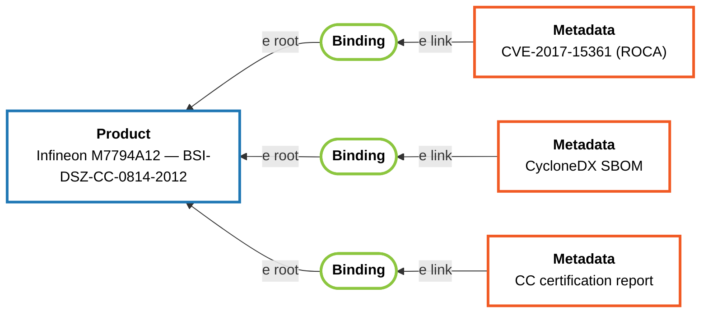
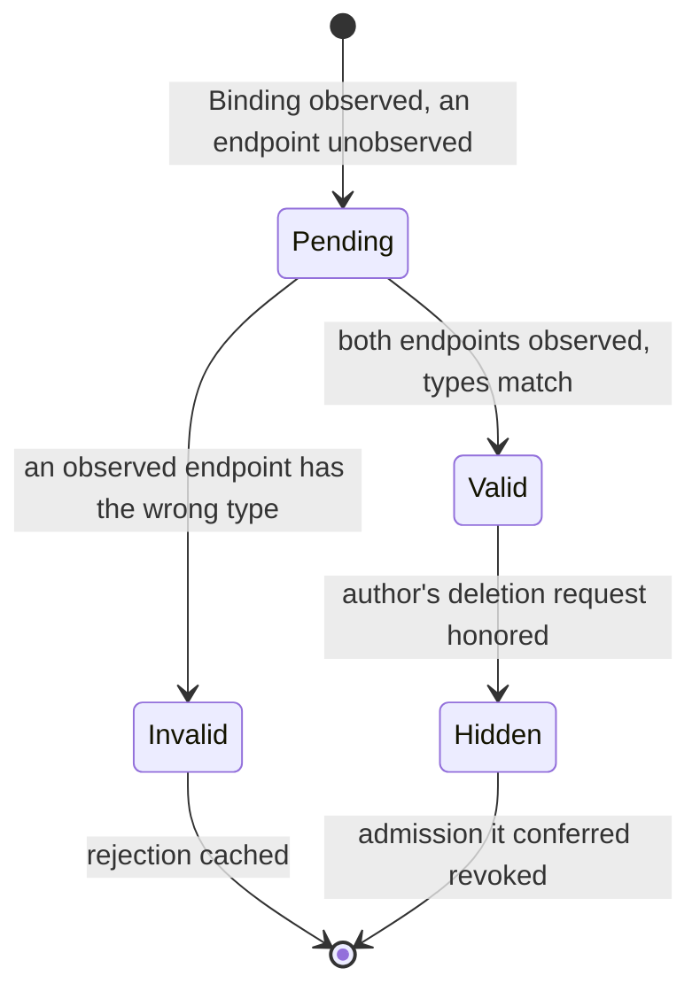
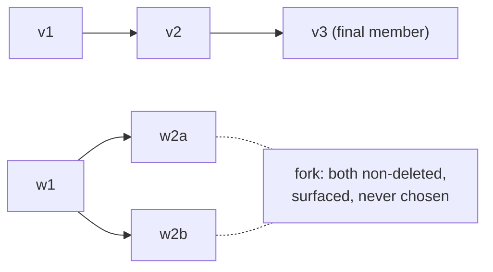
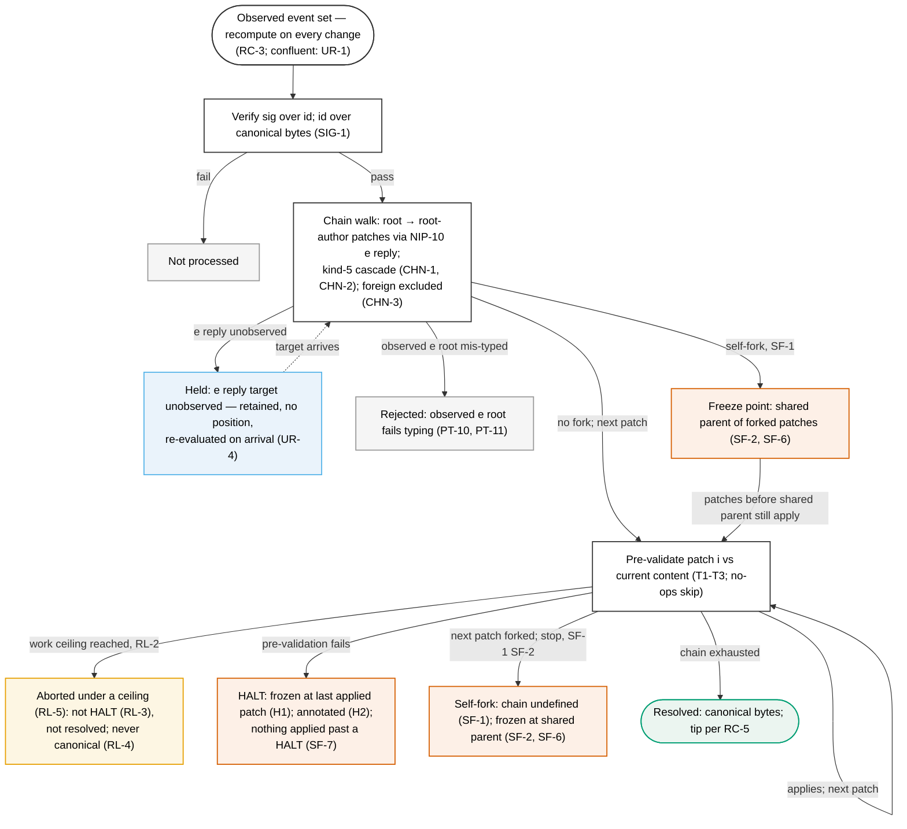
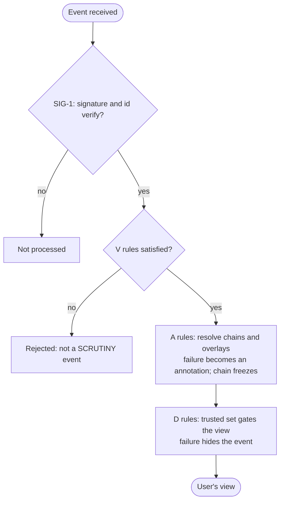
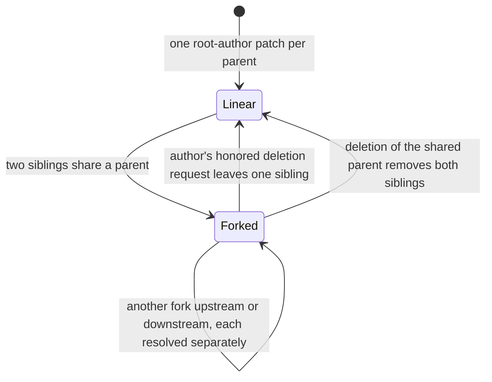
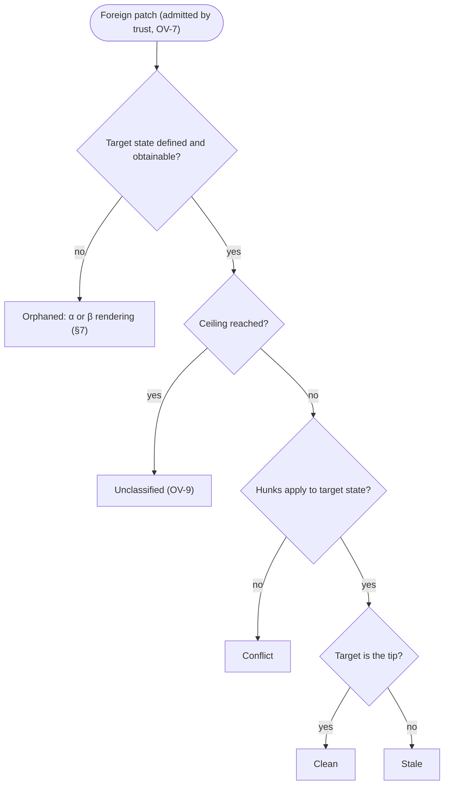
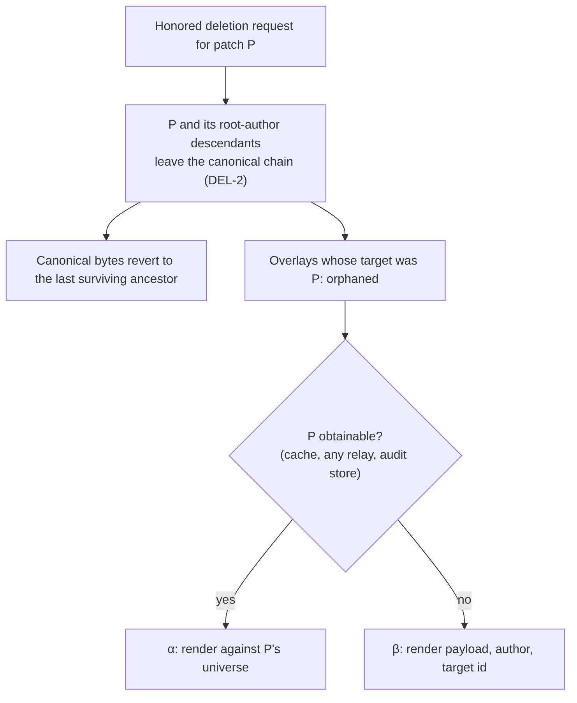
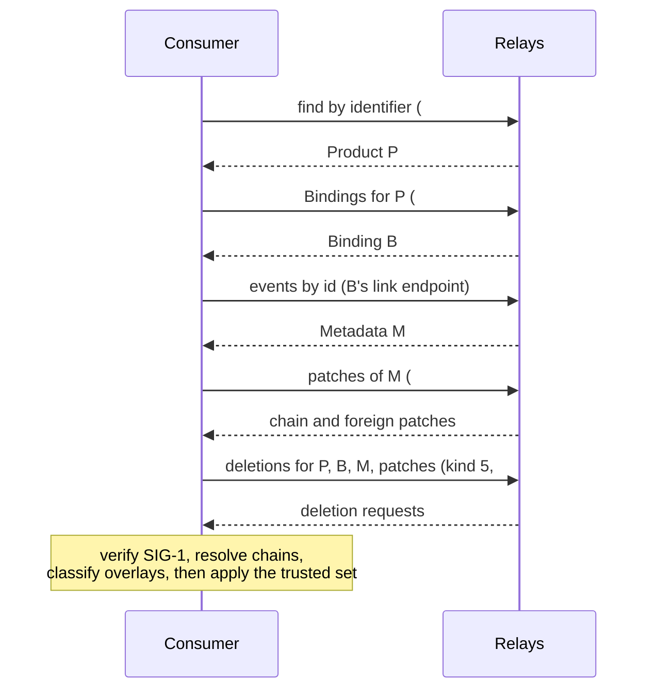

# SCRUTINY Fabric — Protocol Specification v0.9.1

**Version:** 0.9.1
**Status:** Draft

This is the only normative document. For an introduction, read the [overview](overview.md). Release history is in [CHANGELOG.md](../CHANGELOG.md); the reasons behind individual decisions are in [docs/adr/](adr/); the threat model is [threat-model.md](threat-model.md).

## Keywords and conformance

The key words "MUST", "MUST NOT", "REQUIRED", "SHALL", "SHALL NOT", "SHOULD", "SHOULD NOT", "RECOMMENDED", "NOT RECOMMENDED", "MAY", and "OPTIONAL" in this document are to be interpreted as described in BCP 14 [RFC 2119] [RFC 8174] when, and only when, they appear in all capitals, as shown here.

This specification binds three roles. A **producer** builds and publishes events. A **consumer** reads events and resolves them. An *interactive* consumer renders for a person; a *service* consumer is any consumer that is not interactive, whether it serves other software (index services, APIs, scanners, agents) or runs as a tool. A **relay** stores and serves events. A rule binds the role it names: "producers" and "publishers" are producers, "consumers" and "clients" are consumers, "relays" are relays, and "implementations" means every role the rule's subject concerns. An implementation conforms when it satisfies every MUST and MUST NOT in the rules that bind a role it implements and reports the outcomes pinned by the conformance vectors ([§10](#10-conformance-vectors)). A SHOULD or SHOULD NOT may be departed from only for a reason the implementer understands and documents; a MAY is optional.

Normative references: [RFC 2119](https://www.rfc-editor.org/rfc/rfc2119), [RFC 8174](https://www.rfc-editor.org/rfc/rfc8174), and the base specifications in [§3.2](#32-base-layers-and-inherited-semantics). Each rule table below is the authority for its rules. The Layer column assigns every rule to one of the three layers of [§5.1](#51-rule-layers), and [`rules.json`](../rules.json) lists all rules in one file, generated from these tables.

Examples are not normative. Where an example and a rule disagree, the rule governs.

## 1. Scope

SCRUTINY Fabric is a discovery layer on Nostr `kind: 1` events. It binds security metadata to products: signed nodes (Products, Metadata) are joined by signed edges (Bindings), and a Patch event evolves the content of a node. This document defines the four event types and their tags, the diff format of Patches, how a consumer resolves chains and overlays, how a user's trusted set gates what the user sees, deletion, and the queries a consumer uses to find events.

It does not define payload formats. SBOMs, advisories and certificates travel as event `content` or as attachments, and the protocol does not parse them. How a user builds a trusted set is out of scope.



**Figure 1 — The event graph.** A Binding names one Product in its `e root` tag and one Metadata event in its `e link` tag. One Product can have many Bindings, and one Metadata event can be bound to many Products by publishing one Binding for each pair.

## 2. Terms

Each term has one meaning in this document. Rules use these words and no synonyms.

**Events**

- **SCRUTINY event**: a `kind: 1` event that carries a `scrutiny-fabric` `t` tag. Whether it is valid is decided by the V rules ([§5.1](#51-rule-layers)).
- **Product**, **Metadata**: root events. A **root event** is the Product or Metadata event that a chain of Patches is anchored to.
- **Binding**: a signed edge between one Product and one Metadata event ([§3.4](#34-binding)).
- **Patch**: a `scrutiny-patch` event that carries zero or one fenced unified diff ([§3.5](#35-patch)). The **patch payload** is the byte sequence inside that fenced block ([§4.1](#41-payload-and-envelope)).
- **No-op patch**: a Patch with no fenced block, or a header-only block with no hunks. Its effect is the identity.
- **Deletion request**: a Nostr `kind: 5` event. It is **honored** when its `pubkey` equals the target's `pubkey`. A target that a honored deletion request removes from the default view is **retracted**.
- **Succession**, **final member**: the Products or Metadata events joined by `supersedes` links form a succession; its final member is the one that no other member supersedes ([§3.6](#36-supersession)).

**Chains**

- **Root author**: the `pubkey` of the root event.
- **Root-author patch**, **foreign patch**: a Patch whose `pubkey` equals, or differs from, the root author's.
- **Canonical chain**: the linear sequence of root-author patches threaded by `e reply` markers from the root event forward.
- **Tip**: the last event of the canonical chain: the last patch, or the root event where the chain has no patches. It is undefined while a self-fork is unresolved.
- **Resolved content** of an event: the root content with every patch up to and including that event applied. The **canonical bytes** are the resolved content of the tip.
- **Sibling**, **subtree**: siblings are root-author patches that reply to the same parent. A sibling's subtree is the sibling and all its descendants, which the deletion cascade removes together.
- **Self-fork**: two or more siblings. The canonical chain is undefined until the fork is resolved.
- **HALT**: the state in which a patch has failed pre-validation and the canonical bytes stay at the last applied patch.
- **Overlay**: a foreign patch together with its classification (clean, conflict, stale, orphaned or unclassified) against its target. The **target state** is the resolved content of the foreign patch's `e reply` target.

**Observation and validity**

- **Observed**: received, and verified under [SIG-1](#rule-SIG-1). An event that is not observed is **unobserved**.
- **Held**: the disposition of a Patch, or of a `supersedes` marker, that waits for an unobserved event. A Binding in that situation is **pending**. Both are re-evaluated when the event arrives.
- **V-valid**: satisfying every V rule ([§5.1](#51-rule-layers)). Anything else is V-invalid.
- **Annotation**: a diagnostic that a consumer reports about a patch or a chain: the protocol error annotation of [H2](#rule-H2) and the resource-limit-exceeded annotation of [RL-3](#rule-RL-3).
- **Ceiling**: a consumer's configured limit on work or size ([§4.5](#45-resource-limits)).
- **Confluence**: the state an implementation reaches depends only on the set of observed events, not on arrival order ([UR-1](#rule-UR-1)).

**Trust and discovery**

- **Trusted set**: the pubkeys a user trusts. How the set is built is out of scope.
- **Admitted**: allowed into a user's view by the trust rules of [§5.2](#52-trust-and-admission). Events that are not admitted are hidden from the view; they are still computed over.
- **Indexer**: the value of an `i` tag, such as a CVE number, a CPE or a Package URL. An **index service** is a service consumer that precomputes views; the two senses are never mixed.
- **Interactive consumer**, **service consumer**: see Keywords and conformance.

## 3. Event model

All SCRUTINY events are `kind: 1` Nostr events. `t` tags say which events are in scope and what type each is; the type decides which other tags the event carries.

### 3.1 Identification and versioning

A SCRUTINY event carries three kinds of `t` tag:

- `["t", "scrutiny-fabric"]`, which puts the event in scope.
- `["t", "scrutiny-v<MAJOR>.<MINOR>.<PATCH>"]`, for example `["t", "scrutiny-v0.9.1"]`, which names the specification version.
- One event-type tag: `scrutiny-product`, `scrutiny-metadata`, `scrutiny-binding` or `scrutiny-patch`.

A `kind: 1` event that has `scrutiny-fabric` but breaks the cardinalities below is an invalid SCRUTINY event. An event without `scrutiny-fabric` is not a SCRUTINY event and this specification does not apply to it. Tag names use kebab-case; inside the version tag the three numbers are separated by dots.

Version numbers are unpadded decimal integers with no digit-count ceiling. Versions order by comparing `MAJOR`, `MINOR` and `PATCH` in turn, each as a digit string, so no implementation depends on a host integer type ([ADR-0010](adr/0010-digit-string-version-ordering.md)). A consumer that meets a higher version than its own may store the event and make it discoverable, provided the event satisfies every V rule; it does not reject the event for its version tag alone.

Before it processes any event, a consumer verifies the signature and recomputes the event `id`. A signature check alone is not enough, because the signature covers the `id`, so an event whose `content` or `tags` were altered while keeping the original `id` and `sig` still passes it. The check applies to every event a consumer reads, including kind 5 deletion requests and kind 1040 attestations: honoring a forged deletion request would remove canonical history, and relays are not trusted to have checked ([§9](#9-security-considerations)). An event that fails either check is not processed or rendered.

Publishers may attach [NIP-03](https://github.com/nostr-protocol/nips/blob/master/03.md) OpenTimestamps attestations (kind 1040) to any SCRUTINY event. An attestation is evidence that an event existed before a Bitcoin block, which helps audits and disputes after a key compromise. The protocol has no `created_at`-based tip selection, and [OTS-1](#rule-OTS-1) keeps timestamps out of resolution. NIP-03 is marked `unrecommended` on its own page.

| # | Layer | Inherits from | Rule |
|---|---|---|---|
| <a id="rule-TAG-1"></a>TAG-1 | V | — | Every SCRUTINY event MUST carry exactly one `["t","scrutiny-fabric"]` tag. |
| <a id="rule-TAG-2"></a>TAG-2 | V | — | Every SCRUTINY event MUST carry exactly one version `t` tag matching `^scrutiny-v\d+\.\d+\.\d+$`. |
| <a id="rule-TAG-3"></a>TAG-3 | V | — | Every SCRUTINY event MUST carry exactly one event-type `t` tag from `{scrutiny-product, scrutiny-metadata, scrutiny-binding, scrutiny-patch}`. |
| <a id="rule-TAG-4"></a>TAG-4 | D | — | The `t` values this specification defines use kebab-case (`scrutiny-fabric`, `scrutiny-product`, …); underscored variants from older drafts are not defined. The rule does not constrain other tags: TAG-5 governs every unknown or inherited tag, whatever its spelling. |
| <a id="rule-TAG-5"></a>TAG-5 | V | NIP-01 | Unknown tags MUST be ignored by parsers. |
| <a id="rule-VER-1"></a>VER-1 | V | — | Ordering between two version tags is a per-field numeric tuple comparison of `(MAJOR, MINOR, PATCH)`. Each field compares as a decimal digit string — leading zeros ignored, the longer string the greater, equal lengths lexicographically — never by conversion to a host number type, and never as a lexicographic comparison of the whole tag value. |
| <a id="rule-VER-2"></a>VER-2 | V | — | A higher-version event MAY be processed opaquely if it satisfies every Validity invariant of this specification. |
| <a id="rule-VER-3"></a>VER-3 | V | — | A higher-version event that violates a Validity invariant of this specification MUST NOT be rendered as a Product, Metadata, Binding, or Patch. |
| <a id="rule-VER-4"></a>VER-4 | V | — | Implementations MUST NOT reject higher-version events *solely* because of the version tag. |
| <a id="rule-OTS-1"></a>OTS-1 | A | NIP-03 | OpenTimestamps attestations are an audit signal only: consumers MUST NOT use OTS-derived timestamps in canonical-chain construction, overlay classification, or self-fork resolution. |
| <a id="rule-SIG-1"></a>SIG-1 | V | NIP-01 | Before processing any event — including kind 5 deletions and kind 1040 attestations — implementations MUST verify the signature **and** that `id` equals the SHA-256 of the NIP-01 canonical serialization. A signature-only check is insufficient. |

### 3.2 Base layers and inherited semantics

SCRUTINY builds on Nostr and CommonMark. These are the specifications it depends on.

| Specification | Used for | Status |
|---|---|---|
| [NIP-01](https://github.com/nostr-protocol/nips/blob/master/01.md) | Event structure, signatures, relay protocol, single-letter tag indexing | Required |
| [NIP-09](https://github.com/nostr-protocol/nips/blob/master/09.md) | Deletion requests (kind 5), [§7](#7-kind-5-deletion) | Required |
| [NIP-10](https://github.com/nostr-protocol/nips/blob/master/10.md) | Threading: `e root` and `e reply` markers | Required |
| [NIP-73](https://github.com/nostr-protocol/nips/blob/master/73.md) | `i` tag shape; SCRUTINY defines its own prefix registry ([§3.7](#37-identifiers)) | Required |
| CommonMark §4.5 | Fenced code blocks: the patch payload envelope ([§4.1](#41-payload-and-envelope)) | Required |
| [NIP-92](https://github.com/nostr-protocol/nips/blob/master/92.md), [NIP-94](https://github.com/nostr-protocol/nips/blob/master/94.md) | `imeta` attachments and their fields (`m`, `x`, `size`, `fallback`), [§3.8](#38-attachments) | Optional |
| [NIP-03](https://github.com/nostr-protocol/nips/blob/master/03.md) | OpenTimestamps attestations, audit signal only ([§3.1](#31-identification-and-versioning)) | Optional |
| [NIP-13](https://github.com/nostr-protocol/nips/blob/master/13.md), [NIP-18](https://github.com/nostr-protocol/nips/blob/master/18.md), [NIP-25](https://github.com/nostr-protocol/nips/blob/master/25.md), [NIP-57](https://github.com/nostr-protocol/nips/blob/master/57.md) | Ranking and spam signals, described in [optional signals](guide/optional-signals.md) | Optional |

Behavior in these areas is inherited from the base layer. A consumer defers to the base specification, except in the rows marked SCRUTINY-specific below, where this specification departs from or extends it.

| Topic | Base layer | Meaning for SCRUTINY |
|---|---|---|
| Event structure, JSON encoding, signatures, relay protocol, tag indexing (`#e`, `#t`, `#i`, `#k`) | NIP-01 | SCRUTINY events are kind 1 events. NIP-01 defines the signature scheme and the `id`; [SIG-1](#rule-SIG-1) requires that both be checked. Relays handle tag indexing. |
| Deletion: author match, several `e` tags, optional `k` scoping, relay honor semantics | NIP-09 | A kind 5 event may carry several `e` tags; each target is an independent request, gated by the author match. Kind 5 events usually carry no `scrutiny-fabric` tag, so discovery queries them by kind and `#e` ([§8](#8-discovery)). |
| `e` tag grammar: `root` and `reply` markers, empty relay hint, advisory author hint | NIP-10 | An empty relay hint means no hint. A wrong author hint does not invalidate the event that carries it ([BD-12](#rule-BD-12)). |
| Markup in `kind: 1` `content` | NIP-10 | **SCRUTINY-specific.** NIP-10 advises against markdown or HTML in kind 1 content. Patches carry a CommonMark fenced block ([§4.1](#41-payload-and-envelope)), and Product and Metadata `content` is free-form. A generic client shows the text as written. |
| The `e` tag marker set | NIP-10 | **SCRUTINY-specific.** NIP-10 defines `root` and `reply`. Bindings also use `link` ([§3.4](#34-binding)), and Product and Metadata events may use `supersedes` ([§3.6](#36-supersession)). A generic client may ignore or misread them. |
| Relay handling of deleted events | NIP-09 | **SCRUTINY-specific.** NIP-09 asks relays to delete the event. A relay SHOULD keep the original of a `scrutiny-fabric` event together with its deletion request, so the audit trail survives ([DEL-11](#rule-DEL-11)). |
| `i` and `k` tags: external IDs as `<prefix>:<value>`, `k` as the kind of identifier | NIP-73 | Same tag shape and meaning, with SCRUTINY's own prefix registry ([§3.7](#37-identifiers)). `k` is the set of identifier kinds present in the event, not a label on each `i` tag. |
| Fenced blocks: info strings, variable-length fences | CommonMark §4.5 | Lookup, fence-length matching and the payload byte boundary are CommonMark's responsibility ([§4.1](#41-payload-and-envelope)). |
| Eventual consistency across relays | Nostr operational model | Events arrive out of order, late or never. Canonical bytes, overlay states and self-fork detection are re-evaluated when the observed set changes ([§6.1](#61-root-author-and-canonical-chain)). |

Where a base layer allows a choice, SCRUTINY may narrow it in the section that uses it, and says so there. [ADR-0016](adr/0016-departures-from-nip-10-and-nip-09.md) gives the reasons for the three SCRUTINY-specific rows.

### 3.3 Product and Metadata

A **Product** identifies a product, hardware model, software package or other target. A **Metadata** event says something about a Product or about another Metadata event: an observation, finding, test result, certification, vulnerability or advisory. The two have the same shape and differ in the `t` tag. Metadata events usually carry more content and more attachments, such as a full advisory or an SBOM.

| Field or tag | Count | Requirement | Description |
|---|---|---|---|
| `content` | 1 | MUST | Free-form text: prose, JSON, YAML or any other format. |
| `i` | 0..64 | SHOULD | Identifiers of what the event is about ([§3.7](#37-identifiers)). |
| `k` | 0..64 | SHOULD | The kinds of the `i` identifiers present ([§3.7](#37-identifiers)). |
| `imeta` | 0..N | OPTIONAL | Attached files ([§3.8](#38-attachments)). |

`created_at` is the time the event was created, not the time of the fact it describes. Historical dates, such as a certification or disclosure date, belong in `content`. Deployed relays commonly accept events a few minutes ahead and one to three years behind, and advertise their bounds in the NIP-11 fields `created_at_lower_limit` and `created_at_upper_limit`, so a backdated event can be refused.

| # | Layer | Inherits from | Rule |
|---|---|---|---|
| <a id="rule-CA-1"></a>CA-1 | D | — | Publishers SHOULD NOT backdate `created_at` to a historical date the event describes. Relays may reject events outside a bounded timestamp window (NIP-11 `created_at_lower_limit`, `created_at_upper_limit`, in seconds); historical dates belong in `content`. |
| # | Layer | Inherits from | Rule |
|---|---|---|---|
| <a id="rule-PR-1"></a>PR-1 | V | — | A Product event MUST carry a `content` field (any UTF-8 byte sequence; format is free-form). |
| <a id="rule-PR-2"></a>PR-2 | D | — | A Product event SHOULD carry no more than 64 `i` tags. |
| <a id="rule-PR-3"></a>PR-3 | D | — | A Product event SHOULD carry no more than 64 `k` tags. |
| <a id="rule-PR-4"></a>PR-4 | D | NIP-73 | The `k` collection SHOULD contain at minimum one entry per **distinct** `i` prefix kind present in the event. A missing or incomplete `k` collection does NOT invalidate the event; consumers MAY derive the kind from the `i` value's prefix (§3.7). Consumers MUST treat `k` as a set. |
| <a id="rule-PR-5"></a>PR-5 | V | NIP-92 | `imeta` attachments are OPTIONAL. |
| # | Layer | Inherits from | Rule |
|---|---|---|---|
| <a id="rule-MD-1"></a>MD-1 | V | — | A Metadata event MUST carry a `content` field (any UTF-8 byte sequence; format is free-form). |
| <a id="rule-MD-2"></a>MD-2 | D | — | A Metadata event SHOULD carry no more than 64 `i` tags. |
| <a id="rule-MD-3"></a>MD-3 | D | — | A Metadata event SHOULD carry no more than 64 `k` tags. |
| <a id="rule-MD-4"></a>MD-4 | D | NIP-73 | The `k` collection SHOULD contain at minimum one entry per **distinct** `i` prefix kind present in the event. A missing or incomplete `k` collection does NOT invalidate the event; consumers MAY derive the kind from the `i` value's prefix (§3.7). Consumers MUST treat `k` as a set. |
| <a id="rule-MD-5"></a>MD-5 | V | NIP-92 | `imeta` attachments are OPTIONAL. |

### 3.4 Binding

A **Binding** is an immutable directed edge from a Metadata event to a Product. It carries two `e` tags.

| Tag | Count | Requirement | Description |
|---|---|---|---|
| `e` with marker `root` | 1 | MUST | The Product: `["e", "<id>", "<relay>", "root", "<author_pk>"]`. |
| `e` with marker `link` | 1 | MUST | The Metadata event: `["e", "<id>", "<relay>", "link", "<author_pk>"]`. |

A Binding between two Products, between two Metadata events, or to any other event type is not permitted. To relate other things, publish a Metadata event that describes the relationship and bind it to a Product.

A Binding can arrive before its endpoints. Until both are observed the Binding is pending: stored, not rendered, though an audit view may list long-pending Bindings. Figure 2 shows the lifecycle.



**Figure 2 — Binding lifecycle.** A Binding stays pending for as long as an endpoint is missing; it is neither valid nor invalid. An invalid Binding stays invalid, so the rejection may be cached. A hidden Binding stops conferring admission on its endpoints ([DEL-5](#rule-DEL-5)).

The `<relay>` field is a hint. The `<author_pk>` field is a hint for outbox-model discovery: when the relay hint does not resolve, the referenced author's write relays are searched. Trust decisions rest on the verified `pubkey` of the event, never on the hint.

A Binding has no update mechanism. To correct one, delete it ([§7](#7-kind-5-deletion)) and publish a replacement. To dispute one, publish a competing Binding; the trust graph decides which edge a user sees, and the protocol has no dispute mechanism for edges. A Binding by a trusted author cannot be overridden by anyone else. The protocol keeps every valid Binding; collapsing duplicates is a presentation choice ([BD-11](#rule-BD-11)).

| # | Layer | Inherits from | Rule |
|---|---|---|---|
| <a id="rule-BD-1"></a>BD-1 | V | — | A Binding event MUST carry exactly one `e` tag with marker `root`. |
| <a id="rule-BD-2"></a>BD-2 | V | NIP-10 | A Binding event MUST carry exactly one `e` tag with marker `link`. The `link` marker is defined by this specification; NIP-10 defines only `root` and `reply` (§3.2). |
| <a id="rule-BD-3"></a>BD-3 | V | — | The `e root` endpoint MUST be a `scrutiny-product` event. |
| <a id="rule-BD-4"></a>BD-4 | V | — | The `e link` endpoint MUST be a `scrutiny-metadata` event. |
| <a id="rule-BD-5"></a>BD-5 | V | — | A Binding whose endpoints, once observed, do not satisfy BD-3/BD-4 is an invalid SCRUTINY event and MUST be rejected (TR-1). |
| <a id="rule-BD-6"></a>BD-6 | D | — | A Binding whose endpoints are not yet observed MUST be treated as *pending*: stored locally but NOT rendered until both endpoints are observed. |
| <a id="rule-BD-7"></a>BD-7 | V | — | A Binding whose observed endpoint contradicts BD-3/BD-4 transitions to permanently invalid; implementations SHOULD cache the rejection. |
| <a id="rule-BD-8"></a>BD-8 | D | NIP-10 | The `<relay>` field in `e` tags is advisory. An empty string means "no hint." Implementations MUST NOT rely on relay hints exclusively and SHOULD query their configured relay set for referenced events; they MUST fall back to their full relay set if the event is not found on the hinted relay. |
| <a id="rule-BD-9"></a>BD-9 | A | — | Bindings have no patch-based update mechanism. To correct a Binding, kind 5 delete it and publish a replacement. Patch events cannot target a Binding. |
| <a id="rule-BD-10"></a>BD-10 | V | — | A Binding MUST NOT contain more than one `e root` or more than one `e link`. |
| <a id="rule-BD-11"></a>BD-11 | D | — | Duplicate detection is a presentation concern. Implementations MAY collapse visually-identical bindings (same root, same link, same pubkey) at render time. |
| <a id="rule-BD-12"></a>BD-12 | V | NIP-10 | A mismatch between the author-hint suffix in an `e` tag and the actual event `pubkey` does not invalidate the referencing Binding. Trust decisions MUST be based on the verified event pubkey, not the hint. |

### 3.5 Patch

A **Patch** is a NIP-10 reply to a Product, a Metadata event or another Patch. It carries at most one unified diff that proposes a change to the `content` of its target. The `i` tags, `k` tags and attachments of a root event cannot be patched.

| Tag | Count | Requirement | Description |
|---|---|---|---|
| `e` with marker `root` | 1 | MUST | The root Product or Metadata event: `["e", "<root-id>", "<relay>", "root", "<root-author-pk>"]`. |
| `e` with marker `reply` | 1 | MUST | The event the Patch applies to. The first Patch of a chain points at the root; every later one points at the specific event whose `content` it changes. |

The event named by `e root` must be a Product or Metadata event ([ADR-0017](adr/0017-patch-root-typing.md)). A root-author patch extends the canonical chain. A foreign patch never changes canonical content; it renders as an overlay ([§6.3](#63-foreign-overlays)). Order within a chain comes from `e reply` links, never from `created_at`. Patches are append-only: a Patch cannot be inserted between two others, its parent cannot change, and only its author can delete it ([§7](#7-kind-5-deletion)).

A Patch with no fenced diff, or with a header-only block, is a no-op patch. It takes a position in the chain and changes nothing. It carries administrative notes, deprecation notices, version statements and foreign comments that do not propose a diff.

| # | Layer | Inherits from | Rule |
|---|---|---|---|
| <a id="rule-PT-1"></a>PT-1 | V | NIP-10 | A Patch event MUST carry exactly one `e` tag with marker `root` (pointing at the root Product or Metadata). |
| <a id="rule-PT-2"></a>PT-2 | V | NIP-10 | A Patch event MUST carry exactly one `e` tag with marker `reply` (pointing at its immediate target). |
| <a id="rule-PT-3"></a>PT-3 | V | — | A Patch event MUST carry zero or one fenced `diff` / `patch` code block. |
| <a id="rule-PT-4"></a>PT-4 | V | — | If multiple fenced `diff` / `patch` blocks appear, only the first (document order) is the patch payload; subsequent blocks MUST be treated as prose. |
| <a id="rule-PT-5"></a>PT-5 | A | — | Authorship classification: a **root-author patch** has `pubkey` equal to the root event's `pubkey`; a **foreign patch** does not. |
| <a id="rule-PT-6"></a>PT-6 | A | — | A root-author patch's `e reply` MUST point at the root event or another root-author patch. A root-author patch replying to a foreign patch is ignored for canonical-chain construction (§6.3). While the target is unobserved this rule cannot be evaluated — the parent's authorship class is unknown — so the patch is neither included in nor excluded from the chain on its basis; it is retained and held per §6.4 (UR-4). |
| <a id="rule-PT-7"></a>PT-7 | V | — | A foreign patch's `e reply` MUST point at the root event or a root-author patch. Overlay-to-overlay reply is invalid (§6.3). |
| <a id="rule-PT-8"></a>PT-8 | A | — | A no-op patch (no fenced block, or header-only fenced block per §4.1 N1/N2) participates in chain topology but contributes no content change. |
| <a id="rule-PT-9"></a>PT-9 | A | — | Patches are append-only. A patch cannot be inserted between two existing patches, and its parent pointer cannot be changed after publication. Removal is only via kind 5 deletion by the patch's own author (§7). |
| <a id="rule-PT-10"></a>PT-10 | V | — | The event referenced by `e root` MUST be a `scrutiny-product` or `scrutiny-metadata` event. |
| <a id="rule-PT-11"></a>PT-11 | V | — | A Patch whose OBSERVED `e root` violates PT-10 is invalid and MUST be rejected. |

### 3.6 Supersession

A root author who must change an immutable part of a root event, its `i` or `k` tags or its attachments, publishes a new Product or Metadata event, and usually deletes the old one ([§7](#7-kind-5-deletion)). A `supersedes` marker records the link:

`["e", "<superseded-event-id>", "<relay>", "supersedes"]`

The marker states lineage and nothing more. It deletes nothing and moves nothing. A relay that honored the deletion may no longer serve the old event; then the target stays unobserved and no link forms ([SUP-1](#rule-SUP-1)).



**Figure 3 — Successions.** An arrow points from an event to the event that supersedes it. The first succession is linear and its final member is `v3`. The second is forked because two non-deleted events supersede `w1` ([SUP-2](#rule-SUP-2)).

| # | Layer | Inherits from | Rule |
|---|---|---|---|
| <a id="rule-SUP-1"></a>SUP-1 | A | — | A Product or Metadata event MAY carry `["e", <id>, <relay>, "supersedes"]`. The marker forms a supersession link if and only if the named event is observed, is V-valid, has the same event type as the carrying event, and has the same `pubkey`; an event retained after a deletion request still counts as observed. Otherwise no link forms, and the marker is re-evaluated whenever the observed set changes (UR-1): while the named event is unobserved the marker is held. An event SHOULD carry at most one `supersedes` marker, and a consumer honors only the first in tag order. |
| <a id="rule-SUP-2"></a>SUP-2 | A | — | A consumer that reports the current version of any member of a succession reports its final member. A succession is forked when two or more non-deleted events supersede the same event: consumers MUST surface the fork (the event ids of the competing successors) and MUST NOT choose between them by `created_at`, event ID, or any other heuristic. The fork ends when at most one of them is non-deleted. A deleted event stays in its succession: if the final member is deleted the succession is retracted, and its earlier members do not become current again. |
| <a id="rule-SUP-3"></a>SUP-3 | A | — | Successions are computed over all V-valid observed events, and trust admission is applied to the result (TR-7). A link confers no admission: the final member is in a user's view only if TR-2 admits it. Bindings, patches, overlays and deletion requests attached to a superseded event are not transferred to its replacement; they continue to refer to the event they name. |
| <a id="rule-SUP-4"></a>SUP-4 | V | — | A Product or Metadata event carrying a `supersedes` marker is valid. An `e` tag with the marker `supersedes` is neither `root`, `reply` nor `link`: it counts toward none of BD-1, BD-2, PT-1 or PT-2, creates no Binding or Patch relation, and has no meaning on a Binding or a Patch. Its author-hint element, when present, is advisory as for any `e` tag (BD-12). |

### 3.7 Identifiers

Relay queries by `i` tag are the protocol's main discovery mechanism, so a root event that omits its identifiers can be found only through content search. A publisher includes the identifiers that the event is *about*: CVE, CPE, PURL, Common Criteria certificate, FIPS validation number. A publisher does not copy the identifiers nested in a payload, such as every component of an SBOM, into `i` tags. That bloats the event and dilutes discovery.

Each `i` tag has the form `<prefix>:<value>` and is paired with a `k` tag that carries the prefix, for example `["i", "cve:CVE-2017-15361"]` with `["k", "cve"]`. The `k` collection is a set: a producer may emit one `k` per `i` or one per distinct prefix, and a consumer treats the collection as a set. Because the kind can be derived from the prefix, a missing `k` tag reduces discoverability by `#k` filter and does not affect validity.

The registry below is a baseline, not a closed set. New prefixes follow the convention "lowercase prefix, authority-canonical value". Unknown prefixes pass through as opaque identifiers.

| Prefix | `k` tag | Source | Example |
|---|---|---|---|
| `cve` | `cve` | [MITRE CVE](https://www.cve.org/) | `cve:CVE-2017-15361` |
| `cwe` | `cwe` | [MITRE CWE](https://cwe.mitre.org/) | `cwe:CWE-310` |
| `cpe` | `cpe` | [NIST CPE 2.3](https://nvd.nist.gov/products/cpe) | `cpe:2.3:h:infineon:m7794a12:-:*:*:*:*:*:*:*` |
| `purl` | `purl` | [Package URL](https://github.com/package-url/purl-spec) | `purl:pkg:maven/org.apache/log4j-core@2.14.1` |
| `cc` | `cc` | [Common Criteria](https://www.commoncriteriaportal.org/) | `cc:BSI-DSZ-CC-0814-2012` |
| `fips` | `fips` | [FIPS 140](https://csrc.nist.gov/projects/cryptographic-module-validation-program) | `fips:140-3-4321` |
| `fcc-id` | `fcc-id` | FCC equipment | `fcc-id:2AHKT-T2` |
| `swid` | `swid` | SWID tag | `swid:tag-id` |
| `gtin` | `gtin` | GS1 GTIN | `gtin:00012345678905` |

The `i` and `k` tags of a root event are immutable ([IX-3](#rule-IX-3)). To add or change identifiers, publish a new root event and link it with `supersedes` ([§3.6](#36-supersession)).

| # | Layer | Inherits from | Rule |
|---|---|---|---|
| <a id="rule-IX-1"></a>IX-1 | D | — | Publishers SHOULD include canonical `i` tags for top-level indexers the event is *about* (CVE, CPE, PURL, CC certificate ID, FIPS validation number, etc.). |
| <a id="rule-IX-2"></a>IX-2 | D | — | Events SHOULD contain no more than 64 `i` tags. |
| <a id="rule-IX-3"></a>IX-3 | A | — | `i` tags and `k` tags on root events (Products and Metadata) are immutable. Patches only modify `content` (§3.5). To add or change indexers after publication, publish a new root event. |
| <a id="rule-IX-4"></a>IX-4 | D | — | Deeply nested indexers from payload contents (e.g., every component in a large SBOM) SHOULD NOT be duplicated as `i` tags. |
| # | Layer | Inherits from | Rule |
|---|---|---|---|
| <a id="rule-IR-1"></a>IR-1 | V | — | Prefix is lowercase ASCII matching `[a-z0-9-]+`. |
| <a id="rule-IR-2"></a>IR-2 | V | — | Value is the source authority's canonical form, preserved verbatim (case, punctuation, separators all as the issuing body writes them). |
| <a id="rule-IR-3"></a>IR-3 | V | NIP-73 | Parsers split on the **first** `:` only; values containing colons (e.g., `cpe:2.3:...`) work transparently. |
| <a id="rule-IR-4"></a>IR-4 | V | — | Unknown prefixes are valid; parsers pass them through and treat them as opaque indexers. |
| <a id="rule-IR-5"></a>IR-5 | D | — | An `i` value is a spelling: a `#i` filter matches exactly that spelling. A service consumer that reports a count for an `i` value reports it as scoped to the spellings it searched, and one that widens across spellings (aliases, deprecated prefixes, case-folding) MUST disclose the set of spellings the count covers. |

### 3.8 Attachments

A payload larger than about 30 KB should stay below typical relay event-size limits, so it goes in a file referenced by an [NIP-92](https://github.com/nostr-protocol/nips/blob/master/92.md) `imeta` tag. The file can be hosted on [Blossom](https://github.com/hzrd149/blossom-server) or any other host. The tag declares a MIME type and a SHA-256 hash:

```json
[
  "imeta",
  "url https://blossom.example.org/abc123...cdx.json",
  "m application/vnd.cyclonedx+json",
  "x abc1234567890abcdef0123456789abcdef0123456789abcdef0123456789abc",
  "size 1048576",
  "fallback https://mirror.example.net/abc123...cdx.json"
]
```

The event signature proves that the publisher declared the hash, not that the bytes a host serves match it. The `x` hash is the only defense against substitution by the host, so a consumer that skips verification loses the integrity guarantee of the attachment. The `size` field also bounds a download: a client can stop when the bytes exceed it.

SCRUTINY uses `imeta` as a general attachment mechanism: an attachment need not be referenced from `content`, as NIP-92 envisions for inline media. Attachments suit SBOMs (CycloneDX, SPDX), CSAF advisories, in-toto and SLSA attestations, signed PDFs, certification reports and large test archives.

| # | Layer | Inherits from | Rule |
|---|---|---|---|
| <a id="rule-IM-1"></a>IM-1 | A | NIP-92 | Implementations SHOULD verify the `x` hash by streaming the artifact contents and comparing against the declared SHA-256. |
| <a id="rule-IM-2"></a>IM-2 | A | — | If a declared `size` is present, implementations SHOULD additionally compare fetched byte length against `size` and treat a mismatch as a verification failure of the same severity as a hash mismatch. |
| <a id="rule-IM-3"></a>IM-3 | A | NIP-92, NIP-94 | An `imeta` tag names its primary source in `url` and MAY name alternates in `fallback` entries (NIP-94). Implementations SHOULD try the sources in order, `url` first, and accept the first whose fetched bytes match the declared `x` hash. Source selection MUST NOT influence the validity decision — only the hash check does. Additional `url` entries in one `imeta` tag are not alternates and are ignored. |
| <a id="rule-IM-4"></a>IM-4 | A | — | Implementations MUST warn before displaying or processing unverified artifacts. |
| <a id="rule-IM-5"></a>IM-5 | V | — | SCRUTINY extends NIP-92: `imeta` attachments are not required to be referenced in the event's `content` field. |

## 4. Patch format and application

A Patch changes the `content` of its target with a unified diff. This section defines where the diff sits in the event, which diffs a consumer accepts, which diffs a producer emits, how a chain of patches is applied, and the limits on the work this takes.

### 4.1 Payload and envelope

A patch's diff acts on the `content` field of the target event, read as a UTF-8 byte sequence. The consumer does not normalize it: no line-ending conversion, trailing-newline change, BOM stripping or whitespace trimming happens before diffing or applying.

The diff sits in the Patch's own `content` as a CommonMark §4.5 fenced code block. The **patch payload** is the byte sequence of the lines strictly between the opening and closing fence lines, each terminated by `\n`. The fence lines and any surrounding prose are not part of it. A block with no closing fence is still a code block in CommonMark: it runs to the end of `content`, and the payload is every line after the opening fence. The payload and the fenced block around it are both covered by the event signature.

To locate the payload, scan `content` for fenced blocks in document order and take the first whose info string matches [E2](#rule-E2). If there is none, the Patch is a no-op.

| # | Layer | Inherits from | Rule |
|---|---|---|---|
| <a id="rule-PB-1"></a>PB-1 | A | — | The `content` field is consumed verbatim as a UTF-8 byte sequence; no normalization (line-ending, trailing-newline, BOM-stripping, whitespace trimming) is performed before diffing or applying. |
| <a id="rule-PB-2"></a>PB-2 | A | — | Consumers MUST NOT normalize the patch-payload byte sequence (the bytes strictly between the fence lines — or, for an unclosed block, after the opening fence line to the end of `content` — each terminated by `\n`) before feeding it to a unified-diff applier. |
| # | Layer | Inherits from | Rule |
|---|---|---|---|
| <a id="rule-E1"></a>E1 | V | CommonMark §4.5, NIP-10 | The patch payload MUST be wrapped in a CommonMark §4.5 fenced code block using backtick (`` ` ``) fences. Tilde (`~`) fences are not recognized as SCRUTINY patch payloads. Markup in `kind:1` `content` is a SCRUTINY-specific departure from NIP-10 (§3.2). |
| <a id="rule-E2"></a>E2 | V | CommonMark §4.5 | The opening fence MUST consist of three or more consecutive backticks, followed by an info string whose first whitespace-delimited token, lowercased, is `diff` or `patch`. Any additional info-string tokens after the first are ignored. |
| <a id="rule-E3"></a>E3 | V | CommonMark §4.5 | The closing fence MUST consist of at least as many backticks as the opening fence, on a line of its own (CommonMark §4.5 closing-fence rule). |
| <a id="rule-E4"></a>E4 | A | — | **Variable-length fences.** Producers MUST choose an opening-fence length of `max(3, N + 1)`, where `N` is the longest run of consecutive backticks anywhere inside the payload bytes. This guarantees that any payload — including patches whose hunks operate on content that itself contains backtick fences (e.g., a Metadata event embedding a code-block PoC) — can be embedded unambiguously. This is a producer obligation, enforced when building an event: a consumer cannot observe a violation, because a payload whose backtick run reached the fence length would have closed the block early (E3) and the bytes after it are not part of the payload at all (E5). There is nothing left for a consumer to check. |
| <a id="rule-E5"></a>E5 | V | CommonMark §4.5 | The payload bytes are the concatenation of all lines strictly between the opening and closing fence lines, each line terminated by `\n` (LF). The opening and closing fence lines themselves are NOT part of the payload. When no closing fence exists (E3), the payload is every line after the opening fence line to the end of `content`. |
| <a id="rule-E6"></a>E6 | V | — | A patch event's `content` MAY contain multiple fenced blocks. The **first** block (in document order) whose info string matches E2 is the patch payload; all subsequent matching blocks are prose and MUST be ignored as patch payloads. |
| <a id="rule-E7"></a>E7 | A | — | If no fenced block matching E2 is present in `content`, the patch is a no-op (see §3.5, Prose-only and no-op patches). |

A no-op can take either of two shapes. A prose-only Patch has no fenced `diff` block; this is what `git diff` emits when the two sides are equal. A header-only block has valid `--- a/content` and `+++ b/content` headers and no hunks; this is what jsdiff's `createPatch` emits for equal sides. The consumer treats both as the identity.

| # | Layer | Inherits from | Rule |
|---|---|---|---|
| <a id="rule-N1"></a>N1 | A | — | A prose-only patch event (no fenced `diff` / `patch` block matching E2) is a valid no-op. |
| <a id="rule-N2"></a>N2 | A | — | A header-only fenced block (valid `--- a/content` / `+++ b/content` headers, zero hunks) is a valid no-op. Consumers MUST NOT reject this shape as malformed. |
| <a id="rule-N3"></a>N3 | A | — | Consumers MUST treat both N1 and N2 as successful no-op application against the current content: the content is unchanged; the event is recorded in the chain as normal. |

### 4.2 Consumer grammar

A consumer accepts every payload that matches this grammar:

```
patch-payload  = 1*file-section
file-section   = [ index-preamble ] [ diff-git-line ] header-block *hunk-block
index-preamble = [ "Index: " line-content LF ] "=" 1*"=" LF   ; optional, jsdiff style
diff-git-line  = "diff --git a/content b/content" trailing LF   ; optional
header-block   = "--- a/content" trailing LF
                 "+++ b/content" trailing LF
hunk-block     = hunk-header LF *hunk-line
hunk-header    = "@@ -" lineno [ "," count ] " +" lineno [ "," count ] " @@" trailing
hunk-line      = ( " " / "+" / "-" / "\" ) line-content LF
               / LF                ; a context line that is itself empty
line-content   = *( %x00-09 / %x0B-FF )   ; any octet sequence except LF
trailing       = [ SP line-content ]  ; tolerated, ignored: timestamps, whitespace, etc.
```

Four properties of the grammar are easy to misread:

- `line-content` is any octet except LF, not ABNF's `VCHAR`. `VCHAR` excludes spaces and every non-ASCII byte, and would reject context lines with an internal space, any UTF-8 payload, and the `patch -u` timestamps that [C2](#rule-C2) requires consumers to tolerate.
- A hunk line may be empty. An empty context line is a single space, and a lone trailing space is the first thing that editors, mail transports and web forms strip. `git apply` and jsdiff accept the stripped form, so the grammar does too.
- The `Index:` line is optional before the `===` separator. jsdiff omits it when the patch comes from `structuredPatch` and `formatPatch` instead of `createPatch`.
- A payload may carry several file sections, and a `---` line where a hunk line could appear starts a new section instead of removing a line. The grammar allows both readings; every deployed parser takes this one, and [§4.4](#44-application) allows application through `git apply` or jsdiff. The cost is that a removal of a line whose content is exactly `-- a/content` cannot be expressed.

The grammar and the tolerance rules were checked against `git` and the jsdiff npm package in an interoperability study (`investigations/diff-parity` in the `scrutiny-fabric-tools` repository); its fixtures seeded the conformance vectors ([§10](#10-conformance-vectors)).

| # | Layer | Inherits from | Rule |
|---|---|---|---|
| <a id="rule-C1"></a>C1 | V | — | The `---` and `+++` header path tokens MUST be exactly `a/content` and `b/content` respectively. A payload with any other path tokens is invalid. |
| <a id="rule-C2"></a>C2 | V | unified-diff | A payload carrying trailing data on its `---`, `+++`, `diff --git`, or `@@` lines (timestamps as emitted by `patch -u` / GNU `diff -u`, whitespace, etc.) **is valid**; consumers MUST tolerate that data and MUST ignore it. |
| <a id="rule-C3"></a>C3 | V | unified-diff | A payload carrying the `Index:` preamble (capital `I`, followed by an `===…` separator line) **is valid**; the preamble MAY appear and consumers MUST tolerate it. It is *not* the same as the `index <sha>..<sha>` line emitted by `git diff` by default, which is forbidden (see P2). |
| <a id="rule-C4"></a>C4 | V | unified-diff | A payload carrying a `diff --git a/content b/content` line before the headers **is valid**; the line MAY appear and consumers MUST tolerate it. It is not required. |
| <a id="rule-C5"></a>C5 | A | unified-diff | A hunk line beginning with `\` is a no-newline-at-end-of-file marker: it signals the absence of a trailing newline in the corresponding side of the diff, and consumers MUST handle it per the unified-diff spec. Consumers MUST key on the `\` prefix; **the marker's text is informational and MUST NOT be relied upon**, because GNU diff and git translate it through gettext (`\ No newline at end of file` under an English locale, `\ Kein Zeilenumbruch am Dateiende` under `LANG=de_DE.UTF-8`). Matching the English text loses the signal on a payload produced under another locale, which changes the resulting bytes that PB-1 makes normative. |
| <a id="rule-C6"></a>C6 | A | — | Hunk `@@` line numbers are advisory. Consumers MUST locate each hunk by context match against the current content, subject to the determinism requirement in §4.4. |
| <a id="rule-C7"></a>C7 | V | — | **Floor on acceptance.** Any patch payload matching the consumer grammar above **is valid**, including one carrying a header block and zero hunks (the header-only no-op shape, N2). A conforming consumer MUST accept every such payload and MUST NOT apply a stricter reading of the grammar than the grammar states. This is the inclusive counterpart to C1: C1 fixes what the valid set excludes, C7 fixes its lower bound. It is what forbids a consumer being stricter than the grammar on its own initiative, a case TR-1's second clause does not reach because no A or D rule is involved. |
| <a id="rule-C8"></a>C8 | A | unified-diff | **Multiple file sections.** A payload MAY carry more than one `file-section`. A `---` line occurring where a hunk line could appear begins a new file section; it MUST NOT be interpreted as a removal line. Consumers MUST process the hunks of every section as a single sequence in document order, sequenced per §4.4 T3, and MUST NOT drop any section. Because §4.2 C1 constrains every section's paths to `a/content` / `b/content`, the sections address one and the same content. |

### 4.3 Producer output

A producer emits payloads that match the consumer grammar. These tools produce conforming output:

| Tool | Invocation |
|---|---|
| `git` | `git diff --no-index --unified=3 a/content b/content` |
| jsdiff | `createPatch("content", oldStr, newStr, "", "", { context: 3 })` |
| GNU diff | `diff -U 3 a/content b/content` |

Example payload (non-normative):

```diff
diff --git a/content b/content
--- a/content
+++ b/content
@@ -1 +1 @@
-Infineon M7794A12 (BSI-DSZ-CC-0814-2012, CC EAL4+)
+Infineon M7794A12 — Rev B (BSI-DSZ-CC-0814-2012, CC EAL4+)
```

| # | Layer | Inherits from | Rule |
|---|---|---|---|
| <a id="rule-P1"></a>P1 | A | unified-diff | **Context lines.** Producers SHOULD emit `min(3, available)` lines of context before and after each change block — three where the content affords it, and as many as exist where it does not. This is a **producer obligation, enforced when building a patch, not a validity criterion applied to a received one**: `--unified=3` and its equivalents specify a *maximum* the tool supplies where the content affords it, never a minimum it guarantees, and "available" depends on the target event's content, which a validity check over a single event never sees. Consumers MUST NOT reject a payload for carrying fewer context lines; a zero-context hunk is normal (see T2) and the §4.3 example below has none. |
| <a id="rule-P2"></a>P2 | V | — | No `index <oldsha>..<newsha> <mode>` lines (the lowercase-`index` form emitted by `git diff` by default), no `mode` lines, no `similarity index` lines, and no rename metadata. Strip these post-hoc. Note that `--no-index` does **not** suppress them — it makes git diff two paths outside a repository and has no effect on index-line emission — so a producer using the `git` invocation recommended above MUST filter the index line itself. |
| <a id="rule-P3"></a>P3 | A | — | Producers MUST emit UTF-8 with LF line endings inside the payload. A producer obligation, enforced when building an event: a consumer MUST NOT reject a payload over its line endings, because PB-2 forbids normalising the payload bytes, so a CRLF payload simply fails to match LF content and is handled by the determinism requirement (T1) as an ordinary failure to apply. Rejecting it at the Validity layer instead would pre-empt that with a harsher outcome for the same defect. |
| <a id="rule-P4"></a>P4 | A | — | Producers SHOULD verify their patch applies cleanly against the target event's resolved content before publishing. |

### 4.4 Application

The procedure below computes the canonical bytes of a root event and classifies the foreign patches against it. Figure 4 shows it for one root.

1. Verify every event ([SIG-1](#rule-SIG-1)). Collect the V-valid events and every deletion request.
2. Build the canonical chain: start at the root event and follow `e reply` links through root-author patches. Apply the deletion cascade ([§7](#7-kind-5-deletion)): a deleted patch is removed with its descendants. A patch whose `e root` is unobserved cannot be classified and is held ([UR-2](#rule-UR-2)). A root-author patch whose `e reply` target is unobserved takes no position in the walk and is held ([UR-4](#rule-UR-4)).
3. If two siblings share a parent, the chain is in a self-fork ([§6.2](#62-self-fork)): freeze at the shared parent and apply nothing downstream of it.
4. Take the root content as the starting state. For each root-author patch in chain order, pre-validate the payload by applying it to the current content in a temporary workspace (`git apply --check` and jsdiff's `applyPatch` behave this way, subject to [T1](#rule-T1)). No-op patches skip pre-validation and change nothing.
5. If pre-validation succeeds, apply the payload and go on. If it fails, HALT: the canonical bytes are the state after the last applied patch, or the root content if the first patch failed. No later patch is applied, even if it would apply on its own. HALT is re-evaluated whenever the chain changes, most often when the author deletes the failing patch.
6. If a ceiling stops application before any verdict ([§4.5](#45-resource-limits)), the outcome is *aborted under a ceiling*. It is not HALT, because no patch was shown to fail, and it is not resolved, because patches remain unapplied.
7. If every patch applied, the outcome is *resolved* and the canonical bytes are the final state.
8. Classify each foreign patch against its target ([§6.3](#63-foreign-overlays)). Apply the trusted set to the results last ([§5.2](#52-trust-and-admission)).

A self-fork and a HALT are separate freeze conditions. Where both are live, the canonical bytes freeze at whichever is earlier in chain order ([SF-7](#rule-SF-7)), and every condition found is still surfaced.



**Figure 4 — Canonical-chain walk and apply pipeline for one root.** Boxes cite the rules they rest on; edge labels give the condition for each transition. *Rejected* and *not processed* end only the offending event's part in the walk, and the walk continues with the rest. Every terminal state is a re-evaluation, not a verdict, because the pipeline runs again whenever the observed set changes ([RC-3](#rule-RC-3)).

The position rules for pure-insertion hunks in [T2](#rule-T2) are argued in [ADR-0013](adr/0013-pure-insertion-position-and-carry-forward.md). An implementation may delegate application to `git apply` or to a unified-diff library such as the `diff` npm package. T1 and [H1](#rule-H1) still apply to its results.

| # | Layer | Inherits from | Rule |
|---|---|---|---|
| <a id="rule-T1"></a>T1 | A | — | **Determinism (unambiguous context).** Each hunk's context lines together with its removed (`-`) lines MUST occur exactly once in the current content at the time of application. If the pattern occurs zero times, the patch is invalid (HALT, H1). If the pattern occurs two or more times, the patch is also invalid — the protocol does not rely on the hunk's `@@` line numbers for disambiguation, because production appliers (`git apply`, jsdiff) treat those line numbers as advisory and relocate hunks based on context match. Implementations MAY use the `@@` line numbers as a hint for the initial search position but MUST verify uniqueness across the full target content before applying. |
| <a id="rule-T2"></a>T2 | A | — | **Insertion carve-out.** A hunk with no context lines and no `-` lines (e.g., `@@ -0,0 +1,N @@` against empty content, or any pure-insertion hunk) has no pattern to disambiguate. Such a hunk MUST apply at the position implied by its `@@` header's `-` line number; the T1 uniqueness check does not apply. **That line number is interpreted in the coordinates of the patch's pre-application content, and MUST be carried forward by the net line delta of all prior hunks in the same patch.** Without the carry-forward this rule and T3 designate different positions the moment an earlier hunk in the same patch has added or removed lines, and the patch silently produces wrong content; with it, both rules hold simultaneously. This is what `git apply` and jsdiff both do. **If the implied position, after carry-forward, falls outside the current content's line range, it clamps: a position past the last line inserts the `+` lines after the final line, and one before the first line inserts them at the start.** The line count is the count of the content's own lines — a final newline terminates the last line and does not add one, so `a\nb\n` has two lines and a `@@ -3,0 +3,1 @@` hunk against it appends after `b`. Clamping defines the position; it is not a failed match, and it never reaches T1 or invokes H1. C6's context-match remedy cannot supply the missing semantics here — a pure-insertion hunk has no context lines by definition — so without this sentence an out-of-range header would be an input the grammar permits with three defensible dispositions (clamp here, clamp elsewhere, or HALT) and no named one. |
| <a id="rule-T3"></a>T3 | A | — | **Multi-hunk sequencing.** When a patch carries multiple hunks, the T1 check for each hunk is evaluated against the content as produced after all prior hunks in the **same patch** have already been applied. Hunks are processed in document order, across every `file-section` of the payload (C8). A hunk that would satisfy T1 against the pre-patch content but fails after an earlier hunk in the same patch has shifted matching positions causes the patch to HALT (H1). A pure-insertion hunk has no pattern and so is never subject to this check; its position is governed by T2's carry-forward instead. |
| <a id="rule-H1"></a>H1 | A | — | **HALT semantics.** If pre-validation fails for a patch in the canonical chain, the canonical bytes are the state after the last successfully applied patch (or the root state, if the first patch is invalid). No later patches are applied, even if they might themselves be individually valid. HALT is reevaluated whenever the chain topology changes — most commonly when the invalid patch is kind 5 deleted by its author (§7), removing it from the chain. |
| <a id="rule-H2"></a>H2 | A | — | **Protocol error annotation.** Implementations MUST surface an invalid patch as a protocol error annotation, including the event ID, author, and the failure reason. |
| <a id="rule-CHN-1"></a>CHN-1 | A | NIP-10 | The canonical chain is built by walking root-author patches (those whose `pubkey` equals the root event's `pubkey`) by following NIP-10 `e reply` markers from the root forward. A root-author patch whose `e reply` target is unobserved contributes no position to the walk; it is held per UR-4 until re-evaluated on the target's arrival. |
| <a id="rule-CHN-2"></a>CHN-2 | A | — | Kind 5 cascade per §7 is applied while building the chain (deleted patches and their descendants are removed). |
| <a id="rule-CHN-3"></a>CHN-3 | A | — | Foreign patches (those whose `pubkey` differs from the root event's `pubkey`) never enter the canonical chain. They are evaluated separately as overlays against their `e reply` target's resolved content (the target-state snapshot rule, §6.3). The same T1/T2/T3/H1 rules apply when computing an overlay's classification against its target. |

### 4.5 Resource limits

SCRUTINY is permissionless, so every consumer processes adversarial input. The determinism check T1 is the most expensive step: showing that a hunk's context occurs exactly once means scanning the whole target content for each hunk, so cost grows with content length times hunk count.

Producers keep to these bounds, which reflect limits that deployed relays enforce:

| Bound | Recommended | Basis |
|---|---|---|
| Total event size | ≤ 64 KB; prefer `imeta` above ~30 KB ([§3.8](#38-attachments)) | strfry `maxEventSize = 65536` |
| Length of a single tag value | ≤ 1024 bytes | strfry `maxTagValSize = 1024` |
| Hunks per patch payload | ≤ 64 | T1 cost |
| Patches per canonical chain | ≤ 1000 | Chain-resolution cost |

Consumers enforce configurable ceilings. An adversary optimizes against whichever unit a consumer counts, so a consumer also bounds the total work of patch application, measured in bytes compared, instead of relying on hunk or patch counts alone. Whatever the unit, each line of a hunk's match pattern costs at least one unit even when it is empty: T1's scan costs `|content| × |pattern|` element comparisons whatever bytes those elements carry, and without the floor a pattern of empty lines would run a full-length scan at a billed cost of zero.

An event that exceeds a ceiling stays V-valid. Exceeding a ceiling stops *application* and is reported as a distinct resource-limit-exceeded annotation, never as HALT, which means a patch that failed to apply. A ceiling has a disposition wherever an outcome is reported: an overlay becomes `unclassified` ([OV-9](#rule-OV-9)), and a chain becomes *aborted under a ceiling* ([RL-5](#rule-RL-5)). Neither says anything about the event or its author.

Verifying an event's `id` requires hashing the whole event, so SIG-1 costs no less than the event's size. A consumer may therefore enforce the total-event-size bound at ingest or at the transport layer before SIG-1, and declining to verify an oversized event does not make it V-invalid. Every other ceiling applies only to events that passed SIG-1.

| # | Layer | Inherits from | Rule |
|---|---|---|---|
| <a id="rule-RL-1"></a>RL-1 | D | — | Producers SHOULD respect the recommended bounds of §4.5. |
| <a id="rule-RL-2"></a>RL-2 | A | — | Consumers SHOULD enforce configurable ceilings and SHOULD bound total patch-application work (bytes compared, charged at no less than one unit per line of the hunk's match pattern (T1)), not only hunk or patch counts. |
| <a id="rule-RL-3"></a>RL-3 | A | — | Exceeding a ceiling aborts application and MUST be surfaced as a distinct resource-limit-exceeded annotation, never as HALT. The event remains V-valid. |
| <a id="rule-RL-4"></a>RL-4 | A | — | Content abandoned for resource reasons MUST NOT be served or cached as canonical bytes. |
| <a id="rule-RL-5"></a>RL-5 | A | — | **Chain disposition under a ceiling.** A chain whose application was stopped by a ceiling is reported as **aborted under a ceiling**, distinct from both `resolved` and HALT. Reporting it as `resolved` would name the last applied patch as the tip and claim a completeness the implementation does not have — which RC-3 then obliges service consumers to serve downstream. Reporting it as HALT is forbidden by RL-3. The report MUST identify the patch at which application stopped and the ceiling that was reached, and MUST NOT cite H1. |

## 5. Rule layers and trust

### 5.1 Rule layers

Every rule belongs to one of three layers, chosen by what the rule constrains, not by how strongly it is worded. A MUST can appear in any layer, and so can a SHOULD or a MAY. The Layer column of each rule table is authoritative. An implementation that groups its checks by layer reads the Layer column or [`rules.json`](../rules.json).

| Layer | Question | Consequence of failing a rule |
|---|---|---|
| **V**, validity | Is this event a well-formed SCRUTINY event? | The event is rejected: it MUST NOT enter SCRUTINY processing or be rendered as a Product, Metadata, Binding or Patch. It may still be stored opaquely. |
| **A**, application | Given a V-valid event, does applying it to chain state work, and what does it produce? | The event is kept. The failure is reported as an annotation, and chain state freezes at the last successful application. |
| **D**, discovery | How do consumers find, fetch, hide and show events across relays? | The event is kept and computed over. Only what the user sees changes. |

A consumer keeps the layers apart ([TR-1](#rule-TR-1)): a V-valid event is never rejected for breaking an A or D rule. Emitting 100 `i` tags breaks [IX-2](#rule-IX-2) and does not invalidate the event. The A and D layers are tolerant: unknown tags, surplus fields, misplaced replies and indexer-discipline violations are ignored, not rejected. Only V failures keep an event out of processing altogether ([ADR-0011](adr/0011-rule-layers.md)).

V rules have two voices. *Exclusion* rules say what puts an event outside the valid set, such as the tag cardinalities of [§3.1](#31-identification-and-versioning). *Inclusion* rules say what does not, and read as an obligation to tolerate something: [C2](#rule-C2)'s trailing timestamps, [C3](#rule-C3)'s `Index:` preamble, [C7](#rule-C7)'s floor on acceptance. An inclusion rule produces no output when it holds, but it limits how strict a consumer may be.

A rule that constrains how an event is built, not what an event is, is not a V rule. Context-line counts ([P1](#rule-P1)), fence lengths ([E4](#rule-E4)) and line endings ([P3](#rule-P3)) are producer obligations: a consumer cannot observe a violation, or rejecting would be disproportionate. They sit in layer A or D. To tell the layers apart, ask whether a consumer holding the event could tell that the rule was honored, and whether rejection is the outcome wanted when it was not. If both answers are no, the rule is not a V rule.



**Figure 5 — Where each layer acts.** An event is verified, then checked for validity, then applied to chain state, then gated for display. Only the first two steps can discard an event; the last two change what happens to a valid event.

| # | Layer | Inherits from | Rule |
|---|---|---|---|
| <a id="rule-TR-1"></a>TR-1 | V | — | V-invalid events MUST NOT enter SCRUTINY processing and MUST NOT be rendered. A V-valid event MUST NOT be rejected by an A or D rule (§5.1). |

### 5.2 Trust and admission

Each user keeps a trusted set of pubkeys. It can be a hand-picked allowlist, an N-hop expansion of [NIP-02](https://github.com/nostr-protocol/nips/blob/master/02.md) follow lists, or a threshold over a reputation source. The mechanism is out of scope. The protocol assumes only that an implementation can classify any pubkey as trusted or not.

An event is admitted to a user's view if its `pubkey` is trusted, or if it is reachable through an admitted Binding. A Binding is admitted only if its own `pubkey` is trusted. Trust does not flow through its endpoints, so an untrusted author cannot add edges to a trusted user's graph by pointing at trusted events.

When a Binding is admitted, both endpoints become admitted, for as long as the Binding is not retracted ([§7](#7-kind-5-deletion)). When a root event is admitted, its canonical chain is admitted with it: the root-author patches, and the root author's deletion requests that target them, are part of the root's current state, and judging a Binding needs it. Foreign patches are not admitted with the root. A Binding says that two events are relevantly connected; it does not say that everyone who commented on either one is trusted. A foreign author needs their own place in the trusted set, and then the patch renders as an overlay.

Filtering is a presentation step. Chain construction, self-fork detection and overlay classification run over every V-valid observed event, without the trusted set, and the trusted set is then applied to the results ([TR-7](#rule-TR-7)). Filtering first would hide a self-fork or HALT in the chain of a root that was admitted through a Binding, because that chain may include patches by a key the user does not trust directly.

For example, a user who trusts only a vendor's pubkey, where the vendor publishes Bindings to research findings, sees the vendor's Products and their chains, the vendor's Bindings, the Metadata those Bindings reach and their chains. Patches by other parties do not appear unless the user also trusts those authors.

| # | Layer | Inherits from | Rule |
|---|---|---|---|
| <a id="rule-TR-2"></a>TR-2 | D | — | A SCRUTINY event is admitted to a user's view if its `pubkey` is trusted OR it is reachable via a trusted Binding (§5.2). |
| <a id="rule-TR-3"></a>TR-3 | D | — | A Binding event is admitted only if its `pubkey` is trusted. Trust does NOT flow transitively through the endpoints (§5.2). |
| <a id="rule-TR-4"></a>TR-4 | D | — | When a Binding is admitted, both of its endpoints (`e root` and `e link`) become reachable and are admitted even if their authors are not directly trusted (§5.2) — for as long as the Binding is not retracted (§7, DEL-5). |
| <a id="rule-TR-5"></a>TR-5 | D | — | When a root Product or Metadata is admitted, its canonical chain is admitted with it: root-author patches and root-author kind 5 events targeting them are admitted automatically — for as long as the root's own admission survives (§7, DEL-5). |
| <a id="rule-TR-6"></a>TR-6 | D | — | Foreign patches are NOT transitively admitted via root admission. They require independent trust on the foreign author's pubkey. |
| <a id="rule-TR-7"></a>TR-7 | D | — | Trust filtering is applied at presentation time, to the results of chain and overlay computation. Implementations MUST NOT filter by trust before canonical-chain construction, self-fork detection, or overlay classification. |

## 6. Chains, overlays and forks

### 6.1 Root author and canonical chain

The root author is sovereign over the canonical chain. The chain is what that author is currently saying about the Product or Metadata event, and the author extends it with a patch whose `e reply` points at the tip. A well-behaved author publishes a strictly linear chain: exactly one root-author patch per parent.

The tip of a chain with no patches is the root event itself. A chain with no patches still has a tip. This matters for overlays: the first overlay on any new Product replies to a root that has never been patched, and it must be `clean`, not `stale` ([RC-5](#rule-RC-5), [ADR-0012](adr/0012-tip-of-an-unpatched-chain.md)).

The canonical bytes come from the root event and the canonical chain only ([RC-2](#rule-RC-2)). A service consumer that is asked what an event says returns the canonical bytes. Overlays are listed separately and are never folded into that answer.

Chain and overlay state depend on the events a consumer has observed so far. A late event can change a classification: a sibling arriving on another relay reveals a self-fork, or a deletion request removes a patch that was part of the chain. Service consumers recompute whenever the observed set changes in a way that affects what they serve; serving stale bytes when fresher inputs are at hand is a conformance failure, because downstream tools such as vulnerability scanners rely on it. Interactive consumers recompute too, and caching or batching must not delay it unreasonably.

| # | Layer | Inherits from | Rule |
|---|---|---|---|
| <a id="rule-RC-1"></a>RC-1 | A | NIP-10 | The canonical chain is the linear sequence of patch events whose `pubkey` equals the root event's `pubkey`, threaded by NIP-10 `e reply` markers from the root forward. |
| <a id="rule-RC-2"></a>RC-2 | A | — | Canonical bytes are computed strictly from the root event plus the canonical chain. Foreign overlays are NOT part of canonical bytes. |
| <a id="rule-RC-3"></a>RC-3 | A | — | Service consumers MUST recompute canonical bytes and overlay states whenever their observed event set changes in a way that affects events they serve. |
| <a id="rule-RC-4"></a>RC-4 | A | — | Interactive consumers SHOULD recompute on observed-set change. |
| <a id="rule-RC-5"></a>RC-5 | A | — | **Tip identification.** The tip is the last event in the canonical chain: the last patch where the chain carries patches, and the root event itself where it carries none. An unresolved self-fork leaves the chain undefined (SF-1) and the tip undefined with it. This matters because §6.3's `clean` classification turns on whether the overlay's target *is* the tip: reading the tip as "the last patch" and nothing else makes an overlay on a root that has never been patched `stale`, asserting that the chain has advanced past a target it has not advanced past. That is the first overlay published against any new Product, so it is the common case. |

### 6.2 Self-fork

A self-fork happens when an author publishes two patches in parallel, typically from two devices, before either is broadcast, or when someone with a stolen key publishes a competing patch. The canonical chain is then undefined, and no sibling wins.



**Figure 6 — Self-fork states.** While forked, the canonical bytes are frozen at the shared parent of the earliest unresolved fork and the fork is surfaced as an error. The chain resumes when exactly one sibling is left. A fork whose shared parent is itself held ([UR-4](#rule-UR-4)) is not a fork yet.

How each aspect behaves:

| Aspect | Behavior |
|---|---|
| Detection | Two root-author patches reply to the same target, and the target is part of the observed chain. If the target is held, both patches are held with it and detection repeats when it arrives. |
| Rendering | Freeze the canonical bytes at the shared parent. Show the self-fork as an error with the sibling event IDs, timestamps and available context. Do not choose between siblings by `created_at`, event ID or any other heuristic. |
| Resolution | The root author deletes one sibling, that is, a patch that replies directly to the shared parent. The cascade removes that sibling's whole subtree, and the chain continues through the survivor. Deleting a patch below a sibling removes only that patch and leaves the fork. |
| Several forks | Each is resolved on its own. The canonical bytes freeze at the earliest unresolved fork. |
| HALT | Both can be live at once. The canonical bytes freeze at whichever is earlier in chain order ([SF-7](#rule-SF-7)). Every condition found is still surfaced. |
| Overlays | Overlays keep rendering against their targets ([§6.3](#63-foreign-overlays)). A self-fork freezes the canonical content and does not gate overlays. |

The protocol does not select between competing tips. `created_at` is informational, and OpenTimestamps attestations are audit evidence, not a tiebreaker ([OTS-1](#rule-OTS-1)). The reasons for the choices in [SF-5](#rule-SF-5) and SF-7 are in [ADR-0014](adr/0014-self-fork-and-halt-precedence.md).

| # | Layer | Inherits from | Rule |
|---|---|---|---|
| <a id="rule-SF-1"></a>SF-1 | A | — | A **root self-fork** occurs when two or more root-author patches reply to the same parent event; they are *siblings*. The canonical chain is undefined while the self-fork is unresolved. Two patches sharing a parent that is itself held pending an unobserved target (UR-4) are not a fork: neither participates in the chain yet, so there is no position to contend for, and detection re-evaluates if and when the target arrives. |
| <a id="rule-SF-2"></a>SF-2 | A | — | Clients MUST freeze the canonical bytes at the shared parent of the forked patches while the self-fork is unresolved. |
| <a id="rule-SF-3"></a>SF-3 | A | — | Clients MUST surface the self-fork as an explicit error condition (event IDs of the siblings, timestamps, available context). |
| <a id="rule-SF-4"></a>SF-4 | A | — | Clients MUST NOT silently choose between the siblings by `created_at`, event ID, or any other heuristic. |
| <a id="rule-SF-5"></a>SF-5 | A | NIP-09 | Resolution: the root author emits a kind 5 deletion targeting one of the siblings (a patch that replies directly to the shared parent); the kind 5 cascade (§7) eliminates that sibling's subtree in its entirety. A deletion that targets a patch below a sibling leaves the fork in place. Deleting the shared parent or an ancestor of it removes both siblings with it. |
| <a id="rule-SF-6"></a>SF-6 | A | — | Multiple unresolved forks are resolved independently; canonical bytes are frozen at the earliest unresolved fork. |
| <a id="rule-SF-7"></a>SF-7 | A | — | **Precedence between a self-fork and a HALT.** Where a self-fork (SF-2) and a HALT (§4.4 H1) are both live, canonical bytes freeze at whichever point is earlier in chain order. A self-fork upstream of a HALT freezes at the shared parent, and the patches downstream of it — including the one that would have HALTed — are never evaluated, because the chain past an undefined point is not evaluated at all. A HALT upstream of a self-fork freezes at the last successfully applied patch; the fork is still surfaced per SF-3 though it did not determine the content. Implementations MUST NOT apply any patch past a HALT in order to reach a downstream fork parent: H1 admits no exception, and doing so would return different canonical bytes for the same event set than an implementation that did not. |

### 6.3 Foreign overlays

A foreign patch never changes canonical content. A SCRUTINY-aware client renders it as an overlay anchored to its `e reply` target. The target is the root event or a root-author patch. A foreign patch that replies to another foreign patch is invalid, and a consumer does not render it as an overlay ([PT-7](#rule-PT-7)). A root-author patch that replies to a foreign patch is not a chain extension and is ignored. An author who wants to adopt a foreign change publishes their own patch with the same effect, replying to a canonical parent.

An overlay is read against its target state: the resolved content of its `e reply` target. If the target is the root event, that is the original `content`. If the target is the root-author patch at position N, it is the root content with patches 1 to N applied. This is what the overlay's author signed against, and the only content the overlay is classified against. If the target has no defined resolved content, because the chain HALTed at or before it, it sits in or below an unresolved self-fork, or it is held, the overlay is orphaned and is not classified as clean, conflict or stale.

Classification is a pure function of the overlay payload and the target state, and gives the same result on every compliant client. A client exposes the classification through its API so that downstream tools can read it; how it is drawn is up to the client. There are five outcomes. The first four are classifications. The fifth records that none was reached.

| State | Condition | Default rendering |
|---|---|---|
| **Clean** | The target is in the canonical chain, the overlay's hunks apply against the target state, and the target is the current tip. The root event is the tip where the chain has no patches. | Show the proposed diff highlighted over the target's content. |
| **Conflict** | The target is in the canonical chain, but at least one hunk fails against the target state: its context is missing or ambiguous ([T1](#rule-T1)). | Surface a conflict in the API. SHOULD show the target-time view, the proposed view and the current canonical bytes side by side. No protocol-level merge happens. |
| **Stale** | The target is in the canonical chain and the hunks apply, but the chain has advanced past the target, so at least one canonical patch lies downstream of it. | Treat it as a clean overlay against historical state, and show it apart from `clean`, with a note that N canonical patches have been published since. |
| **Orphaned** | The target cannot be obtained from any followed relay (deleted, never received) or has no defined position in the chain. | Apply the α/β rule ([§7](#7-kind-5-deletion)): if the target can be located, render against its universe (α); otherwise render the payload, author and target id alone (β). |
| **Unclassified** | A consumer ceiling ([§4.5](#45-resource-limits)) was reached before classification. The target is defined and obtainable; nothing about the overlay is established. | Surface the overlay with the resource-limit-exceeded annotation and say that classification was not attempted. Never present it as `conflict` or `orphaned`. |



**Figure 7 — Overlay classification.** Each foreign patch ends in exactly one of five states, and the order of the questions is fixed: an undefined target comes before everything else, a ceiling before any judgment about the hunks.

A foreign patch is visible only if its `pubkey` is in the user's trusted set ([OV-7](#rule-OV-7)). The trusted set gates which overlays appear and has no effect on the canonical chain. A client may offer to re-apply an overlay against the current tip, a "rebase preview". That is informational and outside this specification.

| # | Layer | Inherits from | Rule |
|---|---|---|---|
| <a id="rule-OV-1"></a>OV-1 | — | — | *Reserved.* Foreign-patch reply-target validity is normative under **PT-7** (§3.5). This ID is retained for cross-reference stability. |
| <a id="rule-OV-2"></a>OV-2 | A | — | **Target-state snapshot.** An overlay is interpreted against the target's resolved content — the canonical bytes computed by applying the canonical chain up to and including the foreign patch's `e reply` target. This is the byte sequence the overlay author signed against, and the only sequence the overlay is evaluated against. |
| <a id="rule-OV-3"></a>OV-3 | A | — | If the overlay's `e reply` target has no defined resolved content (downstream of HALT, inside an unresolved self-fork, itself a sibling in such a fork, or held pending an unobserved reply parent per UR-4), the overlay MUST be treated as **orphaned** and MUST NOT be classified as clean / conflict / stale. |
| <a id="rule-OV-4"></a>OV-4 | A | — | Overlay classification against its target is a pure function of (overlay payload, target's resolved content) and MUST be deterministic across compliant clients. Given fixed ceilings, this holds for OV-9's `unclassified` outcome too; because ceilings are local and configurable (RL-2), two clients with *different* ceilings MAY reach different outcomes, and that is the one permitted source of divergence. |
| <a id="rule-OV-5"></a>OV-5 | D | — | Clients SHOULD expose the classification (clean / conflict / stale / orphaned, or `unclassified` per OV-9) through their API/data layer so downstream tooling can read it. Visual rendering remains client-defined. |
| <a id="rule-OV-6"></a>OV-6 | A | — | A foreign overlay is rendered against its original `e reply` target's resolved content. Clients MAY additionally offer a "rebase preview" against the current canonical tip; this is informational and outside the protocol's normative surface. |
| <a id="rule-OV-7"></a>OV-7 | D | — | A foreign patch is visible to the user only if its `pubkey` is in the user's trusted set. The trust set gates which overlays appear; it does not affect the canonical chain. |
| <a id="rule-OV-8"></a>OV-8 | A | — | A root-author patch whose `e reply` points at a foreign patch is ignored for canonical-chain construction. |
| <a id="rule-OV-9"></a>OV-9 | A | — | **Ceiling reached before classification.** If a §4.5 consumer ceiling is reached while classifying an overlay, the outcome is **unclassified** — a distinct fifth outcome, not one of the four classifications. Such an overlay MUST NOT be reported as `conflict` (no failure was established), as `orphaned` (the target is well defined and obtainable, and the α/β rule does not apply), or as `clean` or `stale` (the hunks were never shown to apply). It MUST be accompanied by the distinct resource-limit-exceeded annotation of RL-3, and MUST NOT cite H1. |

### 6.4 Unobserved references

An event can be observed before the events it names. It is then kept, not discarded, and re-evaluated when the target arrives ([UR-1](#rule-UR-1)). The condition shows in four places:

- a Binding with unobserved endpoints is pending ([BD-6](#rule-BD-6));
- a Patch whose `e root` or `e reply` target is unobserved is held ([UR-2](#rule-UR-2), UR-4);
- a `supersedes` marker whose target is unobserved is held ([SUP-1](#rule-SUP-1));
- a deletion request whose target has not arrived is applied when the target is observed ([DEL-8](#rule-DEL-8)).

Ingestion is confluent: the state a consumer reaches depends only on the set of events it has observed. Discarding an event whose target has not yet arrived would break that, because the same set would give different state depending on delivery order. The Patch cases and the caching rule need the following detail.

A Patch whose `e root` is unobserved cannot be classified as root-author or foreign, because that needs the root's `pubkey`. It takes no part in the chain until the root arrives.

A root-author patch whose root is observed but whose `e reply` target is not takes no position in the chain: [PT-6](#rule-PT-6) needs the parent's authorship class, and the parent may turn out to be a root-author patch, a foreign patch, or never arrive. The patch's own authorship class is already settled, so the hold concerns topology only. Counting it as a chain candidate would claim a contiguity the observed set cannot support, and two such patches that share a missing parent would look like a self-fork that may disappear when the parent arrives. The interim chain therefore excludes it ([ADR-0015](adr/0015-confluence-and-unobserved-references.md)).

A consumer caches a classification as permanent only when no further observation can change it. A Binding's endpoint typing cannot change once the endpoint is observed, so the rejection of [BD-7](#rule-BD-7) is safe to cache. A Patch's authorship class can change when its root arrives, so it is not cached while the root is unobserved.

| # | Layer | Inherits from | Rule |
|---|---|---|---|
| <a id="rule-UR-1"></a>UR-1 | A | — | Ingestion MUST be confluent: the state an implementation reaches depends only on the set of events observed, never on arrival order. |
| <a id="rule-UR-2"></a>UR-2 | A | — | A Patch whose `e root` is unobserved MUST be retained and re-evaluated on the root's arrival. It does not participate in the canonical chain until then. |
| <a id="rule-UR-3"></a>UR-3 | D | — | A classification MAY be cached as permanent only when no further observation could change it. A Patch's authorship class MUST NOT be cached while its root is unobserved. |
| <a id="rule-UR-4"></a>UR-4 | A | — | A root-author patch whose `e reply` target is unobserved MUST be retained and re-evaluated on the target's arrival. It does not participate in canonical-chain construction or self-fork detection until then; PT-6 is evaluated if and when the target is observed. |

## 7. Kind 5 deletion

SCRUTINY uses [NIP-09](https://github.com/nostr-protocol/nips/blob/master/09.md) kind 5 events as deletion requests and defines no retraction event of its own. A deletion request is honored only when its `pubkey` matches the target's `pubkey`, so nobody can delete another author's event.

```json
{
  "kind": 5,
  "pubkey": "vendor_pk...",
  "content": "Retracting — typo in PURL.",
  "tags": [
    ["e", "<target-event-id>"],
    ["k", "1"]
  ]
}
```

A deletion request retracts the author's own statement. The target leaves the default view and stays available for audit, together with every event that refers to it. A client offers a "show deleted events" toggle that shows deleted events and all their descendants, so that users can inspect the historical state ([DEL-10](#rule-DEL-10)).

The effect on the default view depends on what the target is:

| Target | Effect | Details |
|---|---|---|
| Root-author patch | Cascade | The patch leaves the canonical chain together with every root-author patch that replies to it, directly or not. The canonical bytes revert to the last surviving ancestor. Overlays that targeted the deleted patch become orphaned ([§6.3](#63-foreign-overlays)). |
| Foreign patch | Overlay retraction | The overlay leaves the default overlay rendering. Canonical bytes are unaffected, since overlays were never part of them. |
| Product or Metadata (root) | Default-view retraction | The root leaves default views. Its chain, the overlays on any event in it, and the Bindings that reference it are kept for audit. In default mode a client treats the root as absent, and in audit mode it shows the full history with the deletion notice. A client does not drop overlays or patches of a retracted root: a retraction is a statement by the root author, not an erasure of other people's opinions ([DEL-4](#rule-DEL-4)). |
| Binding | Edge retraction | The Binding leaves default views and stops conferring admission on its endpoints ([DEL-5](#rule-DEL-5)). The endpoints stay valid events; a retracted Binding never deletes or invalidates them. An endpoint admitted only through this Binding leaves the default view with its chain. An endpoint with another surviving path, direct trust or a different admitted Binding, is unaffected. |
| Kind 5 event | None | Deletion requests cannot be deleted. NIP-09 defines no reversal. To restore content, the author publishes a new event with a new id ([DEL-6](#rule-DEL-6)). |

Admission does not outlive the assertion that produced it. Otherwise a compromised key could insert events into a user's view permanently by publishing a Binding and then deleting it, which defeats the guarantee of [§5.2](#52-trust-and-admission) that untrusted actors cannot extend a trusted user's graph. An overlay that is admitted on its own merit but whose target has left the view is rendered by the α/β rule, as though the target were unobtainable, and is not dropped.

**α/β rendering for orphaned overlays.** When an overlay's target is unobtainable, because it was deleted or no followed relay has it, the overlay is orphaned. Rendering depends on whether the target can still be found:

| Target obtainable | Rule | Rendering |
|---|---|---|
| Yes: cached, or fetched from any relay, including under the "show deleted" toggle | α | Render the overlay against the target's resolved content in the historical universe. Classify it (clean, conflict, stale) normally, independent of the live chain. |
| No | β | Render a standalone artifact: payload, author, target event id and a "target unavailable" marker. Do not re-anchor it to the target's parent or any other event. |

The rule applies equally to overlays whose targets have not yet reached the client: render β until the target arrives, then upgrade to α.



**Figure 8 — Effect of deleting a root-author patch.** The patch and its descendants leave the chain and the canonical bytes revert. Overlays on the deleted patch are never dropped: they render by α when the patch can be found and by β when it cannot.

A relay that is SCRUTINY-aware inspects the target of a kind 5 event. If the target carries a `scrutiny-fabric` tag, the relay stores the deletion request next to the original and keeps serving both. The author no longer stands by the content, and the audit trail stays visible to anyone who asks for it. This departs from NIP-09, which asks relays to delete the original ([§3.2](#32-base-layers-and-inherited-semantics)).

Before applying a deletion request, a consumer checks that its `pubkey` matches the target's. If the target is not yet observed, the request is recorded and applied on arrival, and the canonical bytes are recomputed then. A consumer caches the deletion requests it receives and applies them while building the chain, whether or not the queried relay reports them. This guards against relays that store deletions but leave them out of filter results, or that ignore NIP-09 altogether.

| # | Layer | Inherits from | Rule |
|---|---|---|---|
| <a id="rule-DEL-1"></a>DEL-1 | A | NIP-09 | A kind 5 deletion is honored only when its `pubkey` matches the target event's `pubkey`. |
| <a id="rule-DEL-2"></a>DEL-2 | A | — | Deletion of a root-author patch removes the patch and all its canonical descendants from the canonical chain (kind 5 cascade). The canonical bytes revert to the last surviving ancestor. |
| <a id="rule-DEL-3"></a>DEL-3 | A | — | Deletion of a foreign overlay hides it from default overlay rendering. Canonical bytes are unaffected. |
| <a id="rule-DEL-4"></a>DEL-4 | D | — | Deletion of a root Product/Metadata hides the root from default views. The canonical chain, foreign overlays, and Bindings referencing the root are preserved for audit. Clients MUST NOT silently drop overlays or patches associated with a retracted root. |
| <a id="rule-DEL-5"></a>DEL-5 | D | — | Deletion of a Binding hides the edge from default views **and revokes the admission it conferred** (TR-4). Endpoints remain V-valid and are never cascade-deleted; an endpoint with no surviving admission path leaves the default view along with its canonical chain. An independently-admitted overlay whose target has left the view renders per the α/β rule, not dropped. |
| <a id="rule-DEL-6"></a>DEL-6 | A | NIP-09 | A kind 5 event cannot itself be deleted by another kind 5 event. To restore previously deleted content, the author must publish a fresh event with a new ID. |
| <a id="rule-DEL-7"></a>DEL-7 | A | — | **α/β degradation for orphaned overlays.** If the overlay's target is obtainable (cached or fetched), render against the target's universe (α). If unobtainable, render as a standalone artifact (β); the overlay is not re-anchored to any other event. |
| <a id="rule-DEL-8"></a>DEL-8 | A | — | If a kind 5 deletion's target is not yet observed, the deletion event is recorded and applied when the target is observed. Canonical bytes MUST be recomputed when a previously unobserved deletion target arrives. |
| <a id="rule-DEL-9"></a>DEL-9 | A | — | Implementations MUST cache locally received kind 5 deletion events and apply them during chain construction, regardless of whether the queried relay reports the deletion. |
| <a id="rule-DEL-10"></a>DEL-10 | D | — | Clients SHOULD offer a "show deleted events" toggle that, when enabled, surfaces deleted events and all their descendants (patches against a deleted root, overlays against deleted patches, etc.) so users can inspect the historical state. |
| <a id="rule-DEL-11"></a>DEL-11 | D | NIP-09 | SCRUTINY-aware relays SHOULD inspect the `e` tag target of a kind 5 event; if the target event carries a `scrutiny-fabric` `t` tag, the relay SHOULD store the deletion alongside the original and surface it to SCRUTINY-aware queriers. Keeping the original departs from NIP-09's request that relays delete it (§3.2). |

## 8. Discovery

All queries assume relays that support [NIP-01](https://github.com/nostr-protocol/nips/blob/master/01.md) `#t`, `#e` and `#i` filters. A discovery query selects SCRUTINY events by `#t:["scrutiny-fabric"]` or by an event-type value ([DQ-1](#rule-DQ-1)). A relay returns whatever matches, so a consumer verifies [TAG-1](#rule-TAG-1) on every result. [NIP-50](https://github.com/nostr-protocol/nips/blob/master/50.md) `search` support is optional; a client checks the relay's [NIP-11](https://github.com/nostr-protocol/nips/blob/master/11.md) document before relying on it.

### 8.1 Finding events by what they are

A user who knows an identifier (CPE, CVE, PURL, …) starts with the most specific query and widens it when results are insufficient.

1. **Exact identifier.** One relay filter, no client-side work:

   ```json
   {"kinds": [1], "#t": ["scrutiny-fabric"], "#i": ["cpe:2.3:h:infineon:m7794a12:-:*:*:*:*:*:*:*"]}
   ```

2. **Broader identifier**, if the exact one returns nothing. Strip specificity and query again. This relies on the publisher having included vendor-level or product-level identifiers, which is not guaranteed. A client can list several specificity levels in one request, because Nostr combines `#i` values with OR:

   ```json
   {"kinds": [1], "#t": ["scrutiny-fabric"], "#i": ["cpe:2.3:h:infineon:m7794a12:-:*:*:*:*:*:*:*", "cpe:2.3:h:infineon:m7794a12:*", "cpe:2.3:h:infineon:*"]}
   ```

3. **Free text** (NIP-50), if identifier search fails. Support, tokenization and ranking vary by relay, and results are sorted by relevance, not by `created_at`. The client verifies that results carry valid SCRUTINY tags and match what the user asked for ([DQ-3](#rule-DQ-3)).

   ```json
   {"kinds": [1], "#t": ["scrutiny-fabric"], "search": "Infineon M7794A12"}
   ```

4. **Full scan**, as a last resort. Fetch all Products and Metadata events and parse their content locally. Narrow the list to one type when the target type is known. Bindings and Patches carry no `i` tags and are not returned.

   ```json
   {"kinds": [1], "#t": ["scrutiny-product", "scrutiny-metadata"]}
   ```

Metadata discovery follows the same ladder with `cve:`, `cwe:` and other metadata-oriented identifiers.

### 8.2 Following edges from a known event

| From | Query | Then |
|---|---|---|
| Product to its Metadata | `{"kinds":[1],"#t":["scrutiny-binding"],"#e":["<product-id>"]}` | Read the `link` endpoints of the results and resolve them. Filter by the trusted set ([§5.2](#52-trust-and-admission)). |
| Metadata to its Products | `{"kinds":[1],"#t":["scrutiny-binding"],"#e":["<metadata-id>"]}` | Read the `root` endpoints. A Binding has only `e` tags, so any NIP-01 relay supports this. |
| Root to its patches | `{"kinds":[1],"#t":["scrutiny-patch"],"#e":["<root-id>"]}` | One query returns every patch of the chain, however deep, because each carries the chain root in an `e root` tag ([PT-1](#rule-PT-1)). Rebuild the order from `e reply` links, never from `created_at`. Keep only results whose `e root` names the queried id, and repeat with an earlier `until` while the relay truncates ([DQ-6](#rule-DQ-6)). |
| Ids to events | `{"ids":["<id>", …]}` | Fetches known events, for example the endpoints of a Binding or the root of a Patch ([DQ-7](#rule-DQ-7)). |
| Event to its successors | `{"kinds":[1],"#t":["<type of the event>"],"#e":["<id>"],"authors":["<pubkey of the event>"]}` | Finds events that name the event in a `supersedes` marker ([DQ-8](#rule-DQ-8)). Only the author can supersede it ([SUP-1](#rule-SUP-1)), hence the `authors` filter. |
| Event to its deletions | `{"kinds":[5],"#e":["<id>"]}` | Returns kind 5 events that target the id. Kind 5 events carry no `scrutiny-fabric` tag, so `#t` does not apply. Honor only those whose `pubkey` matches the target's ([§7](#7-kind-5-deletion)). |

For every chain root, patch and Binding it caches, a client issues the deletion query at first sight and periodically afterwards, to catch relays that store deletions but leave them out of default results. Bindings are included because deleting one revokes the admission it conferred ([DEL-5](#rule-DEL-5)): a client that never polls for Binding deletions keeps showing a de-admitted endpoint indefinitely.

A `#t` list holds one SCRUTINY value only ([DQ-5](#rule-DQ-5)). Because NIP-01 matches any listed value and every SCRUTINY event carries the fabric tag, listing it with another value selects every SCRUTINY event.



**Figure 9 — A typical discovery session.** The consumer finds a Product by identifier, follows its Bindings to Metadata, fetches the patches of each root, polls for deletions, and resolves locally. Trust filtering is the last step ([TR-7](#rule-TR-7)).

### 8.3 Queries the protocol does not support

Three kinds of query have no cheap indexed form and need content parsing or NIP-50:

- Vendor-name queries ("all Infineon products"): there is no identifier prefix for vendor names, so vendor information lives in `content`.
- Free-text queries over payload contents (use NIP-50).
- Cross-format queries such as "which products contain log4j 2.14 according to any embedded SBOM": they need payloads fetched and parsed.

This is the price of free-form `content` plus identifier discipline instead of structured labels.

| # | Layer | Inherits from | Rule |
|---|---|---|---|
| <a id="rule-DQ-1"></a>DQ-1 | D | NIP-01 | All discovery queries assume relays supporting NIP-01 `#t`, `#e`, and `#i` filters. A query that selects by an event-type `t` value satisfies the fabric-tag requirement at the relay; any other discovery query MUST include `#t:["scrutiny-fabric"]`. A relay returns whatever matches, so a consumer MUST verify TAG-1 on every result. Kind 5 lookups are exempt, because kind 5 events typically do not carry `scrutiny-fabric` tags. |
| <a id="rule-DQ-2"></a>DQ-2 | D | NIP-09 | Clients SHOULD issue `{kinds:[5], #e:[<id>]}` for every chain root, every patch, and every Binding they cache, both at first sight and periodically thereafter, to guard against relays that store deletions but omit them from default filter results. Binding deletions are required because retraction revokes conferred admission (§7, DEL-5). |
| <a id="rule-DQ-3"></a>DQ-3 | D | NIP-50 | When falling back to NIP-50 free-text `search` queries (§8.1 step 3), clients MUST verify returned events carry valid `scrutiny-fabric` tags (per §3.1) and match the user's intent. NIP-50 ranking is relay-dependent and untrusted. |
| <a id="rule-DQ-4"></a>DQ-4 | D | NIP-10 | When traversing `e`-tag references (§3.4, §8.2), the query MUST select the expected event-type `t` value, results MUST be filtered locally for that tag, and the `e` tag markers (`root`, `link`, `reply`, `supersedes`) MUST be inspected to determine each result's role relative to the queried event. |
| <a id="rule-DQ-5"></a>DQ-5 | D | NIP-01 | A `#t` filter list MUST NOT combine `scrutiny-fabric` with any other SCRUTINY `t` value (an event-type value or a version value). NIP-01 matches any listed value and every SCRUTINY event carries the fabric tag, so the combination selects every SCRUTINY event and voids the other constraint. |
| <a id="rule-DQ-6"></a>DQ-6 | D | — | A chain's patches are obtained with the root-anchored query `{"kinds":[1],"#t":["scrutiny-patch"],"#e":["<root-event-id>"]}`. Every patch names the chain root in an `e` tag with marker `root` (PT-1), so one query reaches the whole chain however deep it is. A consumer MUST keep only results whose `e` tag with marker `root` names the queried id, because the filter also matches events that merely mention it. A relay may truncate results (NIP-11 `max_limit`, `default_limit`), so a consumer MUST page until a query returns fewer events than the limit in force. Chain order comes from `e reply` parentage (PT-2), never from `created_at`. |
| <a id="rule-DQ-7"></a>DQ-7 | D | NIP-01 | Events whose ids are known are fetched with `{"ids":["<event-id>", ...]}`. DQ-1 does not apply to such a fetch: the id fixes the event, and its signature and id are verified under SIG-1. |
| <a id="rule-DQ-8"></a>DQ-8 | D | NIP-01 | The events that supersede a known event are found with `{"kinds":[1],"#t":["<event type of the known event>"],"#e":["<event-id>"],"authors":["<pubkey of the known event>"]}`. Only results carrying a `supersedes` marker that names the id count (SUP-1). |

## 9. Security considerations

This section states what the protocol assumes, which attacks it addresses and which it leaves out, in the form of [RFC 3552](https://www.rfc-editor.org/rfc/rfc3552). The [threat model](threat-model.md) analyzes each attack in detail.

**Assumptions.** Schnorr signatures and SHA-256 hold. Relays are untrusted for completeness and integrity: a relay can omit events, serve them late, ignore filters or stop answering. At least one relay a consumer queries is honest. Each user's trusted set was not chosen by an attacker. Artifact hosts are untrusted, and attachment bytes are checked against their declared hash. Event content is untrusted input to any renderer or model that reads it.

**What signatures give.** Nobody else can produce a valid signature for a pubkey, nobody can alter a signed event, and nobody can delete another author's event (NIP-09 author match, [DEL-1](#rule-DEL-1)). Signing proves identity, not time: an author can set any `created_at`, and [CA-1](#rule-CA-1) asks publishers not to backdate but nothing enforces it.

**Attacks the protocol addresses.**

- *Tampering and forgery.* A consumer verifies signature and `id` on every event ([SIG-1](#rule-SIG-1)), and attachments by hash ([IM-1](#rule-IM-1)).
- *Overwriting by others.* Foreign patches never enter the canonical chain ([CHN-3](#rule-CHN-3)), and a foreign key cannot delete or supersede another author's event (DEL-1, [SUP-1](#rule-SUP-1)).
- *Relay censorship.* Publishers send events to several relays and consumers query several. Attachments hosted outside the relay survive relay takedowns. A hostile vendor can pressure relays to drop findings, and a client that queries only those relays sees a censored graph; no cryptographic mechanism prevents this, and the defense is operational.
- *Flooding and Sybil keys.* Anyone can create keys and publish valid events. They reach a user's view only if the keys fall inside the user's trusted set ([§5.2](#52-trust-and-admission)), and consumers bound the work an event can cause ([§4.5](#45-resource-limits)). A wide N-hop expansion weakens the defense in proportion; an implementation warns when an expansion would admit many previously unseen pubkeys.
- *Hiding conflicts.* Trust filtering runs after chain construction ([TR-7](#rule-TR-7)), so a client does not conceal a self-fork or HALT.
- *Late insertion.* A retracted Binding stops conferring admission ([DEL-5](#rule-DEL-5)), so publishing and deleting a Binding does not leave an event in a user's view.

**Out of scope.** The mechanism for building a trusted set. Key revocation. Payload semantics: SBOM and advisory contents are not validated. Metadata that is signed but false. Privacy of queries and of relay selection.

**Residual risk.** A leaked key gives the attacker sovereignty over every chain of that pubkey: false patches, deletion of legitimate history, forced self-forks, Bindings that look genuine. Events signed before the leak remain distinguishable, and OpenTimestamps attestations strengthen that ([§3.1](#31-identification-and-versioning)), but later events under the same key are indistinguishable from genuine ones. This version has no revocation. The remedy is social: announce the compromise out of band, rotate to a new key and have the community move its trust. A trusted key that signs false statements is, likewise, outside what the protocol can detect.

## 10. Conformance vectors

The vector files named here are the machine-readable conformance corpus. An implementation that reports a different outcome for any case does not conform. The prose and the rule tables remain the definition of each rule: where a vector and a rule disagree, the rule governs and the vector is a defect; report it instead of implementing to it.

### 10.1 Files and digests

The vectors live in this repository under `vectors/`, one file per rule category, and are pinned by digest so that a released implementation stays testable offline against the exact corpus it claimed to pass.

| File | Category | Layer | Cases | SHA-256 |
|---|---|---|---|---|
| `vectors/application.json` | application | A | 50 | `6bc9d8e2b86698e53b28af0be5080f92cec7a8bf25bede3e87bd508f6a430381` |
| `vectors/validity.json` | validity | V | 23 | `a3ddcbf6d393abb826aec25585135f60f3587bc41a1c0f840f02499b46b5c365` |

Two more categories are reserved and not yet published: `vectors/discovery.json` (D layer) and `vectors/serialization.json` (event-id serialization, [SIG-1](#rule-SIG-1)). Their absence does not mean the D layer cannot be tested.

The digest is the SHA-256 of the file's exact bytes as committed: UTF-8, LF line endings, one terminating LF, no byte-order mark. A checkout that rewrites line endings changes the digest, and `.gitattributes` pins `vectors/**` to LF for that reason. An implementation that vendors the corpus verifies the digest in CI in both directions: that its copy matches this table, and that this table matches the corpus.

### 10.2 Case structure

Every case has three common fields:

| Field | Meaning |
|---|---|
| `name` | Stable identifier, `category/slug`. A case is added or removed, never silently redefined. |
| `rule` | The rule ID, as listed in [`rules.json`](../rules.json), that the case exists to pin. A case may exercise other rules too. |
| `why` | What would be wrong if the case failed. Informational. |

`validity.json` cases give one event and a verdict. A case has an `event`, an optional `observed` array of further events the validator may look up, and an `expect` object:

- `status`: one of `valid`, `invalid`, `pending`, `not-scrutiny`. Normative.
- `mustEmit`, `mustNotEmit`: rule IDs the implementation must, or must not, report. These are containment checks, not equality: an implementation that reports extra advisory issues still conforms.
- `awaiting`: for `pending`, the event IDs the verdict waits on.

`application.json` has two case shapes, told apart by `kind`:

- `kind: "apply"` applies one `payload` to one `content` string ([§4.4](#44-application)). `expect.outcome` is `applied`, `noop` or `halt`. For `applied`, `expect.content` is the resulting byte sequence and is normative under [PB-1](#rule-PB-1).
- `kind: "chain"` resolves an `events` set rooted at `rootId` ([§6](#6-chains-overlays-and-forks)). `expect.chain` pins the chain state, naming only the fields the case is about. `expect.overlays` pins overlay classification ([§6.3](#63-foreign-overlays)). `expect.annotations` and `expect.noAnnotations` list the rule IDs whose annotation must, or must not, appear.

A case that depends on a ceiling ([§4.5](#45-resource-limits)) carries an `options` object that states the ceiling it assumes. Ceilings are local and configurable ([RL-2](#rule-RL-2)), so a vector that left it out would not be reproducible.

### 10.3 What the vectors establish

- **Halt reasons are advisory.** For an `apply` case that expects `halt`, the `reason` field records why the reference implementation halted. This specification defines no vocabulary of halt reasons, so conformance requires only agreement that application halted and, where it succeeded, on the resulting bytes.
- **Signatures and event IDs are not exercised.** Events in the A-layer vectors are well-formed, but their `id` and `sig` are placeholders. These vectors presuppose that SIG-1 and V-layer validity already succeeded and are not for testing either.
- **Confluence is asserted over the whole corpus.** [UR-1](#rule-UR-1) says state depends on the set of events, not their order. Every `chain` case therefore has to give its expectation under every permutation of its `events` array. A runner that tries only the given order has not run the corpus.
- **The corpus is incomplete by design.** It grows as rules are implemented. The absence of a rule from the corpus does not mean the rule is untestable or that an implementation may ignore it.
