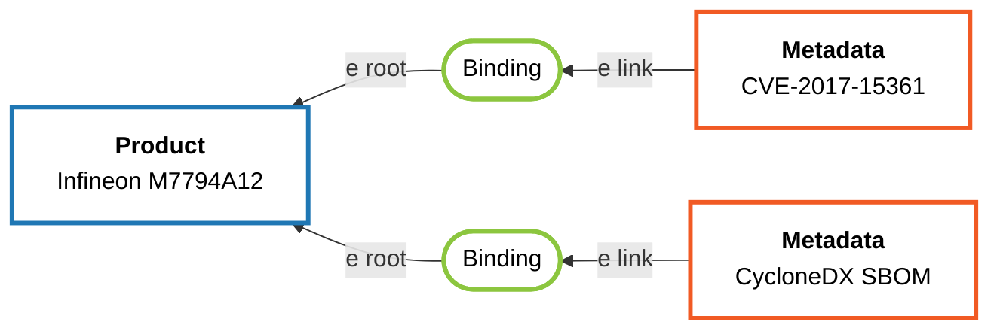

# SCRUTINY Fabric — Protocol Specification v0.6.1

**Version:** 0.6.1
**Status:** Draft

---

## Changelog

### v0.6.1

- **New Appendix G "Conformance vectors." `vectors/application.json`, `vectors/validity.json`.** The corpus is now published and digest-pinned rather than listed as future work; §11's "Test vectors" bullet is struck and Appendix E points at the corpus its fixtures seeded. Three phases of a reference implementation each had to substitute their own gate for the missing vectors, which is the point at which a deferral stops being one. Appendix G is normative, but the prose still governs: where a vector and the prose disagree the vector is the defect. Three limits are stated rather than left to be discovered — halt *reasons* are advisory because this specification defines no vocabulary for them; A-layer vectors carry placeholder `id` and `sig` fields and presuppose SIG-1, so they MUST NOT be used to exercise it; and UR-1 makes every `chain` case an assertion over **every permutation** of its event set, not the order printed. `.gitattributes` pins `vectors/**` to LF, without which the digests are unverifiable on a Windows checkout.
- **P1 re-tagged V → A and reworded as a producer obligation at `min(3, available)`.** Three problems, in descending order of force. **T2 became unreachable:** T2 normatively defines apply semantics for a hunk with no context lines, so if P1 rejected at the V layer no zero-context hunk could reach the A layer and T2 would mandate behaviour for a case already made impossible. **The spec's own example violated P1:** §5.2's illustrative payload has zero context lines before or after its change block. **The parenthetical was false:** `--unified=3` is a *maximum* the tool supplies where the content affords it, not a minimum it guarantees — and since SCRUTINY diffs a single `content` field, frequently one line, every change within three lines of a content boundary produces a P1-violating payload from the spec's own recommended command. That is the common case, not an edge case. P1 is now enforced when building a patch, and consumers MUST NOT reject a payload for carrying fewer context lines.
- **§6.0's Validity manifest no longer cites §5.1.** §5.1 contains exactly two rules and both are tagged A, so the wholesale citation swept Application rules into the Validity layer — the same defect v0.6.0 audited out of this bullet when it replaced `E*` with `E1–E6` to stop it capturing E7. This matters beyond tidiness: the V manifest is the list an implementation partitions its validity checks against, and P1's mis-tagging turned on whether that list was authoritative or over-broad. The bullet now cites `P2–P3` rather than `P1–P3`, and P1 joins the A layer's producer-obligation entry alongside P4. §5.4's RL-2..RL-5 are also listed under A, having previously appeared in no manifest at all.
- **§6.0 now states that the Validity layer has exactly one disposition, and what follows from that.** Rejection is the only consequence attached to a V failure, so rules that are advisory to producers, or are obligations on consumers *to accept*, have no disposition that fits and were being tagged V for want of anywhere better — which is the shape underlying both items above. The preamble now names the two categories and gives the test: if a reader could not act on the rule with only the event in hand, and rejection is not the outcome wanted when it fails, it is not a Validity rule. One case is left knowingly outstanding rather than corrected silently: **C7 is an obligation to accept and remains tagged V**, because v0.6.0 added it to this manifest deliberately and reversing that belongs to a revision that can weigh it. Introducing an explicit non-rejecting advisory disposition — which would give these rules a home without stretching A — is likewise deferred, since it changes the layering model itself.
- **T2 given a coordinate system, reconciling it with T3.** T2 said a pure-insertion hunk applies "at the position implied by its `@@` header's `-` line number"; T3 said each hunk is evaluated against the content produced by all prior hunks in the same patch. For a hunk located by content match there is no conflict, since C6 makes the numbers advisory — but a pure insertion has no pattern, so the `@@` number is the only positional information there is, and it indexes the **pre-patch** file. Once an earlier hunk has added or removed lines the two rules designate different positions, and the spec named no winner: the two readings return different bytes. T2 now states that the number is interpreted in pre-application coordinates and is carried forward by the net line delta of all prior hunks in the same patch — the only reading under which both rules hold, and what `git apply` and jsdiff both do. Found by a property test, not by inspection.
- **Self-fork versus HALT precedence bounded; new SF-7.** §5.3 step 5 said a self-fork "applies before HALT … regardless of whether the per-patch pre-validation would have failed", unconditionally. Where the HALT is *upstream* of the fork, freezing at the fork's shared parent requires applying patches past a HALT, which H1 prohibits without qualification — two MUST-level rules returning different canonical bytes for the same event set, with no stated tiebreak. The precedence is now stated as a freeze *point* rather than a winning rule: bytes freeze at whichever condition is earlier in chain order. A fork upstream of a HALT freezes at the shared parent and the downstream patches are never evaluated (the asymmetry that makes that direction conflict-free); a HALT upstream of a fork freezes at the last applied patch, and the fork is still surfaced per SF-3 though it did not determine the content. §7.2's table and §7.4's procedure are aligned.
- **§5.4's resource limit given a disposition in both places an outcome is reported; new OV-9 and RL-5.** §5.4 insisted a ceiling is neither invalidity nor HALT, but §7.3 offered exactly four overlay states and §7.4 offered resolved-or-HALT, so a conforming implementation had nothing to return. A ceiling is none of the four: the overlay may well apply, so `conflict` asserts a failure never established; the target is well defined and obtainable, so `orphaned` is false and would wrongly trigger the α/β rule. §7.3 now has a fifth outcome, **unclassified** (OV-9), and §7.4 step 4 a third chain outcome, **aborted under a ceiling** (RL-5) — reporting such a chain as `resolved` would claim a completeness the implementation lacks, which RC-3 then obliges non-UI consumers to serve downstream. OV-4's purity claim now notes the one permitted source of divergence: ceilings are local (RL-2), so clients configured differently MAY differ here and only here.
- **§5.2 grammar admits multiple file sections; new C8.** The grammar admitted exactly one `header-block`, and a payload carrying a second `--- a/content` / `+++ b/content` pair had two readings the spec did not choose between: `hunk-line` admits `-` as a prefix, so `--- a/content` parsed equally well as the removal of a line reading `-- a/content`, while every deployed parser reads it as a second file patch. The two produce different content. Settled in favour of the deployed reading, because §5.3 explicitly permits delegating application to `git apply` or jsdiff and the other choice would have made both non-conforming. `patch-payload` is now `1*file-section`, and C8 requires every section's hunks be processed as one sequence in document order under T3. The cost is stated in §5.2 rather than left to be discovered: a removal line whose content is exactly `-- a/content` is not expressible.
- **§5.2 consumer grammar corrected: `line-content` replaces `*VCHAR`, and an empty hunk line is admitted.** The grammar is ABNF, where `VCHAR` is `%x21-7E` — printable ASCII *excluding* the space, which the grammar's own `trailing = SP *VCHAR` confirms was intended. Read literally it therefore rejected every context line containing an internal space, every payload carrying a non-ASCII byte — including the em dash in §5.2's own example — and the `patch -u` timestamps C2 obliges consumers to tolerate. Separately, `hunk-line` required a prefix character, so a blank context line that lost its lone trailing space to an editor or mail transport matched no production, even though `git apply`, `patch -u` and jsdiff all accept that form. `trailing` is now `[ SP line-content ]` and is cited without a repetition operator.
- **`index-preamble` makes the `Index:` line optional relative to the `===…` separator.** jsdiff — named in §5.2's reference toolchain — emits the separator alone when a patch is produced through `structuredPatch` + `formatPatch` rather than `createPatch`, and `createPatch` names its paths `content` rather than `a/content` / `b/content`, so neither jsdiff entry point emitted a payload the previous grammar accepted unmodified.
- **C5 rekeyed on the `\` prefix; its text is now explicitly informational.** GNU diff and git translate the marker through gettext, so the same content diffed under `LANG=de_DE.UTF-8` emits `\ Kein Zeilenumbruch am Dateiende`. A consumer matching the English string silently loses the no-trailing-newline signal, which changes the resulting bytes — and PB-1 makes those bytes normative. The grammar already admitted `\` without constraining what follows, so only C5's wording needed the fix.
- **P2's remedy corrected.** P2 advised "Use `--no-index` with git, or strip these post-hoc". The first clause is false: `--no-index` makes git diff two paths outside a repository and has no effect on index-line emission. Since §5.2's reference toolchain recommends exactly that invocation, a producer following the spec literally emitted payloads P2 declared invalid. The rule itself was sound and is unchanged.
- Version tag `scrutiny-v060` → `scrutiny-v061`. §3's forward-compatibility example, which used `scrutiny-v061` as its illustration of a *higher* version, now uses `scrutiny-v062`.

### v0.6.0

- **Why 0.6.0 and not 0.5.10.** The version tag is fixed at three digits encoding MAJOR/MINOR/PATCH (`^scrutiny-v\d{3}$`, VER-1), so each MINOR line admits exactly ten PATCH revisions — `scrutiny-v050` through `scrutiny-v059`. v0.5.9 was already patch 9; there is no `scrutiny-v0510`, and staying in 0.5.x would mean changing the tag scheme itself and breaking TAG-2, VER-1, and every published event.
- **PR-4 and MD-4 re-tagged V → D; MUST → SHOULD.** A missing or incomplete `k` collection no longer invalidates an event. The `k` value is pure redundancy — derivable from the `i` value by splitting on the first colon — so discarding an advisory over it is disproportionate, and the previous text contradicted §9, which already said such an event was valid but less discoverable. Consumers MAY derive the kind from the `i` prefix. §9's prose now defers to PR-4/MD-4 rather than restating the requirement.
- **New §7.6 "Unresolved references." UR-1, UR-2, UR-3.** Bindings (BD-6) and deletions (DEL-8) already had hold-and-re-evaluate semantics; patches did not. A Patch whose `e root` is unobserved cannot be classified at all, because the root-author versus foreign distinction requires the root's `pubkey`; it MUST be retained and re-evaluated on the root's arrival. Generalised as a standing requirement: **ingestion is confluent** — state depends only on the set of events observed, never on arrival order. A classification MAY be cached as permanent only when no further observation could change it.
- **Binding deletion revokes the admission it conferred.** DEL-5 amended; TR-4, TR-5, §6.4 and §10 aligned. Previously §10 said only that a retracted Binding was "hidden from default views" while TR-4 admitted endpoints unconditionally — two rules with opposite readings. Admission MUST NOT outlive the assertion that produced it: otherwise a compromised key could permanently insert events into a user's view by publishing a Binding and then deleting it, defeating §6.3. Endpoints remain V-valid and are never cascade-deleted. DQ-2 and §8.2 extended to poll for Binding deletions, without which the rule is unimplementable.
- **New §5.4 "Resource limits." RL-1..RL-4.** The spec previously bounded only `i` and `k` tag counts. Recommended producer bounds now reflect limits deployed relays enforce, and consumers SHOULD bound the *total work* of patch application in bytes compared, since an adversary optimises against whichever unit is counted. Exceeding a local ceiling aborts application and is surfaced as a distinct **resource-limit exceeded** annotation — never as HALT, and never as invalidity.
- **New SIG-1 (§3).** A signature commits to the `id`, so a signature-only check passes for an event whose `content` or `tags` were altered while retaining the original `id` and `sig`. Both the signature *and* the `id`-equals-SHA-256 check MUST be performed, on **every event consumed** — including kind 5 deletions and kind 1040 attestations, not only events carrying a `scrutiny-fabric` tag. An unverified deletion is indistinguishable from a forged one. §3.2's NIP-01 row amended so inherited-semantics deference cannot be read as putting SIG-1 out of scope.
- **§5.2 consumer grammar corrected; new C7.** The grammar required at least one hunk block (`[ hunk-block ]+`), contradicting N2, which accepts a header-only no-op — and postfix `+` is regex, not ABNF. Now `header-block *hunk-block`. The grammar's "a conforming consumer MUST accept" obligation is registered as C7.
- **New TR-7.** §6.2 said untrusted events were "filtered out before any other processing." Taken literally that conceals root self-forks and HALT conditions in the chain of a root admitted via a trusted Binding, because such a root's own patches may be authored by a pubkey the user does not trust directly — the chain then renders linear and complete when it is neither. Filtering is now explicitly a **presentation-time** operation applied to the results of chain and overlay computation. §7.4 step 5 and §7.5 aligned.
- **New CA-1 (§4 preamble).** `created_at` is the time the *event* was created, not the time of the fact it describes. Deployed relays commonly reject events whose `created_at` falls outside a bounded window, so backdated events are **silently refused** — nothing stored, no error. Publishers mapping historical records SHOULD NOT backdate; historical dates belong in `content`.
- §6.0's Validity manifest now cites `E1–E6` rather than `E*` (which swept in E7, an Application rule) and includes C7; its Discovery bullet cites `TR-2..TR-7`. Appendix B no longer describes merges as planned for `v060`.
- Version tag `scrutiny-v059` → `scrutiny-v060`.

### v0.5.9

- **Admission layers reframed: V / A / D instead of L1 / L2.** The two-bucket layering introduced in v0.5.8 (L1 = validity, L2 = interpretation) conflated "rule strength" (MUST vs SHOULD) with "rule subject." It mis-tagged ~30 rules. §6.0 now defines three layers that match what the spec actually does: **V (Validity)** — is the event well-formed and admissible (tags, schema, payload envelope format); **A (Application)** — given an admitted event, does applying it to chain state succeed (patch determinism, HALT, chain construction, kind 5 cascade, overlay classification, deletion semantics); **D (Discovery)** — how do consumers find, gate visibility, and resolve events across the relay mesh (indexer discipline, queries, trust admission, rendering visibility, relay-hint fallback). Every rule's Layer column is retagged accordingly. No normative changes to the rules themselves; only the layering metadata changes.
- **Restored missing MUST in BD-8.** v0.5.8 silently dropped the "Implementations MUST fall back to their full relay set if the event is not found on the hinted relay" clause from §4.3 prose during rule-table extraction. Restored to both prose and BD-8.
- **New DQ-3.** Section 8.1 step 3 (NIP-50 search fallback) contained an un-tagged normative MUST: "Client MUST verify returned events carry valid `scrutiny-fabric` tags and match the user's intent." Now a registered rule.
- **New DQ-4.** Section 4.3 binding traversal note contained an un-tagged normative MUST: results of `{"#e":[<metadata-id>]}` MUST be filtered for `scrutiny-binding` `t` tags and `e` tag markers inspected to determine endpoint role. Now a registered rule.
- **New DEL-10, DEL-11.** Section 10 contained two un-tagged normative directives: clients SHOULD offer a "show deleted events" toggle (DEL-10); SCRUTINY-aware relays SHOULD inspect kind 5 `e` tag targets and store deletions alongside originals (DEL-11). Both now registered.
- **De-duplicated OV-1 ↔ PT-7.** Both rules normatively stated "a foreign patch's `e reply` MUST point at the root event or a root-author patch; overlay-to-overlay reply is invalid." The constraint is structurally a Patch-event shape rule, so PT-7 (§4.4) remains the single normative source. OV-1 in §7.3 is now a reserved cross-reference pointing at PT-7; the ID is retained for citation stability.
- Version tag `scrutiny-v058` → `scrutiny-v059`.

### v0.5.8

- **Rule registry.** Every normative MUST / MUST NOT / SHOULD / SHOULD NOT / MAY in the spec is now tagged with a stable mnemonic ID (`E4`, `T1`, `BD-3`, `DEL-2`, …). Each rule carries a Layer column (L1 / L2, since reframed to V / A / D in v0.5.9) and, where applicable, an "Inherits from" column linking to the base-layer source (NIP-01 / NIP-09 / NIP-10 / NIP-73 / CommonMark §4.5). No normative changes — IDs are an indexing overlay on existing rules.
- **New Appendix F.** Flat sortable registry of every rule ID, its layer, its section, its inheritance source, and a one-line summary. This is the index implementers and conformance tests dereference; the prose sections remain the authoritative definitions.
- Version tag `scrutiny-v057` → `scrutiny-v058`.

### v0.5.7

- **New §3.2** "Relationship to base layers — inherited semantics." Consolidates which behaviours are inherited from NIP-01 / NIP-09 / NIP-10 / NIP-73 / CommonMark §4.5; SCRUTINY does not override them.
- **New §6.0** "Admission layers." Splits event evaluation into Layer 1 (protocol validity, MUST/MUST NOT) and Layer 2 (interpretation, SHOULD/MAY). Surplus tags, lineage-invalid placements, and similar are now explicitly admitted-but-ignored rather than rejected.
- **§5.1 / §5.2 rewrite.** Patch payload envelope anchored on CommonMark §4.5 fenced code blocks. Variable-length fence rule (`max(3, longest_backtick_run + 1)`) lets patches operate on content that itself contains backtick fences (e.g., Metadata events with embedded PoC code blocks).
- **§4.3 pending-endpoint lifecycle.** Bindings whose endpoints are not yet observable are held pending; admitted on endpoint arrival if typing check passes; permanently invalid (cached) otherwise.
- **§7.1 recomputation requirement.** Non-UI consumers (indexers, HTTP APIs, AI agents, vulnerability scanners) MUST recompute canonical bytes and overlay states when their observed event set changes. UIs SHOULD.
- **§4.1 / §4.2 / §9 k-tag rule.** Set semantics: at minimum one `k` per distinct prefix kind in the event; producers MAY emit one `k` per `i`. Aligns with NIP-73.
- **§3 carve-outs.** Exactly one `["t","scrutiny-fabric"]` tag. Version-tag regex `^scrutiny-v\d{3}$`. Forward-compat clarified: higher-version events admitted opaquely only if v0.5.7 Layer-1 invariants still hold.
- **§5.3 carve-outs.** Insertion hunks (no context / no `-` lines) bypass the exactly-once uniqueness check. Multi-hunk patches: each hunk's uniqueness check is evaluated against the content as produced after prior hunks in the same patch.
- **§7.3 overlay clarifications.** Overlays whose `e reply` target is unapplied (downstream of HALT or inside an unresolved self-fork) are orphaned, not classified. Stale-vs-conflict-vs-clean wording rewritten for clarity.
- **§7.2 self-fork resolution.** Wording updated: delete any patch in the unwanted branch; topology cascade removes its descendants.
- **§8.2 deletion query.** Added query example for fetching kind 5 deletions affecting an event.
- **§4.6 imeta tightening.** `size` mismatch SHOULD be treated as a verification failure; multiple `url` mirrors permitted per NIP-92.
- **§3.1 OTS clarification.** Consumers MUST NOT use OTS timestamps in canonical-chain or overlay decisions.
- **New Appendix E.** Non-normative reference to the empirical interop study in `scrutiny-fabric-tools/investigations/diff-parity/`.
- Version tag `scrutiny-v056` → `scrutiny-v057`.

---

## 1. Abstract

SCRUTINY Fabric is a decentralized permissionless discovery layer protocol for binding security-relevant metadata to products. It's built on Nostr `kind: 1` events. The protocol exposes signed nodes (Products, Metadata) and signed edges (Bindings).

---

## 2. Motivation & design principles

### Why a discovery layer?

The original design problem in the security-metadata space is **discoverability**: users need a permissionless, censorship-resistant way to find security context for products they use, while vendors and researchers need a way to publish that context transparently. Existing constructs (CycloneDX SBOMs, CSAF advisories, Common Criteria certificates, in-toto attestations) already define rich payload formats; the missing piece is a graph layer that lets users find which payloads are about which products, and follow trust through who said so.

SCRUTINY Fabric is that graph layer. It does NOT redefine SBOM or vulnerability formats -- it points at them.

### Design principles

1. **Stay Nostr-native.** Every construct maps to existing NIPs (NIP-10 threading, NIP-73 external IDs, NIP-92 imeta, NIP-09 deletion). No invented machinery where Nostr already has an answer.
2. **Render gracefully in generic Nostr clients.** Products and Metadata read as text posts; Bindings appear as threaded references.
3. **Deep semantics require SCRUTINY-aware processing.** Graph views, diff application, chain computation, and patched content computation require a protocol-aware implementation.
4. **Cheap relay queries for the common case; deeper queries require local processing.** Canonical indexers (`i` tags) make "all events about CVE-X" a 1-millisecond relay filter. Anything fancier — "all Infineon products," "all SBOMs containing log4j" — requires local content parsing.
5. **Don't fight established formats.** A vendor publishes a CycloneDX SBOM as the `content` of a Metadata event (or via imeta + Blossom for large files). The protocol does not parse, validate, or reformat the payload.
6. **Minimal protocol surface.** Four event types. No labels. No retraction events. Deletions are NIP-09. Updates are git-style patches.

### What this document defines

- The four SCRUTINY event types and their tag schemas.
- The diff format for patch events.
- Trust admission rules.
- How chains, root self-forks, foreign overlays, and deletions resolve.
- Discovery patterns.
- Recognized canonical-indexer prefixes.

---

## 3. Versioning & event identification

All SCRUTINY events use `kind: 1` (Nostr short text note). They are identified by required `t` tags:

- `["t", "scrutiny-fabric"]` — required on every SCRUTINY event.
- `["t", "scrutiny-v061"]` — version tag. Exactly one version tag MUST be present.
- Exactly one event-type tag:
  - `["t", "scrutiny-product"]`
  - `["t", "scrutiny-metadata"]`
  - `["t", "scrutiny-binding"]`
  - `["t", "scrutiny-patch"]`

An event carrying `scrutiny-fabric` but missing the version tag, carrying more than one version tag, or carrying more than one `["t","scrutiny-fabric"]` tag, or containing zero or more than one event-type tag, is an invalid SCRUTINY event and MUST NOT be processed as a Product, Metadata, Binding, or Patch. Standard Nostr events (those without `scrutiny-fabric`) are not SCRUTINY events and are outside the scope of this specification.

Tag-name convention: SCRUTINY uses kebab-case (`scrutiny-fabric`, `scrutiny-product`, etc.). Underscored variants from older drafts are not recognized.

**Version-tag form.** Version tags match the regular expression `^scrutiny-v\d{3}$`. The three digits encode `MAJOR`, `MINOR`, `PATCH` respectively (`scrutiny-v061` ≡ v0.6.1). Comparisons between version tags are lexicographic on the three-digit suffix, which coincides with semantic ordering because the digits are zero-padded.

**Forward-compatibility.** Unknown tags MUST be ignored by parsers. An event carrying a higher version tag than the implementation's own (e.g., a v0.6.1 implementation encountering `scrutiny-v062`) MAY be admitted opaquely — i.e., admitted to local storage and discoverable — provided that the event still satisfies every Validity invariant of this specification (§6.0). An event carrying a higher version tag that violates a v0.6.1 Validity invariant (e.g., a new event-type `t` tag that this specification does not recognise, producing zero recognised event-type tags) MUST be treated as an unknown event type and MUST NOT be rendered as a Product, Metadata, Binding, or Patch. Implementations MUST NOT reject higher-version events *solely* because of the version tag.

**Signature and identifier verification.** Before processing any event, implementations MUST verify both that its `sig` is a valid Schnorr signature for its `pubkey` over its `id`, and that its `id` equals the SHA-256 of its NIP-01 canonical serialization. Verifying the signature alone is insufficient: the signature commits to the `id`, so an event whose `content` or `tags` were altered while retaining the original `id` and `sig` still passes a signature-only check.

This applies to **every event an implementation consumes**, including kind 5 deletions (§10) and kind 1040 attestations (§3.1) — not only events carrying a `scrutiny-fabric` tag. An unverified deletion is indistinguishable from a forged one, and honouring a forged deletion removes canonical history (§10 DEL-2). Relays are not trusted to have performed either check (§7.5). An event failing either check MUST NOT be processed or rendered.

| # | Layer | Inherits from | Rule |
|---|---|---|---|
| TAG-1 | V | — | Every SCRUTINY event MUST carry exactly one `["t","scrutiny-fabric"]` tag. |
| TAG-2 | V | — | Every SCRUTINY event MUST carry exactly one version `t` tag matching `^scrutiny-v\d{3}$`. |
| TAG-3 | V | — | Every SCRUTINY event MUST carry exactly one event-type `t` tag from `{scrutiny-product, scrutiny-metadata, scrutiny-binding, scrutiny-patch}`. |
| TAG-4 | V | — | Tag names use kebab-case; underscored variants from older drafts are not recognised. |
| TAG-5 | V | NIP-01 | Unknown tags MUST be ignored by parsers. |
| VER-1 | V | — | The three digits in `scrutiny-vMMP` encode MAJOR/MINOR/PATCH. Lexicographic comparison coincides with semantic ordering. |
| VER-2 | V | — | A higher-version event MAY be admitted opaquely if it satisfies every Validity invariant of this specification. |
| VER-3 | V | — | A higher-version event that violates a Validity invariant of this specification MUST NOT be rendered as a Product, Metadata, Binding, or Patch. |
| VER-4 | V | — | Implementations MUST NOT reject higher-version events *solely* because of the version tag. |
| OTS-1 | A | NIP-03 | OpenTimestamps attestations are an audit signal only: consumers MUST NOT use OTS-derived timestamps in canonical-chain construction, overlay classification, or self-fork resolution. |
| SIG-1 | V | NIP-01 | Before processing any event — including kind 5 deletions and kind 1040 attestations — implementations MUST verify the signature **and** that `id` equals the SHA-256 of the NIP-01 canonical serialization. A signature-only check is insufficient. |

### 3.1 Nostr NIP dependencies

SCRUTINY Fabric depends on the following NIPs from the Nostr protocol ecosystem:

| NIP | Purpose | Requirement |
|---|---|---|
| NIP-01 | Event structure, signatures, relay protocol | **MANDATORY** — base protocol |
| NIP-03 | OpenTimestamps attestations (kind:1040) for timestamp verifiability | **MAY** — audit signal only |
| NIP-09 | Event deletion (kind:5) | **MANDATORY** — deletion events, per §10 |
| NIP-10 | Text note threading (`e root`, `e reply` markers) | **MANDATORY** — chain topology, binding endpoints |
| NIP-13 | Proof-of-Work (`nonce` tag) for spam deterrence | **MAY** — see signals below |
| NIP-18 | Reposts (kinds 6/16) | **MAY** — see signals below |
| NIP-25 | Reactions (kind 7) | **MAY** — see signals below |
| NIP-57 | Lightning Zaps (kind 9735) | **MAY** — see signals below |
| NIP-73 | External content IDs (`i` tag format) | **MANDATORY** — `#i` relay indexing; SCRUTINY defines its own prefix registry (§9) using NIP-73's `<prefix>:<value>` convention |
| NIP-92 | Media attachments (`imeta` tag) | **OPTIONAL** — payload attachments, per §4.6 |
| CommonMark §4.5 | Fenced code blocks | **MANDATORY** — patch payload envelope, per §5.2 |

SCRUTINY uses `i` tags with `#i` relay indexing (enabled by NIP-01's single-letter tag indexing convention). The `i` tag format is modeled on NIP-73's `<prefix>:<value>` convention and pairs each `i` tag with a corresponding `k` tag indicating the prefix kind. SCRUTINY defines its own prefix registry (§9) rather than using NIP-73's predefined types (ISBN, DOI, ISAN, etc.), which are media-oriented and unsuitable for security indexers.

#### Optional publisher and consumer signals (MAY)

The following NIPs provide auxiliary signals that implementations MAY use for ranking, spam deterrence, or attention economics. None are required for protocol conformance. Each operates on a distinct axis:

**NIP-13 (Proof-of-Work).** Publisher-side computational cost signal. Anti-spam at publication time. Publishers MAY include a `nonce` tag with committed difficulty. Relays supporting NIP-11 MAY advertise PoW requirements via `min_pow_difficulty`; publishers SHOULD inspect relay info documents before publishing and match or exceed any advertised minimum. No minimum difficulty is mandated.

**NIP-18 (Reposts).** Consumer-side distribution signal. Repost events (`kind: 6/16`) referencing SCRUTINY events signal amplification intent. Queryable via `{"kinds": [6], "#e": ["<event-id>"]}`. Implementations MAY use repost counts as an attention signal.

**NIP-25 (Reactions).** Consumer-side sentiment signal. Reaction events (`kind: 7`) provide lightweight feedback. Queryable via `{"kinds": [7], "#e": ["<event-id>"]}`. Implementations MAY use reaction counts as a sentiment indicator.

**NIP-57 (Lightning Zaps).** Consumer-side economic endorsement signal. Zap receipts (`kind: 9735`) provide verifiable payment proof referencing the zapped event. Queryable via `{"kinds": [9735], "#e": ["<event-id>"]}`. Implementations MAY use zap counts as an economic importance signal.

#### NIP-03 OpenTimestamps (MAY)

Publishers MAY attach NIP-03 OpenTimestamps attestations (kind:1040) to any SCRUTINY event. A kind:1040 attestation references its target event via an `e` tag and contains a base64-encoded `.ots` file with at least one Bitcoin-confirmed attestation in its `content`. OTS proofs provide tamper-resistant evidence of an event's existence at or before a given Bitcoin block — useful for audit, forensic analysis of pre/post key-compromise events (§7.5), and disputes about timestamp authenticity. OTS proofs do NOT act as a tiebreaker between competing patches; the protocol has no `created_at`-based tip selection (see §7.2). NIP-03 adoption in the Nostr ecosystem is currently low. OTS attestations are an audit signal only: consumers MUST NOT use OTS-derived timestamps in canonical-chain construction, overlay classification, or self-fork resolution.

### 3.2 Relationship to base layers — inherited semantics

SCRUTINY is a thin layer on top of Nostr and CommonMark. Behaviour in the following areas is inherited from those base layers; SCRUTINY does not override them, and implementations MUST defer to the base-layer specification rather than re-derive semantics.

| Topic | Inherited from | What this means for SCRUTINY |
|---|---|---|
| Event structure, JSON encoding, signatures, relay protocol, single-letter tag indexing (`#e`, `#t`, `#i`, `#k`, …) | NIP-01 | SCRUTINY events are kind:1 events. NIP-01 defines the signature scheme and id derivation; SCRUTINY requires that both be *performed* before processing (SIG-1). Tag-based relay indexing is NIP-01's responsibility. |
| Kind 5 deletion: author-match rule, multi-`e`-tag deletions, optional `k`-tag scoping, relay honour semantics | NIP-09 | A kind 5 event MAY carry multiple `e` tags; each `e` target is treated as an independent deletion intent, gated by the per-target author-match check. Kind 5 events typically do not carry a `scrutiny-fabric` `t` tag; discovery uses `{kinds:[5], #e:[<id>]}` (§8). |
| `e` tag marker grammar (`root` / `reply`), relay-hint empty-string convention, advisory author hint | NIP-10 | The relay-hint field MAY be the empty string `""` meaning "no hint." A mismatch between the author-hint suffix and the actual event `pubkey` does not invalidate the referencing event (§4.3). |
| `i` tag / `k` tag semantics: external content IDs as `<prefix>:<value>`, `k` as the *kind* of identifier | NIP-73 | SCRUTINY defines its own prefix registry (§9) rather than NIP-73's media-oriented predefined types, but uses NIP-73's tag *shape* and *semantics* unchanged. `k` is the set of identifier kinds present in the event (§4.1, §9), not a per-`i` label. |
| Fenced code block parsing, info strings, variable-length fences | CommonMark §4.5 | The patch payload envelope is a CommonMark §4.5 fenced code block; lookup, fence-length matching, and payload byte boundary are CommonMark's responsibility (§5.2). |
| Eventual consistency under a multi-relay mesh | Nostr operational model | Events arrive out of order, late, or never; SCRUTINY-specific classifications (canonical bytes, overlay state, self-fork detection) MUST be re-evaluated when the observed event set changes (§7.1). |

Where the base layer offers a normative choice (e.g., NIP-09 allows but does not require relays to honour deletions; CommonMark allows tilde or backtick fences), SCRUTINY may restrict the choice further in the relevant section; such restrictions are explicitly marked as SCRUTINY-specific.

---

## 4. Event types

All events in this section additionally carry the required `t` tags per §3 (`scrutiny-fabric`, `scrutiny-v061`, and exactly one event-type tag). The tables below show event-type-specific tags only.



**`created_at` semantics.** `created_at` is the time the *event* was created, not the time of the fact it describes. Publishers mapping historical records — certification dates, disclosure dates, release dates — SHOULD NOT backdate `created_at` to the historical date. Deployed relays commonly reject events whose `created_at` falls outside a bounded window (commonly a few minutes ahead and one to three years behind), so backdated events are silently refused: nothing is stored and no error is returned. Historical dates belong in `content`.

| # | Layer | Inherits from | Rule |
|---|---|---|---|
| CA-1 | D | — | Publishers SHOULD NOT backdate `created_at` to a historical date the event describes. Deployed relays reject events outside a bounded timestamp window; historical dates belong in `content`. |

### 4.1 Product (`scrutiny-product`)

A Product event identifies a specific product, hardware model, software package, or any other security-relevant target.

| Field / Tag | Cardinality | Requirement | Description |
| :--- | :--- | :--- | :--- |
| `content` | 1 | MUST | Free-form description (prose, JSON, YAML — any format). |
| `i` | 0..64 | SHOULD | Canonical indexers per NIP-73 (see §9). Events SHOULD contain no more than 64 `i` tags. Publishers SHOULD surface only top-level indexers the event is *about* (see §4.5). |
| `k` | 0..64 | SHOULD | Indexer kinds present in the event's `i` tags (see §9). Set semantics: at minimum one `k` per **distinct** `i` prefix kind. Producers MAY emit one `k` per `i` (matches NIP-73 examples); consumers MUST treat the `k` collection as a set. |
| `imeta` | 0..N | OPTIONAL | NIP-92 attached files (datasheets, photos, certificates). |

**Mini-example:**

```json
{
  "id": "aaa111...",
  "kind": 1,
  "pubkey": "vendor_pk...",
  "created_at": 1714000000,
  "content": "Infineon M7794A12 — smartcard chip used in CC EAL4+ certified products (BSI-DSZ-CC-0814-2012).",
  "tags": [
    ["t", "scrutiny-fabric"],
    ["t", "scrutiny-product"],
    ["t", "scrutiny-v061"],
    ["i", "cpe:2.3:h:infineon:m7794a12:-:*:*:*:*:*:*:*"],
    ["k", "cpe"]
  ]
}
```

| # | Layer | Inherits from | Rule |
|---|---|---|---|
| PR-1 | V | — | A Product event MUST carry a `content` field (any UTF-8 byte sequence; format is free-form). |
| PR-2 | D | — | A Product event SHOULD carry no more than 64 `i` tags. |
| PR-3 | D | — | A Product event SHOULD carry no more than 64 `k` tags. |
| PR-4 | D | NIP-73 | The `k` collection SHOULD contain at minimum one entry per **distinct** `i` prefix kind present in the event. A missing or incomplete `k` collection does NOT invalidate the event; consumers MAY derive the kind from the `i` value's prefix (§9). Consumers MUST treat `k` as a set. |
| PR-5 | V | NIP-92 | `imeta` attachments are OPTIONAL. |

### 4.2 Metadata (`scrutiny-metadata`)

A Metadata event represents an observation, finding, test result, certification, vulnerability, advisory, or similar — anything that *says something* about a Product (or about another Metadata).

The shape is identical to Product. The distinction is purely semantic, expressed via the `t` tag. Metadata events typically carry richer content (full advisory text, embedded SBOMs, test reports) and more `imeta` attachments (PDFs, JSON files, signed attestations).

| Field / Tag | Cardinality | Requirement | Description |
| :--- | :--- | :--- | :--- |
| `content` | 1 | MUST | Free-form description, summary, or full payload (JSON/YAML/prose). |
| `i` | 0..64 | SHOULD | Canonical indexers (see §9). Events SHOULD contain no more than 64 `i` tags. Publishers SHOULD surface only top-level indexers the metadata is *about* (§4.5). |
| `k` | 0..64 | SHOULD | Indexer kinds present in the event's `i` tags (see §9). Set semantics: at minimum one `k` per **distinct** `i` prefix kind. Producers MAY emit one `k` per `i` (matches NIP-73 examples); consumers MUST treat the `k` collection as a set. |
| `imeta` | 0..N | OPTIONAL | NIP-92 attachments — often the actual SBOM/advisory/report file. |

**Mini-example:**

```json
{
  "id": "bbb222...",
  "kind": 1,
  "pubkey": "researcher_pk...",
  "created_at": 1714000010,
"content": "CVE-2017-15361 (ROCA): predictable RSA key generation in Infineon TPM/smartcards. Affected keys may be factorable using Coppersmith's attack on the public modulus.",
  "tags": [
    ["t", "scrutiny-fabric"],
    ["t", "scrutiny-metadata"],
    ["t", "scrutiny-v061"],
    ["i", "cve:CVE-2017-15361"],
    ["k", "cve"],
    ["i", "cwe:CWE-310"],
    ["k", "cwe"]
  ]
}
```

| # | Layer | Inherits from | Rule |
|---|---|---|---|
| MD-1 | V | — | A Metadata event MUST carry a `content` field (any UTF-8 byte sequence; format is free-form). |
| MD-2 | D | — | A Metadata event SHOULD carry no more than 64 `i` tags. |
| MD-3 | D | — | A Metadata event SHOULD carry no more than 64 `k` tags. |
| MD-4 | D | NIP-73 | The `k` collection SHOULD contain at minimum one entry per **distinct** `i` prefix kind present in the event. A missing or incomplete `k` collection does NOT invalidate the event; consumers MAY derive the kind from the `i` value's prefix (§9). Consumers MUST treat `k` as a set. |
| MD-5 | V | NIP-92 | `imeta` attachments are OPTIONAL. |

### 4.3 Binding (`scrutiny-binding`)

A Binding is an immutable directed edge connecting a Product to a Metadata. Direction: **`e link` (Metadata) → `e root` (Product)**.

| Tag | Cardinality | Requirement | Description |
| :--- | :--- | :--- | :--- |
| `e` with marker `root` | 1 | MUST | The Product event ID. `["e", "<id>", "<relay>", "root", "<author_pk>"]`. |
| `e` with marker `link` | 1 | MUST | The Metadata event ID. `["e", "<id>", "<relay>", "link", "<author_pk>"]`. |

**Endpoint typing.** The `e root` endpoint MUST be a `scrutiny-product` event and the `e link` endpoint MUST be a `scrutiny-metadata` event. A Binding whose endpoints, once observed, do not match this typing is an invalid SCRUTINY event and MUST NOT be admitted. Bindings between two Products, between two Metadata events, or between Products/Metadata and other event types (Patches, kind 5 deletions, non-SCRUTINY events) are not permitted. To express other kinds of relationships, publish a new Metadata event describing the relationship and bind it to the relevant Product.

**Pending-endpoint lifecycle.** Under Nostr's eventual-consistency model, a Binding's endpoint events may not be observable at the time the Binding itself is first seen. Implementations MUST treat such a Binding as **pending**: the Binding is admitted to local storage but is NOT rendered until both endpoints are observed. On endpoint arrival:

- If both endpoints are now observed and the typing check (root = `scrutiny-product`, link = `scrutiny-metadata`) succeeds, the Binding transitions to admitted and is rendered.
- If at least one endpoint is observed and its type contradicts the typing rule, the Binding transitions to permanently invalid; implementations SHOULD cache the rejection so the Binding is not re-evaluated on every event-set change.
- If endpoints remain unobserved indefinitely, the Binding remains pending; it is neither admitted nor rejected. Implementations MAY surface long-pending Bindings in audit views.

**Relay hints.** The `<relay>` field in `e` tags is advisory. An empty string means "no hint" — Implementations MUST NOT rely on relay hints exclusively and SHOULD query their configured relay set for referenced events. They MUST fall back to their full relay set if the event is not found on the hinted relay.

**Immutability.** Bindings have no patch-based update mechanism. To correct a Binding, kind 5 delete it (per §10) and publish a replacement. Patch events cannot target a Binding.

M:N relationships between products and metadata are expressed by publishing multiple Binding events; no single Binding event may contain more than one `e root` or `e link`.

Bindings are immutable signed assertions. Third parties who believe a binding is incorrect SHOULD publish a competing Binding with corrected prose; the trust graph determines which edge is presented to the user. There is no protocol-level dispute mechanism for edges. A Binding authored by a trusted pubkey cannot be overridden by a foreign pubkey — this is by design: edge authorship carries the full weight of the author's trust.

**Deduplication.** Duplicate detection is a presentation concern. The protocol admits all valid Bindings; implementations MAY collapse visually-identical bindings (same root, same link, same pubkey) at render time.

**Note on `e` tag filtering:** Because both endpoints use `e` tags, the metadata-first traversal `{"#e": ["<metadata-event-id>"]}` fetches all events referencing the metadata. Results MUST be filtered for \`scrutiny-binding\` \`t\` tags, and the \`e\` tag markers (\`root\` vs \`link\`) inspected to determine whether the metadata is the anchor or the linked endpoint.

**Note on author hint.** The `<author_pk>` in `e` tags follows NIP-10's marked e-tag format and is used for outbox-model event discovery: when a relay hint does not resolve, the referenced pubkey's write relays are searched to locate the event. It is advisory — trust decisions MUST be based on the actual event pubkey, verified from the Nostr event signature, never the hint. A mismatch between the hint and the actual event's pubkey does not invalidate the binding.

**Mini-example:**

```json
{
  "id": "ccc333...",
  "kind": 1,
  "pubkey": "researcher_pk...",
  "created_at": 1714000020,
  "content": "Vulnerability: ROCA affects this Infineon smartcard chip.",
  "tags": [
    ["t", "scrutiny-fabric"],
    ["t", "scrutiny-binding"],
    ["t", "scrutiny-v061"],
    ["e", "aaa111...", "", "root", "vendor_pk..."],
    ["e", "bbb222...", "", "link", "researcher_pk..."]
  ]
}
```

| # | Layer | Inherits from | Rule |
|---|---|---|---|
| BD-1 | V | — | A Binding event MUST carry exactly one `e` tag with marker `root`. |
| BD-2 | V | — | A Binding event MUST carry exactly one `e` tag with marker `link`. |
| BD-3 | V | — | The `e root` endpoint MUST be a `scrutiny-product` event. |
| BD-4 | V | — | The `e link` endpoint MUST be a `scrutiny-metadata` event. |
| BD-5 | V | — | A Binding whose endpoints, once observed, do not satisfy BD-3/BD-4 is an invalid SCRUTINY event and MUST NOT be admitted. |
| BD-6 | D | — | A Binding whose endpoints are not yet observed MUST be treated as *pending*: admitted to local storage but NOT rendered until both endpoints are observed. |
| BD-7 | V | — | A Binding whose observed endpoint contradicts BD-3/BD-4 transitions to permanently invalid; implementations SHOULD cache the rejection. |
| BD-8 | D | NIP-10 | The `<relay>` field in `e` tags is advisory. An empty string means "no hint." Implementations MUST NOT rely on relay hints exclusively and SHOULD query their configured relay set for referenced events; they MUST fall back to their full relay set if the event is not found on the hinted relay. |
| BD-9 | A | — | Bindings have no patch-based update mechanism. To correct a Binding, kind 5 delete it and publish a replacement. Patch events cannot target a Binding. |
| BD-10 | V | — | A Binding MUST NOT contain more than one `e root` or more than one `e link`. |
| BD-11 | D | — | Duplicate detection is a presentation concern. Implementations MAY collapse visually-identical bindings (same root, same link, same pubkey) at render time. |
| BD-12 | V | NIP-10 | A mismatch between the author-hint suffix in an `e` tag and the actual event `pubkey` does not invalidate the referencing Binding. Trust decisions MUST be based on the verified event pubkey, not the hint. |

### 4.4 Patch (`scrutiny-patch`)

A Patch is a NIP-10 reply to a Product, Metadata, or another Patch. It carries at most one unified diff that proposes a change to the target's `content`. Patches form chains; the chain is what evolves the content of a Product or Metadata over time — `i` tags and `imeta` attachments are immutable after root publication. Patch ordering within a chain is determined by NIP-10 `e reply` markers (parent → child lineage), NOT by `created_at` timestamps.

Patches are append-only: a patch can only be published as a child of an existing event via NIP-10 `e reply`. Patches cannot be inserted between two existing patches, nor can their parent pointer be changed after publication (Nostr events are cryptographically immutable). The only way to remove a patch is kind 5 deletion (§10), and only the patch's own author can delete it (NIP-09).

A patch event MUST carry zero or one fenced `diff` / `patch` code block. If multiple fenced `diff` / `patch` blocks appear in a patch event's `content`, only the first (in appearance order) is the patch payload; subsequent blocks are ignored (treated as prose). This rule defends against confusion where a renderer-quoted example accidentally appears as a second block.

| Tag | Cardinality | Requirement | Description |
| :--- | :--- | :--- | :--- |
| `e` with marker `root` | 1 | MUST | The root Product or Metadata event. `["e", "<root-id>", "<relay>", "root", "<root-author-pk>"]`. |
| `e` with marker `reply` | 1 | MUST | The immediate target event the patch applies to. For the first patch in a chain, this points back to the root. For all subsequent patches (whether by the root author or a foreign author), this points at the specific event whose `content` the patch is proposing to change. |

**Mini-example (updating the product description):**

```json
{
  "id": "ddd444...",
  "kind": 1,
  "pubkey": "vendor_pk...",
  "created_at": 1714000030,
  "content": "Update firmware revision in description.\n\n```diff\ndiff --git a/content b/content\n--- a/content\n+++ b/content\n@@ -1 +1 @@\n-Infineon M7794A12 — smartcard chip used in CC EAL4+ certified products (BSI-DSZ-CC-0814-2012).\n+Infineon M7794A12 — smartcard chip (firmware Rev B) used in CC EAL4+ certified products (BSI-DSZ-CC-0814-2012).\n```",
  "tags": [
    ["t", "scrutiny-fabric"],
    ["t", "scrutiny-patch"],
    ["t", "scrutiny-v061"],
    ["e", "aaa111...", "", "root", "vendor_pk..."],
    ["e", "aaa111...", "", "reply", "vendor_pk..."]
  ]
}
```

**Authorship classification** (interpretive, not enforced by tags):

- **Root-author patch** — patch event whose `pubkey` equals the root event's `pubkey`. These compose the **canonical chain**: each root-author patch's diff is applied to the resolved content of its `e reply` target, and the result becomes the new canonical state at that point in the chain. A root-author patch's `e reply` MUST point at the root event or another root-author patch; a root-author patch replying to a foreign patch is ignored for canonical-chain construction (§7.3). Clients render the patched content as the Product or Metadata's current state.
- **Foreign patch** — patch event whose `pubkey` differs from the root event's `pubkey`. Foreign patches NEVER mutate the canonical chain. They are rendered as **overlays** (annotations or proposed changes) anchored to their `e reply` target. A foreign patch's `e reply` MUST point at the root event or a root-author patch — overlay-to-overlay reply is invalid (§7.3). The overlay is interpreted against the target's resolved canonical content at the time of signing (the target-state snapshot rule, §7.3).

**Prose-only and no-op patches.** A patch event with no fenced diff block (or with a header-only fenced block — see §5.2) is a **no-op patch**. No-op patches participate in chain topology (root-author no-ops are valid chain links) but contribute no changes to the content. Purpose: administrative notes, deprecation announcements, version statements, foreign annotations that don't propose a diff, or other context that belongs in the timeline without modifying the content.

| # | Layer | Inherits from | Rule |
|---|---|---|---|
| PT-1 | V | NIP-10 | A Patch event MUST carry exactly one `e` tag with marker `root` (pointing at the root Product or Metadata). |
| PT-2 | V | NIP-10 | A Patch event MUST carry exactly one `e` tag with marker `reply` (pointing at its immediate target). |
| PT-3 | V | — | A Patch event MUST carry zero or one fenced `diff` / `patch` code block. |
| PT-4 | V | — | If multiple fenced `diff` / `patch` blocks appear, only the first (document order) is the patch payload; subsequent blocks MUST be treated as prose. |
| PT-5 | A | — | Authorship classification: a **root-author patch** has `pubkey` equal to the root event's `pubkey`; a **foreign patch** does not. |
| PT-6 | A | — | A root-author patch's `e reply` MUST point at the root event or another root-author patch. A root-author patch replying to a foreign patch is ignored for canonical-chain construction (§7.3). |
| PT-7 | V | — | A foreign patch's `e reply` MUST point at the root event or a root-author patch. Overlay-to-overlay reply is invalid (§7.3). |
| PT-8 | A | — | A no-op patch (no fenced block, or header-only fenced block per §5.2 N1/N2) participates in chain topology but contributes no content change. |
| PT-9 | A | — | Patches are append-only. A patch cannot be inserted between two existing patches, and its parent pointer cannot be changed after publication. Removal is only via kind 5 deletion by the patch's own author (§10). |

---

### 4.5 Indexer discipline

The discovery contract: **Publishers SHOULD include canonical `i` tags for top-level indexers the event is *about*** — CVE, CPE, PURL, CC certificate ID, FIPS validation number, etc.

Events SHOULD contain no more than 64 `i` tags. Publishers SHOULD surface only top-level indexers the event is *about*; deeply nested indexers from payload contents (e.g., every component in a large SBOM) SHOULD NOT be duplicated as `i` tags. A publisher who enumerates hundreds or thousands of nested indexers in `i` tags creates unnecessary relay payload and dilutes the discovery value.

Indexers nested inside payloads (e.g., every component in a CycloneDX SBOM) are OPTIONAL to surface as `i` tags. The publisher decides which indexers are "what this event is about" versus "what this event mentions in passing."

`i` tags and `k` tags on root events (Products and Metadata) are immutable — patches only modify `content` (§4.4). To add or change indexers after publication, publish a new root event.

Without this discipline, the discovery layer's value collapses — relay-side queries by indexer are the protocol's primary discovery affordance. Publishers who omit `i` tags rely on content search to be discovered.

| # | Layer | Inherits from | Rule |
|---|---|---|---|
| IX-1 | D | — | Publishers SHOULD include canonical `i` tags for top-level indexers the event is *about* (CVE, CPE, PURL, CC certificate ID, FIPS validation number, etc.). |
| IX-2 | D | — | Events SHOULD contain no more than 64 `i` tags. |
| IX-3 | A | — | `i` tags and `k` tags on root events (Products and Metadata) are immutable. Patches only modify `content` (§4.4). To add or change indexers after publication, publish a new root event. |
| IX-4 | D | — | Deeply nested indexers from payload contents (e.g., every component in a large SBOM) SHOULD NOT be duplicated as `i` tags. |

---

### 4.6 Payload attachments (imeta + Blossom)

For payloads larger than ~30 KB (to stay below typical relay event-size limits), use NIP-92 `imeta` tags pointing to files stored on Blossom (or any other Nostr-friendly content host) with explicit MIME type and SHA-256 hash:

```json
[
  "imeta",
  "url https://blossom.example.org/abc123...cdx.json",
  "m application/vnd.cyclonedx+json",
  "x abc1234567890abcdef0123456789abcdef0123456789abcdef0123456789abc",
  "size 1048576"
]
```

Implementations SHOULD verify the `x` hash by streaming the artifact contents and comparing against the declared SHA-256. The `x` hash is the sole cryptographic defense against artifact substitution by the hosting server. The event signature attests that the publisher declared this hash, not that the fetched bytes match it. Processing unverified artifacts loses the integrity guarantee the `imeta` tag provides.

If a declared `size` is present, implementations SHOULD additionally compare the fetched byte length against `size` and treat a mismatch as a verification failure of the same severity as a hash mismatch. `size` is useful as a fetch bound (clients can abort downloads that grow past the declared size before completing the hash check).

A single `imeta` tag MAY carry multiple `url` entries (NIP-92 mirrors). Implementations SHOULD try them in order and accept the first whose fetched bytes match the declared `x` hash. Mirror selection MUST NOT influence the validity decision — only the hash check does.

**Security note:** Skipping hash verification removes the integrity guarantee entirely. Implementations MUST warn before displaying or processing unverified artifacts.

SCRUTINY extends NIP-92's `imeta` usage: attachments are not necessarily referenced in the event's `content` field (as NIP-92 envisions for inline media). The `imeta` tag serves as a general-purpose file attachment mechanism for payloads independent of the event's prose body.

This pattern is RECOMMENDED for: SBOMs (CycloneDX, SPDX), CSAF advisories, in-toto / SLSA attestations, signed PDFs, certification reports, large test result archives.

| # | Layer | Inherits from | Rule |
|---|---|---|---|
| IM-1 | A | NIP-92 | Implementations SHOULD verify the `x` hash by streaming the artifact contents and comparing against the declared SHA-256. |
| IM-2 | A | — | If a declared `size` is present, implementations SHOULD additionally compare fetched byte length against `size` and treat a mismatch as a verification failure of the same severity as a hash mismatch. |
| IM-3 | A | NIP-92 | A single `imeta` tag MAY carry multiple `url` entries. Implementations SHOULD try them in order and accept the first whose fetched bytes match the declared `x` hash. Mirror selection MUST NOT influence the validity decision — only the hash check does. |
| IM-4 | A | — | Implementations MUST warn before displaying or processing unverified artifacts. |
| IM-5 | V | — | SCRUTINY extends NIP-92: `imeta` attachments are not required to be referenced in the event's `content` field. |

---

## 5. Diff format & application

### 5.1 Content and patch payload

A patch's diff acts on the `content` field of the target event. The `content` field is consumed verbatim as a UTF-8 byte sequence; no normalization (line-ending, trailing-newline, BOM-stripping, whitespace trimming) is performed before diffing or applying.

**Patch payload boundary.** When a patch event carries an inline diff (§5.2), the **patch payload** is the byte sequence of the lines strictly between the opening and closing fence lines of a CommonMark §4.5 fenced code block, each line terminated by `\n` (LF). The fence lines themselves and any prose surrounding them are not part of the payload. Consumers MUST NOT normalize the payload byte sequence before feeding it to a unified-diff applier.

The patch payload is signature-protected by the Nostr event signature — both the surrounding `content` field and the fenced bytes within it are part of the signed event.

| # | Layer | Inherits from | Rule |
|---|---|---|---|
| PB-1 | A | — | The `content` field is consumed verbatim as a UTF-8 byte sequence; no normalization (line-ending, trailing-newline, BOM-stripping, whitespace trimming) is performed before diffing or applying. |
| PB-2 | A | — | Consumers MUST NOT normalize the patch-payload byte sequence (the bytes strictly between fence lines, each terminated by `\n`) before feeding it to a unified-diff applier. |

### 5.2 Patch payload format

The patch payload is embedded in the event's `content` as a CommonMark §4.5 fenced code block. Inside the block, the payload is a unified-diff text stream — the format produced by `git diff` and consumed by `git apply` / `patch -u` / jsdiff `applyPatch`. The spec defines the format by a **consumer grammar** (what a conforming consumer MUST accept) and a **producer recommendation** (a default toolchain that emits conforming output). Either side may use any tool whose behaviour fits.

#### Envelope: CommonMark §4.5 fenced code block

The envelope rules are inherited from CommonMark §4.5; this subsection states them explicitly so implementations need not infer them.

| # | Layer | Inherits from | Rule |
|---|---|---|---|
| E1 | V | CommonMark §4.5 | The patch payload MUST be wrapped in a CommonMark §4.5 fenced code block using backtick (`` ` ``) fences. Tilde (`~`) fences are not recognized as SCRUTINY patch payloads. |
| E2 | V | CommonMark §4.5 | The opening fence MUST consist of three or more consecutive backticks, followed by an info string whose first whitespace-delimited token, lowercased, is `diff` or `patch`. Any additional info-string tokens after the first are ignored. |
| E3 | V | CommonMark §4.5 | The closing fence MUST consist of at least as many backticks as the opening fence, on a line of its own (CommonMark §4.5 closing-fence rule). |
| E4 | V | — | **Variable-length fences.** Producers MUST choose an opening-fence length of `max(3, N + 1)`, where `N` is the longest run of consecutive backticks anywhere inside the payload bytes. This guarantees that any payload — including patches whose hunks operate on content that itself contains backtick fences (e.g., a Metadata event embedding a code-block PoC) — can be embedded unambiguously. |
| E5 | V | CommonMark §4.5 | The payload bytes are the concatenation of all lines strictly between the opening and closing fence lines, each line terminated by `\n` (LF). The opening and closing fence lines themselves are NOT part of the payload. |
| E6 | V | — | A patch event's `content` MAY contain multiple fenced blocks. The **first** block (in document order) whose info string matches E2 is the patch payload; all subsequent matching blocks are prose and MUST be ignored as patch payloads. |
| E7 | A | — | If no fenced block matching E2 is present in `content`, the patch is a no-op (see §4.4, Prose-only and no-op patches). |

**Lookup.** To locate a patch event's payload, scan `content` for fenced code blocks per E1–E2 in CommonMark document order; the first match is the payload. Otherwise the patch is a no-op (E7).

**No-op equivalence.** A patch event whose semantic effect is identity MAY be emitted in either of two shapes:

- **prose-only** — no fenced `diff` / `patch` block at all (this is the form `git diff` emits when `a === b`); or
- **header-only fenced block** — a fenced `diff` block carrying valid `--- a/content` / `+++ b/content` headers but zero hunks (this is the form `jsdiff.createPatch` emits when `a === b`).

| # | Layer | Inherits from | Rule |
|---|---|---|---|
| N1 | A | — | A prose-only patch event (no fenced `diff` / `patch` block matching E2) is a valid no-op. |
| N2 | A | — | A header-only fenced block (valid `--- a/content` / `+++ b/content` headers, zero hunks) is a valid no-op. Consumers MUST NOT reject this shape as malformed. |
| N3 | A | — | Consumers MUST treat both N1 and N2 as successful no-op application against the current content: the content is unchanged; the event is recorded in the chain as normal. |

#### Consumer grammar

A conforming consumer MUST accept any patch payload matching the following structure:

```
patch-payload  = 1*file-section
file-section   = [ index-preamble ] [ diff-git-line ] header-block *hunk-block
index-preamble = [ "Index: " line-content LF ] "=" 1*"=" LF   ; optional, jsdiff style
diff-git-line  = "diff --git a/content b/content" trailing LF   ; optional
header-block   = "--- a/content" trailing LF
                 "+++ b/content" trailing LF
hunk-block     = hunk-header LF *hunk-line
hunk-header    = "@@ -" lineno [ "," count ] " +" lineno [ "," count ] " @@" trailing
hunk-line      = ( " " / "+" / "-" / "\" ) line-content LF
               / LF                ; a context line that is itself empty
line-content   = *( %x00-09 / %x0B-FF )   ; any octet sequence except LF
trailing       = [ SP line-content ]  ; tolerated, ignored: timestamps, whitespace, etc.
```

Three properties of this grammar are easy to misread and are therefore stated explicitly:

- **`line-content` is any octet except LF**, deliberately not ABNF's `VCHAR` (`%x21-7E`). `VCHAR` excludes both the space and every non-ASCII byte, which would reject any context line containing an internal space, any UTF-8 payload — including the em dash in this section's own example below — and the `patch -u` timestamps C2 requires consumers to tolerate.
- **A hunk line may be empty.** A context line whose content is empty is emitted as a single space, and a lone trailing space is the first thing stripped by editors, mail transports, web forms and any pipeline that trims lines. `git apply` and jsdiff both accept the stripped form, so the grammar admits a bare LF at hunk-line position as a context line with an empty body.
- **The `Index:` line is optional relative to the `===…` separator.** jsdiff emits the separator without the `Index:` line when a patch is produced through `structuredPatch` + `formatPatch` rather than `createPatch`.
- **A payload may carry more than one file section**, and a `---` line appearing where a hunk line could appear begins a new section rather than removing a line. Both readings were available from the previous text — `hunk-line` admits `-` as a prefix, so `--- a/content` parsed equally well as the removal of a line reading `-- a/content` — and they produce different content. This is settled in favour of the reading every deployed parser implements (see C8), because §5.3 explicitly permits delegating application to `git apply` or jsdiff and mandating the other reading would make both of them non-conforming. The cost is stated plainly: a removal line whose content is exactly `-- a/content` cannot be expressed, which is already true of every applier a producer might publish against.

Normative consumer rules:

| # | Layer | Inherits from | Rule |
|---|---|---|---|
| C1 | V | — | The `---` and `+++` header path tokens MUST be exactly `a/content` and `b/content` respectively. A payload with any other path tokens is invalid. |
| C2 | V | unified-diff | Trailing data on `---`, `+++`, `diff --git`, and `@@` lines (timestamps as emitted by `patch -u` / GNU `diff -u`, whitespace, etc.) MUST be tolerated and ignored. |
| C3 | V | unified-diff | The `Index:` preamble (capital `I`, followed by an `===…` separator line) MAY appear; consumers MUST tolerate it. It is *not* the same as the `index <sha>..<sha>` line emitted by `git diff` by default, which is forbidden (see P2). |
| C4 | V | unified-diff | The `diff --git a/content b/content` line MAY appear before the headers; consumers MUST tolerate it. It is not required. |
| C5 | A | unified-diff | A hunk line beginning with `\` is a no-newline-at-end-of-file marker: it signals the absence of a trailing newline in the corresponding side of the diff, and consumers MUST handle it per the unified-diff spec. Consumers MUST key on the `\` prefix; **the marker's text is informational and MUST NOT be relied upon**, because GNU diff and git translate it through gettext (`\ No newline at end of file` under an English locale, `\ Kein Zeilenumbruch am Dateiende` under `LANG=de_DE.UTF-8`). Matching the English text loses the signal on a payload produced under another locale, which changes the resulting bytes that PB-1 makes normative. |
| C6 | A | — | Hunk `@@` line numbers are advisory. Consumers MUST locate each hunk by context match against the current content, subject to the determinism requirement in §5.3. |
| C7 | V | — | A conforming consumer MUST accept any patch payload matching the consumer grammar above, including a payload carrying a header block and zero hunks (the header-only no-op shape, N2). |
| C8 | A | unified-diff | **Multiple file sections.** A payload MAY carry more than one `file-section`. A `---` line occurring where a hunk line could appear begins a new file section; it MUST NOT be interpreted as a removal line. Consumers MUST process the hunks of every section as a single sequence in document order, sequenced per §5.3 T3, and MUST NOT drop any section. Because §5.2 C1 constrains every section's paths to `a/content` / `b/content`, the sections address one and the same content. |

#### Producer recommendation

Producers SHOULD emit payloads conforming to the consumer grammar. The reference toolchain:

| Tool | Invocation |
|---|---|
| `git` | `git diff --no-index --unified=3 a/content b/content` |
| jsdiff | `createPatch("content", oldStr, newStr, "", "", { context: 3 })` |
| GNU diff | `diff -U 3 a/content b/content` |

Additional producer rules:

| # | Layer | Inherits from | Rule |
|---|---|---|---|
| P1 | A | unified-diff | **Context lines.** Producers SHOULD emit `min(3, available)` lines of context before and after each change block — three where the content affords it, and as many as exist where it does not. This is a **producer obligation, enforced when building a patch, not a validity criterion applied to a received one**: `--unified=3` and its equivalents specify a *maximum* the tool supplies where the content affords it, never a minimum it guarantees, and "available" depends on the target event's content, which a validity check over a single event never sees. Consumers MUST NOT reject a payload for carrying fewer context lines; a zero-context hunk is normal (see T2) and the §5.2 example below has none. |
| P2 | V | — | No `index <oldsha>..<newsha> <mode>` lines (the lowercase-`index` form emitted by `git diff` by default), no `mode` lines, no `similarity index` lines, and no rename metadata. Strip these post-hoc. Note that `--no-index` does **not** suppress them — it makes git diff two paths outside a repository and has no effect on index-line emission — so a producer using the `git` invocation recommended above MUST filter the index line itself. |
| P3 | V | — | UTF-8 encoding, LF line endings inside the payload. |
| P4 | A | — | Producers SHOULD verify their patch applies cleanly against the target event's resolved content before publishing. |

**Example:**

```diff
diff --git a/content b/content
--- a/content
+++ b/content
@@ -1 +1 @@
-Infineon M7794A12 (BSI-DSZ-CC-0814-2012, CC EAL4+)
+Infineon M7794A12 — Rev B (BSI-DSZ-CC-0814-2012, CC EAL4+)
```

### 5.3 Application

To compute the **patched content** of a Product or Metadata at the chain tip:

1. Build the canonical chain: walk root-author patches (those whose `pubkey` equals the root event's `pubkey`) by following NIP-10 `e reply` markers from the root forward, applying kind 5 cascade per §10. A patch whose `e root` has not been observed cannot be classified as root-author or foreign and is held per §7.6 (UR-2).
2. Take the root event's `content` as the starting state.
3. For each root-author patch in chain order, **pre-validate** the patch payload by attempting to apply it against the current content in a temporary workspace (consistent with `git apply --check` and `jsdiff.applyPatch`'s default behaviour, subject to the determinism requirement below). No-op patches — both prose-only and header-only fenced blocks (§5.2) — skip pre-validation and produce no changes.
4. If pre-validation succeeds, apply the payload to the content and proceed.
5. **If pre-validation fails, HALT further application.** The patched content is the state after the last successfully applied patch (or the root state, if the first patch is invalid). No later patches are applied, even if they might themselves be individually valid. HALT is reevaluated whenever the chain topology changes — most commonly when the invalid patch is kind 5 deleted by its author (§10), removing it from the chain. A root-self-fork (§7.2) is a separate freeze condition; where both conditions are live, **canonical bytes freeze at whichever point is earlier in chain order** (SF-7).
6. Implementations MUST surface an invalid patch as a **protocol error annotation**, including the event ID, author, and the failure.
7. After the last patch applies, the result is the patched content.

The determinism, HALT, and chain-building rules for the procedure above:

| # | Layer | Inherits from | Rule |
|---|---|---|---|
| T1 | A | — | **Determinism (unambiguous context).** Each hunk's context lines together with its removed (`-`) lines MUST occur exactly once in the current content at the time of application. If the pattern occurs zero times, the patch is invalid (HALT, H1). If the pattern occurs two or more times, the patch is also invalid — the protocol does not rely on the hunk's `@@` line numbers for disambiguation, because production appliers (`git apply`, jsdiff) treat those line numbers as advisory and relocate hunks based on context match. Implementations MAY use the `@@` line numbers as a hint for the initial search position but MUST verify uniqueness across the full target content before applying. |
| T2 | A | — | **Insertion carve-out.** A hunk with no context lines and no `-` lines (e.g., `@@ -0,0 +1,N @@` against empty content, or any pure-insertion hunk) has no pattern to disambiguate. Such a hunk MUST apply at the position implied by its `@@` header's `-` line number; the T1 uniqueness check does not apply. **That line number is interpreted in the coordinates of the patch's pre-application content, and MUST be carried forward by the net line delta of all prior hunks in the same patch.** Without the carry-forward this rule and T3 designate different positions the moment an earlier hunk in the same patch has added or removed lines, and the patch silently produces wrong content; with it, both rules hold simultaneously. This is what `git apply` and jsdiff both do. |
| T3 | A | — | **Multi-hunk sequencing.** When a patch carries multiple hunks, the T1 check for each hunk is evaluated against the content as produced after all prior hunks in the **same patch** have already been applied. Hunks are processed in document order, across every `file-section` of the payload (C8). A hunk that would satisfy T1 against the pre-patch content but fails after an earlier hunk in the same patch has shifted matching positions causes the patch to HALT (H1). A pure-insertion hunk has no pattern and so is never subject to this check; its position is governed by T2's carry-forward instead. |
| H1 | A | — | **HALT semantics.** If pre-validation fails for a patch in the canonical chain, the patched content is the state after the last successfully applied patch (or the root state, if the first patch is invalid). No later patches are applied, even if they might themselves be individually valid. HALT is reevaluated whenever the chain topology changes — most commonly when the invalid patch is kind 5 deleted by its author (§10), removing it from the chain. |
| H2 | A | — | **Protocol error annotation.** Implementations MUST surface an invalid patch as a protocol error annotation, including the event ID, author, and the failure reason. |
| CHN-1 | A | NIP-10 | The canonical chain is built by walking root-author patches (those whose `pubkey` equals the root event's `pubkey`) by following NIP-10 `e reply` markers from the root forward. |
| CHN-2 | A | — | Kind 5 cascade per §10 is applied while building the chain (deleted patches and their descendants are removed). |
| CHN-3 | A | — | Foreign patches (those whose `pubkey` differs from the root event's `pubkey`) never enter the canonical chain. They are evaluated separately as overlays against their `e reply` target's resolved content (the target-state snapshot rule, §7.3). The same T1/T2/T3/H1 rules apply when computing an overlay's classification against its target. |

The `scrutiny-fabric` CLI (Appendix A) implements this by writing the content as an actual file in a real git repo and shelling out to git tooling. Independent implementations MAY use a built-in unified-diff applier (e.g., the `diff` npm package) instead of git, but MUST still enforce the pre-validation / halt behaviour and the determinism requirement.

### 5.4 Resource limits

SCRUTINY is permissionless, so implementations process adversarial input by default. The determinism check of §5.3 (T1) is the most expensive operation: establishing that a hunk's context occurs exactly once requires scanning the full target content for each hunk, so cost scales with the product of content length and hunk count.

Producers SHOULD respect the following bounds, which reflect limits deployed relays enforce.

| Bound | Recommended | Basis |
|---|---|---|
| Total event size | ≤ 64 KB; prefer `imeta` above ~30 KB (§4.6) | strfry `maxEventSize = 65536` |
| Length of a single tag value | ≤ 1024 bytes | strfry `maxTagValSize = 1024` |
| Hunks per patch payload | ≤ 64 | T1 cost |
| Patches per canonical chain | ≤ 1000 | Chain-resolution cost |

Consumers SHOULD enforce configurable ceilings. Because an adversary optimises against whichever unit is counted, consumers SHOULD additionally bound the *total work* of patch application, measured in bytes compared, rather than relying on hunk or patch counts alone.

An event exceeding a consumer's ceiling remains valid (§6.0) and MUST NOT be treated as invalid. Exceeding a ceiling aborts *application* and MUST be surfaced as a distinct **resource-limit exceeded** annotation — never as HALT (§5.3 H1), which denotes a patch that genuinely failed to apply. Because ceilings are local, content whose computation was abandoned for resource reasons MUST NOT be served or cached as canonical bytes (§7.1 RC-3).

Since a ceiling is neither invalidity nor a HALT, it needs a disposition of its own wherever an outcome is reported, and it has one in both places an outcome is reported:

- **Classifying an overlay** (§7.3) — the outcome is `unclassified`, a fifth outcome distinct from the four classifications (OV-9).
- **Applying the chain** (§7.4 step 4) — the outcome is *aborted under a ceiling*, distinct from both `resolved` and HALT (RL-5).

Neither disposition is a statement about the event or its author. A ceiling is an expected operating condition, not an exotic one: RL-2 exists precisely because patch payloads are adversary-controlled on a permissionless network.

**Ordering with respect to SIG-1.** Verifying an event's `id` (§3, SIG-1) requires hashing the whole event, so SIG-1 cannot be evaluated more cheaply than the event's own size. The total-event-size bound is therefore enforceable at ingest or at the transport layer *before* SIG-1, and declining to verify an oversized event does not make that event V-invalid. Every other ceiling in this section applies only to events that have already passed SIG-1.

| # | Layer | Inherits from | Rule |
|---|---|---|---|
| RL-1 | D | — | Producers SHOULD respect the recommended bounds of §5.4. |
| RL-2 | A | — | Consumers SHOULD enforce configurable ceilings and SHOULD bound total patch-application work (bytes compared), not only hunk or patch counts. |
| RL-3 | A | — | Exceeding a ceiling aborts application and MUST be surfaced as a distinct resource-limit-exceeded annotation, never as HALT. The event remains V-valid. |
| RL-4 | A | — | Content abandoned for resource reasons MUST NOT be served or cached as canonical bytes. |
| RL-5 | A | — | **Chain disposition under a ceiling.** A chain whose application was stopped by a ceiling is reported as **aborted under a ceiling**, distinct from both `resolved` and HALT. Reporting it as `resolved` would name the last applied patch as the tip and claim a completeness the implementation does not have — which RC-3 then obliges non-UI consumers to serve downstream. Reporting it as HALT is forbidden by RL-3. The report MUST identify the patch at which application stopped and the ceiling that was reached, and MUST NOT cite H1. |

---

## 6. Trust & admission

### 6.0 Admission layers — V / A / D

SCRUTINY rules are partitioned into three layers by **subject**, not by normative strength. A MUST may appear in any layer; so may a SHOULD or MAY. Implementations MUST keep the layers distinct: a V-valid event MUST NOT be rejected by an A or D rule.

**The Validity layer has exactly one disposition, and that constrains what may be tagged V.** Rejection — stated in full below — is the only consequence this specification attaches to a Validity failure. It follows that a rule whose failure should *not* keep an event out of SCRUTINY processing must not be tagged V, however naturally it reads alongside the format rules. Two kinds of rule are routinely mistaken for Validity rules and belong in Application or Discovery instead:

- **Obligations on producers.** A rule directing a producer to emit something a particular way — context-line counts, payload line endings, fence lengths — is enforced when *building* an event. Tagging it V turns producer guidance into grounds for discarding a received event: disproportionate, and unimplementable wherever the obligation is not checkable from the event alone.
- **Obligations on consumers to accept.** A rule directing a consumer to *tolerate* something — trailing timestamps, the grammar's acceptance floor, the header-only no-op shape — has no rejection semantics to give it. Its failure mode is a consumer wrongly rejecting a valid event, the opposite of what the V disposition does.

The practical test: if a reader could not act on the rule with only the event in hand, and rejection is not the outcome wanted when it fails, it is not a Validity rule. This revision applies that standard to the context-line rule of §5.2 and to §6.0's own manifest. One case is knowingly left outstanding: §5.2's consumer-acceptance obligation is an obligation to accept and remains tagged V, because v0.6.0 added it to the Validity manifest deliberately; retagging it belongs to a revision that can weigh that decision, not to a silent correction here.

A future revision may introduce an explicitly non-rejecting advisory disposition, giving such rules somewhere to sit without stretching Application. This revision does not: adding a disposition changes the layering model itself and warrants its own version.

The three layers are:

**V — Validity.** Is this event well-formed and admissible as a SCRUTINY event? V rules cover:

- The §3 tag invariants (exactly one `["t","scrutiny-fabric"]` tag, exactly one version `t` tag, exactly one event-type `t` tag).
- The event-type-specific schema in §4 (required `e` tag markers, well-formed cardinalities, endpoint typing once endpoints are observable per the §4.3 pending-endpoint lifecycle).
- The patch-payload envelope and unified-diff format grammar (§5.2 E1–E6, C1–C4, C7, P2–P3). §5.1's prose defines the payload boundary that grammar applies to, but its own two rules are Application rules and are listed under A below — this bullet cites no rule from §5.1.
- The `i` tag value grammar (§9 IR-1, IR-2, IR-3).

A V-invalid event MUST NOT enter SCRUTINY processing and MUST NOT be rendered as a Product, Metadata, Binding, or Patch. It MAY still be stored opaquely at the relay or in audit caches.

**A — Application.** Given an admitted (V-valid) event, does applying it to chain state succeed, and what does that produce? A rules cover:

- Patch determinism, multi-hunk sequencing, HALT, error annotation (§5.3 T1–T3, H1–H2).
- Canonical-chain construction (§5.3 CHN-*, §7.1 RC-*).
- Root-self-fork freeze and resolution (§7.2 SF-*).
- Overlay target-state evaluation and classification (§7.3 OV-2..OV-4, OV-6, OV-8, OV-9).
- Kind 5 deletion cascade and late-arriving retroactive application (§10 DEL-1..DEL-3, DEL-6..DEL-9).
- Payload-byte handling (§5.1 PB-*), consumer apply-time tolerance (§5.2 C5, C6, C8, N1–N3, E7), and producer obligations (§5.2 P1, P4).
- Resource-limit dispositions (§5.4 RL-2..RL-5).
- imeta artifact verification (§4.6 IM-1..IM-4).
- The "patches don't touch tags" invariant (§4.5 IX-3) and the "no Binding patches" rule (§4.3 BD-9).

An A-rule failure does NOT reject the event: the event is preserved (often surfaced as an error annotation) and the chain state freezes at the last successful application.

**D — Discovery.** How do consumers find, gate visibility, and resolve events across the relay mesh? D rules cover:

- Indexer discipline (§4.5 IX-1, IX-2, IX-4; §4.1 PR-2, PR-3, PR-4; §4.2 MD-2, MD-3, MD-4).
- Relay-hint fallback and fetch behaviour (§4.3 BD-8).
- Pending-Binding rendering (§4.3 BD-6) and duplicate Binding collapse (§4.3 BD-11).
- Trust admission and visibility gating (§6.2–§6.4 TR-2..TR-7; §7.3 OV-5, OV-7).
- Discovery queries (§8 DQ-*).
- Deletion-visibility effects on non-application surfaces (§10 DEL-4, DEL-5, DEL-10, DEL-11).

D rules are about *what consumers see and fetch*; they are not admission criteria for the event itself. A consumer MUST NOT reject a V-valid event because it violates a D-rule (e.g., emitting 100 `i` tags violates IX-2's SHOULD but does not invalidate the event).

This layering is permissive in the Postel sense at the A and D layers: unknown tags, surplus fields, lineage-invalid placements, and indexer-discipline violations are ignored, not rejected. Only V failures keep an event out of SCRUTINY processing entirely.

### 6.1 Trusted pubkeys & web-of-trust

Each user maintains a set of trusted Nostr pubkeys. The set may be:

- A direct allowlist (manually curated).
- An N-hop expansion via NIP-02 follow lists (web-of-trust).
- A scoring threshold from another reputation source.

The mechanism is out of scope for this specification. The protocol assumes only that implementations can classify any pubkey as trusted or untrusted.

### 6.2 Event admission rules (Products, Metadata, Patches)

A SCRUTINY event is admitted to a user's view if **either**:

- Its `pubkey` is trusted, OR
- It is reachable via a trusted Binding (see §6.3, §6.4).

Untrusted, unreachable events are excluded from the user's view. Filtering is a **presentation-time** operation: it determines what the user is shown, not what the implementation computes. Canonical-chain construction (§5.3), self-fork detection (§7.2), and overlay classification (§7.3) are evaluated over the full set of V-valid observed events without reference to the trust set; the trust set is then applied to the results.

Implementations MUST NOT filter events by trust before chain construction. Doing so silently conceals root self-forks and HALT conditions in the chain of a root admitted via a trusted Binding (§6.4), because that root's own patches may be authored by a pubkey the user does not trust directly. This also follows from §6.0: a V-valid event MUST NOT be rejected by a D rule.

### 6.3 Binding admission

A Binding event is admitted **only if its `pubkey` is trusted**. Trust does NOT flow transitively through the endpoints — a Binding authored by an untrusted pubkey that references a trusted Product cannot inject itself into the user's graph by virtue of pointing at trusted endpoints.

This guarantees that untrusted actors cannot extend a trusted user's graph by publishing edges of their own choosing.

### 6.4 Graph traversal via trusted bindings

When a Binding `B` is admitted (because its author is trusted), both of `B`'s endpoints (the `e root` anchor and the `e link` linked event) become reachable, and are therefore admitted even if their authors are not directly trusted — for as long as `B` is not retracted. Admission conferred by a Binding does not outlive the Binding: if `B` is kind 5 deleted, it stops conferring admission, and an endpoint left with no surviving admission path leaves the default view (§10, DEL-5).

**Chain admission via root admission.** When a root Product or Metadata event is admitted (whether by direct trust or via a trusted Binding), its **canonical chain is admitted with it**, for as long as the root's own admission survives. That is: patches authored by the root event's author replying into the root's chain, plus kind 5 events authored by the root's author targeting them, are admitted automatically because they are an integral part of the root's current state.

**Foreign patches are NOT transitively admitted via root admission.** They require independent trust on the foreign author's pubkey. A Binding says "these two events are relevantly connected" — it does not say "I trust everyone with an opinion on either endpoint." Foreign authors form their own trust ecosystem.

A user trusting only a vendor's pubkey, with that vendor publishing Bindings to research findings, sees: the vendor's Products + the vendor's canonical chains + the vendor's Bindings + the Metadata reachable via those Bindings + the canonical chains of those Metadata. Foreign patches by other parties (annotations, proposed changes) do not appear unless the user also trusts those authors; when trusted, they render as overlays per §7.3 without mutating the canonical content.

Chain admission through bindings is not a transitive trust leak — it is a **contextual requirement**. To evaluate whether "CVE-2024-0001 affects Widget v2.0," Widget v2.0's current content, indexers, and attachments are required. Without the product's chain, the binding's metadata lacks the context needed for evaluation.

| # | Layer | Inherits from | Rule |
|---|---|---|---|
| TR-1 | V | — | V-invalid events MUST NOT enter SCRUTINY processing and MUST NOT be rendered. A V-valid event MUST NOT be rejected by an A or D rule (§6.0). |
| TR-2 | D | — | A SCRUTINY event is admitted to a user's view if its `pubkey` is trusted OR it is reachable via a trusted Binding (§6.2). |
| TR-3 | D | — | A Binding event is admitted only if its `pubkey` is trusted. Trust does NOT flow transitively through the endpoints (§6.3). |
| TR-4 | D | — | When a Binding is admitted, both of its endpoints (`e root` and `e link`) become reachable and are admitted even if their authors are not directly trusted (§6.4) — for as long as the Binding is not retracted (§10, DEL-5). |
| TR-5 | D | — | When a root Product or Metadata is admitted, its canonical chain is admitted with it: root-author patches and root-author kind 5 events targeting them are admitted automatically — for as long as the root's own admission survives (§10, DEL-5). |
| TR-6 | D | — | Foreign patches are NOT transitively admitted via root admission. They require independent trust on the foreign author's pubkey. |
| TR-7 | D | — | Trust filtering is applied at presentation time, to the results of chain and overlay computation. Implementations MUST NOT filter by trust before canonical-chain construction, self-fork detection, or overlay classification. |

---

## 7. Chains, overlays, root-self-fork

### 7.1 Root author & canonical chain

- **Root author:** the `pubkey` of the root Product or Metadata event. The root author is sovereign over the canonical chain.
- **Canonical chain:** the linear sequence of patch events whose `pubkey` equals the root event's `pubkey`, threaded by NIP-10 `e reply` markers from the root forward.
- **Tip:** the last patch in the canonical chain.

The canonical chain is what the root author is "currently saying" about their Product or Metadata. The root author extends the chain by publishing a new patch whose `e reply` points at the current tip. A correctly-behaving root author publishes a strictly linear chain — exactly one root-author patch per parent.

**Canonical bytes.** The "patched content" of a Product or Metadata (§5.3) is computed strictly from the root event plus the canonical chain. Foreign overlays (§7.3) are NOT part of the canonical bytes. A non-UI consumer (indexer, AI agent, downstream tool) asking "what does this event say?" receives the canonical bytes; overlays are enumerable separately as annotations and MUST NOT be folded into the canonical answer.

**Eventual consistency.** Chain and overlay state are computed against the event set the client has currently observed. Late-arriving events MAY retroactively change classification — for instance, a previously unseen sibling patch arriving on a new relay can reveal a root-self-fork, or a kind 5 deletion can drop an event that had been part of the chain.

- **Non-UI consumers** (indexers, HTTP APIs returning canonical bytes, AI agents, vulnerability scanners, and any service that exposes a SCRUTINY event's canonical bytes by event ID) MUST recompute canonical bytes and overlay states whenever their observed event set changes in a way that affects events they serve. Serving stale canonical bytes when fresh inputs are locally available is a conformance failure; downstream pipelines (e.g., a vulnerability scanner relying on the indexer's view) depend on this guarantee.
- **UI consumers** (interactive clients rendering for a human) SHOULD recompute on observed-set change. UIs typically re-render naturally as events arrive; the SHOULD covers cases where caching or batching delays the recomputation.

The term "branch" is NOT used as a normative concept in this specification. ("Branch" appears informally in the Git Mapping appendix only.)

| # | Layer | Inherits from | Rule |
|---|---|---|---|
| RC-1 | A | NIP-10 | The canonical chain is the linear sequence of patch events whose `pubkey` equals the root event's `pubkey`, threaded by NIP-10 `e reply` markers from the root forward. |
| RC-2 | A | — | Canonical bytes are computed strictly from the root event plus the canonical chain. Foreign overlays are NOT part of canonical bytes. |
| RC-3 | A | — | Non-UI consumers MUST recompute canonical bytes and overlay states whenever their observed event set changes in a way that affects events they serve. |
| RC-4 | A | — | UI consumers SHOULD recompute on observed-set change. |

### 7.2 Root self-fork (invalid state)

A **root self-fork** is the situation where two or more root-author patches reply to the same parent event. This is **invalid**: the canonical chain is undefined while a self-fork is unresolved. It typically arises from two-device publishing (the root author writes two patches in parallel on different devices before either is broadcast), or from a compromised key.

| Aspect | Rule |
|---|---|
| Detection | Any client encountering two root-author patches with the same `e reply` target. |
| Canonical chain state | **Undefined** — neither branch is selected. |
| Rendering | Clients MUST freeze the patched content at the shared parent of the forked patches. Clients MUST surface the self-fork as an explicit error condition (event IDs of both branches, timestamps, available context). Clients MUST NOT silently pick one branch by `created_at`, event ID, or any other heuristic. |
| Resolution | The root author MUST emit a NIP-09 kind 5 deletion targeting **any patch in one of the forked branches**; topology cascade (§10) removes the deleted patch's descendants from the canonical chain, eliminating that branch in its entirety. Once exactly one branch remains (the kind 5 may arrive on any relay at any later time), the chain resolves and the canonical chain follows the surviving branch. The simplest resolution targets the head of the unwanted branch (one deletion event); deleting an earlier patch in that branch produces the same result via cascade. |
| Multiple unresolved forks | If multiple self-forks exist at different points in the chain, each must be resolved independently. The patched content is frozen at the earliest unresolved fork. |
| Interaction with HALT | A self-fork and a HALT (§5.3 H1) are independent freeze conditions and both can be live at once. Canonical bytes freeze at whichever point is **earlier in chain order** (SF-7). Every condition found is still surfaced: a fork that lost the race is reported per SF-3 even though it did not determine the content. |
| Foreign overlays during a self-fork | Continue to render against their `e reply` target as defined in §7.3. The self-fork only freezes the canonical content; it does not gate overlay processing. |

Root-author tip selection between competing patches is not part of this protocol. `created_at` is informational; NIP-03 OpenTimestamps (§3.1) provide audit-grade timestamp evidence but do not act as a tiebreaker.

| # | Layer | Inherits from | Rule |
|---|---|---|---|
| SF-1 | A | — | A **root self-fork** occurs when two or more root-author patches reply to the same parent event. The canonical chain is undefined while the self-fork is unresolved. |
| SF-2 | A | — | Clients MUST freeze the patched content at the shared parent of the forked patches while the self-fork is unresolved. |
| SF-3 | A | — | Clients MUST surface the self-fork as an explicit error condition (event IDs of both branches, timestamps, available context). |
| SF-4 | A | — | Clients MUST NOT silently pick one branch by `created_at`, event ID, or any other heuristic. |
| SF-5 | A | NIP-09 | Resolution: the root author emits a kind 5 deletion targeting a patch in one of the forked branches; topology cascade (§10) eliminates that branch in its entirety. |
| SF-6 | A | — | Multiple unresolved forks are resolved independently; patched content is frozen at the earliest unresolved fork. |
| SF-7 | A | — | **Precedence between a self-fork and a HALT.** Where a self-fork (SF-2) and a HALT (§5.3 H1) are both live, canonical bytes freeze at whichever point is earlier in chain order. A self-fork upstream of a HALT freezes at the shared parent, and the patches downstream of it — including the one that would have HALTed — are never evaluated, because the chain past an undefined point is not evaluated at all. A HALT upstream of a self-fork freezes at the last successfully applied patch; the fork is still surfaced per SF-3 though it did not determine the content. Implementations MUST NOT apply any patch past a HALT in order to reach a downstream fork parent: H1 admits no exception, and doing so would return different canonical bytes for the same event set than an implementation that did not. |

### 7.3 Foreign overlays

A **foreign patch** is a `scrutiny-patch` event whose `pubkey` differs from the root event's `pubkey`. Foreign patches NEVER mutate the canonical content. They are rendered by SCRUTINY-aware clients as **overlays** anchored to their `e reply` target.

**Overlay target restriction.** A foreign patch's NIP-10 `e reply` marker MUST point at either (a) the root Product/Metadata event, or (b) a root-author patch in the canonical chain. Overlay-to-overlay reply (foreign patch replying to another foreign patch) is invalid in this protocol version; consumers MUST treat such an event as an invalid SCRUTINY event and MUST NOT render it as an overlay. Recursive overlays are listed in §11 future work.

**Target-state snapshot.** An overlay is interpreted against the **target's resolved content** — the canonical bytes computed by applying the canonical chain up to and including the foreign patch's `e reply` target. If the target is the root event itself, the target's resolved content is the root's original `content` with no patches applied. If the target is a root-author patch at position N in the chain, the target's resolved content is the root content with patches 1..N applied. This is the byte sequence the overlay author signed against, and it is the only sequence the overlay is evaluated against.

**Overlays anchored at unapplied targets.** If the overlay's `e reply` target is a root-author patch that was not successfully applied to the canonical chain — because the chain HALTed at or before that patch (§5.3), because the patch is downstream of an unresolved root-self-fork (§7.2), or because the patch is itself a sibling in such a fork — the target has no defined resolved content. The overlay MUST be treated as **orphaned** (see the orphaned row below and the α/β degradation rule in §10) and MUST NOT be classified as clean / conflict / stale.

**Overlay rendering states.** Classification of a foreign patch against its target is a pure function of (overlay payload, target's resolved content). The result MUST be deterministic across compliant clients. Clients SHOULD expose the classification through their API/data layer so downstream tooling can read it; visual rendering remains client-defined. Five outcomes are possible — the first four are classifications, the fifth records that no classification was reached:

| State | Condition | Default rendering |
|---|---|---|
| **Clean** | Overlay's `e reply` target is still in the canonical chain at the same position, AND the overlay's hunks apply against the target's resolved content (per §5.3 determinism), AND the target is the current canonical tip. The overlay is "live" — anchored to the current head of the chain. | Render the overlay as a colour-highlighted proposed diff overlaying the target's view. Both the target's content and the proposed change are visible. |
| **Conflict** | Overlay's target is still in the canonical chain at the same position, but at least one hunk fails to apply against the target's resolved content (context not found, or ambiguous per the determinism requirement). | Surface as a conflict in the client API. Default rendering SHOULD show the target-time view, the overlay's proposed view, and the current canonical patched content side-by-side; the user resolves visually. No protocol-level merge happens. |
| **Stale** | Overlay's target is still in the canonical chain at the same position AND the hunks apply against target-state, BUT the canonical chain has advanced past the target (the target is no longer the tip). The overlay is well-formed against the universe its author addressed, but newer canonical patches exist downstream. | Functionally a clean overlay against historical canonical state. Surface distinctly from `clean` so clients can show "this annotation was authored against an older revision; N canonical patches have been published since." |
| **Orphaned** | Overlay's `e reply` target is unobtainable from any relay the client follows (kind 5 deleted, never received, or its canonical position is undefined — e.g., downstream of HALT or inside an unresolved self-fork, per the carve-out above). | Apply the α/β degradation rule (§10): if the target event can be located (e.g., on a different relay, or in audit-mode storage), render the overlay against the target's universe (α); otherwise render the overlay as a standalone artifact showing only its payload + author + target id (β). |
| **Unclassified** | A §5.4 consumer ceiling was reached before the overlay could be classified. Not a classification but the absence of one: the overlay's target *is* well defined and obtainable, and the overlay may well apply — nothing about it has been established. | Surface the overlay together with the distinct resource-limit-exceeded annotation §5.4 requires (RL-3), stating that classification was not attempted. Clients MUST NOT present it as `conflict`, which would assert a failure of the overlay's author that was never established, and MUST NOT present it as `orphaned`, which would wrongly trigger the α/β degradation rule for a target that is perfectly obtainable. |

Foreign overlays are always rendered against their original `e reply` target's resolved content. Clients MAY additionally offer to re-apply a foreign overlay against the current canonical tip (a "rebase preview") — this is informational and outside the protocol's normative surface.

**Visibility.** A foreign patch is visible to the user only if its `pubkey` is in the user's trusted set (see §6). The trust set gates which foreign overlays appear; it does not affect the canonical chain, which is always the root author's.

**Root-author patches replying to foreign patches** are NOT permitted in the canonical chain. A root-author patch whose `e reply` points at a foreign patch is not a chain extension and is ignored for canonical-chain construction. The root author who wishes to incorporate a foreign change MUST emit their own patch with the same effect, replying to a canonical parent. Explicit "adoption" semantics are listed in §11 future work.

| # | Layer | Inherits from | Rule |
|---|---|---|---|
| OV-1 | — | — | *Reserved.* Foreign-patch reply-target validity is normative under **PT-7** (§4.4). This ID is retained for cross-reference stability. |
| OV-2 | A | — | **Target-state snapshot.** An overlay is interpreted against the target's resolved content — the canonical bytes computed by applying the canonical chain up to and including the foreign patch's `e reply` target. This is the byte sequence the overlay author signed against, and the only sequence the overlay is evaluated against. |
| OV-3 | A | — | If the overlay's `e reply` target has no defined resolved content (downstream of HALT, inside an unresolved self-fork, or itself a sibling in such a fork), the overlay MUST be treated as **orphaned** and MUST NOT be classified as clean / conflict / stale. |
| OV-4 | A | — | Overlay classification against its target is a pure function of (overlay payload, target's resolved content) and MUST be deterministic across compliant clients. Given fixed ceilings, this holds for OV-9's `unclassified` outcome too; because ceilings are local and configurable (RL-2), two clients with *different* ceilings MAY reach different outcomes, and that is the one permitted source of divergence. |
| OV-5 | D | — | Clients SHOULD expose the classification (clean / conflict / stale / orphaned, or `unclassified` per OV-9) through their API/data layer so downstream tooling can read it. Visual rendering remains client-defined. |
| OV-6 | A | — | A foreign overlay is rendered against its original `e reply` target's resolved content. Clients MAY additionally offer a "rebase preview" against the current canonical tip; this is informational and outside the protocol's normative surface. |
| OV-7 | D | — | A foreign patch is visible to the user only if its `pubkey` is in the user's trusted set. The trust set gates which overlays appear; it does not affect the canonical chain. |
| OV-8 | A | — | A root-author patch whose `e reply` points at a foreign patch is ignored for canonical-chain construction. |
| OV-9 | A | — | **Ceiling reached before classification.** If a §5.4 consumer ceiling is reached while classifying an overlay, the outcome is **unclassified** — a distinct fifth outcome, not one of the four classifications. Such an overlay MUST NOT be reported as `conflict` (no failure was established), as `orphaned` (the target is well defined and obtainable, and the α/β rule does not apply), or as `clean` or `stale` (the hunks were never shown to apply). It MUST be accompanied by the distinct resource-limit-exceeded annotation of RL-3, and MUST NOT cite H1. |

### 7.4 Computing the patched content

The patched content of a Product or Metadata is the result of applying the canonical chain per §5.3:

1. Fetch all `scrutiny-patch` events referencing the root via `#e` and `#t`, plus all kind 5 deletions authored by any pubkey that targets these events.
2. Filter to root-author patches. Apply kind 5 cascade per §10 (any patch directly deleted is removed; its descendants are also removed).
3. Walk the surviving patches in chain order. If two or more of them share an `e reply` target, the chain is in root-self-fork state (§7.2): freeze canonical bytes at the shared parent and proceed to overlay classification without applying anything downstream of it. Patches at or before the fork parent are still applied in step 4, and a HALT among them takes precedence because it is earlier in chain order (SF-7).
4. Apply the patches up to the freeze point, if any, in order per §5.3. Three outcomes are possible, and they are distinct:
   - **resolved** — every patch applied; canonical bytes are the final state and the tip is the last patch.
   - **HALT** — a patch failed the §5.3 determinism requirement. Freeze canonical bytes at the last successfully applied patch. No later patch is applied, whether or not it would individually succeed (H1). The chain resumes only if the offending patch is later kind 5 deleted by the root author.
   - **aborted under a ceiling** — a §5.4 consumer ceiling stopped application before any verdict was reached. This is neither of the other two: it is not a HALT, because no patch was shown to fail (RL-3 forbids conflating them), and it is not resolved, because patches remain that were deliberately not applied. Report it distinctly (RL-5), and do not serve or cache the partial state as canonical bytes (RL-4).
5. For each foreign patch, classify against its `e reply` target's resolved content per §7.3 (clean / conflict / stale / orphaned / unclassified); trust gating (OV-7) is applied to the results at presentation time, not before classification (TR-7). Classification is independent of overlay-vs-overlay ordering (overlay-to-overlay is invalid; §7.3) and yields the same result on any compliant client.

Foreign patches are not part of canonical bytes (§7.1). They are processed separately as overlays per §7.3.

A standalone "effective view" event type is not defined; the patched content is purely computational.

### 7.5 Trust model & assumptions

SCRUTINY operates on a public Nostr relay mesh with three actor types. Everything that follows in this specification derives from these assumptions — they are stated here so every admission rule, chain resolution procedure, and discovery pattern can be evaluated against a declared threat baseline.

**Publishers** (root authors, foreign annotators, binding creators) sign every event with their Nostr key. Cryptography guarantees: nobody else can produce a valid signature for a publisher's pubkey; nobody can modify a signed event without invalidating the signature; nobody can delete another publisher's event (NIP-09 pubkey check). Publishers cannot be prevented from setting an arbitrary `created_at` — signing proves identity, not time (CA-1 directs publishers not to backdate; nothing enforces it cryptographically). Root authors are sovereign over their own canonical chains: they extend the chain with their own patches and resolve self-forks via kind 5 deletion. Foreign authors cannot overwrite canonical content; their patches are always rendered as overlays. Any pubkey can create Binding edges — trust controls which edges are visible, not whether they exist.

**Relays** store and serve events, apply filters (`#t`, `#e`, `#i`), and relay new events among peers. They are assumed **honest but curious** in the steady state: a well-behaved relay returns matching events and propagates publications to peers. Relays MAY be malicious: they can omit results (censorship), serve stale data, drop NIP-specific filter support (`#i`, NIP-50), or degrade into total non-response. The protocol's defense against relay malice is multiplicity: query multiple relays, cache results locally, cross-reference. No single relay is trusted with completeness. Relay operators MAY also face external pressure (legal, economic) from vendors seeking to suppress unfavorable findings.

**Users** maintain a trusted-pubkey set — an allowlist of Nostr identities whose attestations they accept. This set may be manually curated, bootstrapped via NIP-02 follow lists (web-of-trust), or derived from a third-party reputation source. The trust mechanism itself is out of scope, but its existence is a hard protocol requirement: untrusted, unreachable events are excluded from the user's view. That exclusion is a presentation-time filter applied to the results of chain and overlay computation, never a pre-filter on what the implementation computes (§6.2, TR-7). Implementations SHOULD query multiple relays and cross-reference results to mitigate relay censorship.

**Sybil resistance** is delegated to the user's web-of-trust. An attacker who generates thousands of Nostr keys can flood the network with fake Products, Metadata, and Bindings. These are syntactically valid and relay-storable. They enter a user's view only if the attacker's keys fall within the user's trust radius (direct trust or N-hop expansion). A web-of-trust with wide N-hop expansion weakens Sybil resistance proportionally; a tightly curated allowlist strengthens it. Implementations SHOULD warn when trust-radius expansion would admit a large number of previously unseen pubkeys.

**Relay-level censorship** (events withheld by relays) is mitigated by publishing to multiple relays and by Blossom-hosted payloads that survive relay takedowns. A hostile vendor can pressure relays to drop specific events; users querying only the pressured relays see a censored graph. No cryptographic mechanism prevents this — the defense is operational (publish widely, query broadly).

**Key compromise.** If a root author's nsec leaks, the attacker inherits sovereignty over all chains originating from that pubkey: they can publish false patches extending existing chains, kind 5 delete legitimate history, induce root-self-fork by emitting a competing patch at any chain point, create bindings indistinguishable from genuine ones. Pre-compromise events remain signed by the legitimate author and are forensically distinguishable (NIP-03 OpenTimestamps strengthen this — §3.1); post-compromise events are indistinguishable from genuine ones under the same key. There is no key-revocation mechanism in this protocol version; the remedy is social (announce compromise out-of-band, rotate to a new key, encourage the community to migrate trust).

### 7.6 Unresolved references

Under the eventual-consistency model of §3.2, an event may be observed before the events it references. Most cases are already covered: Bindings whose endpoints are unobserved by §4.3's pending-endpoint lifecycle (BD-6), deletions whose target is unobserved by §10 (DEL-8), and annotations whose target is unobserved by §10's α/β degradation rule (DEL-7).

**Patches whose root is unobserved.** A Patch whose `e root` target has not been observed cannot be classified at all: the root-author versus foreign distinction (§4.4 PT-5) requires the root event's `pubkey`. Such a Patch MUST be retained and re-evaluated when the root is observed. It does not participate in the canonical chain until then. Its rendering, if any, is governed by §10's α/β rule, not by this section.

**Confluence.** Whatever the mechanism, the requirement is the same in every case: **ingestion is confluent.** The state an implementation reaches MUST depend only on the *set* of events it has observed, never on the order in which they arrived. Discarding a referencing event whose target has not yet arrived violates this, because the same event set then yields different state depending on delivery order.

**Caching a classification.** A classification MAY be cached as permanent only when no further observation could change it. A Binding's endpoint typing cannot change once the endpoint is observed, so BD-7's cached rejection is safe. A Patch's authorship class *can* change when its root arrives, so it MUST NOT be cached as invalid while the root is unobserved.

| # | Layer | Inherits from | Rule |
|---|---|---|---|
| UR-1 | A | — | Ingestion MUST be confluent: the state an implementation reaches depends only on the set of events observed, never on arrival order. |
| UR-2 | A | — | A Patch whose `e root` is unobserved MUST be retained and re-evaluated on the root's arrival. It does not participate in the canonical chain until then. |
| UR-3 | D | — | A classification MAY be cached as permanent only when no further observation could change it. A Patch's authorship class MUST NOT be cached while its root is unobserved. |

---

## 8. Discovery & Queries

### 8.0 Assumptions

All queries assume relays supporting NIP-01 `#t`, `#e`, and `#i` filters. Every SCRUTINY event carries `#t:["scrutiny-fabric"]`, so this filter is included in all discovery queries to exclude non-SCRUTINY events. NIP-50 `search` support is optional — clients SHOULD check NIP-11 relay info documents before relying on free-text search.

### 8.1 Discovery Flow — Finding Events by What They Are

The common discovery scenario: a user wants to find products or metadata related to a known indexer (CPE, CVE, PURL, etc.). The following degradation strategy starts with the most specific query and widens the net when results are insufficient.

**1. Exact indexer (best case)**

```json
{"kinds": [1], "#t": ["scrutiny-fabric"], "#i": ["cpe:2.3:h:infineon:m7794a12:-:*:*:*:*:*:*:*"]}
```

Returns all events tagged with this exact indexer. Single relay filter, no client-side processing. Works for any recognised indexer prefix: `cve:`, `cwe:`, `purl:`, `cc:`, `fips:`, `fcc-id:`, `swid:`, `gtin:`.

**2. Broader indexer (if exact returns nothing)**

```json
{"kinds": [1], "#t": ["scrutiny-fabric"], "#i": ["cpe:2.3:h:infineon:m7794a12:*"]}
```

Strip specificity from the indexer and requery. Relies on publishers including vendor-level or product-level indexers as `i` tags — not guaranteed, but a useful heuristic. Clients MAY also query multiple specificity levels in a single REQ (Nostr treats `#i` values with OR logic):

```json
{"#i": ["cpe:2.3:h:infineon:m7794a12:-:*:*:*:*:*:*:*", "cpe:2.3:h:infineon:m7794a12:*", "cpe:2.3:h:infineon:*"]}
```

**3. Free-text (NIP-50, if indexer search fails)**

```json
{"kinds": [1], "#t": ["scrutiny-fabric"], "search": "Infineon M7794A12"}
```

Falls back to NIP-50 full-text search against event `content`. Relay-dependent — support is optional and implementations vary (tokenization, ranking, AND/OR logic). Results are sorted by relevance, not `created_at`. Client MUST verify returned events carry valid `scrutiny-fabric` tags and match the user's intent. Check NIP-11 for `supported_nips: [50]` before relying on this.

For metadata discovery, the same flow applies with `cve:`, `cwe:`, and other metadata-oriented indexers.

**4. Full scan (last resort)**

```json
{"kinds": [1], "#t": ["scrutiny-product", "scrutiny-metadata"]}
```

Fetches all Product and Metadata events from the relay. Client parses content locally to find matches. Narrow the filter to `"scrutiny-product"` or `"scrutiny-metadata"` when the target type is known. Bindings and patches are excluded — they do not carry `i` tags.

### 8.2 Traversal Flow — Following Edges from a Known Event

Once an event is found (via §8.1 or otherwise), discover its connections.

**Product → Bound Metadata**

```json
{"kinds": [1], "#t": ["scrutiny-binding"], "#e": ["<product-event-id>"]}
```

Client inspects `e` tag markers to identify `link` endpoints, then resolves those events. Filter results by trusted pubkeys (§6).

**Metadata → Products**

```json
{"kinds": [1], "#t": ["scrutiny-binding"], "#e": ["<metadata-event-id>"]}
```

Client inspects `e` tag markers to identify `root` endpoints (the product anchors). Because the binding uses only `e` tags, this works on any NIP-01 compliant relay.

**Deletions affecting an event**

```json
{"kinds": [5], "#e": ["<event-id>"]}
```

Returns NIP-09 kind 5 events that target `<event-id>`. Kind 5 events do not carry a `scrutiny-fabric` `t` tag (per §3.2 inherited NIP-09 semantics), so `#t` filtering is not applicable here; the query is by kind + `#e`. Per §10, each returned deletion is honoured only if its `pubkey` matches the target event's `pubkey`. Clients SHOULD issue this query for every chain root, every patch, and every Binding they cache, both at first sight and periodically thereafter, to guard against relays that store deletions but omit them from default filter results. Bindings are included because a Binding's retraction revokes the admission it conferred (§10, DEL-5); a client that never polls for Binding deletions goes on showing a de-admitted endpoint indefinitely.

### 8.3 Unsupported Query Types

Queries that are NOT cheaply supported by indexer-based or structural lookup, and which require content parsing or NIP-50:

- Vendor-name queries ("all Infineon products") — there is no canonical `i` prefix for vendor names; vendor information lives in `content` prose.
- Free-text queries over payload contents (use NIP-50).
- Cross-format synthesis ("which products contain log4j 2.14 according to any embedded SBOM") — requires fetching metadata payloads and parsing them.

These are deliberate trade-offs of dropping structured-label tagging in favor of free-form `content` + canonical indexer discipline.

| # | Layer | Inherits from | Rule |
|---|---|---|---|
| DQ-1 | D | NIP-01 | All discovery queries assume relays supporting NIP-01 `#t`, `#e`, and `#i` filters and MUST include `#t:["scrutiny-fabric"]` (except for kind 5 lookups, which do not carry `scrutiny-fabric` tags). |
| DQ-2 | D | NIP-09 | Clients SHOULD issue `{kinds:[5], #e:[<id>]}` for every chain root, every patch, and every Binding they cache, both at first sight and periodically thereafter, to guard against relays that store deletions but omit them from default filter results. Binding deletions are required because retraction revokes conferred admission (§10, DEL-5). |
| DQ-3 | D | NIP-50 | When falling back to NIP-50 free-text `search` queries (§8.1 step 3), clients MUST verify returned events carry valid `scrutiny-fabric` tags (per §3) and match the user's intent. NIP-50 ranking is relay-dependent and untrusted. |
| DQ-4 | D | NIP-10 | When traversing `e`-tag references via `{"#e":[<event-id>]}` (§4.3, §8.2), results MUST be filtered for the expected `scrutiny-*` event-type `t` tag, and the `e` tag markers (`root`, `link`, `reply`) MUST be inspected to determine each result's role relative to the queried event. |

---

## 9. Canonical indexer registry

### Recognized `i` prefixes

The `k` tag accompanying each `i` tag indicates the prefix kind. It uses the same value as the `i` prefix (e.g., `["k", "cve"]` alongside `["i", "cve:CVE-2017-15361"]`).

| Prefix | `k` tag | Source | Example |
|---|---|---|---|
| `cve` | `cve` | MITRE CVE | `cve:CVE-2017-15361` |
| `cwe` | `cwe` | MITRE CWE | `cwe:CWE-310` |
| `cpe` | `cpe` | NIST CPE 2.3 | `cpe:2.3:h:infineon:m7794a12:-:*:*:*:*:*:*:*` |
| `purl` | `purl` | Package URL | `purl:pkg:maven/org.apache/log4j-core@2.14.1` |
| `cc` | `cc` | Common Criteria | `cc:BSI-DSZ-CC-0814-2012` |
| `fips` | `fips` | FIPS 140 | `fips:140-3-4321` |
| `fcc-id` | `fcc-id` | FCC equipment | `fcc-id:2AHKT-T2` |
| `swid` | `swid` | SWID tag | `swid:tag-id` |
| `gtin` | `gtin` | GS1 GTIN | `gtin:00012345678905` |

**Rules:**

- Prefix is lowercase ASCII matching `[a-z0-9-]+`.
- Value is the source authority's canonical form, preserved verbatim (case, punctuation, separators all as the issuing body writes them).
- Parsers split on the **first** `:` only; values containing colons (e.g., `cpe:2.3:...`) work transparently.
- Unknown prefixes are valid; parsers pass them through and treat them as opaque indexers.
- The event SHOULD carry at least one `k` tag for each distinct prefix kind present in its `i` tags (PR-4, MD-4 — normative there, not restated here). Producers MAY emit one `k` per `i` tag (matches NIP-73's published examples); consumers MUST treat the `k` collection as a set keyed by value. The relay-side `#k:<prefix>` filter therefore returns events that carry *any* `i` tag with that prefix. Because the kind is derivable from the `i` value's prefix, a missing `k` tag reduces discoverability via the `#k` relay filter but does not affect validity.

The registry above is a baseline; SCRUTINY does not mandate a closed set. New prefixes emerge as needed; the convention is "lowercase prefix, authority-canonical value."

| # | Layer | Inherits from | Rule |
|---|---|---|---|
| IR-1 | V | — | Prefix is lowercase ASCII matching `[a-z0-9-]+`. |
| IR-2 | V | — | Value is the source authority's canonical form, preserved verbatim (case, punctuation, separators all as the issuing body writes them). |
| IR-3 | V | NIP-73 | Parsers split on the **first** `:` only; values containing colons (e.g., `cpe:2.3:...`) work transparently. |
| IR-4 | V | — | Unknown prefixes are valid; parsers pass them through and treat them as opaque indexers. |

---

## 10. Kind 5 deletion

SCRUTINY uses NIP-09 kind 5 deletion events. There is no SCRUTINY-specific retraction event.

NIP-09 fundamentals apply: a kind 5 deletion is honored only when its `pubkey` matches the target event's `pubkey`. Foreign actors cannot delete each other's events.

```json
{
  "kind": 5,
  "pubkey": "vendor_pk...",
  "content": "Retracting — typo in PURL.",
  "tags": [
    ["e", "<target-event-id>"]
  ]
}
```

A kind 5 deletion is a retraction of the author's own statement. The deleted event is hidden from **default views** but is preserved for the full audit trail along with every surrounding event that references it. Clients SHOULD offer a "show deleted events" toggle that, when enabled, surfaces deleted events and all their descendants (patches against a deleted root, overlays against deleted patches, etc.) so users can inspect the historical state.

Per-event-type effects on the default view:

- **Patch events (root-author):** **topology cascade in the canonical chain.** The deleted patch is removed from the canonical chain. All canonical descendants (root-author patches replying transitively to the deleted patch) are also removed. The patched content reverts to the last surviving ancestor. Foreign overlays whose `e reply` target was the deleted patch enter the **orphaned** rendering state per §7.3 — they remain visible in audit views; default views apply the α/β degradation rule below.
- **Patch events (foreign):** **overlay retraction.** The deleted foreign overlay is hidden from default overlay rendering. Per NIP-09, only the overlay's own author can delete it. Canonical bytes are unaffected (overlays were never part of them).
- **Product or Metadata events (root):** **default-view retraction.** The root event is hidden from default views. The canonical chain, all foreign overlays against any event in the chain, and all Bindings referencing the root are preserved for audit — they are not deleted, only de-emphasized. A SCRUTINY-aware client in default mode SHOULD treat the retracted root as if absent; in audit mode it SHOULD surface the full history including the deletion notice. Clients MUST NOT silently drop annotations or patches associated with a retracted root — a retraction is a statement by the root author, not an erasure of others' opinions.
- **Binding events:** **edge retraction.** The Binding event is hidden from default views, and it ceases to confer admission on its endpoints (§6.4). Its endpoints remain *valid* SCRUTINY events — a retracted Binding never invalidates, deletes, or cascades into the Product or Metadata it connected — but an endpoint that was admitted **only** by way of this Binding is no longer reachable, and leaves the default view together with its canonical chain. An endpoint admitted by any surviving path, whether direct trust or another admitted Binding, is unaffected.

  Admission MUST NOT outlive the assertion that produced it. Were it to persist, a compromised key could permanently insert events into a user's view by publishing a Binding and then deleting it, defeating §6.3's guarantee that untrusted actors cannot extend a trusted user's graph.

  A foreign overlay that is independently admitted (§6, OV-7) but whose target has left the default view by this rule is rendered per §10's α/β degradation rule, as though its target were unobtainable. It is not silently dropped (DEL-4).
- **Kind 5 events:** **no effect.** Kind 5 events cannot themselves be deleted by other kind 5 events; NIP-09 does not define cascade or reversal semantics for deletion targets. Publishing a kind 5 deletion targeting another kind 5 has no effect. To restore previously deleted content, the author must publish a fresh event with a new ID.

**α/β degradation for orphaned overlays.** When a foreign overlay's `e reply` target is unobtainable (deleted, or simply not retrievable from any relay the client follows), the overlay enters the **orphaned** state. Rendering depends on whether the target event can still be located:

| Target obtainable? | Rule | Rendering |
|---|---|---|
| Yes (cached locally, or fetched from any relay including under the "show deleted" toggle) | **α** | Render the overlay against the target's resolved content in the historical/deleted-view universe. The overlay's classification (clean / conflict / stale) is computed normally against the target's universe — independent of the live canonical chain. |
| No | **β** | Render the overlay as a standalone artifact: payload + author + target event id + "target unavailable" marker. No anchoring against any current content. Overlay is not re-anchored to the target's parent or any other event. |

The α/β rule applies symmetrically to overlays whose targets simply have not yet been gossiped to the client. In that case, render β until the target arrives; on arrival, upgrade to α (and to the appropriate clean/conflict/stale classification if the target is not deleted).

**Relay policy.** SCRUTINY-aware relays SHOULD inspect the `e` tag target of a kind 5 event; if the target event carries a `scrutiny-fabric` `t` tag, the relay SHOULD store the deletion alongside the original. NIP-09 makes honoring optional at the relay layer; a SCRUTINY-aware relay SHOULD surface deletions to SCRUTINY-aware implementations while remaining standards-compliant. This means a deleted event still exists on relays — the author simply no longer stands by that content, while the audit trail remains visible to anyone who specifically queries for it.

**Kind 5 validation.** Before applying a kind 5 deletion, implementations MUST verify that the deletion's `pubkey` matches the target event's `pubkey`. If the target event is not yet available (eventual consistency), the deletion event is recorded and applied retroactively once the target becomes available. The patched content MUST be recomputed when a previously-unavailable deletion target arrives.

**Kind 5 caching.** Implementations MUST cache locally received kind 5 deletion events and apply them during chain construction (§7.4), regardless of whether the queried relay reports the deletion. This guards against relays that store deletion events but omit them from filter results, or that do not surface NIP-09 deletions at all.

| # | Layer | Inherits from | Rule |
|---|---|---|---|
| DEL-1 | A | NIP-09 | A kind 5 deletion is honored only when its `pubkey` matches the target event's `pubkey`. |
| DEL-2 | A | — | Deletion of a root-author patch removes the patch and all its canonical descendants from the canonical chain (topology cascade). The patched content reverts to the last surviving ancestor. |
| DEL-3 | A | — | Deletion of a foreign overlay hides it from default overlay rendering. Canonical bytes are unaffected. |
| DEL-4 | D | — | Deletion of a root Product/Metadata hides the root from default views. The canonical chain, foreign overlays, and Bindings referencing the root are preserved for audit. Clients MUST NOT silently drop annotations or patches associated with a retracted root. |
| DEL-5 | D | — | Deletion of a Binding hides the edge from default views **and revokes the admission it conferred** (TR-4). Endpoints remain V-valid and are never cascade-deleted; an endpoint with no surviving admission path leaves the default view along with its canonical chain. An independently-admitted overlay whose target has left the view renders per the α/β rule, not dropped. |
| DEL-6 | A | NIP-09 | A kind 5 event cannot itself be deleted by another kind 5 event. To restore previously deleted content, the author must publish a fresh event with a new ID. |
| DEL-7 | A | — | **α/β degradation for orphaned overlays.** If the overlay's target is obtainable (cached or fetched), render against the target's universe (α). If unobtainable, render as a standalone artifact (β); the overlay is not re-anchored to any other event. |
| DEL-8 | A | — | If a kind 5 deletion's target is not yet available, the deletion event is recorded and applied retroactively once the target becomes available. Patched content MUST be recomputed when a previously-unavailable deletion target arrives. |
| DEL-9 | A | — | Implementations MUST cache locally received kind 5 deletion events and apply them during chain construction, regardless of whether the queried relay reports the deletion. |
| DEL-10 | D | — | Clients SHOULD offer a "show deleted events" toggle that, when enabled, surfaces deleted events and all their descendants (patches against a deleted root, overlays against deleted patches, etc.) so users can inspect the historical state. |
| DEL-11 | D | NIP-09 | SCRUTINY-aware relays SHOULD inspect the `e` tag target of a kind 5 event; if the target event carries a `scrutiny-fabric` `t` tag, the relay SHOULD store the deletion alongside the original and surface it to SCRUTINY-aware queriers. |

---

## 11. Future work

- **Merges & overlay adoption.** Planned, exact form TBD. The current spec forbids root-author patches that reply to foreign patches (§7.3); a future version may define explicit adoption semantics (a root-author patch that machine-references a foreign overlay it incorporates). Related: a future version may define a merge primitive that lets a foreign author propose a rebased overlay against a newer canonical tip.
- **Recursive overlays (overlay-to-overlay reply).** The current spec restricts foreign patches to replying at the root event or a root-author patch only (§7.3). A future version may define a `reply-to-comment` style overlay chain, with rules for classification and visibility when the parent overlay itself is in a non-clean state.
- **Supersedes tag for root-patch redo.** Currently a root author who wants to replace a just-published patch must kind 5 delete it and republish — two events for one intent. A future version may define a `supersedes` tag that lets a root author atomically replace a prior patch.
- **Confidential metadata.** NIP-44 encrypted variants for embargoed disclosures (coordinated CVE).
- **Vendor identity discovery.** NIP-51 list events for "Products by vendor X" and similar curation primitives.
- **Metadata-to-Metadata binding.** The current spec restricts Bindings to Product↔Metadata only (§4.3). A future version may permit Metadata↔Metadata edges for derived findings, supplementing relationships, or cross-advisory references.
- **Cherry-pick.** Attribution of diffs adopted from other patches. Includes machine-readable source references (`e` tags with marker `cherry-pick`) and optional cryptographic verification of the adopted diff's fidelity to the source. Deferred until ecosystem usage provides design requirements.
- **Snapshot pins.** State anchoring for bindings (`root:rev` / `link:rev` markers pointing to specific patch event IDs). Enables binding authors to record "evaluated against state X" with verified state anchoring, providing stronger historical audit context than `created_at` correlation alone.
- **Data Vending Machine integration.** NIP-90 job requests for SCRUTINY-derived computations (e.g., "summarize all CVE metadata bound to product X as a PDF"). Would require a reserved job-request kind and output MIME-type convention. Deferred until at least one DVM provider expresses interest.

---

## Appendix A — Companion CLI (`scrutiny-fabric`)

`scrutiny-fabric` is a reference CLI that materializes Nostr events into a real git repository and back, leveraging standard git tooling for diff production, application, and inspection. It is a separate project; this appendix describes the intended interaction pattern.

```bash
$ scrutiny-fabric materialize <root-event-id> --to /tmp/repo
# Walks events from the given root, fetches the canonical chain,
# writes the content and replays patches as commits.

$ cd /tmp/repo && git log --all
# Inspect history with any git command.

$ git diff main HEAD~2
# Compute diffs between any two states.

$ scrutiny-fabric publish HEAD --signing-key <nsec> --relays wss://...
# Format-patches new commits since last published tip,
# wraps each as a scrutiny-patch event, signs, and publishes.
```

The CLI is **not** part of the protocol normative surface. It is the recommended interaction path for power users and scripts. Independent implementations may use any unified-diff applier (e.g., `diff` npm package, Python's `difflib`, Go's `git2go`); the protocol does not require git itself.

The CLI's on-disk layout (`content` as a file at the repo root) is a convention; alternative layouts are permissible as long as they round-trip to valid SCRUTINY events.

---

## Appendix B — Git mapping (non-normative)

Concepts borrowed from git, mapped to SCRUTINY:

| Git concept | SCRUTINY analog | Notes |
|---|---|---|
| Commit | Patch event | Carries a unified diff. |
| Parent pointer | NIP-10 `e reply` marker | Threading is reused as commit lineage. |
| Linear branch | Canonical chain | Strictly linear; root-author patches only. Two patches sharing a parent is an *invalid* root-self-fork (§7.2), not a feature. |
| Patch (unified diff) | Fenced ```diff block in patch content | Real `git diff` output, signature-protected. |
| `git apply` / `patch -u` | Patch application | The CLI shells out to real git. |
| Pull-request review comment anchored to a specific commit | Foreign patch as overlay (§7.3) | Foreign authors propose changes against a specific event in the canonical chain. Like a PR comment anchored to a commit (not a branch), an overlay is evaluated against the target's resolved content, not the chain tip. Foreign-to-foreign reply is not supported in this version. |
| Merge conflict | Foreign overlay in *conflict* state (§7.3) | Surfaced visually; no protocol-level resolution. |
| Signing | Native Nostr event signature | Equivalent to git commit signing. |

**NOT borrowed:** branch names / refs, tags (annotated releases), the index / staging area, the working tree, remotes / push / pull (relays are the transport), rebase, submodules, hooks, pack files, **merges** (planned for a future version).

---

## Appendix C — Glossary

- **Root author:** pubkey of the root Product or Metadata event. Sovereign authority over the canonical chain.
- **Canonical chain:** the strictly linear sequence of patch events authored by the root author, threaded by NIP-10 `e reply` markers from the root to the tip.
- **Tip:** the last patch in the canonical chain.
- **Root self-fork:** invalid state in which two or more root-author patches share an `e reply` target. The chain is undefined until the root author kind-5-deletes one branch (§7.2).
- **Patch:** a `scrutiny-patch` event carrying zero or one fenced unified-diff payload.
- **No-op patch:** a patch event with no fenced diff block, or with a header-only fenced block (no hunks). Both shapes are equivalent identity operations (§5.2).
- **Foreign patch:** a `scrutiny-patch` event whose `pubkey` differs from the root event's `pubkey`. Renders as an overlay (§7.3), never mutates canonical content.
- **Overlay:** the rendering of a foreign patch against its `e reply` target's resolved content. Four states: clean, conflict, stale, orphaned (§7.3). Overlay-to-overlay reply is invalid in this protocol version.
- **Annotation:** synonym for a foreign patch, especially when it is informational (no-op or commentary).
- **Patched content:** the `content` of a Product or Metadata event after applying the canonical chain (§5.3). Synonymous with canonical bytes.
- **Canonical bytes:** the byte sequence produced by applying the root event's `content` plus the canonical chain. Foreign overlays are NOT part of canonical bytes (§7.1).
- **Target state (target-state snapshot):** the resolved canonical content at a specific event's position in the canonical chain. An overlay is interpreted against the target state of its `e reply` target (§7.3).
- **Stale overlay:** overlay whose `e reply` target still exists but whose target's resolved content has changed since the overlay was signed; context match fails (§7.3).
- **Orphaned overlay:** overlay whose `e reply` target is unobtainable (deleted, or not retrievable from any followed relay). Rendered per the α/β degradation rule (§10).
- **Patch payload:** the exact byte sequence inside the fenced `diff`/`patch` code block of a patch event (§5.1).

---

## Appendix D — Worked example

A single cohesive walkthrough. Six events demonstrating: Product, Metadata, Binding, root-author patch, foreign overlay, kind 5 deletion (with stale-overlay consequence).

Pubkeys are abbreviated:
- `vendor_pk` — Infineon's hypothetical vendor pubkey (root author for the Product).
- `researcher_pk` — a security researcher (publishes Metadata + Binding).
- `auditor_pk` — a third-party auditor (publishes a foreign patch).

Event IDs use the convention `<letters><digits>` for clarity (real Nostr IDs are 64-char hex).

### D.1 Product event (`aaa111`)

```json
{
  "id": "aaa111",
  "kind": 1,
  "pubkey": "vendor_pk",
  "created_at": 1714000000,
  "content": "Infineon M7794A12 — smartcard chip used in CC EAL4+ certified products (BSI-DSZ-CC-0814-2012).",
  "tags": [
    ["t", "scrutiny-fabric"],
    ["t", "scrutiny-product"],
    ["t", "scrutiny-v061"],
    ["i", "cpe:2.3:h:infineon:m7794a12:-:*:*:*:*:*:*:*"],
    ["k", "cpe"],
    ["i", "cc:BSI-DSZ-CC-0814-2012"],
    ["k", "cc"]
  ]
}
```

### D.2 Metadata event (`bbb222`)

```json
{
  "id": "bbb222",
  "kind": 1,
  "pubkey": "researcher_pk",
  "created_at": 1714000010,
  "content": "CVE-2017-15361 (ROCA): predictable RSA key generation in Infineon TPM/smartcards. Affected keys may be factorable using Coppersmith's attack on the public modulus.",
  "tags": [
    ["t", "scrutiny-fabric"],
    ["t", "scrutiny-metadata"],
    ["t", "scrutiny-v061"],
    ["i", "cve:CVE-2017-15361"],
    ["k", "cve"],
    ["i", "cwe:CWE-310"],
    ["k", "cwe"]
  ]
}
```

### D.3 Binding event (`ccc333`)

The researcher publishes a Binding asserting the vulnerability connection.

```json
{
  "id": "ccc333",
  "kind": 1,
  "pubkey": "researcher_pk",
  "created_at": 1714000020,
  "content": "Vulnerability: ROCA affects this Infineon smartcard chip.",
  "tags": [
    ["t", "scrutiny-fabric"],
    ["t", "scrutiny-binding"],
    ["t", "scrutiny-v061"],
    ["e", "aaa111", "", "root", "vendor_pk"],
    ["e", "bbb222", "", "link", "researcher_pk"]
  ]
}
```

After this binding is admitted (per §6), users trusting the researcher (or who reach the Product via a different trust path) can find both the Product and the Metadata, and follow the vulnerability connection.

### D.4 Root-author patch (`ddd444`)

The vendor publishes a patch updating the Product's description with firmware revision information. The patch replies to the root via NIP-10 `e reply`.

```json
{
  "id": "ddd444",
  "kind": 1,
  "pubkey": "vendor_pk",
  "created_at": 1714000030,
  "content": "Update description with firmware revision.\n\n```diff\ndiff --git a/content b/content\n--- a/content\n+++ b/content\n@@ -1 +1 @@\n-Infineon M7794A12 — smartcard chip used in CC EAL4+ certified products (BSI-DSZ-CC-0814-2012).\n+Infineon M7794A12 — smartcard chip (firmware Rev B) used in CC EAL4+ certified products (BSI-DSZ-CC-0814-2012).\n```",
  "tags": [
    ["t", "scrutiny-fabric"],
    ["t", "scrutiny-patch"],
    ["t", "scrutiny-v061"],
    ["e", "aaa111", "", "root", "vendor_pk"],
    ["e", "aaa111", "", "reply", "vendor_pk"]
  ]
}
```

After applying `ddd444`, the patched content of the Product has the updated description. The Product's `i` tags (cpe, cc) remain unchanged — indexers are immutable after root publication (§4.5).

### D.5 Foreign patch (`eee555`)

An auditor objects to the firmware-revision wording, asserting the chip was actually pulled from the original certification scope when Rev B was introduced. The auditor publishes a foreign patch replying to `ddd444`.

```json
{
  "id": "eee555",
  "kind": 1,
  "pubkey": "auditor_pk",
  "created_at": 1714000040,
  "content": "Disputing the implied scope: the original CC certificate (BSI-DSZ-CC-0814-2012) was issued against Rev A; Rev B underwent re-evaluation under a different certificate ID. Linking the two as a single product overstates the certification coverage.\n\n```diff\ndiff --git a/content b/content\n--- a/content\n+++ b/content\n@@ -1 +1 @@\n-Infineon M7794A12 — smartcard chip (firmware Rev B) used in CC EAL4+ certified products (BSI-DSZ-CC-0814-2012).\n+Infineon M7794A12 — smartcard chip. Firmware Rev A is covered by BSI-DSZ-CC-0814-2012; Rev B was re-evaluated under a separate certificate.\n```",
  "tags": [
    ["t", "scrutiny-fabric"],
    ["t", "scrutiny-patch"],
    ["t", "scrutiny-v061"],
    ["e", "aaa111", "", "root", "vendor_pk"],
    ["e", "ddd444", "", "reply", "vendor_pk"]
  ]
}
```

`eee555` is foreign-authored (`auditor_pk` ≠ `vendor_pk`) and is therefore NOT part of the canonical chain. It is admitted to a user's view only if the user trusts `auditor_pk`. When admitted, it renders as an overlay per §7.3: its `e reply` target is `ddd444`, so the client computes `ddd444`'s resolved content (root + `ddd444`'s diff) and renders the auditor's proposed diff over it. The canonical patched content (with `ddd444` applied) remains primary; the auditor's overlay appears alongside as their proposed alternative.

### D.6 Kind 5 deletion (`fff666`)

The vendor decides the firmware-revision wording in `ddd444` was misleading and retracts it. They publish a NIP-09 deletion targeting `ddd444`.

```json
{
  "id": "fff666",
  "kind": 5,
  "pubkey": "vendor_pk",
  "created_at": 1714000050,
  "content": "Retracting — wording was ambiguous; will republish with clearer scope.",
  "tags": [
    ["e", "ddd444"]
  ]
}
```

**Effects:**

- `ddd444` is removed from the canonical chain. Per §10's topology-cascade rule, any canonical descendants would also be removed; in this example there are none (no further root-author patches replying to `ddd444`).
- The patched content of the Product reverts to `aaa111`'s state (the root): two `i` indexers, original description.
- The foreign overlay `eee555` referenced `ddd444` as its NIP-10 `reply` parent. With `ddd444` retracted, the overlay enters the **orphaned** rendering state per §7.3. The α/β degradation rule (§10) decides how it renders: if the client can still locate `ddd444` (cached, on another relay, or surfaced via the "show deleted events" toggle), the overlay renders against `ddd444`'s universe (α) — the auditor's diff sits over the post-`ddd444` content; if `ddd444` is unobtainable, the overlay renders as a standalone artifact showing only its payload + author + target id (β). Either way the auditor's opinion is preserved.
- The relay still stores `ddd444`, `eee555`, and `fff666` (per §10's relay policy). An audit-mode query can recover the historical state.

The vendor may later publish a fresh patch (with a new ID) replying to `aaa111` to reintroduce the firmware information with clearer wording. The auditor may re-publish their foreign patch against the new event if they still find it problematic.

### D.7 Walkthrough summary

- Two principals (vendor, researcher) each contribute their own root events.
- A binding from the researcher connects them (Product ↔ Metadata, per §4.3).
- The vendor evolves their Product via a root-author patch (canonical chain).
- An auditor adds a foreign patch as an overlay (rendered against `ddd444`'s resolved content).
- The vendor retracts their patch; canonical content reverts; the auditor's overlay becomes orphaned but remains preserved for audit (rendered α or β per §10's degradation rule depending on whether `ddd444` can still be located).

This single example exercises every major SCRUTINY-fabric mechanism: event types, diff format, canonical-chain construction, foreign overlay rendering, kind 5 retraction, topology cascade, and orphaned-overlay handling. Larger scenarios (root self-forks, multi-patch chains, embedded SBOMs) are direct compositions of these primitives.

---

## Appendix E — Empirical interop validation (non-normative)

The diff format and application rules in §5 are not theoretical. They were derived from and validated against an interop study comparing the two production toolchains a publisher or consumer is most likely to use: `git diff --no-index --unified=3` / `git apply` and the `diff` (jsdiff v9) npm package.

The study lives in the sibling repository at:

```
scrutiny-fabric-tools/investigations/diff-parity/
```

with the full report at `scrutiny-fabric-tools/investigations/diff-parity/REPORT.md`. Key findings (summarised here so this spec is self-contained):

- **Hunk-body parity.** Across 20+ realistic scenarios (single-line edits, multi-hunk patches, pure insertion, pure deletion, empty ↔ content boundaries, no-trailing-newline both directions, CRLF / mixed line endings, BOM-prefixed UTF-8, unicode multibyte content, embedded "diff-looking" content), the hunk body (everything from `@@ ...` onward) is **byte-identical** between `git diff` and jsdiff `formatPatch({isGit:true})`.
- **Apply-direction interop.** `jsdiff.applyPatch(a, git_patch) === b` in every scenario; `git apply jsdiff_patch` in every scenario after the producer adapter is applied. A publisher using either tool produces output that consumers using the other tool can apply.
- **Context relocation is the default.** Both `git apply` and `jsdiff.applyPatch` perform context-based hunk relocation when the `@@` line numbers don't match — silently. The §5.3 determinism requirement (unambiguous-context match, exactly-once uniqueness check) is the protocol-level guard rail that makes chain application deterministic across implementations despite this default behaviour.
- **Empty-patch shape divergence.** `git diff` emits zero bytes when `a === b`; `jsdiff.createPatch` emits a header-only fenced block. The §5.2 "no-op equivalence" clause exists specifically to absorb this divergence — both shapes are accepted as semantic identity.
- **Producer adapter not needed for canonical bytes.** `jsdiff.formatPatch({isGit:true})` with names `'a/content'` / `'b/content'` natively emits spec-canonical bytes; the only systematic divergence from `git diff` output is `@@ -L +L @@` shorthand vs `@@ -L,1 +L,1 @@` full form, both explicitly accepted by §5.2.

The study's fixtures seeded the conformance corpus published under Appendix G.

---

## Appendix F — Rule registry (flat index)

A flat sortable index of every mnemonic rule ID defined in this specification. Each row gives the rule's section, layer (V = Validity, A = Application, D = Discovery, per §6.0), inheritance source (the base-layer specification the rule derives from, or `—` if the rule is SCRUTINY-native), and a one-line summary. The prose in the cited section remains the authoritative definition; this appendix is an index.

| ID | § | Layer | Inherits from | Summary |
|---|---|---|---|---|
| TAG-1 | 3 | V | — | Exactly one `["t","scrutiny-fabric"]` tag. |
| TAG-2 | 3 | V | — | Exactly one version `t` tag matching `^scrutiny-v\d{3}$`. |
| TAG-3 | 3 | V | — | Exactly one event-type `t` tag from the recognised set. |
| TAG-4 | 3 | V | — | Tag names use kebab-case. |
| TAG-5 | 3 | V | NIP-01 | Unknown tags MUST be ignored. |
| VER-1 | 3 | V | — | `scrutiny-vMMP` digits encode MAJOR/MINOR/PATCH; lexicographic ordering. |
| VER-2 | 3 | V | — | Higher-version events MAY be admitted opaquely if V-valid. |
| VER-3 | 3 | V | — | Higher-version events violating Validity MUST NOT render. |
| VER-4 | 3 | V | — | MUST NOT reject higher-version events *solely* for the version tag. |
| OTS-1 | 3 | A | NIP-03 | OTS is audit signal only; not used for chain construction or tip selection. |
| SIG-1 | 3 | V | NIP-01 | Every consumed event MUST have both its signature and its `id` verified before processing. |
| CA-1 | 4 | D | — | `created_at` SHOULD NOT be backdated to a historical date; historical dates belong in `content`. |
| PR-1 | 4.1 | V | — | Product `content` field is required. |
| PR-2 | 4.1 | D | — | Product SHOULD carry ≤64 `i` tags. |
| PR-3 | 4.1 | D | — | Product SHOULD carry ≤64 `k` tags. |
| PR-4 | 4.1 | D | NIP-73 | `k` SHOULD contain ≥1 entry per distinct `i` prefix; absence does not invalidate; treat as set. |
| PR-5 | 4.1 | V | NIP-92 | `imeta` attachments OPTIONAL. |
| MD-1 | 4.2 | V | — | Metadata `content` field is required. |
| MD-2 | 4.2 | D | — | Metadata SHOULD carry ≤64 `i` tags. |
| MD-3 | 4.2 | D | — | Metadata SHOULD carry ≤64 `k` tags. |
| MD-4 | 4.2 | D | NIP-73 | `k` SHOULD contain ≥1 entry per distinct `i` prefix; absence does not invalidate; treat as set. |
| MD-5 | 4.2 | V | NIP-92 | `imeta` attachments OPTIONAL. |
| BD-1 | 4.3 | V | — | Exactly one `e root` tag. |
| BD-2 | 4.3 | V | — | Exactly one `e link` tag. |
| BD-3 | 4.3 | V | — | `e root` endpoint MUST be a `scrutiny-product`. |
| BD-4 | 4.3 | V | — | `e link` endpoint MUST be a `scrutiny-metadata`. |
| BD-5 | 4.3 | V | — | Binding with invalid endpoint typing MUST NOT be admitted. |
| BD-6 | 4.3 | D | — | Binding with unobserved endpoints is pending; admitted but not rendered. |
| BD-7 | 4.3 | V | — | Endpoint contradiction → permanently invalid; SHOULD cache rejection. |
| BD-8 | 4.3 | D | NIP-10 | Relay-hint advisory; MUST fall back to full relay set if not found on hint. |
| BD-9 | 4.3 | A | — | No patch-based Binding update; correct via kind 5 + replacement. |
| BD-10 | 4.3 | V | — | Binding MUST NOT contain more than one `e root` or `e link`. |
| BD-11 | 4.3 | D | — | Duplicate Binding collapse is a presentation concern. |
| BD-12 | 4.3 | V | NIP-10 | Author-hint mismatch does NOT invalidate the referencing Binding. |
| PT-1 | 4.4 | V | NIP-10 | Exactly one `e root` tag. |
| PT-2 | 4.4 | V | NIP-10 | Exactly one `e reply` tag. |
| PT-3 | 4.4 | V | — | Zero or one fenced `diff` / `patch` block. |
| PT-4 | 4.4 | V | — | Multiple fenced blocks → only the first is the payload. |
| PT-5 | 4.4 | A | — | Root-author vs foreign classification by `pubkey`. |
| PT-6 | 4.4 | A | — | Root-author patch `e reply` MUST point at root or root-author patch (otherwise ignored for chain). |
| PT-7 | 4.4 | V | — | Foreign patch `e reply` MUST point at root or root-author patch; no overlay-to-overlay. |
| PT-8 | 4.4 | A | — | No-op patch participates in chain topology but contributes no change. |
| PT-9 | 4.4 | A | — | Patches append-only; removal only via author's own kind 5. |
| IX-1 | 4.5 | D | — | Publishers SHOULD include canonical `i` tags for top-level indexers. |
| IX-2 | 4.5 | D | — | Events SHOULD carry ≤64 `i` tags. |
| IX-3 | 4.5 | A | — | `i` and `k` tags on root events are immutable. |
| IX-4 | 4.5 | D | — | Deeply nested indexers SHOULD NOT be duplicated as `i` tags. |
| IM-1 | 4.6 | A | NIP-92 | SHOULD verify `x` hash by streaming and comparing SHA-256. |
| IM-2 | 4.6 | A | — | `size` mismatch is a verification failure equal to hash mismatch. |
| IM-3 | 4.6 | A | NIP-92 | Multi-URL `imeta`: first hash-matching mirror is accepted; mirror choice MUST NOT influence validity. |
| IM-4 | 4.6 | A | — | MUST warn before displaying unverified artifacts. |
| IM-5 | 4.6 | V | — | `imeta` attachments not required to be referenced in `content`. |
| PB-1 | 5.1 | A | — | `content` consumed verbatim; no normalization before diff/apply. |
| PB-2 | 5.1 | A | — | Consumers MUST NOT normalize patch payload bytes before applying. |
| E1 | 5.2 | V | CommonMark §4.5 | Backtick-fenced code block; tilde fences not recognised. |
| E2 | 5.2 | V | CommonMark §4.5 | Opening fence ≥3 backticks; info string first token `diff` or `patch`. |
| E3 | 5.2 | V | CommonMark §4.5 | Closing fence ≥ opening-fence length. |
| E4 | 5.2 | V | — | Variable-length fences: `max(3, N+1)` where `N` is longest payload run. |
| E5 | 5.2 | V | CommonMark §4.5 | Payload = bytes between fence lines, each terminated by `\n`. |
| E6 | 5.2 | V | — | Multiple matching fenced blocks: first is payload, rest ignored. |
| E7 | 5.2 | A | — | No matching fenced block → no-op (§4.4). |
| N1 | 5.2 | A | — | Prose-only patch is a valid no-op. |
| N2 | 5.2 | A | — | Header-only fenced block (valid headers, zero hunks) is a valid no-op. |
| N3 | 5.2 | A | — | Both no-op shapes MUST be treated as successful no-op application. |
| C1 | 5.2 | V | — | `---`/`+++` path tokens MUST be exactly `a/content` and `b/content`. |
| C2 | 5.2 | V | unified-diff | Trailing data on header/`@@` lines MUST be tolerated and ignored. |
| C3 | 5.2 | V | unified-diff | `Index:` preamble MAY appear; MUST be tolerated. |
| C4 | 5.2 | V | unified-diff | `diff --git` line MAY appear; MUST be tolerated. |
| C5 | 5.2 | A | unified-diff | A hunk line beginning with `\` is a no-newline marker; key on the prefix, not the (localised) text. |
| C6 | 5.2 | A | — | `@@` line numbers advisory; consumers locate hunks by context match. |
| C7 | 5.2 | V | — | Consumers MUST accept any payload matching the §5.2 consumer grammar, including zero-hunk payloads. |
| C8 | 5.2 | A | unified-diff | Multiple file sections permitted; a `---` at hunk-line position starts a section, not a removal. |
| P1 | 5.2 | A | unified-diff | Producers SHOULD emit `min(3, available)` context lines; not a validity criterion for consumers. |
| P2 | 5.2 | V | — | No `index <sha>..<sha>`, `mode`, `similarity index`, or rename metadata; `--no-index` does not suppress them. |
| P3 | 5.2 | V | — | UTF-8 encoding, LF line endings inside the payload. |
| P4 | 5.2 | A | — | Producers SHOULD verify their patch applies cleanly before publishing. |
| T1 | 5.3 | A | — | Determinism: context+`-` lines MUST occur exactly once in current content. |
| T2 | 5.3 | A | — | Insertion carve-out: pure-insertion hunks apply at the `@@` `-`-line position. |
| T3 | 5.3 | A | — | Multi-hunk sequencing: each hunk checked against post-prior-hunks content. |
| H1 | 5.3 | A | — | HALT: pre-validation failure freezes chain at last successful patch. |
| H2 | 5.3 | A | — | Invalid patches MUST be surfaced as protocol error annotations. |
| CHN-1 | 5.3 | A | NIP-10 | Canonical chain walks root-author patches via NIP-10 `e reply`. |
| CHN-2 | 5.3 | A | — | Kind 5 cascade applied during chain build. |
| CHN-3 | 5.3 | A | — | Foreign patches never enter the canonical chain; same T/H rules apply to overlays. |
| RL-1 | 5.4 | D | — | Producers SHOULD respect the recommended resource bounds of §5.4. |
| RL-2 | 5.4 | A | — | Consumers SHOULD enforce configurable ceilings and bound total patch-application work in bytes compared. |
| RL-3 | 5.4 | A | — | Ceiling exceeded → resource-limit-exceeded annotation, never HALT; event remains V-valid. |
| RL-4 | 5.4 | A | — | Content abandoned for resource reasons MUST NOT be served or cached as canonical bytes. |
| RL-5 | 5.4 | A | — | A chain stopped by a ceiling is *aborted under a ceiling* — distinct from both resolved and HALT. |
| TR-1 | 6 | V | — | V-invalid events MUST NOT enter SCRUTINY processing; V-valid events MUST NOT be rejected by an A or D rule. |
| TR-2 | 6 | D | — | Event admitted if `pubkey` trusted OR reachable via a trusted Binding. |
| TR-3 | 6 | D | — | Binding admitted only if its `pubkey` is trusted; no transitive endpoint trust. |
| TR-4 | 6 | D | — | A trusted Binding admits its `e root` and `e link` endpoints, until the Binding is retracted. |
| TR-5 | 6 | D | — | Root admission admits the root's canonical chain, for as long as the root's admission survives. |
| TR-6 | 6 | D | — | Foreign patches are NOT transitively admitted; require independent trust. |
| TR-7 | 6 | D | — | Trust filtering is presentation-time; MUST NOT precede chain construction, self-fork detection, or overlay classification. |
| RC-1 | 7.1 | A | NIP-10 | Canonical chain = linear root-author patch sequence by `e reply`. |
| RC-2 | 7.1 | A | — | Canonical bytes computed from root + canonical chain; overlays excluded. |
| RC-3 | 7.1 | A | — | Non-UI consumers MUST recompute on observed-set change. |
| RC-4 | 7.1 | A | — | UI consumers SHOULD recompute on observed-set change. |
| SF-1 | 7.2 | A | — | Root self-fork: two root-author patches at same parent → chain undefined. |
| SF-2 | 7.2 | A | — | Freeze patched content at shared parent while unresolved. |
| SF-3 | 7.2 | A | — | Surface self-fork as an explicit error condition. |
| SF-4 | 7.2 | A | — | MUST NOT pick branch by `created_at`, event ID, or any heuristic. |
| SF-5 | 7.2 | A | NIP-09 | Resolution: root author kind 5 deletion on one branch. |
| SF-6 | 7.2 | A | — | Multiple forks resolved independently; freeze at earliest unresolved. |
| SF-7 | 7.2 | A | — | Self-fork vs HALT: freeze at whichever is earlier in chain order; never apply past a HALT. |
| OV-1 | 7.3 | — | — | *Reserved.* See **PT-7** (§4.4). |
| OV-2 | 7.3 | A | — | Target-state snapshot: overlay evaluated against target's resolved content. |
| OV-3 | 7.3 | A | — | Undefined target content → overlay is orphaned, not clean/conflict/stale. |
| OV-4 | 7.3 | A | — | Classification is a pure deterministic function of (payload, target content). |
| OV-5 | 7.3 | D | — | Clients SHOULD expose classification through their API/data layer. |
| OV-6 | 7.3 | A | — | Overlay rendered against original target; "rebase preview" is non-normative. |
| OV-7 | 7.3 | D | — | Foreign overlay visible only if its `pubkey` is in the user's trusted set. |
| OV-8 | 7.3 | A | — | Root-author patch replying to foreign patch ignored for chain construction. |
| OV-9 | 7.3 | A | — | Ceiling reached before classification → `unclassified`; never conflict, orphaned, clean or stale. |
| UR-1 | 7.6 | A | — | Ingestion MUST be confluent: state depends on the observed set, never on arrival order. |
| UR-2 | 7.6 | A | — | Patch with unobserved `e root` is retained and re-evaluated on the root's arrival. |
| UR-3 | 7.6 | D | — | Classification cached as permanent only when no further observation could change it. |
| DQ-1 | 8 | D | NIP-01 | Discovery queries assume NIP-01 `#t`/`#e`/`#i` filters; include `#t:["scrutiny-fabric"]`. |
| DQ-2 | 8 | D | NIP-09 | SHOULD issue `{kinds:[5], #e:[<id>]}` per cached root, patch, and Binding, periodically. |
| DQ-3 | 8 | D | NIP-50 | NIP-50 search results MUST be verified for valid `scrutiny-fabric` tags and intent match. |
| DQ-4 | 8 | D | NIP-10 | `{"#e":[id]}` traversal results MUST be filtered for the expected `scrutiny-*` `t` tag and `e` markers inspected for role. |
| IR-1 | 9 | V | — | `i` prefix is lowercase ASCII matching `[a-z0-9-]+`. |
| IR-2 | 9 | V | — | `i` value is the source authority's canonical form, preserved verbatim. |
| IR-3 | 9 | V | NIP-73 | Parsers split on the first `:` only. |
| IR-4 | 9 | V | — | Unknown prefixes valid; pass through as opaque indexers. |
| DEL-1 | 10 | A | NIP-09 | Kind 5 honored only when `pubkey` matches target event's `pubkey`. |
| DEL-2 | 10 | A | — | Root-author patch deletion → topology cascade in canonical chain. |
| DEL-3 | 10 | A | — | Foreign overlay deletion → hidden from default; canonical bytes unaffected. |
| DEL-4 | 10 | D | — | Root deletion → default-view retraction; annotations preserved for audit. |
| DEL-5 | 10 | D | — | Binding deletion → edge retraction and revocation of the admission it conferred; endpoints stay V-valid. |
| DEL-6 | 10 | A | NIP-09 | Kind 5 events cannot themselves be kind-5-deleted. |
| DEL-7 | 10 | A | — | α/β degradation for orphaned overlays; not re-anchored. |
| DEL-8 | 10 | A | — | Late-arriving deletion target → retroactive application; recompute content. |
| DEL-9 | 10 | A | — | MUST cache received kind 5 events and apply during chain construction. |
| DEL-10 | 10 | D | — | Clients SHOULD offer a "show deleted events" toggle exposing deleted events + descendants. |
| DEL-11 | 10 | D | NIP-09 | SCRUTINY-aware relays SHOULD store kind 5 deletions targeting scrutiny-fabric events alongside originals. |

---

## Appendix G — Conformance vectors

This appendix is **normative**. The vector files it names are the machine-readable conformance corpus for this specification: an implementation that reports a different outcome for any case does not conform.

The prose in the cited sections remains the authoritative definition of every rule. Where a vector and the prose disagree, **the prose governs and the vector is a defect** — report it rather than implementing to it.

### G.1 Files and digests

The vectors live in this repository under `vectors/`, one file per rule category, and are pinned by digest so a released implementation stays testable offline against the exact corpus it claimed to pass.

| File | Category | Layer | Cases | SHA-256 |
|---|---|---|---|---|
| `vectors/application.json` | application | A | 46 | `c3b8282e6be50a1d8f755ad36e7fd0ffcec2cde5120f70946e02a494179ee971` |
| `vectors/validity.json` | validity | V | 19 | `bf1af55a8687c6380acd597fd7dd1488f997736b7afdf9813f78c349e849f90f` |

Two further categories are reserved and not yet published: `vectors/discovery.json` (D-layer) and `vectors/serialization.json` (§3 event-id serialization). Their absence is not a statement that the D layer is untestable.

**Digest definition.** The SHA-256 is computed over the file's exact bytes as committed: UTF-8, LF line endings, terminated by exactly one LF, with no byte-order mark. A checkout that rewrites line endings changes the digest; `.gitattributes` pins `vectors/**` to LF for this reason. Implementations vendoring the corpus SHOULD verify the digest in CI in both directions — that the vendored copy matches this appendix, and that this appendix matches the corpus.

### G.2 Case structure

Every case in every file carries three common fields:

| Field | Meaning |
|---|---|
| `name` | Stable identifier, `category/slug`. Names are permanent; a case is added or removed, never silently redefined. |
| `rule` | The mnemonic rule ID (Appendix F) the case pins. One case may exercise several rules; `rule` names the one it exists for. |
| `why` | Prose stating what would be wrong if the case failed. Informational. |

**`validity.json`** — one event in, an admission verdict out. Each case carries an `event` (a complete Nostr event object), an optional `observed` array of further events the validator may dereference, and an `expect` object:

- `status` — one of `valid`, `invalid`, `pending`, `not-scrutiny`. Normative.
- `mustEmit` / `mustNotEmit` — rule IDs the implementation is required to report, or required not to report. **Containment, not equality:** an implementation reporting additional advisory issues still conforms. Only the listed codes are constrained.
- `awaiting` — for `pending`, the event IDs the verdict is waiting on.

**`application.json`** — two case shapes, discriminated by `kind`:

- `kind: "apply"` — §5.3 application of one `payload` against one `content` string. `expect.outcome` is `applied`, `noop` or `halt`; for `applied`, `expect.content` is the resulting byte sequence and is normative under PB-1.
- `kind: "chain"` — §7 resolution over an `events` set, rooted at `rootId`. `expect.chain` pins the chain state and only those fields the case is about; `expect.overlays` pins overlay classification per §7.3; `expect.annotations` / `expect.noAnnotations` list the rule IDs whose annotation must, or must not, be present.

Where a case depends on a §5.4 ceiling, it carries an explicit `options` object stating the ceiling assumed. Ceilings are local and configurable (RL-2), so a vector that did not state its ceiling would not be reproducible.

### G.3 What the vectors do and do not establish

**Halt reasons are advisory.** Where an `apply` case expects `halt`, the accompanying `reason` records why the reference implementation halted. This specification defines no vocabulary of halt reasons, so `reason` is **not** normative: conformance requires agreeing that application halted, and — where it succeeded — on the resulting bytes.

**Signatures and event IDs are not exercised.** Events in the A-layer vectors are structurally well-formed but their `id` and `sig` fields are placeholders and are **not** cryptographically valid. A-layer vectors presuppose that §3 SIG-1 and V-layer admission have already succeeded; they MUST NOT be used to exercise either. Serialization and signature checking are the reserved `serialization.json`'s subject.

**Confluence is asserted over the whole corpus.** UR-1 requires that state depend only on the *set* of events observed. Every `chain` case therefore MUST yield its stated expectation under **any permutation** of its `events` array, not merely the order given. A runner that only tries the given order has not run the corpus.

**The corpus is incomplete by design.** It is authored incrementally as rules are implemented. A rule's absence from the corpus is not a claim that the rule is untestable, nor that an implementation may ignore it — Appendix F remains the complete registry, and §6.0 the complete statement of what each layer's failure means.
