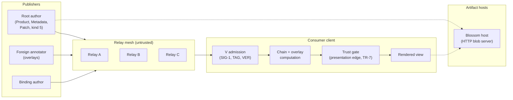
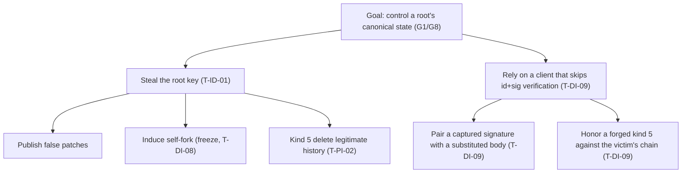
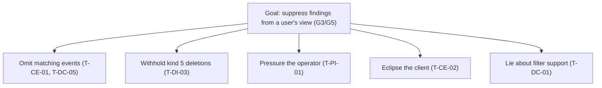

# SCRUTINY Fabric: Threat Model

**Protocol version:** 0.8.1  
**Document status:** Draft for security review  
**Methodology:** Adversary-model-based, in the Dolev–Yao tradition of numbered capability classes. Adversary grading adapts ETSI TS 102 165-1 V5.3.1 capability bands and the motivation axis (Appendix A, explicitly scoped). Risk ratings are ordinal-with-rationale (§5). Ratings use no ordinal arithmetic. Validation targets protocol-spec v0.8.1. Every mechanism claim cite-checks against rule IDs in spec Appendix F.

**Keyword declaration.** The key words MUST, SHOULD, and MAY and their negations appear in this document in uppercase ONLY inside verbatim quotations. The permitted quotations are protocol-spec rules anchored by rule ID, protocol-spec prose anchored by section, and the previous revision quoted as evidence in Appendix B. All analysis and guidance in this document uses lowercase modal verbs. When an uppercase keyword appears, it belongs to the quoted source, not to this document. This declaration follows the [RFC 2119](https://www.rfc-editor.org/rfc/rfc2119) and [RFC 8174](https://www.rfc-editor.org/rfc/rfc8174) convention of reserving capitals for formal obligation.

**Marker legend.** `†` marks TM-side guidance or implementation-behavior observations that no spec rule requires. Everything not marked `†` anchors to a protocol-spec rule ID or to common-knowledge infrastructure behavior.

---

## §1: Scope and Method

This document threat-models the SCRUTINY Fabric protocol v0.8.1: a security-metadata publication and discovery layer on public Nostr. It identifies adversary classes (§4) and enumerates threats against protocol-level security goals (§2). It rates threats by argument rather than by arithmetic (§5). It separates protocol-level obligations from ecosystem responsibilities (§9).

### 1.1 In scope

- The four SCRUTINY event types (Product, Metadata, Binding, Patch) and their `t` tag schema (spec §3, §4, TAG-1 to TAG-5).
- Version-tag form, ordering, and forward-compatibility (spec §3, VER-1 to VER-4).
- The unified-diff payload format, application semantics, and consumer resource ceilings (spec §5, PB-1 to RL-5).
- Trust admission and visibility gating: V/A/D layering, trusted-pubkey sets, Binding-conferred admission, presentation-time filtering (spec §6, TR-1 to TR-7).
- Canonical chains, root self-forks, foreign overlays, and patched-content computation (spec §7, RC-1 to SF-7, OV-2 to UR-4).
- Discovery queries, indexer discipline, and the canonical indexer registry (spec §4.5, §8, §9, DQ-1 to IR-4).
- Kind 5 deletion semantics: cascade, retroactive application, overlay degradation, retention guidance (spec §10, DEL-1 to DEL-11).
- Payload attachments through `imeta` and Blossom: hash binding, mirror handling, warning duties (spec §4.6, IM-1 to IM-5).
- The conformance corpus: its publication format, digest pinning, and coverage limits (spec Appendix G).
- Inherited Nostr properties that affect SCRUTINY integrity, availability, and privacy (spec §3.2).

### 1.2 Out of scope

- Client implementation internals: rendering hygiene, storage layout, UI design. Where the protocol leaves a decision to clients, this document names the exposure and the client layer owns the fix (§9).
- Relay software internals beyond behavior observable at the protocol interface (spec §8.0).
- Key generation, storage, and operational key hygiene.
- Transport-layer security: TLS downgrade, certificate validation, DNS poisoning. These are platform concerns (§8 excluded-concerns list).
- Legal and regulatory compliance, except where legal pressure directly enters the threat model (T-PI-01).
- Ranking and aggregation of optional social signals ([NIP-13](https://github.com/nostr-protocol/nips/blob/master/13.md), [NIP-18](https://github.com/nostr-protocol/nips/blob/master/18.md), [NIP-25](https://github.com/nostr-protocol/nips/blob/master/25.md), [NIP-57](https://github.com/nostr-protocol/nips/blob/master/57.md)): the spec marks all four as may-tier (spec §3.1). Their interpretation is client-layer.
- AI-agent interpretation of event contents. AI agents participate only through publisher keys and are indistinguishable from human publishers at the protocol layer (Appendix A.3).

### 1.3 Method

1. Derive security goals from the spec's design principles and rule set (§2). Record non-goals explicitly.
2. Fix the trust model and assumptions from spec §7.5 (§3). Downgrade and flag assumptions that empirical evidence contradicts.
3. Define adversary archetypes as capability classes with explicit can/cannot tables (§4). Grade each by Appendix A's band and motivation criteria, and name the crossing axis.
4. Enumerate threats per entry point and per rule family (§6). Write adversarial entries when a named archetype can act. Write structural-weakness entries when the exposure follows from a design decision alone (§5).
5. Rate each entry: Impact names the degraded goal, the affected parties, and the scope. Likelihood argues motivation, capability, preconditions, and defense class (absence of a control is itself a named class). Residual states what remains after the spec's own mitigations.
6. Record what the protocol cannot fix at its own layer as residual risks (§8) and as boundary assignments (§9).

### 1.4 Verification

Every catalog entry cites bracketed rule IDs from spec Appendix F, and every cited rule exists in the registry (Appendix F). Catalog entries cite every rule family, or §6.3 dispositions the family with a rationale. A mechanical gate (`tools/verify-tm-sync.mjs`) enforces version pinning, catalog/summary parity, citation admissibility, ledger bidirectionality, and the absence of retired terminology. A suspected spec defect halts the citing entry and triggers escalation, not a workaround. No such escalation proved necessary for v0.8.1: no surviving entry depends on an internally contradicted rule.

### 1.5 Completeness claim

Two cross-checks bound the catalog (§6). One cross-check pairs every entry point in §1b with every archetype in §4. The other covers every rule family in spec Appendix F, by citation in the catalog or by a dispositioned rationale. §6.3 names the uncited rules that carry no surviving adversarial premise, rather than skipping them silently.

---

## §1b: System Model and Entry Points

Four trust boundaries, each anchored to one rule family:

1. **Signature boundary:** every event crosses it once: `sig` over `id` over canonical serialization ([SIG-1](protocol-spec.md#rule-SIG-1)). Beyond it, an attacker may forge or replay events. Inside, a failing event never reaches processing.
2. **Transport boundary:** TLS between client and relay and between client and artifact host. Confidentiality and integrity of transit end here. Content beyond it is public by design.
3. **Artifact boundary:** the `x` SHA-256 hash in `imeta` tags ([IM-1](protocol-spec.md#rule-IM-1), [IM-4](protocol-spec.md#rule-IM-4)). Inside it, fetched bytes are trustworthy. Outside it, a host serves attacker-chosen bytes.
4. **Trust boundary:** the user's trusted-pubkey set applied at the presentation edge, after chain and overlay computation ([TR-7](protocol-spec.md#rule-TR-7)). No pre-filtering happens at ingress.

### 1b.1 Entry points

Every interface where attacker-shaped input crosses a trust boundary or changes protocol state:

| Entry point | Input shape | Primary catalog entries |
|---|---|---|
| E1 Publication | Signed events of the four types from any key | T-ID-01, T-EC-04, T-EC-05 |
| E2 Query responses (`#t`, `#e`, `#i`, kind 5) | Filter results from relays, including withheld or fabricated subsets | T-DC-01, T-CE-01, T-DI-03, T-DC-05 |
| E3 `imeta` fetch | Blossom artifact bytes behind a URL | T-AV-04, T-SV-03, T-DI-06 |
| E4 Trusted-pubkey set import | Allowlist, NIP-02 expansion, or reputation-source input | T-DC-02, T-EC-02, T-ID-02 |
| E5 Patch payload | Unified-diff text inside a fenced block | T-AV-02, T-AV-05 |
| E6 Kind 5 ingestion | Deletion events and their cascades | T-DI-03, T-DI-07, T-DI-09, T-PI-02 |
| E7 Opaque forward-version admission | Events of a higher version than the implementation | T-EC-06 |
| E8 Conformance corpus import | Digest-pinned vectors from spec Appendix G | T-EC-07 |
| E9 NIP-02 follow-list import | Follow graphs during WoT bootstrap | T-ID-02 |
| E10 NIP-50 responses | Free-text search results from relays | T-DC-01, T-DC-03 |

---

## §2: Security Goals

**Scope note:** goals are protocol-relative. Visibility of published events is public by design. Network-layer attacks (traffic analysis, endpoint compromise, TLS interception) operate below the protocol layer. They are §9 boundary assignments, not goal violations. A goal is degraded when an adversary defeats a property the protocol itself claims to protect.

| # | Goal | Definition |
|---|---|---|
| G1 | Integrity | Events, indexers, and attachments stay bound to the signing key. Canonical bytes derive deterministically from the root event plus the canonical chain. Unauthorized modification invalidates the signature or fails the hash check. |
| G2 | Authenticity | Every event is attributable to its signing key, and the attribution is verifiable by any consumer. Claim limited to the key: binding a key to a real-world identity is out-of-band (§3), so the protocol promises attribution, never real-world identification. |
| G3 | Censorship Resistance | No single relay, vendor, or authority can remove valid events from the network. Suppression at one point never eliminates the data from the mesh (spec §7.5). |
| G4 | Trust Separation | Each user selects their own trusted-pubkey set. Admission to the user's view is a presentation-time filter applied after chain and overlay computation ([TR-7](protocol-spec.md#rule-TR-7)); no global authority overrides the user's set. |
| G5 | Discoverability | Given an indexer (`cve:`, `cpe:`, `purl:`, and the other §9 prefixes), a client finds affiliated security metadata within its trust perimeter through `#i` queries and Binding traversal. |
| G6 | Auditability | Historical state stays recoverable: chain history, deletions, and timestamps remain attributable and reconstructable for audit. Audit surfaces never re-enter chain construction. |
| G7 | Portability | Events are self-contained and replicable across any compliant relay and into external archives. No relay-local state taints the event format. |
| G8 | Availability | A client that follows the spec's multiplicity guidance keeps computing, serving, and retrieving protocol state: per-root work stays bounded, chains do not freeze without a surfaced cause, and relay omission does not stall the client. |
| G9 | Privacy | Participation reveals no more than published events plus the query behavior a user necessarily exposes to the relays and hosts they talk to. The protocol adds no disclosure on top of publication itself. |

### 2.1 Non-goals (not currently addressed)

- **Real-world identity binding.** Any key may claim any identity because key generation is permissionless (spec §1). Verification is delegated out-of-band.
- **Key revocation.** No mechanism exists in this protocol version. Recovery after compromise is social (T-ID-01, §8).
- **Relay incentive and penalty mechanisms.** Honest service is an operational assumption, not an enforced property.
- **Confidential metadata.** Deferred (spec §11: [NIP-44](https://github.com/nostr-protocol/nips/blob/master/44.md) encrypted variants).
- **Recursive overlays and merge adoption.** Deferred (spec §11). V0.8.1 renders overlays only.
- **Cherry-pick attribution and state anchoring for Bindings.** Both deferred in spec §11. No v0.8.1 mechanism exists to model.

---

## §3: Trust Model and Assumptions

Fixes the actor model from spec §7.5 and states the assumptions the rest of this document stands on.

### 3.1 Actors

**Publishers** sign every event with their Nostr key: nobody else produces a valid signature for the key. Nobody modifies a signed event without invalidating the signature. Nobody deletes another publisher's event. Publishers may still set an arbitrary `created_at`. Signing proves identity, not time (CA-1 is a non-enforced directive). Root authors are sovereign over their chains. They extend them with patches and resolve self-forks by kind 5 deletion. Foreign annotators never mutate canonical content. Their events render as overlays (spec §7.3). Any key may author a Binding. Trust controls visibility, not existence.

**Relays** store and serve events, apply `#t`/`#e`/`#i` filters, and propagate publications. The baseline is honest-but-curious. Relays may also omit results, serve stale data, drop filter support, or stop answering. The defense is multiplicity: query multiple relays, cache locally, cross-reference (spec §7.5). No relay is trusted with completeness.

**Users** maintain a trusted-pubkey set: manual allowlist, [NIP-02](https://github.com/nostr-protocol/nips/blob/master/02.md) web-of-trust expansion, or a reputation-source threshold. The curation mechanism is out of protocol scope (spec §6.1). The set's existence is a hard protocol requirement. Untrusted, unreachable events leave the user's view through a presentation-time filter, never through pre-filtering of computation.

### 3.2 Derived trust properties

- **Sybil resistance** is delegated to the user's trusted set. An attacker with thousands of keys floods the network with valid events. Such events enter the view only where the user's trust radius admits them (T-ID-02).
- **Relay-level suppression** has no cryptographic defense. The defense is operational (publish widely, query broadly, spec §7.5).
- **Key compromise** has no protocol-level remedy. A leaked root key confers full chain sovereignty (T-ID-01). Pre-compromise events are forensically distinguishable, strengthened by external timestamp evidence (spec §7.5). Post-compromise events are indistinguishable.
- **Permissionless identity** enables participation at the cost of moving identity verification outside the protocol (T-ID-04).

### 3.3 Assumptions

1. Secp256k1 Schnorr signatures and SHA-256 are computationally sound against non-quantum adversaries.
2. Consumers perform SIG-1's id+signature verification before processing every event. This is load-bearing: T-DI-09 is the failure mode.
3. At least one honest, non-coerced relay exists in each user's configured set during normal operation.
4. Publishers control their own private keys until a compromise is analyzed as a named threat (T-ID-01).
5. The Nostr base layers remain stable within the evaluation horizon. Base layers per spec §3.1: [NIP-01](https://github.com/nostr-protocol/nips/blob/master/01.md), [NIP-09](https://github.com/nostr-protocol/nips/blob/master/09.md), [NIP-10](https://github.com/nostr-protocol/nips/blob/master/10.md), [NIP-73](https://github.com/nostr-protocol/nips/blob/master/73.md), CommonMark §4.5. May-tier layers per spec §3.1: [NIP-03](https://github.com/nostr-protocol/nips/blob/master/03.md), [NIP-13](https://github.com/nostr-protocol/nips/blob/master/13.md), [NIP-18](https://github.com/nostr-protocol/nips/blob/master/18.md), [NIP-25](https://github.com/nostr-protocol/nips/blob/master/25.md), [NIP-57](https://github.com/nostr-protocol/nips/blob/master/57.md). [NIP-50](https://github.com/nostr-protocol/nips/blob/master/50.md) search per spec §8. [NIP-92](https://github.com/nostr-protocol/nips/blob/master/92.md) `imeta` is optional per spec §3.1.

**Downgraded assumption.** Earlier revisions assumed clients correctly implement all must-level spec rules. Empirical work on the Nostr client ecosystem shows major clients skip signature and id verification, among other gaps. Source: "Not in The Prophecies: Practical Attacks on Nostr" ([ePrint 2025/1459](https://eprint.iacr.org/2025/1459)). This document therefore treats client-side must-level obligations as honored only where a conformance check exists (spec Appendix G). It rates "client skips the check" as an exploitable class (T-DI-09, T-EC-06).

---

## §3b: Asset Inventory

Assets the catalog reasons about, with the security properties each needs. This inventory tracks **C**onfidentiality, **I**ntegrity, **A**vailability, and **Au**thenticity (attribution to the signing key) per asset. **NR** is key-level non-repudiation: the signing key cannot plausibly deny events it signed. That claim binds the key, not the real-world operator behind it.

| # | Asset | Description | C | I | A | Au | NR |
|---|---|---|---|---|---|---|---|
| A1 | Product events | Signed root events identifying security-relevant targets | — | ● | ● | ● | ● |
| A2 | Metadata events | Signed root events carrying observations, findings, certifications | — | ● | ● | ● | ● |
| A3 | Binding events | Directed edges connecting two events | — | ● | ● | ● | ● |
| A4 | Patch events | Diff-carrying replies forming canonical chains | — | ● | ● | ● | ● |
| A5 | Kind 5 deletion events | NIP-09 deletions driving cascade or edge retraction | — | ● | ◐ | ● | ● |
| A6 | Canonical chains | Linear root-author patch sequences defining current state | — | ● | ● | ● | ● |
| A7 | Canonical bytes | Root content plus applied canonical chain ([RC-2](protocol-spec.md#rule-RC-2)) | — | ● | ◐ | — | — |
| A8 | Indexers (`i` tags) | NIP-73-shaped values enabling `#i` relay discovery | — | ◐ | ● | — | — |
| A9 | Binding topology | The relationship graph the discovery flow traverses | — | ● | ● | ● | — |
| A10 | Attached artifacts (`imeta` + Blossom) | External payloads pinned by SHA-256 | ◐ | ● | ◐ | — | — |
| A11 | Trusted-pubkey set | The user's allowlist driving admission | ○ | ● | ◐ | — | — |
| A12 | Pubkey-to-reputation mappings | Associations between keys and perceived trustworthiness | ○ | ● | ◐ | ● | — |
| A13 | Timestamp/audit claims | `created_at` values and OTS attestations as audit input | — | ◐ | — | — | — |
| A14 | Conformance corpus | Digest-pinned per-release test vectors (App G.1, G.3); discovery and serialization layers reserved, not yet published | — | ● | ◐ | ● | — |
| A15 | Rendered content | Client-presented prose, overlays, and attachments derived from published events; attacker-shaped input surface | ◐ | ◐ | ◐ | — | — |

**Legend:** ● required. ◐ partial or situational. ○ desirable operationally but not a protocol-level property. — not applicable.

---

## §4: Adversary Archetypes

Eleven capability classes. Archetypes are not mutually exclusive. One actor may combine several. Grades use Appendix A: capability band per A.1's test questions (crossing axis named) and motivation per A.2. An archetype's grade bounds what its members can bring. A specific attack's demands live in each entry's Likelihood segment and never re-grade the archetype.

| # | Archetype | Grade | Justification |
|---|---|---|---|
| A1 | Malicious Relay Operator | **[B3, M3]** | B3: holds a named infrastructure role (test question 3). M3: suppression is recurring, vendor-incentivized, and cheap to repeat (§7.5). |
| A2 | Compromised Publisher | **[B1, M3]** | B1: stock tooling plus one key; no infrastructure position (test 4 answers no). M3: recurring attempts, undeterred by signature attribution. |
| A3 | Network-Level Attacker | **[B5, M4]** | B5: observes or controls the network layer (test question 1). M4: goal-directed isolation of a target. |
| A4 | Hostile Vendor | **[B4, M4]** | B4: staff, legal apparatus, multi-region reach (test question 2). M4: A.2's own worked example, suppression of unfavorable findings. |
| A5 | Occasionally Lying Publisher | **[B1, M3]** | B1: one trusted key, no position. M3: maintains presence deliberately to repeat. |
| A6 | Sybil Amplifier | **[B2, M3]** | B2: sybil key generation at scale is the band's own marker. M3: expansion attempts repeat after failure. |
| A7 | Spam/DoS Attacker | **[B2, M3]** | B2: custom scripts and self-hosted capacity. M3: recurring floods, attribution costs nothing. |
| A8 | Identifier Squatter | **[B1, M2]** | B1: stock tooling, one key. M2: opportunistic; attribution risk deters where defenses are mid-strength. |
| A9 | Infrastructure Impersonator | **[B3, M3]** | B3: operates lookalike infrastructure roles. M3: targets bootstrap repeatedly. |
| A10 | Defaming Consumer | **[B1, M3]** | B1: one key, no position. M3: fabricated findings persist across friction. |
| A11 | Artifact-Targeting Attacker | **[B3, M3]** | B3: operates or pressures artifact hosts (host-operation axis). M3: recurring fetch and takedown pressure. |

**Clarifier (applies wherever Compromised Publisher is graded).** B3's positional clause covers those who OPERATE the channel: relay, Blossom-host, and index operators. It does not cover those who publish through it. A leaked trusted key is an attack precondition argued per entry, not a position.

**Footnote to A1.** Malicious Relay Operator is M4 when acting as a vendor's suppression arm (A.2's worked example). T-DI-09 grades that case [B3, M4] and is conformant under this footnote.

### A1: Malicious Relay Operator

| Capabilities | Cannot do |
|---|---|
| Controls relay storage, serving logic, and filter implementation | Forge or modify signed events |
| Omits results, serves stale data, drops `#i` or NIP-50 support silently | Prevent clients from querying alternative relays |
| Observes all subscription filters, timing, and query patterns | Force clients to accept forged results (signatures protect integrity) |
| May operate under legal or economic pressure from third parties | Delete events permanently from relays it does not control |

Drives T-DC-01, T-DC-05, T-CE-01, T-SV-01, T-DI-03, T-DI-09.

### A2: Compromised Publisher

| Capabilities | Cannot do |
|---|---|
| Holds a valid key (own, stolen, or organizational) | Modify events signed by other pubkeys |
| Publishes, patches, and kind 5-deletes events authoritative to that key | Override the canonical chain of a root owned by another key |
| Crafts arbitrary `created_at` values | Bypass the trust gate on clients that do not trust the key |
| Inherits full sovereignty over chains rooted at the compromised key | Undo cryptographic attribution of pre-compromise events |

Drives T-DI-01, T-DI-04, T-DI-07, T-DI-08, T-ID-01, T-ID-05, T-ID-06, T-DC-03 (with A4), T-AV-05 (with A7), T-EC-04 (with A6), T-ID-04 (with A8).

### A3: Network-Level Attacker

| Capabilities | Cannot do |
|---|---|
| Intercepts, drops, or redirects WebSocket connections | Break TLS without a compromised CA |
| Eclipses a client into a controlled relay set | Forge event signatures |
| Performs traffic analysis on connection timing and volume | Read TLS-encrypted payloads |
| May control corporate, ISP, or state infrastructure | Modify events in transit |

Drives T-CE-02.

### A4: Hostile Vendor

| Capabilities | Cannot do |
|---|---|
| Exerts economic pressure on relay operators (contracts, payments) | Forge or modify signed events |
| Exerts legal pressure (takedown notices, cease-and-desist claims) | Prevent re-broadcast from relays outside its legal reach |
| Funds sustained multi-jurisdiction campaigns | Distinguish voluntary retraction from coerced retraction at protocol level |
| Suppresses unfavorable findings about its own product | Suppress events on artifact hosts beyond its reach |

Drives T-PI-01, T-AV-04 (with A11), T-DC-03 (with A2).

### A5: Occasionally Lying Publisher

| Capabilities | Cannot do |
|---|---|
| Holds a trusted key with an established track record | Override trust gating on clients not trusting the key |
| Injects subtly false publications, timed for maximum impact | Prevent forensic attribution to the signing key |
| Mixes false entries into genuine work, making detection hard | Prevent contradictions from other trusted publishers |

Drives T-EC-05 (with A6, A7).

### A6: Sybil Amplifier

| Capabilities | Cannot do |
|---|---|
| Generates thousands of keypairs at near-zero cost | Control who follows or trusts the generated keys |
| Engineers trust-radius placement through social manipulation | Bypass gating on clients with curated allowlists |
| Floods discovery queries with sybil-authored events | Guarantee expansion into a specific user's radius |

Drives T-ID-02, T-EC-04 (with A2), T-EC-05 (with A5, A7).

### A7: Spam/DoS Attacker

| Capabilities | Cannot do |
|---|---|
| Generates large volumes of syntactically valid events | Bypass gating on clients with curated allowlists |
| Pads chains and overlays at per-event cost near zero | Force relay acceptance beyond relay limits |
| Targets single products with focused flooding | Make spam indistinguishable from trusted content under verification |

Drives T-AV-01, T-AV-02, T-AV-05 (with A2), T-EC-05 (with A5, A6).

### A8: Identifier Squatter

| Capabilities | Cannot do |
|---|---|
| Claims well-known indexers on self-published events | Validate claims against authoritative registries |
| Backdates `created_at` for audit-evidence corruption only, gaining no chain-ordering or discovery priority ([RC-1](protocol-spec.md#rule-RC-1), [SF-4](protocol-spec.md#rule-SF-4); §8.1: NIP-50 ranks by relevance; NIP-01 limit-pagination is newest-first, so a backdated claim reduces its own recency) | Prevent the real authority from publishing competing events |
| Claims CVE, CPE, PURL, CC identifiers without authorization | Control which keys users trust for given indexers |
| Pre-positions before vendors enter the ecosystem | Escape long-term attribution of the squatting behavior |

Drives T-ID-03, T-ID-04 (with A2).

### A9: Infrastructure Impersonator

| Capabilities | Cannot do |
|---|---|
| Mimics official SCRUTINY infrastructure (relays, clients, services) | Forge signatures from legitimate project keys |
| Distributes tampered default trusted-pubkey sets and software | Affect users on legitimate distribution channels |
| Targets new users when brand recognition is weakest | Prevent community detection and exposure |

Drives T-EC-02.

### A10: Defaming Consumer

| Capabilities | Cannot do |
|---|---|
| Publishes fabricated negative findings | Remove cryptographic attribution to their own key |
| Binds fabricated findings to target products | Forge the targeted vendor's signature |
| Exploits the asymmetric cost of investigating each false claim | Prove a negative cryptographically |

Drives no current catalog entry. T-ID-04’s identity-claim surface and T-EC-04’s fabrication-scale entry cover the defamation mechanism. The catalog retains Defaming Consumer because its can/cannot table bounds that class.

### A11: Artifact-Targeting Attacker

| Capabilities | Cannot do |
|---|---|
| Compromises or pressures artifact hosts | Forge events referencing the artifacts |
| Replaces artifact bytes where hash verification is skipped | Corrupt correctly hash-verified artifacts |
| Embeds tracking URLs in `imeta` references | Hide tracking from clients inspecting URL patterns |
| Exploits single-source hosting fragility | Prevent mirror distribution by others |

Drives T-AV-04 (with A4), T-SV-03, T-DI-06.

---

## §5: Risk Method

Ratings are ordinal-with-rationale. No formulas, no multiplication of levels, no numeric scores. Each rating is a claim an argument can audit. The levels below are the entire vocabulary. Every application of them appears with its reasoning in the entry's segments 4 to 6.

### 5.1 Impact (severity vocabulary)

| Level | Definition |
|---|---|
| Critical | A security goal breaks permanently for some class of users, with no protocol-level recovery path. |
| High | A security goal degrades measurably for a class of users under realistic conditions; partial mitigations leave material gaps. |
| Medium | A security goal degrades partially; the impact is bounded by implementation quality, deployment shape, or attacker sustainment cost. |
| Low | Minor or operational impact under narrow configurations; consequence is self-limiting or easily detected. |

Impact = which goal breaks, for whom, at what scope. One sentence per entry.

### 5.2 Likelihood (five-label scale)

| Label | Reading |
|---|---|
| Very unlikely | Exotic configuration or sustained effort with weak payoff. |
| Unlikely | Realistic configuration but meaningful preconditions or friction. |
| Possible | Reachable by the driving archetype under normal deployment oddities. |
| Likely | Recurring in the wild or near-costless to attempt. |
| Very likely | Present by default; only active defense stands between the adversary and the outcome. |

The labels come from ETSI TS 102 165-1 V5.3.1, Table 4 "Summary of likelihood metric" and Table 14 "Occurrence likelihood". Labels only: Appendix A.3 rejects the numeric values TVRA attaches to them.

Likelihood = driving archetype motivation × capability band × preconditions × defense class. Defense class names the cited mitigation's own keyword level: must, should, may, or absent (no rule). An assumption that §7.5 declares and that no normative rule supports counts as absent. Structural-weakness entries take no adversary. For these entries, Likelihood argues condition probability (how often the design's preconditions arise in the wild) × absence of controls.

### 5.3 Residual

What remains after counting the spec's own mitigations, stated with the same vocabulary. We allow a ranged residual (e.g., Low–Medium) only where implementation-quality variance genuinely shifts the outcome. Ranges are not a hedge. The entry narrates both bounds and names which configuration yields which bound.

### 5.4 Structural weaknesses

Entries of Type `structural-weakness` name the design decision or assumption responsible in place of an adversary. They carry a Spec row of the form `no single rule: family <letters>; see §<x.y>` and flag exposures that follow from a documented trade-off rather than from an adversary's action.

### 5.5 Marker

`†` = TM-side guidance, not a spec requirement. Attach it to any statement about what implementations do or should do that no rule ID backs.

---

## §6: Coverage and Completeness

### 6.1 Catalog overview

| Prefix | Category | Count | Focus |
|---|---|---|---|
| DI | Data Integrity | 8 | Content, chains, attachments, deletion admission |
| ID | Identity | 6 | Keys, trust radius, indexers, publishing identity |
| AV | Availability | 5 | Inflation, exhaustion, artifact hosting |
| DC | Discovery | 4 | Relay behavior, indexer desync, bootstrap |
| CE | Censorship | 2 | Suppression and eclipse at presentation |
| SV | Surveillance | 2 | Query and fetch privacy |
| EC | Ecosystem | 7 | Adoption-scale, corpus, forward compatibility |
| PI | Protocol Interactions | 3 | Cross-mechanism tensions |

Total: 37 entries.

### 6.2 Entry point × archetype

This matrix crosses every §1b.1 entry point against every §4 archetype. Cells that produce a threat land as entries. Each row lists that cell's primary entries. §4's Drives lines carry the full per-archetype mapping.

| Entry point | Reaching archetypes | Entries |
|---|---|---|
| E1 Publication | A2, A4, A5, A6, A7, A8, A10 | T-ID-01, T-EC-04, T-EC-05, T-AV-01, T-AV-03 |
| E2 Query responses | A1 | T-DC-01, T-CE-01, T-DI-03, T-DC-05 |
| E3 imeta fetch | A11, A4 | T-AV-04, T-SV-03, T-DI-06 |
| E4 Trusted-set import | A6, A9 | T-DC-02, T-EC-02, T-ID-02 |
| E5 Patch payload | A2, A7 | T-AV-02, T-AV-05 |
| E6 Kind 5 ingestion | A1, A2 | T-DI-03, T-DI-07, T-DI-09, T-PI-02 |
| E7 Opaque admission | structural | T-EC-06 |
| E8 Corpus import | structural (supply chain) | T-EC-07 |
| E9 NIP-02 import | A6 | T-ID-02 |
| E10 NIP-50 responses | A1, A4 | T-DC-01, T-DC-03 |

A3 has no entry-point reach. A3 drives T-CE-02 through network-layer eclipse, below the protocol layer. It is assigned per §4 rather than through these entry points.

### 6.3 Rule-family coverage matrix

Each spec Appendix F rule family is cited by entries or dispositioned with a rationale. Uncited members of cited families are format-internal rules (schema, grammar, procedural sequencing) unless named below.

| Family | Cited | Entries / disposition |
|---|---|---|
| BD | 5/12 | T-DC-05, T-DI-04, T-ID-05. uncited members (BD-1..BD-5, BD-7, BD-8) are endpoint-typing and pending-lifecycle mechanics rolled into T-ID-05’s hint-forgery disposition |
| C | 0/8 | assessed, no surviving threat — consumer-tolerance grammar; malformed diffs are validity failures, not attack surface |
| CA | 1/1 | T-DI-01 |
| CHN | 2/3 | T-AV-02, T-PI-02. CHN-1 (forward walk) is sequencing-internal; CHN-2/3 cited |
| DEL | 9/11 | T-DI-03, T-DI-07, T-DI-08, T-DI-09, T-PI-01, T-PI-02. DEL-3 assessed (see below); DEL-6 (kind 5 undeletable) is an internal invariant |
| DQ | 4/4 | T-CE-01, T-DC-01, T-DC-03, T-DC-05, T-DI-03, T-DI-07, T-SV-01 |
| E | 0/7 | assessed, no surviving threat — envelope grammar, validity-internal |
| H | 0/2 | assessed, no surviving threat — HALT is an outcome class, not an attack vector; its abuse surfaces through T-AV-02 and chain-freeze entries |
| IM | 4/5 | T-AV-03, T-AV-04, T-DI-06, T-ID-06, T-SV-03. IM-5 deliberately uncited: the NIP-92 extension is scope-enabling, not a control (T-DI-06 companion rationale) |
| IR | 1/4 | T-ID-03. IR-1, IR-3, IR-4 are prefix/value grammar; self-assertion exposure covered by T-ID-03 through IR-2 |
| IX | 2/4 | T-DC-03, T-ID-03, T-SV-01. IX-2, IX-4 are should-class tag-quantity hygiene against discovery dilution; the dilution premise overlaps T-AV-01's flood economics and has no distinct entry |
| MD | 1/5 | T-ID-06. MD-2..MD-5 are Metadata schema rows, validity-internal |
| N | 1/3 | T-AV-05. N1, N2 assessed — tolerance rules inside the diff grammar; N3 cited by T-AV-05, which prices no-op handling as an adversarial surface |
| OTS | 1/1 | T-DI-01, T-ID-01, T-PI-03 |
| OV | 5/9 | T-AV-01, T-AV-02, T-AV-05, T-ID-03, T-ID-04, T-ID-06, T-PI-02. OV-1 is a reserved ID, cross-reference-only by spec design; OV-2, OV-4, OV-8 are snapshot/determinism/ignore-rule mechanics internal to the overlay contract |
| P | 0/4 | assessed, no surviving threat — producer obligations on encoding and context lines; violations are producer-side (A-layer duties consumers must not reject over); P2 is the family's V-layer rule, applied at validity |
| PB | 2/2 | T-ID-06 |
| PR | 1/5 | T-ID-06. PR-2..PR-5 are Product schema rows, validity-internal |
| PT | 2/11 | T-AV-05. PT-1/2/3/4/5/6/9 mechanics internal; PT-10, PT-11 explicitly assessed (see below) |
| RC | 5/5 | T-AV-02, T-AV-03, T-DC-03, T-DI-01, T-DI-02, T-DI-08, T-EC-01, T-ID-01, T-ID-03. RC family completeness (per T-DI-02’s disposition record): RC-1/RC-2 define the canonical-chain and canonical-bytes surface that AV-02, DC-03, DI-01, DI-02, DI-08, EC-01, and ID-01 anchor on; RC-3..RC-5 bind conformance duties (recompute, tip identification) whose failure modes are the DI family’s observed-set and freeze entries |
| RL | 5/5 | T-AV-01, T-AV-02, T-AV-03, T-AV-05, T-EC-01 |
| SF | 5/7 | T-DI-01, T-DI-02, T-DI-08, T-ID-01, T-ID-03. SF-6, SF-7 explicitly assessed (see below) |
| SIG | 1/1 | T-AV-02, T-CE-02, T-DI-09, T-EC-04, T-EC-07, T-ID-01, T-ID-04, T-ID-05, T-PI-03 |
| T | 1/3 | T-AV-02. T2, T3 are sequencing mechanics of the same determinism family; T1 cited by T-AV-02 |
| TAG | 4/5 | T-EC-03, T-EC-06. TAG-4 is kebab-case hygiene, validity-internal |
| TR | 5/7 | T-AV-01, T-AV-02, T-CE-01, T-CE-02, T-DI-07, T-EC-02, T-EC-04, T-EC-05, T-ID-02, T-ID-04, T-ID-05, T-SV-01. TR-5, TR-6 (chain/binding admission transitivity) underpin entry point E4; no independent threat beyond T-ID-02 and T-DC-02’s bootstrap surface |
| UR | 4/4 | T-AV-03, T-DC-05, T-EC-07 |
| VER | 4/4 | T-EC-06 |

**Explicitly assessed, uncited rules:**
- PT-10, PT-11 (patch endpoint-typing procedure): internal classification mechanics with no surviving adversarial premise at v0.8.1. Their failure mode is admission rejection itself (spec §4.4), a dead end for the adversary.
- SF-6, SF-7 (multi-fork and fork/HALT precedence): resolve ambiguities inside the freeze decision itself. The exploitable freeze is adversary-independent and treated in T-DI-02 / T-DI-08. No independent threat.
- DEL-3 (deletion of a foreign overlay hides it from default rendering): the overlay's own author retracting it removes only that author's contribution. Canonical bytes are unaffected by rule, so no adversary gains leverage. No surviving premise.

### 6.4 Flagship attack trees

Two illustrations. Trees are not the completeness carrier (entry points and the family matrix are) because goal-rooted trees drop spec-mechanism edges.

---

---

## §7: Threat Catalog

### §7.1: Data Integrity

Data Integrity: content, chains, attachments, and deletion behavior that corrupt or distort deterministic state (G1, G6, G8).

#### T-DI-01: Forged `created_at` in Audit Evidence

| Field | Value |
|---|---|
| Type | adversarial |
| Adversary | Compromised Publisher |
| Assets | A13 Timestamp/audit claims |
| Goals | G6 Auditability |
| Spec | [CA-1](protocol-spec.md#rule-CA-1), [OTS-1](protocol-spec.md#rule-OTS-1), [RC-1](protocol-spec.md#rule-RC-1), [SF-4](protocol-spec.md#rule-SF-4); §3.1, §4, §7.5 |

**1. Problem.** Publishers set `created_at` themselves and signing proves identity, not time ([CA-1](protocol-spec.md#rule-CA-1); §7.5). Chain construction ignores timestamps, confining forgery to the audit channel ([RC-1](protocol-spec.md#rule-RC-1), [SF-4](protocol-spec.md#rule-SF-4)). An in-window event stores with no error and no plausibility check ([CA-1](protocol-spec.md#rule-CA-1); §4). Publication times stay indistinguishable in-band, and G6 Auditability degrades.

**2. Mitigation.** OpenTimestamps attestations give tamper-resistant proof of existence at or before a Bitcoin block, for disputes over timestamp authenticity ([OTS-1](protocol-spec.md#rule-OTS-1); §3.1). Relays commonly reject events outside a bounded window ([CA-1](protocol-spec.md#rule-CA-1); §4). This bounds a usable backdate to roughly one to three years. CA-1 directs publishers not to backdate, but nothing enforces it cryptographically ([CA-1](protocol-spec.md#rule-CA-1); §7.5).

**3. Gap.** CA-1 is a should with no enforcement, so any timestamp inside the window is accepted as published. OpenTimestamps is a may with low adoption, so most events lack tamper-resistant evidence ([OTS-1](protocol-spec.md#rule-OTS-1); §3.1). The window is ecosystem practice, not a rule. It is absent as a protocol control, and no client must flag an implausible timestamp.†

**4. Impact: Low**: the forgery falsifies one evidentiary field, degrading G6 for adjudicators trusting self-reported times. Canonical chains are unaffected.

**5. Likelihood: Unlikely**: a Compromised Publisher [B1, M3] needs a contested audit and an OTS-free event, against an unenforced should ([CA-1](protocol-spec.md#rule-CA-1)) and a may-class OTS.

**6. Residual risk: Low**: the forgery is cheap and persistent. It deceives only adjudicators trusting self-reported times. OTS evidence remains available on demand.

#### T-DI-02: Relay-Subset Divergence in Canonical Bytes

| Field | Value |
|---|---|
| Type | structural-weakness |
| Adversary | — (structural) |
| Assets | A6 Canonical chains, A7 Canonical bytes |
| Goals | G1 Integrity, G6 Auditability |
| Spec | no single rule: family RC; see §7.1 |

**1. Problem.** Chain and overlay state follow the event set a client currently observes (§7.1). Relays are honest but curious. No relay is trusted with completeness (§7.5). Heterogeneous subsets are the mesh's steady state, so clients can disagree on canonical bytes. A root self-fork typically arises from two-device publishing (§7.2). Its kind 5 resolution [SF-5](protocol-spec.md#rule-SF-5) can arrive late. The same root may then show frozen content [SF-2](protocol-spec.md#rule-SF-2) where a peer already shows a resolved chain. G1 integrity holds per observed set, not per root.

**2. Mitigation.** Non-UI consumers must recompute canonical bytes and overlay states when their observed event set changes in a way that affects events they serve ([RC-3](protocol-spec.md#rule-RC-3)). UI consumers should do the same ([RC-4](protocol-spec.md#rule-RC-4)). Multi-relay querying and local caching defend against relay incompleteness (§7.5).

**3. Gap.** The recompute duties bind each client to its own observed set ([RC-3](protocol-spec.md#rule-RC-3), [RC-4](protocol-spec.md#rule-RC-4)). Nothing requires the sets to agree. Set agreement is absent. Multi-relay querying is should-class (§7.5). UI recompute is should-class ([RC-4](protocol-spec.md#rule-RC-4)). Divergence persists until the missing event arrives.

**4. Impact: Medium**: While sets differ, users of different clients disagree on a root's current state (G1), and audit claims (G6) contradict.

**5. Likelihood: Likely**: condition probability is high. Out-of-order, late, or absent arrivals are the inherited Nostr model (§3.2). No set-agreement control exists.

**6. Residual risk: Medium overall, Low for non-UI**: Non-UI consumers converge on arrival under a must-class recompute duty [RC-3](protocol-spec.md#rule-RC-3). Interactive clients that defer [RC-4](protocol-spec.md#rule-RC-4) can show stale or frozen content until refresh.

#### T-DI-03: Retraction Propagation Gaps

| Field | Value |
|---|---|
| Type | adversarial |
| Adversary | Malicious Relay Operator |
| Assets | A5 Kind 5 deletion events, A7 Canonical bytes, A9 Binding topology |
| Goals | G1 Integrity, G6 Auditability |
| Spec | [DEL-2](protocol-spec.md#rule-DEL-2), [DEL-8](protocol-spec.md#rule-DEL-8), [DEL-9](protocol-spec.md#rule-DEL-9), [DEL-11](protocol-spec.md#rule-DEL-11), [DQ-2](protocol-spec.md#rule-DQ-2); §7.4, §8, §10 |

**1. Problem.** Deleting a root-author patch cascades to every canonical descendant ([DEL-2](protocol-spec.md#rule-DEL-2)). The cascade runs only against deletions a client has observed ([DEL-9](protocol-spec.md#rule-DEL-9)). A relay withholding a kind 5 leaves its clients computing stale canonical bytes. A relay storing the kind 5 without its target surfaces a context-free retraction. A single-relay client sees no split.

**2. Mitigation.** Implementations cache locally received kind 5s and apply them even when the queried relay omits them ([DEL-9](protocol-spec.md#rule-DEL-9)). Implementations record a late-target deletion and apply it retroactively on arrival ([DEL-8](protocol-spec.md#rule-DEL-8)). SCRUTINY-aware relays store a kind 5 alongside its target and surface it to SCRUTINY-aware queriers ([DEL-11](protocol-spec.md#rule-DEL-11)). Periodic `{kinds:[5], #e:[<id>]}` polls per cached root, patch, and Binding, plus multi-relay querying, guard against default-result omissions ([DQ-2](protocol-spec.md#rule-DQ-2); §7.5).

**3. Gap.** No rule requires a complete result set or user-side verification, so completeness is absent. [DEL-9](protocol-spec.md#rule-DEL-9) and [DEL-8](protocol-spec.md#rule-DEL-8) caching are must-class but cover only deletions already received. [DEL-11](protocol-spec.md#rule-DEL-11) co-serving and [DQ-2](protocol-spec.md#rule-DQ-2) polling are should-level. A withholding relay can therefore leave stale bytes.

**4. Impact: Medium**: Clients of a withholding relay compute stale canonical bytes, degrading G1 and G6 at relay scope.

**5. Likelihood: Possible**: a Malicious Relay Operator [B3, M3] recurs by position and interest, needing single-relay reliance against should-class checks.

**6. Residual risk: Medium**: must-class caching cannot deliver a deletion never received. Completeness stays absent, so stale bytes persist until a should-level check runs.

#### T-DI-04: Binding Relationship Ambiguity

| Field | Value |
|---|---|
| Type | adversarial |
| Adversary | Compromised Publisher |
| Assets | A3 Binding events, A9 Binding topology |
| Goals | G1 Integrity, G5 Discoverability |
| Spec | [BD-9](protocol-spec.md#rule-BD-9), [BD-10](protocol-spec.md#rule-BD-10), [BD-11](protocol-spec.md#rule-BD-11), [BD-12](protocol-spec.md#rule-BD-12); §4.3, §8.3 |

**1. Problem.** Binding relationship semantics live in free-form `content`, with structured labels deliberately dropped for canonical indexer discipline (§8.3). No closed vocabulary exists, so the protocol never classifies a claimed relationship as true, false, or complete. Validation covers shape only, at most one `e root` and one `e link` per Binding ([BD-10](protocol-spec.md#rule-BD-10)). A machine consumer parsing relationship claims cannot tell false from honest.

**2. Mitigation.** Trust follows the verified pubkey, never a hint, keeping attribution pinned ([BD-12](protocol-spec.md#rule-BD-12)). Kind 5 deletion and a fresh replacement correct a false Binding. Competing Bindings carry corrected prose (§4.3, [BD-9](protocol-spec.md#rule-BD-9)). Renderers may collapse visually identical duplicates at presentation ([BD-11](protocol-spec.md#rule-BD-11)).

**3. Gap.** [BD-12](protocol-spec.md#rule-BD-12) verification is must-class but pins identity only. No rule checks what the claim says. Correction is author-driven and non-atomic. A false Binding stands until the author retracts or a competitor outranks it ([BD-9](protocol-spec.md#rule-BD-9)). Truth verification of relationship claims is absent. Mislabeling stays traceable, yet no rule prevents it.

**4. Impact: Medium**: A trusted key's false relationship claim renders as fact until corrected or out-competed, degrading G1 for readers and G5 for automated classification.

**5. Likelihood: Possible**: a Compromised Publisher [B1, M3] recurs and needs only a key and a trusting consumer. The must-class identity checks never touch claim truth.

**6. Residual risk: Low–Medium**: human readers and audits bound the false claim at Low. Automated consumers that trust rendered edges meet it at Medium.

#### T-DI-06: Attached Payload Integrity in Transit

| Field | Value |
|---|---|
| Type | adversarial |
| Adversary | Artifact-Targeting Attacker |
| Assets | A10 Attached artifacts (imeta), A15 Rendered content |
| Goals | G1 Integrity, G2 Authenticity |
| Spec | [IM-1](protocol-spec.md#rule-IM-1), [IM-2](protocol-spec.md#rule-IM-2), [IM-3](protocol-spec.md#rule-IM-3), [IM-4](protocol-spec.md#rule-IM-4); §4.6 |

**1. Problem.** Payload claims attach out-of-band via `imeta` tags. The signature attests the declared hash, not the fetched bytes. Verification is should-level [IM-1](protocol-spec.md#rule-IM-1). A client may skip it and only warn before display or processing [IM-4](protocol-spec.md#rule-IM-4). An Artifact-Targeting Attacker with serving-path control feeds substituted bytes to any client that skips the check. No two distinct byte streams pass one declared SHA-256. Divergence among clients signals a skipped check, not a hash break.

**2. Mitigation.** [IM-1](protocol-spec.md#rule-IM-1) directs streamed verification of the `x` hash. A declared `size` mismatch fails the fetch the same way [IM-2](protocol-spec.md#rule-IM-2). [IM-3](protocol-spec.md#rule-IM-3) allows multiple `url` entries, settling on the first whose bytes match. Mirror choice cannot sway validity.

**3. Gap.** Verification stays should-level [IM-1](protocol-spec.md#rule-IM-1). The size check is conditional should [IM-2](protocol-spec.md#rule-IM-2). Mirror neutrality is must-class [IM-3](protocol-spec.md#rule-IM-3). The [IM-4](protocol-spec.md#rule-IM-4) warning is must-class with no block. The warning is presentational. Headless or routine ingestion satisfies it with no human decision and erodes the only guard†. Host rot, takedown, and compromise removal are T-AV-04's scope. This entry covers bytes accepted without the [IM-1](protocol-spec.md#rule-IM-1) check.

**4. Impact: Medium**: A consumer acting on unverified payload bytes may ingest content unrelated to the signed declaration, breaking G1 and G2 for that application.

**5. Likelihood: Possible**: Artifact-Targeting Attacker [B3, M3] holds the serving position. Success needs only a skip-verification or headless client against a should-level check.

**6. Residual risk: Medium**: Verifying clients stay sound. Nothing compels the cautious path, so unverified ingestion persists.

#### T-DI-07: Publish-Then-Delete Admission Revocation Lag

| Field | Value |
|---|---|
| Type | adversarial |
| Adversary | Compromised Publisher |
| Assets | A3 Binding events, A9 Binding topology, A11 Trusted-pubkey set |
| Goals | G4 Trust Separation |
| Spec | [DEL-5](protocol-spec.md#rule-DEL-5), [DEL-8](protocol-spec.md#rule-DEL-8), [DEL-9](protocol-spec.md#rule-DEL-9), [DEL-11](protocol-spec.md#rule-DEL-11), [DQ-2](protocol-spec.md#rule-DQ-2), [TR-3](protocol-spec.md#rule-TR-3), [TR-4](protocol-spec.md#rule-TR-4); §6.3, §6.4, §8, §10 |

**1. Problem.** A trusted author's Binding admits both endpoints, even ones by untrusted authors ([TR-3](protocol-spec.md#rule-TR-3), [TR-4](protocol-spec.md#rule-TR-4); §6.4). An attacker on a compromised trusted key publishes such a Binding to hostile endpoints, harvests the borrowed trust, then deletes it. Deletion revokes it only where clients observe the kind 5 ([DEL-5](protocol-spec.md#rule-DEL-5)). Relay honoring is optional ([DEL-11](protocol-spec.md#rule-DEL-11); §10). The Binding then persists silently in withheld views, degrading G4 Trust Separation (compounds T-DI-03).

**2. Mitigation.** DEL-5 revokes the conferred admission when the author deletes the Binding ([DEL-5](protocol-spec.md#rule-DEL-5)). The same revocation serves lawful retractions, where removing honest endpoints is the author's choice, not a defect. Clients cache received kind 5s despite relay omission ([DEL-9](protocol-spec.md#rule-DEL-9)), reapply them to late targets ([DEL-8](protocol-spec.md#rule-DEL-8)), and poll per cached Binding ([DQ-2](protocol-spec.md#rule-DQ-2); §8).

**3. Gap.** DEL-5 sits at the D layer, so revocation reshapes views without invalidating endpoints ([DEL-5](protocol-spec.md#rule-DEL-5); §10). Relay cooperation and polls are should-class ([DEL-11](protocol-spec.md#rule-DEL-11), [DQ-2](protocol-spec.md#rule-DQ-2)). Must-class caching reaches only received deletions ([DEL-9](protocol-spec.md#rule-DEL-9)). No protocol control bounds the deletion-to-observation lag.

**4. Impact: Medium**: hostile endpoints keep rendering under borrowed trust in withheld views until the deletion arrives, degrading G4 Trust Separation for that client.

**5. Likelihood: Possible**: a Compromised Publisher [B1, M3] needs a key moment plus withheld views, against should-class polls ([DQ-2](protocol-spec.md#rule-DQ-2)) and must-class caching ([DEL-9](protocol-spec.md#rule-DEL-9)).

**6. Residual risk: Medium**: revocation holds wherever clients observe the kind 5. Lag is unbounded, so exposure persists per client until arrival.

#### T-DI-08: Indefinite Self-Fork Freeze (Trusted Root Key)

| Field | Value |
|---|---|
| Type | adversarial |
| Adversary | Compromised Publisher |
| Assets | A4 Patch events, A5 Kind 5 deletion events, A6 Canonical chains, A7 Canonical bytes, A11 Trusted-pubkey set |
| Goals | G8 Availability, G6 Auditability |
| Spec | [SF-1](protocol-spec.md#rule-SF-1), [SF-2](protocol-spec.md#rule-SF-2), [SF-3](protocol-spec.md#rule-SF-3), [SF-4](protocol-spec.md#rule-SF-4), [SF-5](protocol-spec.md#rule-SF-5), [RC-5](protocol-spec.md#rule-RC-5), [DEL-1](protocol-spec.md#rule-DEL-1); §7.2, §7.5, §10 |

**1. Problem.** A Compromised Publisher with a trusted root key publishes a competing patch at any chain point, a root self-fork ([SF-1](protocol-spec.md#rule-SF-1)). The canonical chain and the tip stay undefined while unresolved ([RC-5](protocol-spec.md#rule-RC-5)). Clients freeze the content at the shared parent ([SF-2](protocol-spec.md#rule-SF-2)), surface the fork explicitly ([SF-3](protocol-spec.md#rule-SF-3)), and must not pick a branch ([SF-4](protocol-spec.md#rule-SF-4)). Resolution belongs to the root key alone: a kind 5 deletion on one branch ([SF-5](protocol-spec.md#rule-SF-5); §10). No revocation exists (§7.5).

**2. Mitigation.** Clients must freeze at the shared parent ([SF-2](protocol-spec.md#rule-SF-2)) and must not pick a branch by any heuristic ([SF-4](protocol-spec.md#rule-SF-4)). The fork surfaces explicitly with both branch IDs and timestamps ([SF-3](protocol-spec.md#rule-SF-3)). An honest root author can resolve via kind 5 ([SF-5](protocol-spec.md#rule-SF-5)).

**3. Gap.** No timeout bounds an unresolved self-fork: the frozen state may persist forever (absent). No alternative resolver exists: clients honor only the root key's kind 5 ([DEL-1](protocol-spec.md#rule-DEL-1)). The key holder alone unlocks the freeze. Against a malicious holder, the attacker operates that must-class resolution. Re-freezing costs one broadcast patch per cycle (†).

**4. Impact: High**: Users trusting the root key see frozen canonical bytes and a surfaced error for an unbounded period, degrading G8 and G6.

**5. Likelihood: Possible**: a Compromised Publisher [B1, M3] needs no infrastructure position and recurs under signature attribution. The driver is trusted-key compromise or vendor malice (T-ID-01). The freeze is must-class, and only the key holder can lift it.

**6. Residual risk: High**: No revocation means a re-fork restores the freeze at one patch's cost (†). Social migration is the only remedy (§7.5).

#### T-DI-09: Unverified Kind 5 Honoring Cascades Canonical Chains

| Field | Value |
|---|---|
| Type | adversarial |
| Adversary | Malicious Relay Operator |
| Assets | A5 Kind 5 deletion events, A6 Canonical chains, A7 Canonical bytes |
| Goals | G1 Integrity, G5 Discoverability |
| Spec | [DEL-1](protocol-spec.md#rule-DEL-1), [DEL-2](protocol-spec.md#rule-DEL-2), [DEL-8](protocol-spec.md#rule-DEL-8), [DEL-11](protocol-spec.md#rule-DEL-11), [SIG-1](protocol-spec.md#rule-SIG-1); §3, §10 |

**1. Problem.** Clients honor a kind 5 only when its `pubkey` matches the target's ([DEL-1](protocol-spec.md#rule-DEL-1); §10). An attacker's own kind 5 against a victim's patches still verifies, so honoring it skips the DEL-1 match. Skipping id-recomputation lets a relay pair a captured signature with a substituted body: "A signature-only check is insufficient" ([SIG-1](protocol-spec.md#rule-SIG-1); §3). Clients honoring either forgery cascade the victim's chain ([DEL-2](protocol-spec.md#rule-DEL-2)) and late targets retroactively ([DEL-8](protocol-spec.md#rule-DEL-8)).

**2. Mitigation.** SIG-1 requires verifying the signature and that `id` hashes the canonical serialization, before processing any event including kind 5 ([SIG-1](protocol-spec.md#rule-SIG-1); §3). DEL-1 gates honoring on the author match, made mandatory by §10's validation prose ([DEL-1](protocol-spec.md#rule-DEL-1); §10).

**3. Gap.** Both checks are must-class ([SIG-1](protocol-spec.md#rule-SIG-1), [DEL-1](protocol-spec.md#rule-DEL-1)), so the exposure is clients honoring relay-served deletions unverified†. No rule compels relay-side validation, and relay cooperation stays should-class ([DEL-11](protocol-spec.md#rule-DEL-11)). Affected clients silently render the reverted ancestor as the victim's current state, no error surfaced†.

**4. Impact: Medium**: the victim's chain reverts to its last surviving ancestor for affected clients, degrading G1 Integrity and G5 Discoverability.

**5. Likelihood: Possible**: a Malicious Relay Operator [B3, M4] needs one served client skipping either must-class check. Must-rule client conformance is empirically unreliable†.

**6. Residual risk: Low–Medium**: conformant clients are immune and the forgery stays auditable (lower bound). Non-conformant ones serve that chain as current (upper bound)†.

### §7.2: Identity

Identity: keys, trust-radius expansion, and self-asserted claims entering the user view (G2, G4, G5).

#### T-ID-01: Key Compromise: No Key Revocation

| Field | Value |
|---|---|
| Type | adversarial |
| Adversary | Compromised Publisher |
| Assets | A1 Product events, A2 Metadata events, A3 Binding events, A4 Patch events, A6 Canonical chains, A12 Pubkey-to-reputation mappings |
| Goals | G1 Integrity, G2 Authenticity, G4 Trust Separation |
| Spec | [SIG-1](protocol-spec.md#rule-SIG-1), [SF-2](protocol-spec.md#rule-SF-2), [SF-5](protocol-spec.md#rule-SF-5), [RC-2](protocol-spec.md#rule-RC-2), [OTS-1](protocol-spec.md#rule-OTS-1); §3.1, §7.5 |

**1. Problem.** A leaked root author's nsec hands the attacker sovereignty over all chains that key originates (§7.5). The attacker extends chains with false patches, kind 5-deletes legitimate history, induces root self-forks, and writes genuine-looking bindings ([SF-2](protocol-spec.md#rule-SF-2), [SF-5](protocol-spec.md#rule-SF-5); §7.5). Post-compromise events pass signature and id checks identically to genuine ones ([SIG-1](protocol-spec.md#rule-SIG-1); §7.5). Canonical bytes change under the leaked key ([RC-2](protocol-spec.md#rule-RC-2); §7.5).

**2. Mitigation.** The legitimate author signed pre-compromise events, which stay forensically distinguishable. OpenTimestamps strengthen that boundary as an audit signal ([OTS-1](protocol-spec.md#rule-OTS-1); §3.1, §7.5). The remedy is social: "announce compromise out-of-band, rotate to a new key, encourage the community to migrate trust" (§7.5).

**3. Gap.** "There is no key-revocation mechanism in this protocol version" (§7.5). The forensic boundary is may-class: OpenTimestamps proofs are optional, and ecosystem adoption is currently low ([OTS-1](protocol-spec.md#rule-OTS-1); §3.1). The social remedy is absent as a protocol control, so completeness depends on reaching every trusting party.

**4. Impact: Critical**: G1, G2, and G4 break for every party trusting the leaked key, with no in-protocol recovery path (§7.5).

**5. Likelihood: Possible**: a Compromised Publisher [B1, M3] needs only stock tooling. Custody failures are routine. No defense class exists (absent).

**6. Residual risk: Critical**: carried from v0.5.3. §7.5 states the sovereignty inheritance, forensic asymmetry, and absent revocation, keeping this the model's most severe threat.

#### T-ID-02: Sybil Amplification Through WoT Expansion

| Field | Value |
|---|---|
| Type | adversarial |
| Adversary | Sybil Amplifier |
| Assets | A11 Trusted-pubkey set, A8 Indexers (`i` tags), A1 Product events, A2 Metadata events, A3 Binding events, A4 Patch events |
| Goals | G4 Trust Separation, G5 Discoverability |
| Spec | [TR-2](protocol-spec.md#rule-TR-2), [TR-3](protocol-spec.md#rule-TR-3); §6.1, §7.5 |

**1. Problem.** The protocol delegates sybil resistance to the user's web-of-trust (§7.5). A curated allowlist admits only explicitly trusted pubkeys. An N-hop expansion via [NIP-02](https://github.com/nostr-protocol/nips/blob/master/02.md) follow lists admits any key a trusted key follows. An attacker generating keys at scale then needs one placement inside the radius: bought follows, follow-back exchanges, or one compromised minor account. Each admitted key may publish valid events of every type ([TR-2](protocol-spec.md#rule-TR-2) admits all-or-nothing). The flood erodes trust separation (G4) and discovery value (G5).

**2. Mitigation.** Binding admission does not widen: users admit a Binding only when they trust its own author. Trust does not flow through endpoints ([TR-3](protocol-spec.md#rule-TR-3)). §7.5 sets a should defense: "Implementations SHOULD warn when trust-radius expansion would admit a large number of previously unseen pubkeys."

**3. Gap.** No protocol-level sybil-cost rule exists. §6.1 leaves expansion depth, scoring, and curation out of scope (control absent). The expansion warning is a should clients may omit. Unweighted expansion flattens trust distance: a key three hops out counts the same as a direct follow.

**4. Impact: Medium**: sybil admission pollutes every event surface (A1–A4), eroding G4 per-user and diluting G5, proportional to expansion depth.

**5. Likelihood: Likely**: the Sybil Amplifier [B2, M3] runs sybil key generation at scale for days to weeks. It needs no position and faces a should-level, possibly absent, warning.

**6. Residual risk: Medium**: bounded by trusted-set discipline and warning uptake. Irreducible while the trust model stays permissionless.

#### T-ID-03: Indexer Squatting

| Field | Value |
|---|---|
| Type | adversarial |
| Adversary | Identifier Squatter |
| Assets | A8 Indexers (`i` tags), A1 Product events, A2 Metadata events |
| Goals | G5 Discoverability |
| Spec | [IX-1](protocol-spec.md#rule-IX-1), [IR-2](protocol-spec.md#rule-IR-2), [IX-3](protocol-spec.md#rule-IX-3); §9 |

**1. Problem.** `i` tag values are self-asserted. Nothing validates a claimed `cve:` or `cpe:` indexer against MITRE or the NIST dictionary. §9 records only a format convention: "Value is the source authority's canonical form, preserved verbatim" ([IR-2](protocol-spec.md#rule-IR-2)). IX-1's inclusion guidance is a should, not a registry check. A squatter claims a known indexer early. Its standing rests on real publication time. No surface rewards a backdate. Chains ignore `created_at` ([RC-1](protocol-spec.md#rule-RC-1), [SF-4](protocol-spec.md#rule-SF-4)). Indexer queries fix no result ordering (§8.1). [NIP-50](https://github.com/nostr-protocol/nips/blob/master/50.md) ranks by relevance, and [NIP-01](https://github.com/nostr-protocol/nips/blob/master/01.md) paginates newest-first. Root indexers are immutable ([IX-3](protocol-spec.md#rule-IX-3)), so the claim persists. The attack degrades discovery within the user's trust perimeter (G5).

**2. Mitigation.** Squatter events reach a curated view only through trusted or Binding-reachable keys. Competing claims render side by side inside the user's trusted set ([OV-7](protocol-spec.md#rule-OV-7); §7.5). Authoritative keys outrank squatters by curation alone.

**3. Gap.** Registry cross-reference is absent. No rule checks an indexer against its issuing authority, and no conflict detection or authority priority exists. IX-1's should does not bind squatters. The asymmetry (cheap squatting, costly defense) favors the squatter while trusted-pubkey sets are sparse during bootstrap.

**4. Impact: Medium**: diluted `#i` discovery (G5) and side-by-side noise with legitimate metadata, per-user, worst during bootstrap.

**5. Likelihood: Possible**: the Identifier Squatter [B1, M2] needs only stock tooling. Trusted-set admission gates damage. Attribution risk deters a curious-motivation actor.

**6. Residual risk: Medium**: bounded by trusted-set curation. Declines as authoritative keys gain wide trust.

#### T-ID-04: Unverifiable Identity Claims

| Field | Value |
|---|---|
| Type | adversarial |
| Adversary | Compromised Publisher, Identifier Squatter |
| Assets | A1 Product events, A2 Metadata events, A12 Pubkey-to-reputation mappings |
| Goals | G2 Authenticity, G4 Trust Separation |
| Spec | [SIG-1](protocol-spec.md#rule-SIG-1), [TR-2](protocol-spec.md#rule-TR-2), [TR-3](protocol-spec.md#rule-TR-3), [OV-7](protocol-spec.md#rule-OV-7); §3.1, §6.1, §7.5 |

**1. Problem.** Anyone can generate a keypair and claim, in `content` prose, to be any real-world entity (§1 permissionless publication). The dependency list names no identity-attestation NIP, DNS binding, or certification layer (§3.1). A user facing an event claiming Infineon must establish out-of-band that Infineon controls the key. Admission keys on `pubkey` alone ([TR-2](protocol-spec.md#rule-TR-2)). Once admitted, its claims read as Infineon for that user.

**2. Mitigation.** Permissionless identity is a stated design assumption with no central identity authority (§7.5). Signature plus id verification anchors every claim to the signing key (must, [SIG-1](protocol-spec.md#rule-SIG-1)). Curated trusted-pubkey sets from organization-published keys shield disciplined users ([TR-2](protocol-spec.md#rule-TR-2), [OV-7](protocol-spec.md#rule-OV-7); §7.5). Binding admission gates on the Binding's own `pubkey`, never transitive through endpoints ([TR-3](protocol-spec.md#rule-TR-3)).

**3. Gap.** Pubkey-to-entity binding is absent as a protocol control. The trust mechanism itself is out of scope (§7.5). Curation is practice-only†. Users on unverified defaults have no in-protocol basis for discriminating keys (compounds T-EC-02). Squatting is free while authorities must defend every claim†.

**4. Impact: Medium**: an admitted impostor degrades G2 Authenticity and G4 Trust Separation for every user admitting the key.

**5. Likelihood: Possible**: an Identifier Squatter [B1, M2] or Compromised Publisher [B1, M3] needs only prose and a new key against an absent defense class.

**6. Residual risk: Low–Medium**: Low for out-of-band verified trusted-pubkey sets ([TR-2](protocol-spec.md#rule-TR-2); §7.5). Medium upper bound covers bootstrap users and unverified defaults (compounds T-EC-02).

#### T-ID-05: Author-Hint Forgery on Binding `e` Tags

| Field | Value |
|---|---|
| Type | adversarial |
| Adversary | Compromised Publisher |
| Assets | A3 Binding events, A4 Patch events |
| Goals | G2 Authenticity |
| Spec | [BD-12](protocol-spec.md#rule-BD-12), [BD-6](protocol-spec.md#rule-BD-6), [TR-3](protocol-spec.md#rule-TR-3), [SIG-1](protocol-spec.md#rule-SIG-1); §3.2, §4.3 |

**1. Problem.** An `e` tag's author-hint suffix is advisory. Consumers consult it for outbox-model discovery when the relay hint does not resolve (§3.2, §4.3). The hint never affects a Binding's validity ([BD-12](protocol-spec.md#rule-BD-12)). A Compromised Publisher can therefore pair a trusted hint pubkey with an attacker-keyed referenced event. Any consumer trusting or rendering the hint misattributes the referenced event's author.

**2. Mitigation.** Trust decisions rest on the verified event `pubkey`, never the hint ([BD-12](protocol-spec.md#rule-BD-12)). Signature plus id verification binds the fetched event to its key (must, [SIG-1](protocol-spec.md#rule-SIG-1)). Pending Bindings stay stored but unrendered until both endpoints are observed ([BD-6](protocol-spec.md#rule-BD-6)). Admission requires the Binding's own author be trusted ([TR-3](protocol-spec.md#rule-TR-3)).

**3. Gap.** No rule flags a hint mismatch as a user-facing warning (defense class absent). The hint is structurally unverifiable until the endpoint arrives. BD-6 plus BD-12 protect only compliant consumers†. Hint-faithful renderers propagate the misattribution†.

**4. Impact: Low**: G2 Authenticity degrades only where a consumer violates BD-12 or renders pending content. Compliant consumers see true authorship.

**5. Likelihood: Possible**: a Compromised Publisher [B1, M3] needs only a crafted tag. Deception lands where a client trusts hints against a must-class rule†.

**6. Residual risk: Low**: Compliant consumers are immune. The residual surface is non-compliant renderer behavior with must-class anchors†.

#### T-ID-06: Hostile Markup in Rendered Content

| Field | Value |
|---|---|
| Type | adversarial |
| Adversary | Compromised Publisher |
| Assets | A15 Rendered content |
| Goals | G4 Trust Separation |
| Spec | [PR-1](protocol-spec.md#rule-PR-1), [MD-1](protocol-spec.md#rule-MD-1), [PB-1](protocol-spec.md#rule-PB-1), [PB-2](protocol-spec.md#rule-PB-2), [OV-6](protocol-spec.md#rule-OV-6), [OV-7](protocol-spec.md#rule-OV-7), [IM-4](protocol-spec.md#rule-IM-4); §3.2 |

**1. Problem.** Product and Metadata `content` is free-form with no grammar ([PR-1](protocol-spec.md#rule-PR-1), [MD-1](protocol-spec.md#rule-MD-1)). PB-1 and PB-2 keep payload bytes verbatim end-to-end ([PB-1](protocol-spec.md#rule-PB-1), [PB-2](protocol-spec.md#rule-PB-2)). A Compromised Publisher embeds hostile markup or links in admitted prose, which a client may render as rich text† or present as overlays ([OV-6](protocol-spec.md#rule-OV-6); §7.3). Nothing constrains characters or structure inside `content`. The renderer therefore presents attacker-shaped UI as trusted data.

**2. Mitigation.** Trust gating bounds exposure: foreign content is visible only when its `pubkey` is in the user's trusted set ([OV-7](protocol-spec.md#rule-OV-7); §7.5). The only warn-before-display rule warns before displaying or processing unverified artifacts ([IM-4](protocol-spec.md#rule-IM-4)), must-class but verification-only. Canonical bytes stay intact ([PB-1](protocol-spec.md#rule-PB-1)), so audit tooling still recovers the true content.

**3. Gap.** Sanitization is absent as a protocol control, and no rule governs content rendering. §3.2's base-layer inheritance covers event structure and the patch envelope, not prose presentation. IM-4 covers artifact verification, never markup structure ([IM-4](protocol-spec.md#rule-IM-4)). Neutralizing hostile markup is client responsibility†. Exposure tracks each renderer's hygiene.

**4. Impact: Medium**: Trusted, signed content renders as attacker-controlled UI, degrading G4 Trust Separation for every client that renders without sanitizing.

**5. Likelihood: Possible**: A Compromised Publisher [B1, M3] already holds a trusted publication channel. The remaining preconditions are unsanitized rich rendering† and an absent defense class.

**6. Residual risk: Medium**: Bounded by trust-gate placement and client hygiene†, while portions of the trusted view stay attacker-shaped.

### §7.3: Availability

Availability: inflation, exhaustion, and hosting fragility that degrade compute and retrieval (G8).

#### T-AV-01: Spam and Graph Pollution

| Field | Value |
|---|---|
| Type | adversarial |
| Adversary | Spam/DoS Attacker |
| Assets | A1 Product events, A2 Metadata events, A9 Binding topology |
| Goals | G8 Availability, G5 Discoverability |
| Spec | [TR-1](protocol-spec.md#rule-TR-1), [TR-2](protocol-spec.md#rule-TR-2), [TR-7](protocol-spec.md#rule-TR-7), [OV-7](protocol-spec.md#rule-OV-7), [RL-1](protocol-spec.md#rule-RL-1), [RL-2](protocol-spec.md#rule-RL-2), [RL-4](protocol-spec.md#rule-RL-4); §7.5 |

**1. Problem.** A Spam/DoS Attacker generates valid events no validity rule rejects. V-valid events must not be turned away by A or D rules ([TR-1](protocol-spec.md#rule-TR-1)). §7.5 names the shape: sybil keys flood fake Products, Metadata, and Bindings that relays store. The flood consumes storage, bandwidth, and query responsiveness. This degrades G8 and dilutes G5 until presentation filtering dismisses it.

**2. Mitigation.** Trust gating is structural. [TR-2](protocol-spec.md#rule-TR-2) admits only trusted pubkeys or trusted-Binding reachability. [OV-7](protocol-spec.md#rule-OV-7) shows foreign overlays only to the trusted set. [TR-7](protocol-spec.md#rule-TR-7) keeps the flood out of any curated view at presentation. Patch-carrying floods hit [RL-2](protocol-spec.md#rule-RL-2)'s work ceilings and [RL-4](protocol-spec.md#rule-RL-4)'s serving block (compounds T-AV-02). A plain event flood reaches neither. [NIP-13](https://github.com/nostr-protocol/nips/blob/master/13.md) Proof-of-Work is optional with no minimum difficulty (§3.1). †relay adoption is operator-set.

**3. Gap.** [RL-2](protocol-spec.md#rule-RL-2)'s should-class ceilings cover patch-application work only. Plain event volume escapes them. No per-author rate limit exists. The §5.4 size bounds are only recommended ([RL-1](protocol-spec.md#rule-RL-1)). †Shared kind 1 namespace invites generic relay anti-spam throttling.

**4. Impact: Medium**: query/storage availability degrades (G8) and discovery dilutes (G5) until trust filtering dismisses it. Curated views via [TR-2](protocol-spec.md#rule-TR-2), [OV-7](protocol-spec.md#rule-OV-7) are largely protected.

**5. Likelihood: Likely**: [B2, M3] generates sybil keys at scale with near-zero preconditions, against should-class recommended bounds ([RL-1](protocol-spec.md#rule-RL-1)) and operator-dependent PoW (NIP-13).

**6. Residual risk: Medium**: the curated view survives. Relay storage, query availability, and discovery quality degrade with volume until operators adopt bounds and rate limits.

#### T-AV-02: Foreign-Overlay and Chain-Application Amplified Work

| Field | Value |
|---|---|
| Type | adversarial |
| Adversary | Spam/DoS Attacker |
| Assets | A4 Patch events, A6 Canonical chains, A7 Canonical bytes, A8 Indexers |
| Goals | G8 Availability |
| Spec | [TR-7](protocol-spec.md#rule-TR-7), [T1](protocol-spec.md#rule-T1), [CHN-3](protocol-spec.md#rule-CHN-3), [OV-9](protocol-spec.md#rule-OV-9), [SIG-1](protocol-spec.md#rule-SIG-1), [RL-1](protocol-spec.md#rule-RL-1), [RL-2](protocol-spec.md#rule-RL-2), [RL-3](protocol-spec.md#rule-RL-3), [RL-4](protocol-spec.md#rule-RL-4), [RL-5](protocol-spec.md#rule-RL-5); §5.4, §7.4 |

**1. Problem.** A foreign publisher attaches overlays to any root at no trust cost, because [TR-7](protocol-spec.md#rule-TR-7) gates trust only at presentation time. Every client classifies each overlay against the target before gating ([TR-7](protocol-spec.md#rule-TR-7), [CHN-3](protocol-spec.md#rule-CHN-3)). Overlay count is adversary-controlled. Each hunk's determinism scan costs `|content| × |pattern|` comparisons ([T1](protocol-spec.md#rule-T1)). Only the total-event-size bound applies pre-SIG-1 (§5.4). A root author likewise sets chain length against [RL-1](protocol-spec.md#rule-RL-1)'s recommended bounds, which an adversary ignores. Traversal is linear under [RC-1](protocol-spec.md#rule-RC-1), so amplification is per-event work.

**2. Mitigation.** [RL-2](protocol-spec.md#rule-RL-2) directs consumers to bound total patch-application work under configurable ceilings. A ceiling reached during classification yields an `unclassified` outcome, an [RL-3](protocol-spec.md#rule-RL-3) annotation instead of HALT ([OV-9](protocol-spec.md#rule-OV-9)). A stopped chain is reported as aborted under a ceiling, distinct from resolved and HALT ([RL-5](protocol-spec.md#rule-RL-5)). Abandoned content must not be served as canonical bytes ([RL-4](protocol-spec.md#rule-RL-4)).

**3. Gap.** [RL-2](protocol-spec.md#rule-RL-2) and the ceiling guards carry no mandated default. A spec-legal consumer may therefore set none.

**4. Impact: High**: a ceiling-less client can spend unbounded work on one root's chain and overlays, degrading G8 for that user. Effects stay local to ceiling-less consumers.

**5. Likelihood: Possible**: the Spam/DoS Attacker [B2, M3] generates sybil keys at scale. The precondition is only a ceiling-less consumer. The defense class is should ([RL-2](protocol-spec.md#rule-RL-2)).

**6. Residual risk: Medium**: certain for ceiling-less consumers under floods, bounded once ceilings apply.

#### T-AV-03: Event Size Exceeding Relay Limits

| Field | Value |
|---|---|
| Type | structural-weakness |
| Adversary | — (structural) |
| Assets | A1 Product events, A2 Metadata events, A4 Patch events, A6 Canonical chains |
| Goals | G8 Availability |
| Spec | no single rule: family IM; see §4.6 |

**1. Problem.** Relays enforce operator-configured per-event size limits. The relay protocol is inherited, not overridden (§3.2). [RL-1](protocol-spec.md#rule-RL-1) recommends a 64 KB cap and `imeta` above ~30 KB. A root or patch whose inline payload exceeds a relay's limit is not stored there. When a root-author patch is missing from a client's observed set, the chain stays at the last observed ancestor [RC-5](protocol-spec.md#rule-RC-5). Descendants are held [UR-4](protocol-spec.md#rule-UR-4). Rejection is per-relay, so a large event can reach some relays and not others. Clients on the dropping relays silently lose the update.

**2. Mitigation.** §4.6 routes payloads above ~30 KB to [NIP-92](https://github.com/nostr-protocol/nips/blob/master/92.md) `imeta` attachments, keeping event bodies small. [RL-1](protocol-spec.md#rule-RL-1) states the 64 KB bound. [IM-1](protocol-spec.md#rule-IM-1) and [IM-4](protocol-spec.md#rule-IM-4) bind fetched artifacts to the declared `x` hash and warn before unverified display. They govern verification, not acceptance. The payload then travels over HTTP, not in the event. †A dropped event stays valid but absent. Re-publishing is the only recovery.

**3. Gap.** The bound is absent-normative: [RL-1](protocol-spec.md#rule-RL-1) is a producer should. No rule constrains relay acceptance. Publisher-side detection is absent: rejection is silent and per-relay. †[NIP-11](https://github.com/nostr-protocol/nips/blob/master/11.md) `limitation` advertises limits, but support is inconsistent.

**4. Impact: Medium**: G8 degrades for consumers whose relay set drops a large event. The update stays unavailable until re-published.

**5. Likelihood: Possible**: Events nearing relay limits are a stated design premise of §4.6. Controls are thin: a should-grade bound, no transport guarantee, no acceptance signal.

**6. Residual risk: Medium**: large-event content can silently strand part of the network. Recovery depends on republishing.

#### T-AV-04: Artifact Hosting Fragility

| Field | Value |
|---|---|
| Type | adversarial |
| Adversary | Artifact-Targeting Attacker, Hostile Vendor |
| Assets | A10 Attached artifacts (imeta), A1 Product events, A2 Metadata events |
| Goals | G8 Availability, G2 Authenticity, G6 Auditability |
| Spec | [IM-1](protocol-spec.md#rule-IM-1), [IM-3](protocol-spec.md#rule-IM-3), [IM-4](protocol-spec.md#rule-IM-4); §4.6 |

**1. Problem.** `imeta` attachments live at external URLs, where three failure modes converge: URL rot, legal takedown, and host compromise. [IM-1](protocol-spec.md#rule-IM-1) has clients stream the artifact and compare against the signed `x` hash. Verifying clients therefore always see identical bytes. Split-world survives only as attacker-signed events declaring their own `x`, or as retrievals that skip the hash check. A missing or masked artifact degrades G2 and G6 for payload-grade claims like SBOMs and attestations.

**2. Mitigation.** [IM-1](protocol-spec.md#rule-IM-1) grounds every artifact in the signed `x` hash, verifiable by streaming. [IM-3](protocol-spec.md#rule-IM-3) allows multiple `url` entries, and "Mirror selection MUST NOT influence the validity decision — only the hash check does." [IM-4](protocol-spec.md#rule-IM-4) requires a warning before displaying or processing unverified artifacts.

**3. Gap.** Verification is should-level, so it may be skipped. No rule mandates artifact duplication, pinning, or liveness checks. A missing artifact is indistinguishable from an absent one. Durability rests on ecosystem practice†.

**4. Impact: Medium**: payload-grade claims such as SBOMs and attestations lose availability with their missing artifact (G8). Authenticity (G2) and auditability (G6) of the claim follow.

**5. Likelihood: Possible**: Hostile Vendor [B4, M4] and Artifact-Targeting Attacker [B3, M3] have standing means, given a pressured host and a should-level check with a must warning.

**6. Residual risk: Medium**: Warnings curb surprise but cannot force durability. Artifacts stay hostage to hosting goodwill.

#### T-AV-05: Overlay and No-Op Accumulation

| Field | Value |
|---|---|
| Type | adversarial |
| Adversary | Spam/DoS Attacker, Compromised Publisher |
| Assets | A4 Patch events, A6 Canonical chains, A1 Product events |
| Goals | G8 Availability, G6 Auditability |
| Spec | [PT-8](protocol-spec.md#rule-PT-8), [N3](protocol-spec.md#rule-N3), [PT-7](protocol-spec.md#rule-PT-7), [OV-7](protocol-spec.md#rule-OV-7), [OV-5](protocol-spec.md#rule-OV-5), [RL-1](protocol-spec.md#rule-RL-1), [RL-2](protocol-spec.md#rule-RL-2); §5.4, §6.1, §7.4 |

**1. Problem.** Two accumulation surfaces grow without any content change. [PT-8](protocol-spec.md#rule-PT-8) and [N3](protocol-spec.md#rule-N3) record every no-op patch in the chain as normal. A root-authority holder or a Compromised Publisher can pad chain length at no cost. [PT-7](protocol-spec.md#rule-PT-7) lets foreign patches reply to any root. [OV-7](protocol-spec.md#rule-OV-7) hides untrusted overlays. §7.4 step 5 still classifies every foreign patch regardless of trust. Overlays therefore accumulate unseen on a target. Compounds T-AV-02.

**2. Mitigation.** [OV-7](protocol-spec.md#rule-OV-7) gates visibility. "A foreign patch is visible to the user only if its `pubkey` is in the user's trusted set." [OV-5](protocol-spec.md#rule-OV-5) exposes classification via the API. Downstream tooling can filter overlays. [N3](protocol-spec.md#rule-N3) leaves no-op content unchanged, and [PT-8](protocol-spec.md#rule-PT-8) records no-op topology only. Canonical bytes never shift.

**3. Gap.** No rule caps overlay count per target. [RL-1](protocol-spec.md#rule-RL-1)'s chain-length bound is a producer rule the adversary ignores. [RL-2](protocol-spec.md#rule-RL-2) bounds application cost (should), not the accumulated record. Cumulative volume escapes it. Trusted-pubkey set admission via reputation thresholds (§6.1) can admit sybil keys (absent as protocol control). No rule flags no-op density.

**4. Impact: Medium**: accumulated no-ops and overlays bury legitimate history and dilute the record, degrading G8 and G6 without breaking any integrity invariant.

**5. Likelihood: Possible**: Spam/DoS Attacker [B2, M3] generates sybil keys at scale. The precondition is trusted-set admission or a compromised root key. No rule caps accumulation (absent).

**6. Residual risk: Medium**: Trusted-pubkey set curation bounds exposure. The count itself is uncapped. Sybil admission paths remain.

### §7.4: Discovery

Discovery: relay behavior and indexer alignment that break finding paths (G5, G6).

#### T-DC-01: Malicious relay support-claim and query-result manipulation

| Field | Value |
|---|---|
| Type | adversarial |
| Adversary | Malicious Relay Operator |
| Assets | A8 Indexers (`i` tags), A1 Product, A2 Metadata, A3 Binding, A4 Patch, A5 Kind 5 deletion events |
| Goals | G1, G5, G6 |
| Spec | [DQ-1](protocol-spec.md#rule-DQ-1), [DQ-2](protocol-spec.md#rule-DQ-2), [DQ-3](protocol-spec.md#rule-DQ-3), [DQ-4](protocol-spec.md#rule-DQ-4); §8.0, §7.5 |

**1. Problem.** §8.0 assumes `#t`/`#e`/`#i` filter support. NIP-11 advertises it honor-system†. A relay that drops `#i` support (§7.5) returns `[]` or unindexed noise†, indistinguishable from "no matches anywhere" since [DQ-1](protocol-spec.md#rule-DQ-1) only assumes the filter exists. [DQ-3](protocol-spec.md#rule-DQ-3) adds mis-ranked or mis-selected NIP-50 results bearing valid signatures, and [DQ-4](protocol-spec.md#rule-DQ-4) adds marker-blind traversal resolving roles falsely. [DQ-2](protocol-spec.md#rule-DQ-2) names kind 5 storage-omission suppressing deletion visibility.

**2. Mitigation.** Multi-relay cross-reference per §7.5 (class should) is the only declared defense, with [DQ-2](protocol-spec.md#rule-DQ-2)'s periodic kind-5 poll guarding the deletion surface. Search and traversal carry client-side musts: [DQ-3](protocol-spec.md#rule-DQ-3) tag and intent verification, [DQ-4](protocol-spec.md#rule-DQ-4) type-filtering and marker inspection. NIP-11 pre-check is §8.0's NIP-50-scoped hook, a should-level note with no rule behind it†.

**3. Gap.** No wire-level signal separates "unsupported filter" from "empty result" (class absent). Cross-relay checking is class should and degrades with narrow relay sets, and eclipse removes even that (T-CE-02). [DQ-3](protocol-spec.md#rule-DQ-3) and [DQ-4](protocol-spec.md#rule-DQ-4) shift detection onto the client at must-class.

**4. Impact: High**: Silently wrong discovery degrades G5 and G6 for every relay client, and G1 when deletion surfaces hide behind ambiguity.

**5. Likelihood: Likely**: Malicious Relay Operator [B3, M3] (named infrastructure role per A.1, recurring suppression posture per §7.5), no precondition beyond being queried, against should-class or absent defenses.

**6. Residual risk: High**: should-class defenses do not defeat a relay that lies about capabilities, and eclipse erases cross-checking.

#### T-DC-02: Web-of-trust bootstrap trap

| Field | Value |
|---|---|
| Type | structural-weakness |
| Adversary | — (structural) |
| Assets | A11 Trusted-pubkey set, A1 Product events, A2 Metadata events, A3 Binding events, A4 Patch events, A12 Pubkey-to-reputation mappings |
| Goals | G2, G4, G5 |
| Spec | no single rule: family TR; see §6.1, §7.5 |

**1. Problem.** New users arrive with an empty trusted-pubkey set, and §6.1 names its sources: curated allowlist, NIP-02 follow-list expansion, third-party reputation. Each bootstrap vector is an attack surface: defaults are a supply-chain target (T-EC-02) †, compromised forums inject †, impostor sites seed incorrect trust †. The user is most vulnerable at the moment of least information.

**2. Mitigation.** Permissionless curation gives users full agency over their trust set. Multiple bootstrap paths exist, so no single compromise is universally effective. The protocol works identically regardless of how the set is populated (§6.1, §7.5).

**3. Gap.** No rule defines who creates, distributes, or revokes a default trusted-pubkey set. No bootstrap ceremony exists (class absent). A poisoned default list admits attacker events before the user can detect the poison (T-EC-02).

**4. Impact: High**: Bootstrap poisoning degrades G2, G4, and G5 for every new user, before any protocol mechanism can engage.

**5. Likelihood: Likely**: structural condition probability certain at genesis (every new user passes through bootstrap), controls absent: no rule governs set population or ceremonies.

**6. Residual risk: High**: The protocol's correctness holds regardless of provenance, so no in-protocol defense can compensate for a compromised initial set.

#### T-DC-03: Indexer Burial in Patched Content

| Field | Value |
|---|---|
| Type | adversarial |
| Adversary | Compromised Publisher, Hostile Vendor |
| Assets | A8 Indexers (`i` tags), A4 Patch events, A6 Canonical chains |
| Goals | G5 |
| Spec | [IX-1](protocol-spec.md#rule-IX-1), [IX-3](protocol-spec.md#rule-IX-3), [DQ-1](protocol-spec.md#rule-DQ-1), [DQ-3](protocol-spec.md#rule-DQ-3); §8.1 |

**1. Problem.** Root `i` and `k` tags are immutable, so patches modify `content` only ([IX-3](protocol-spec.md#rule-IX-3)). A root author patches a security-relevant reference into content without naming it in a root, keeping it in canon but out of discovery. `#i` filters match tags, never content ([DQ-1](protocol-spec.md#rule-DQ-1); §8.1). Patches carry no `i` tags. The reference sits in canonical bytes ([RC-2](protocol-spec.md#rule-RC-2)) while `#i` queries miss it. The miss is indistinguishable from absence, degrading G5.

**2. Mitigation.** [IX-1](protocol-spec.md#rule-IX-1) tells publishers to tag top-level indexers, and [IX-3](protocol-spec.md#rule-IX-3)'s honest path is a new root event whose `i` set names the reference. The §8.1 ladder falls back to NIP-50 free-text (step 3) and then full-scan parsing (step 4), NIP-50 relay-optional with client verification per [DQ-3](protocol-spec.md#rule-DQ-3). No step binds the publisher: each rests on relay support or client initiative.

**3. Gap.** No rule compares chain content against the root's `i` set, and relays index tags, not content ([DQ-1](protocol-spec.md#rule-DQ-1)). [IX-1](protocol-spec.md#rule-IX-1) is a should-level obligation with no enforcement hook. Only full-scan client-side parsing (§8.1) is guaranteed, and detection falls to consumer habit and cross-chain audit.

**4. Impact: Medium**: G5 discovery silently omits in-chain findings for indexer-querying consumers while the chain stays authentic and valid.

**5. Likelihood: Possible**: Hostile Vendor [B4, M4] (staff and legal apparatus, suppression of unfavorable findings), needing root-author access against a should-class defense ([IX-1](protocol-spec.md#rule-IX-1)) with no relay-side content hook.

**6. Residual risk: Medium**: the per-chain gap is persistent and motive-safe, bounded only by NIP-50 uptake and audit discipline.

#### T-DC-05: Relay-Omission Chain Freeze

| Field | Value |
|---|---|
| Type | adversarial |
| Adversary | Malicious Relay Operator |
| Assets | A4 Patch events, A6 Canonical chains, A7 Canonical bytes, A9 Binding topology |
| Goals | G8 Availability, G3 Censorship Resistance |
| Spec | [UR-1](protocol-spec.md#rule-UR-1), [UR-2](protocol-spec.md#rule-UR-2), [UR-3](protocol-spec.md#rule-UR-3), [UR-4](protocol-spec.md#rule-UR-4), [BD-6](protocol-spec.md#rule-BD-6); §7.5, §7.6 |

**1. Problem.** Withholding events freezes dependent computations: an event sent to one relay may never reach its clients, so the freeze persists. A withheld reply parent keeps a root-author patch out of chain construction and self-fork detection ([UR-4](protocol-spec.md#rule-UR-4)). A withheld root blocks authorship classification ([UR-2](protocol-spec.md#rule-UR-2)), and withheld binding endpoints keep a Binding pending [BD-6](protocol-spec.md#rule-BD-6). UR-1 makes the freeze spec-compliant ([UR-1](protocol-spec.md#rule-UR-1)). Omission is therefore correct behavior, not a bug. It delays or prevents computation and never shortens the answer set (vs T-CE-01).

**2. Mitigation.** [UR-2](protocol-spec.md#rule-UR-2) and [UR-4](protocol-spec.md#rule-UR-4) require retention and re-evaluation on arrival, so a late event heals the freeze. [UR-1](protocol-spec.md#rule-UR-1) forbids discarding referencing events and [UR-3](protocol-spec.md#rule-UR-3) forbids caching a patch as invalid while its root is unobserved. §7.5 counsels multi-relay querying and [DQ-2](protocol-spec.md#rule-DQ-2) adds periodic kind 5 polls, the only recurring re-check.

**3. Gap.** No rule obliges a relay to serve a complete result set or a client to verify one, so completeness is absent. Retention is must-class but awaits an arrival the withholding relay never produces. Pending states stay silent unless surfaced, and any surfacing is † client practice.

**4. Impact: Medium**: Clients of a withholding relay see stale canonical bytes and frozen overlays, degrading G8 and G3 at relay scope.

**5. Likelihood: Possible**: [B3, M3]: B3 by the positional axis, M3 recurring, over a narrow relay set with single-relay publication and should-level guidance.

**6. Residual risk: Medium**: must-class retention cannot deliver a withheld event, and completeness is absent, so omission persists until another relay has it.

### §7.5: Censorship

Censorship: suppression of valid events at presentation (G3).

#### T-CE-01: Relay-Level Event Suppression

| Field | Value |
|---|---|
| Type | adversarial |
| Adversary | Malicious Relay Operator |
| Assets | A1 Product, A2 Metadata, A3 Binding, A4 Patch, A5 deletion events, A8 Indexers (`i` tags) |
| Goals | G3, G5, G6 |
| Spec | [TR-7](protocol-spec.md#rule-TR-7), [DQ-1](protocol-spec.md#rule-DQ-1), [DQ-2](protocol-spec.md#rule-DQ-2); §7.5, §8 |

**1. Problem.** A malicious relay omits matching events from its filter responses (assumed `#t`/`#e`/`#i` set per [DQ-1](protocol-spec.md#rule-DQ-1)). §7.5 names the tactic ("omit results (censorship)") and notes vendors can pressure operators to drop events. The client's observed set shrinks silently, degrading its chains, overlays, and discovery results (G3, G5, G6).

**2. Mitigation.** §7.5 makes the defense operational ("publish widely, query broadly") and trusts no single relay with completeness. Cross-referencing across multiple relays is the should-class recommendation (§7.5), and [DQ-2](protocol-spec.md#rule-DQ-2)'s should-class periodic kind 5 poll covers deletion omission. Blossom payloads survive relay takedowns (§7.5).

**3. Gap.** No relay transparency or reputation mechanism exists (absent)†. Refusal-to-serve is unprovable, coordinated pool suppression undetectable†. Seam: the censorship hits the presentation and discovery layer ([TR-7](protocol-spec.md#rule-TR-7)'s territory). Omission against chain-construction inputs belongs to T-DC-05.

**4. Impact: Medium**: the affected user's view is silently wrong (G3, G5, G6), yet events remain retrievable from any honest relay.

**5. Likelihood: Possible**: Malicious Relay Operator [B3, M3] (named infrastructure role per A.1, recurring vendor-incentivized suppression per §7.5), costing only configuration against should-class defenses.

**6. Residual risk: Low–Medium**: Low bound: diverse-relay users who cross-reference restore complete views, since suppression affects only its operator's responses. Medium bound: deployments pinned to a narrow relay set (enterprise policy, regional egress) cannot cross-reference, so suppression becomes effective per-user censorship.

#### T-CE-02: Eclipse Attack on Relay Set

| Field | Value |
|---|---|
| Type | adversarial |
| Adversary | Network-Level Attacker |
| Assets | A1 Product, A2 Metadata, A3 Binding, A4 Patch, A5 deletion events, A8 Indexers (`i` tags) |
| Goals | G3, G5, G6 |
| Spec | [SIG-1](protocol-spec.md#rule-SIG-1), [TR-7](protocol-spec.md#rule-TR-7); §7.5 |

**1. Problem.** Dropped connections, poisoned DNS, or sole egress control leave attacker-controlled relays the only reachable ones. They serve a reduced subset of the real graph that still passes [SIG-1](protocol-spec.md#rule-SIG-1) checks: omission leaves no cryptographic trace. The trust filter runs presentation-time ([TR-7](protocol-spec.md#rule-TR-7)) over content already censored at intake.

**2. Mitigation.** [SIG-1](protocol-spec.md#rule-SIG-1) blocks forged injections (must-class), leaving omission and replay as the channels. Cross-referencing across relays (§7.5, should-class) shrinks the eclipse radius whenever one relay path escapes. Connection diversity (ISPs, Tor, VPN) and out-of-band relay discovery add deployment-layer resistance†.

**3. Gap.** No view-completeness check or cross-relay consistency proof exists (absent), so a client cannot learn its view is partial. Detection from inside the protocol is impossible under total egress control†. Topology control lies outside the protocol, so resistance rests on deployment choices†.

**4. Impact: High**: for an eclipsed user, G3, G5, and G6 fail together and silently under fully valid signatures. The wider record is intact.

**5. Likelihood: Possible**: Network-Level Attacker [B5, M4] (network-layer control per A.1's test question, captive-gateway-only stays B4, sustained goal-directed eclipse), with positionality and per-victim scope holding it below Likely.

**6. Residual risk: Low–High**: Deployment variance per §5 is genuine. Low bound: users with diverse relays and alternate network paths keep one honest reference. High bound: users inside fully controlled egress (state-managed networks, captive gateways) lack protocol-level detection or escape.

### §7.6: Surveillance

Surveillance: query and fetch behavior revealing user interests (G9).

#### T-SV-01: REQ filter leakage to relays

| Field | Value |
|---|---|
| Type | adversarial |
| Adversary | Malicious Relay Operator |
| Assets | A8 Indexers (`i` tags), A11 Trusted-pubkey set |
| Goals | G9 Privacy |
| Spec | [DQ-1](protocol-spec.md#rule-DQ-1), [IX-1](protocol-spec.md#rule-IX-1), [TR-7](protocol-spec.md#rule-TR-7); §8.0, §7.5 |

**1. Problem.** Discovery inherits NIP-01 REQ filters per §3.2. Every `#i` indexer, `#e` id, and pubkey a client requests reaches the serving relay as readable plaintext. [DQ-1](protocol-spec.md#rule-DQ-1) fixes `#t:["scrutiny-fabric"]` in each discovery query, and the spec declares relays honest but curious (§7.5), so filters are observable and retainable by baseline. A relay can profile each vulnerability or product indexer queried, often before public disclosure. Named sub-case (absorbed T-SV-02): an organization's `#i` sequence exposes its internal product inventory and post-disclosure response timeline, and author-focused patterns reveal its trusted-pubkey community (A11).

**2. Mitigation.** [IX-1](protocol-spec.md#rule-IX-1) keeps indexer tagging the publisher-side discovery affordance, and [TR-7](protocol-spec.md#rule-TR-7) keeps trust filtering a presentation-time, client-side choice. No spec rule conceals REQ content from the serving relay.

**3. Gap.** No private-retrieval or encrypted-filter primitive exists in the inherited model, class absent. Relay multiplicity (§7.5, class should) fragments exposure across operators but cannot remove it.

**4. Impact: High**: A relay profiles every connected client's security interests, degrading G9 for individuals and organizations alike.

**5. Likelihood: Likely**: Malicious Relay Operator [B3, M3] is graded on infrastructure position and recurring-interest posture, with a mere-query precondition and an absent defense class.

**6. Residual risk: High**: Without protocol-level concealment, out-of-protocol defenses (anonymous routing, batching, superset queries) are † ecosystem practice.

#### T-SV-03: Artifact-Host Tracking via `imeta` Fetches

| Field | Value |
|---|---|
| Type | adversarial |
| Adversary | Artifact-Targeting Attacker |
| Assets | A10 Attached artifacts |
| Goals | G9 Privacy |
| Spec | [IM-1](protocol-spec.md#rule-IM-1), [IM-3](protocol-spec.md#rule-IM-3), [IM-4](protocol-spec.md#rule-IM-4); §4.6 |

**1. Problem.** An `imeta` fetch leaves the relay channel for an arbitrary host URL over ordinary HTTPS (§4.6). The host observes requester IP, timing, and exact URL. Unique per-reader or per-channel URLs turn each fetch into a web-beacon signal. The attacker operates such a host or publishes events whose URLs route through tracking infrastructure. Across users, fetches reveal who investigates which vulnerable product and when.

**2. Mitigation.** [IM-1](protocol-spec.md#rule-IM-1) tells implementations to "verify the `x` hash by streaming the artifact contents and comparing against the declared SHA-256" ([IM-1](protocol-spec.md#rule-IM-1)), binding bytes only. [IM-3](protocol-spec.md#rule-IM-3) permits mirror URLs (NIP-92), providing failover across hosts. "Implementations MUST warn before displaying or processing unverified artifacts" ([IM-4](protocol-spec.md#rule-IM-4)), scoped to integrity. Proxied, delayed, or batched retrieval is practice (†), not protocol.

**3. Gap.** No rule addresses what a host learns at fetch time. [IM-1](protocol-spec.md#rule-IM-1) and [IM-4](protocol-spec.md#rule-IM-4) defend integrity, classes should and must. [IM-3](protocol-spec.md#rule-IM-3) mirrors serve availability, class should, with a must limited to hash acceptance. On privacy the defense class is absent. URL inspection and fetch policy is client discretion (†).

**4. Impact: High**: G9 degrades for artifact consumers: a tracking host learns who fetches findings about which products, enabling targeted pressure on readers per fetch.

**5. Likelihood: Possible**: a [B3, M3] positional archetype (host-operation axis, recurring motive), one precondition, and no fetch-privacy defense (absent).

**6. Residual risk: High**: the mechanism and the spec are unchanged from the old rating, and byte-integrity rules never intersect the fetch channel, so the leak stands in full.

### §7.7: Ecosystem

Ecosystem: adoption-scale, corpus, and forward-compatibility exposures.

#### T-EC-01: Indexer Re-Centralization

| Field | Value |
|---|---|
| Type | structural-weakness |
| Adversary | — (structural) |
| Assets | A7 Canonical bytes, A8 Indexers (`i` tags), A9 Binding topology |
| Goals | G3 Censorship Resistance, G5 Discoverability |
| Spec | no single rule: family RC; see §7.1, §5.4 |

**1. Problem.** Canonical bytes are computed strictly from the root event plus the canonical chain ([RC-2](protocol-spec.md#rule-RC-2)). The determinism check is the most expensive step, scaling with content length times hunk count (§5.4). Non-UI consumers must recompute on every relevant observed-set change ([RC-3](protocol-spec.md#rule-RC-3)), while UI consumers should ([RC-4](protocol-spec.md#rule-RC-4)). At ecosystem scale, that recomputation cost pushes consumers toward centralized services that pre-compute canonical bytes and answer queries (†), degrading G5 and G3.

**2. Mitigation.** The data model is open: any party can reproduce a service's output by replaying the protocol from events alone (†). Consumers can bound their own work with configurable ceilings ([RL-2](protocol-spec.md#rule-RL-2)) and report honest aborts instead of serving stale bytes ([RL-5](protocol-spec.md#rule-RL-5)).

**3. Gap.** No standard query API makes pre-computation services interchangeable (absent). No mechanism lets a client verify that a service serves complete, unfiltered canonical bytes (absent). No protocol-level incentive for service diversity exists, and the cost pressure driving centralization is structural (absent).

**4. Impact: Medium**: A dominant pre-computation service concentrates discovery behind one failure, censorship, and surveillance point at ecosystem scope, degrading G5 and G3.

**5. Likelihood: Possible**: Recomputation cost pressure grows with ecosystem scale (†) × recomputation is must-class for non-UI consumers and should-class for UIs × every counter-control is absent.

**6. Residual risk: Medium**: The open data model supplies a theoretical escape from any single service, but practical switching costs grow with scale (†).

#### T-EC-02: Default Trusted-Pubkey Set Compromise

| Field | Value |
|---|---|
| Type | adversarial |
| Adversary | Infrastructure Impersonator |
| Assets | A11 Trusted-pubkey set, A12 Pubkey-to-reputation mappings, A1 Product, A2 Metadata, A3 Binding, A4 Patch events |
| Goals | G4 Trust Separation, G1 Integrity, G2 Authenticity, G5 Discoverability |
| Spec | [TR-2](protocol-spec.md#rule-TR-2); §6.1, §7.5 |

**1. Problem.** §6.1 permits three trusted-pubkey set sources: a curated allowlist, NIP-02 follow-list expansion, or a third-party reputation source. A controlling adversary seeds the set with its own keys via tampered client builds or shipped defaults († ecosystem supply chain). Each seeded key's events pass admission as trusted ([TR-2](protocol-spec.md#rule-TR-2)), defeating G4 first and G1, G2, G5 after it. The user's trust judgment is attacker-shaped from the start, leaving correction out-of-band (†).

**2. Mitigation.** Multiple bootstrap paths exist in the ecosystem, so no distribution vector serves everyone (†). Users can replace and regrow the set as judgment develops (§6.1, §7.5). Cross-checking a shipped set against community sources can expose seeded keys (†).

**3. Gap.** No rule defines provenance, signing, or versioning for a distributed set (absent). Install-media and shipped-default verification is ecosystem work (†), absent at protocol layer. §7.5's trust-radius expansion warning is should-class prose, not a rule, and never addresses seed compromise.

**4. Impact: High**: An attacker-seeded set makes every trust decision the adversary's, defeating G4 and the G1, G2, G5 guarantees riding on it per installation.

**5. Likelihood: Possible**: Infrastructure Impersonator [B3, M3] (mimic distribution is a trusted publication channel per A.1, recurring attempts) × per-channel compromise needed × provenance controls absent.

**6. Residual risk: High**: Exposure lasts until curation replaces the seed: no protocol anchor detects a compromised source, and correction is social (†).

#### T-EC-03: Kind 1 Namespace Coupling with Relay Policy

| Field | Value |
|---|---|
| Type | structural-weakness |
| Adversary | — (structural) |
| Assets | A1 Product events, A2 Metadata events, A3 Binding events, A4 Patch events |
| Goals | G3 Censorship Resistance, G5 Discoverability |
| Spec | no single rule: family TAG; see §3, §3.2 |

**1. Problem.** All SCRUTINY events use `kind:1`, sharing NIP-01's short-text-note space with general Nostr traffic (§3, §3.2). Relays that rate-limit, size-cap, or throttle kind 1 events apply that policy uniformly to SCRUTINY traffic (†). A high-volume SCRUTINY publisher competes with social chatter for the same quota, degrading G3 and G5. Relay handling of kind 1 may also evolve without awareness of SCRUTINY's dependency (†).

**2. Mitigation.** The [TAG-1](protocol-spec.md#rule-TAG-1) and [TAG-3](protocol-spec.md#rule-TAG-3) tag set is the filter surface a relay can use to identify SCRUTINY events. Relays may exempt such events from generic kind 1 limits if they choose († relay behavior, not a protocol guarantee). The [TAG-2](protocol-spec.md#rule-TAG-2) version-tag pattern `^scrutiny-v\d+\.\d+\.\d+$` distinguishes SCRUTINY generations for such filtering.

**3. Gap.** No migration path to a dedicated kind exists if kind 1 coupling becomes untenable (absent). Relay exemption from generic limits is voluntary, so it is at best may-class and unenforceable by the protocol (†). No mechanism lets a relay advertise SCRUTINY-aware policy handling (absent).

**4. Impact: Medium**: Uniform kind 1 policy can throttle or deprioritize all SCRUTINY publication and discovery at affected relays, degrading G3 and G5.

**5. Likelihood: Possible**: Kind 1 anti-spam tightening and relay policy drift are plausible over time (†) × no protocol control constrains relay kind-level policy and no accommodation exists.

**6. Residual risk: Medium**: A long-term structural dependency on a shared, evolving namespace, with practical impact varying by relay operator policy (†).

#### T-EC-04: Automated False Metadata at Scale

| Field | Value |
|---|---|
| Type | adversarial |
| Adversary | Sybil Amplifier, Compromised Publisher |
| Assets | A2 Metadata, A1 Product, A3 Binding, A12 Pubkey-to-reputation mappings |
| Goals | G5 Discoverability, G4 Trust Separation |
| Spec | [TR-2](protocol-spec.md#rule-TR-2), [SIG-1](protocol-spec.md#rule-SIG-1); §3.1, §6.1, §7.5 |

**1. Problem.** Automated pipelines mass-produce syntactically valid Products, Metadata, and Bindings that read as expert analysis (†). They sign under an operator's key, so output is indistinguishable from human authorship at the protocol layer (App A crosswalk). Under a trusted or compromised key output passes admission at full credibility ([TR-2](protocol-spec.md#rule-TR-2)), while sybil farms enter through N-hop expansion (§6.1, §7.5). That volume, at negligible marginal cost (†), overwhelms corroboration and review, degrading G5 and G4's curatorial premise.

**2. Mitigation.** Each event stays attributable to its signing key ([SIG-1](protocol-spec.md#rule-SIG-1)), and the key's operator answers for machine and human output alike (†). Untrusted output stays out of view ([TR-2](protocol-spec.md#rule-TR-2)), and §7.5 advises warning when trust-radius expansion would admit many unseen pubkeys (should-class prose).

**3. Gap.** No rule distinguishes automated from human production (absent per App A), and no disclosure duty exists (absent). No per-event credibility or rate signal exists beyond binary trust ([TR-2](protocol-spec.md#rule-TR-2)), and may-class proof-of-work (NIP-13) adds cost without vetting (§3.1).

**4. Impact: Medium**: Output admitted at full credibility, in volume that buries corroboration, degrades discovery quality (G5) and the curatorial premise (G4) per user and ecosystem scope.

**5. Likelihood: Likely**: Sybil Amplifier [B2, M3] driving, Compromised Publisher [B1, M3] on the trusted arm × near-zero marginal cost (†) × discrimination absent after admission.

**6. Residual risk: Medium**: Curation and corroboration bound a curated user's exposure, but trusted keys running undisclosed pipelines pass at full weight (†).

#### T-EC-05: Economic and Social Signal Manipulation

| Field | Value |
|---|---|
| Type | adversarial |
| Adversary | Sybil Amplifier, Spam/DoS Attacker, Occasionally Lying Publisher |
| Assets | A2 Metadata events, A11 Trusted-pubkey set, A12 Pubkey-to-reputation mappings |
| Goals | G4 Trust Separation, G5 Discoverability |
| Spec | [TR-2](protocol-spec.md#rule-TR-2), [TR-7](protocol-spec.md#rule-TR-7); §3.1 |

**1. Problem.** §3.1 lists [NIP-18](https://github.com/nostr-protocol/nips/blob/master/18.md) reposts, [NIP-25](https://github.com/nostr-protocol/nips/blob/master/25.md) reactions, and [NIP-57](https://github.com/nostr-protocol/nips/blob/master/57.md) zaps as optional ranking, spam-deterrence, or attention signals, none required for conformance. Sybil keys mint reposts or reactions at negligible cost, and funds buy zap receipts, inflating whichever signals a client counts (†). §3.1 names reaction counts a sentiment indicator only, so negative-suppression ranking is client behavior (†). Raw-count ranking elevates attacker content regardless of signaler trust, degrading G5 and G4.

**2. Mitigation.** The trust perimeter still gates the ranked events ([TR-2](protocol-spec.md#rule-TR-2)), with filtering held at the presentation edge ([TR-7](protocol-spec.md#rule-TR-7)). Trust-weighting counts blunts sybil volume but is guidance (†), not a §3.1 rule.

**3. Gap.** No ranking algorithm or signal-weighting scheme is defined (absent, by design). Raw counting without trust weighting is exposed, and that exposure is a client's choice (†). No rate-limits on signals per target and no coordinated-campaign detection exist (absent).

**4. Impact: Medium**: Attacker-shaped ranking steers discovery of security metadata for clients consuming unweighted signals, degrading G5 and G4 at per-client scope.

**5. Likelihood: Possible**: Sybil Amplifier [B2, M3] (mass key generation marks B2, recurring campaigns mark M3) × near-zero per-signal cost × protocol-layer defense absent, client weighting optional (†).

**6. Residual risk: Medium**: Bounded for curated users by the trust perimeter, rising with N-hop trust expansion and naive signal consumption (†).

#### T-EC-06: Opaque Admission Silently Skips Future Safety Semantics

| Field | Value |
|---|---|
| Type | structural-weakness |
| Adversary | — (structural) |
| Assets | A1 Product events, A2 Metadata events, A3 Binding events, A4 Patch events, A15 Rendered content |
| Goals | G1, G2, G6 |
| Spec | no single rule: family TAG/VER; see §3 |

**1. Problem.** The forward-compatibility contract admits a higher-version event opaquely if it satisfies every v0.8.1 Validity invariant ([VER-2](protocol-spec.md#rule-VER-2)). Unknown tags are ignored by parsers ([TAG-5](protocol-spec.md#rule-TAG-5)). A future release may exist (hypothetical by construction). An event built on its mechanics then passes every v0.8.1 check while the client never evaluates its added semantics. A hypothetical new tag class† is silently dropped, so the event renders as though fully understood† and consumers see a plain v0.8.1 artifact.

**2. Mitigation.** [VER-3](protocol-spec.md#rule-VER-3) must-class exclusion renders nothing violating Validity. [TAG-5](protocol-spec.md#rule-TAG-5) keeps unknown tags ignored rather than misparsed, and [VER-1](protocol-spec.md#rule-VER-1) keeps ordering exact over unbounded fields.

**3. Gap.** No negotiation channel exists (absent) for a publisher to name required semantics. No rule requires surfacing how many unknown tags an opaque admission skipped (absent). [VER-2](protocol-spec.md#rule-VER-2) is may-class and [VER-4](protocol-spec.md#rule-VER-4) forbids version-tag-only rejection, so consistent quarantine cannot be mandatory.

**4. Impact: High**: G1, G2, and G6 degrade silently: inventories and audit trails treat events the client never evaluated as understood, diverging irreversibly from publisher intent.

**5. Likelihood: Possible**: the condition is a future release existing, postulated here rather than observed. The §3 forward-compatibility paragraph anticipates coexisting versions but creates none.

**6. Residual risk: Medium–High**: low bound: no future release, no divergence. High bound: each opaque admission misrepresents content no mitigating rule reaches, and divergence is unbounded.

#### T-EC-07: Conformance Corpus Supply Chain

| Field | Value |
|---|---|
| Type | structural-weakness |
| Adversary | — (structural) |
| Assets | A14 Conformance corpus, A7 Canonical bytes |
| Goals | G1, G6 |
| Spec | no single rule: family UR; see §7.6, Appendix G |

**1. Problem.** A design decision anchors conformance to a per-release digest-pinned corpus published for two layers: application and validity (G.1). Discovery-layer and §3 event-id serialization vectors are reserved and not yet published, so those layers are uncheckable today (G.1, G.3). For halts, G.3 pins only the halt fact and resulting bytes, so reasons (G.3) and unpinned annotations (G.2) may diverge. Whoever lands a vector-and-digest change re-pins conformant for that release (G.1).

**2. Mitigation.** G.1 pins SHA-256 digests over exact LF-only bytes, so any mutation is loud against the published table. Case names are permanent, never silently redefined (G.2), and where vector and prose disagree, prose governs (Appendix G). Every chain case must hold under any event permutation, asserting corpus-wide confluence ([UR-1](protocol-spec.md#rule-UR-1), G.3).

**3. Gap.** No rule governs the channel publishing the digests: control is absent, falling to should-class appendix guidance (G.1). A-layer cases presuppose signature verification and never exercise it ([SIG-1](protocol-spec.md#rule-SIG-1), G.3), so that coverage is absent as well. Halt-reason pricing is absent by design (G.3), so why-divergence stays unpriced.

**4. Impact: Medium**: Conformant-but-divergent behavior on uncovered layers, plus unpriced diagnostic divergence, degrades G1 and G6 across implementations.

**5. Likelihood: Likely**: Two uncovered layers times absent channel governance make divergence-under-conformance the standing condition, loud digests curbing only silent drift.

**6. Residual risk: Medium**: The pinned core holds, but two layers stay uncheckable until vectors publish, halt diagnostics remain advisory by design, and release governance stays protocol-external.

### §7.8: Protocol Interactions

Protocol Interactions: tensions between mechanisms and inherited Nostr semantics.

#### T-PI-01: Legal Pressure Vector

| Field | Value |
|---|---|
| Type | adversarial |
| Adversary | Hostile Vendor |
| Assets | A1 Product, A2 Metadata, A3 Binding, A4 Patch, A10 Attached artifacts |
| Goals | G3, G5 |
| Spec | [DEL-9](protocol-spec.md#rule-DEL-9), [DEL-10](protocol-spec.md#rule-DEL-10), [DEL-11](protocol-spec.md#rule-DEL-11); §7.5 |

**1. Problem.** Relay operators may face legal or economic pressure from vendors suppressing unfavorable findings (§7.5). A vendor pressures many operators through contracts, sponsorship withdrawal, DMCA takedowns, and defamation or trade-secret suits†, in a coordinated campaign†. Users who query only pressured relays see a censored graph (§7.5). A coerced kind 5 deletion is indistinguishable from a voluntary one, so duress-retraction is invisible (§10).

**2. Mitigation.** The defense is declared operational: publish widely and query broadly, with multiple-relay querying and cross-referencing recommended (§7.5). [DEL-11](protocol-spec.md#rule-DEL-11) stores deletions alongside originals on SCRUTINY-aware relays, [DEL-9](protocol-spec.md#rule-DEL-9) caches received kind 5s locally, and [DEL-10](protocol-spec.md#rule-DEL-10) surfaces retracted history via a show-deleted-events toggle. Blossom-hosted payloads survive relay takedowns (§7.5).

**3. Gap.** No rule distinguishes voluntary from coerced retraction (absent), and the deletion controls are must, should, and should ([DEL-9](protocol-spec.md#rule-DEL-9), [DEL-11](protocol-spec.md#rule-DEL-11), [DEL-10](protocol-spec.md#rule-DEL-10)). No campaign-detection mechanism exists (absent)†, §7.5 querying is should-class, and the protocol cannot grant legal immunity. Chilling effects on operators and on researchers watching peers sued are real but unmeasured†.

**4. Impact: High**: a vendor pressuring a user's whole working relay set removes the targeted events from every graph the user can assemble from it (G3, G5).

**5. Likelihood: Likely**: Hostile Vendor [B4, M4] by A.1's legal axis and A.2's example, given pressured-set coverage, against must-and-should deletion controls.

**6. Residual risk: Medium**: coercion resists rule-level defenses, and only operational diversity of relays, jurisdictions, and archives bounds it (†).

#### T-PI-02: [NIP-09](https://github.com/nostr-protocol/nips/blob/master/09.md) Deletion Retention Tension

| Field | Value |
|---|---|
| Type | structural-weakness |
| Adversary | — (structural) |
| Assets | A4 Patch events, A5 Kind 5 deletion events, A6 Canonical chains |
| Goals | G6 Auditability |
| Spec | no single rule: family DEL; see §10, §7.3 |

**1. Problem.** SCRUTINY's audit trail rests on NIP-09 kind 5 deletions, which §3.2 inherits with relay honour made optional. §10 asserts that a deleted event still exists on relays and that the audit trail preserves it, yet the guarantee rests on [DEL-11](protocol-spec.md#rule-DEL-11)'s should-level co-store. The kind 5 cascade ([DEL-2](protocol-spec.md#rule-DEL-2), [CHN-2](protocol-spec.md#rule-CHN-2)) and orphaned-overlay α/β rule ([DEL-7](protocol-spec.md#rule-DEL-7), [OV-3](protocol-spec.md#rule-OV-3)) are SCRUTINY-side semantics generic clients do not compute (†, §2). A relay that honours NIP-09 by discarding the target (†) makes historical state irrecoverable from that relay set.

**2. Mitigation.** [DEL-11](protocol-spec.md#rule-DEL-11) asks SCRUTINY-aware relays to store deletions alongside originals, and [DEL-9](protocol-spec.md#rule-DEL-9) makes clients cache received kind 5s locally. [DEL-10](protocol-spec.md#rule-DEL-10) surfaces deleted events and their descendants through a show-deleted toggle, restoring audit visibility. [DEL-4](protocol-spec.md#rule-DEL-4) preserves root chains, overlays, and Bindings for audit when the author retracts a root.

**3. Gap.** Retention across relays is should-class variance, so audit completeness tracks the least deletion-honouring relay a query touches (absent). [DEL-9](protocol-spec.md#rule-DEL-9) and [DEL-10](protocol-spec.md#rule-DEL-10) recover the notice of deletion, never the deleted bytes once a relay has dropped them (†).

**4. Impact: Medium**: Deletion of a SCRUTINY event degrades audit completeness wherever relays honour NIP-09 by dropping the target (†) (G6).

**5. Likelihood: Possible**: the delete-then-lose condition is a routine kind 5 deletion colliding with a discarding relay, and controls are should-class only.

**6. Residual risk: Medium**: Audit completeness is as strong as the most deletion-honouring relay in the queried set, with no must-level retention rule to lift it (absent).

#### T-PI-03: Cryptographic Agility Gap

| Field | Value |
|---|---|
| Type | structural-weakness |
| Adversary | — (structural) |
| Assets | A1 Product events, A2 Metadata events, A3 Binding events, A4 Patch events, A5 Kind 5 deletion events, A10 Attached artifacts |
| Goals | G1, G2 |
| Spec | no single rule: family SIG; see §3.1, §3.2 |

**1. Problem.** SCRUTINY inherits NIP-01's signature scheme and id derivation, and defers to that base layer rather than re-derive semantics (§3.2, [SIG-1](protocol-spec.md#rule-SIG-1)). Every event's Schnorr `sig` and SHA-256 `id` rest on single primitives, so one break forges both across history and live events. No agility layer or alternative-primitive rule exists, and §3.1 lists no post-quantum or hybrid dependency (absent). [SIG-1](protocol-spec.md#rule-SIG-1) hard-pins the current NIP-01 serialization, so migrating primitives is a breaking change for every existing event, while [OTS-1](protocol-spec.md#rule-OTS-1) is audit-only.

**2. Mitigation.** Any Nostr-level migration of the signature scheme applies to SCRUTINY automatically (§3.2). Within SCRUTINY itself, [SIG-1](protocol-spec.md#rule-SIG-1) is verification-only and single-primitive, giving no alternate signature path. [OTS-1](protocol-spec.md#rule-OTS-1) binds attestations to audit timestamps only, so it records existence but resists no forgery.

**3. Gap.** No algorithm-transition, hybrid-signature, or alternative-primitive rule exists (absent). SCRUTINY is locked to Nostr's migration pace and decisions with no independent agility layer (absent).

**4. Impact: High**: A broken primitive forges every event's signature and id, collapsing G1 and G2 across all historical and live data.

**5. Likelihood: Very unlikely**: condition probability is negligible today with no practical cryptanalysis, absence-of-controls is total, and the negligible condition dominates the level, not the High impact.

**6. Residual risk: Low**: near-horizon the primitives face no practical exposure, and the far-horizon quantum-era forgeability is an unquantified planning concern, not a present-day residual.

---

## §8: Residual Risks

These limitations follow from the protocol's design decisions and its inheritance of Nostr's architecture. The protocol layer cannot eliminate them in this version. The ecosystem carries them. Catalog entries already rate their exploitable edges. This section states the structural residue.

### 8.1 Design-inherent trade-offs

- **Key compromise without revocation.** A leaked key retains authority indefinitely (T-ID-01). No Nostr-wide revocation primitive exists. Recovery is social and asynchronous.
- **Self-reported timestamps.** `created_at` is publisher-controlled and informational ([CA-1](protocol-spec.md#rule-CA-1) is a non-enforced directive). Audit conclusions that use bare timestamps inherit T-DI-01's exposure.
- **Plaintext query exposure.** REQ subscriptions reveal exact client interests to relay operators in cleartext. Nostr offers no private-retrieval primitive inside protocol scope (T-SV-01, boundary assignment in §9).
- **Artifact-fetch privacy.** Fetching an `imeta` attachment exposes the requester to the hosting server over HTTPS: the hash protects integrity, not privacy (T-SV-03).
- **Observed-set divergence.** Canonical bytes track the event set a client currently observes. There is no set-agreement primitive (T-DI-02).

### 8.2 Bootstrap vulnerabilities

- **Trust bootstrap.** The trusted-pubkey-set model presumes an established list. Genesis is when the user is least equipped to make trust decisions (T-DC-02, T-EC-02).
- **View completeness.** Signatures guarantee event integrity but never that a client has seen all relevant events. No decentralized relay mesh without consensus can promise this.

### 8.3 Corpus gaps (structural)

Spec Appendix G ships application-layer and validity-layer vectors. The spec reserves the discovery-layer and serialization vectors and has not yet published them. Until they land, D-layer conformance rests on prose alone. Who verifies TR-2..TR-7 behavior is a test-coverage question, not a spec defect. T-EC-07 rates the supply-chain exposure of the corpus itself.

### 8.4 Deferred mechanisms named but not modeled

- **Snapshot pins** (spec §11 future work): if the spec ships them, stale pin-to-state references would need the same revision discipline as chains. Not a v0.8.1 mechanism. This line is the only sanctioned mention in this document.
- **Cherry-pick attribution** (spec §11): deferred with no current mechanism. A future version defines the `cherry-pick` marker. No v0.8.1 threat entry cites it.
- **Recursive overlays, merge adoption, supersedes tags, confidential metadata, vendor identity lists, metadata-to-metadata Bindings, DVM integration**: all deferred in spec §11. Not modeled here.

### 8.5 Excluded concerns (platform layer)

- Schnorr-signature forgery and SHA-256 collision attacks: astronomically infeasible against non-quantum adversaries.
- Key-management failures (nonce reuse, weak RNG): hygiene questions, not protocol vulnerabilities.
- TLS downgrade, certificate validation, DNS poisoning: transport and platform concerns.
- Compromised supply chain of an implementation itself: orthogonal to protocol design. Multiple implementations and the conformance corpus (Appendix G) are the partial answer.

---

## §9: Boundary Matrix

Which layer owns each responsibility. "Protocol layer" entries point at rules or sections. "ecosystem layer" entries are duties no spec rule imposes.

| Responsibility | Protocol layer | Ecosystem / client layer |
|---|---|---|
| Event integrity | `id` + Schnorr signature verified before processing ([SIG-1](protocol-spec.md#rule-SIG-1)) | — |
| Event availability | Portable event format; relay hints; multiplicity guidance (§7.5) | Relay operators; archival practices; community mirroring |
| Artifact availability | `x` hash binds content ([IM-1](protocol-spec.md#rule-IM-1)); mirror URLs ([IM-3](protocol-spec.md#rule-IM-3)) | Blossom operators; mirror and archive services |
| Artifact integrity | [IM-1](protocol-spec.md#rule-IM-1) hash verification, [IM-4](protocol-spec.md#rule-IM-4) warning duty | Client fetch hygiene |
| Trusted-pubkey set curation | Structure only (§6.1): allowlist, WoT expansion, reputation threshold | Users; client defaults; community governance; curated default sets |
| Trust bootstrap | Not addressed: genesis is undefined (§8.2; T-DC-02, T-EC-02) | Client distributors; community seed lists; bootstrap ceremonies |
| Content sanitization | Not addressed: `content` is free-form by design (T-ID-06) | Renderers: sanitization, link policy, script hygiene |
| Rendered-content safety | Not addressed (A15: rendered content; T-ID-06) | Client UI review and testing |
| Key management, revocation | Not addressed; acknowledged structural gap (T-ID-01, §8.1) | Key tooling; social recovery processes |
| Identity attestation | Not addressed; permissionless by design (§7.5) | Out-of-band verification; key registries |
| Timestamp claims | OTS may-tier for audit only ([OTS-1](protocol-spec.md#rule-OTS-1)); `created_at` informational (§7.2) | OTS adoption; audit tooling |
| Query privacy | Not addressed; inherited Nostr limitation (T-SV-01) | Tor/VPN routing; broad filters with local post-filtering |
| Fetch privacy | Integrity only (T-SV-03) | Proxy retrieval; mirror fetching; anti-tracking policies |
| Spam deterrence | NIP-13 PoW may-tier (spec §3.1, no minimum); trust gating ([TR-2](protocol-spec.md#rule-TR-2)) | Relay limits; client discipline; moderation practice |
| Kind 5 behavior | Semantics defined: cascade, retention guidance, retroactive application (§10) | Relay retention policy; client cascade implementation |
| Cryptographic agility | Not addressed; inherited from Nostr (T-PI-03) | Tracking Nostr evolution; hybrid-scheme proposals |
| Indexer legitimacy | Self-asserted; competing events coexist (T-ID-03) | Community registries; authority cross-reference tooling |
| Signal ranking (reposts, reactions, zaps) | may-tier signals only (spec §3.1) | Ranking hygiene by clients |
| AI-generated content | Not addressed; indistinguishable from human publication (App A.3) | Disclosure norms; automated review |
| Client correctness | Rules defined (§5.3, §7); corpus in Appendix G | Conformance testing; audits; reproducible builds |
| Network-layer interception | Below protocol layer; TLS assumed | Platform and deployment hardening |

---

## §10: Summary Table

Canonical mapping of goals and rules. Risk column equals each entry's residual risk.

| ID | Name | Problem | Mitigation | Gap | Risk |
|---|---|---|---|---|---|
| T-DI-01 | Forged created_at in audit evidence | Signing proves identity, not time; in-window forged timestamps store silently and corrupt audit claims | OTS tamper-resistant attestation (may); CA-1 no-backdate (should); relay windows | CA-1 unenforced; OTS low-adoption; window is ecosystem practice | Low |
| T-DI-02 | Relay-subset divergence in canonical bytes | Canonical bytes follow the observed event set; heterogeneous coverage yields divergent-but-deterministic state | RC-3 recompute (must, non-UI); RC-4 (should, UI); multi-relay querying | No set-agreement control; divergence persists until events arrive | Medium overall, Low for non-UI |
| T-DI-03 | Retraction propagation gaps | Relay withholding or detaching a kind 5 deletion leaves clients computing stale canonical bytes or facing context-free retractions | DEL-9 must-class local caching; DEL-8 retroactive application; DEL-11 should co-serving; DQ-2 should polls; multi-relay querying | No completeness guarantee; co-serving and polling rest at should; must-class caching reaches only received deletions | Medium |
| T-DI-04 | Binding relationship ambiguity | Relationship semantics live in free-form content with no closed vocabulary, so a trusted key's false binding claim is indistinguishable from honest prose at protocol layer | BD-12 trust on verified pubkey; BD-9 delete-and-republish correction; BD-11 render-time duplicate collapse | Verification pins identity only; correction author-driven and non-atomic; truth verification absent | Low–Medium |
| T-DI-06 | Attached payload integrity in transit | Payload claims are verified only by a should-level hash check, so skip-verification and headless clients ingest served bytes behind a must-level warning that never blocks | IM-1 streaming verification, IM-2 size check, IM-3 hash-first mirror choice, IM-4 warning | Verification is should-class, the warning never blocks, and unverified ingestion stays conforming | Medium |
| T-DI-07 | Publish-then-delete admission revocation lag | Trusted Binding admits hostile endpoints, then author deletes it; revocation applies only where the kind 5 is observed, so admission persists silently in withheld views | DEL-5 revocation; DEL-9 kind-5 caching; DEL-8 retroactive application; DQ-2 periodic deletion polls | DEL-5 is D-layer (endpoints stay V-valid); DEL-11/DQ-2 should-class; no protocol bound on deletion-to-observation lag | Medium |
| T-DI-08 | Indefinite self-fork freeze (trusted root key) | A compromised trusted root key forks the chain at any point; chain and tip are undefined and content is frozen while unresolved (SF-1, RC-5) | SF-2 freeze, SF-3 surfacing, SF-4 no-heuristic escape, SF-5 root-key kind 5 resolution (SF-2/3/4 must-class, SF-5 must per §7.2) | No timeout, no alternative resolver; resolution key-locked, re-freeze costs one patch; no key revocation (§7.5) | High |
| T-DI-09 | Unverified kind 5 honoring cascades canonical chains | Clients skipping DEL-1's pubkey match or SIG-1's id-recomputation honor forged deletions, cascading the victim's chain and reverting content to an ancestor | SIG-1 signature+id verification before processing (kind 5 explicitly); DEL-1 pubkey-match gating; §10 mandatory validation | Both checks must-class; exposure is client non-conformance; no relay-side validation rule; silent per-client failure | Low–Medium |
| T-ID-01 | Key compromise — no key revocation | A leaked root-author key inherits chain sovereignty; post-compromise events are indistinguishable from genuine ones | OTS strengthens the pre-compromise forensic boundary (may); remedy is social (out-of-band) | No key-revocation mechanism exists in this protocol version | Critical |
| T-ID-02 | Sybil WoT expansion | N-hop trusted-set expansion admits attacker-placed sybil keys | Warn on large unseen-pubkey admission (§7.5 should); binding admission non-transitive (TR-3) | No sybil-cost rule; WoT scoring out of scope | Medium |
| T-ID-03 | Indexer squatting | Self-asserted `i` tag claims; no registry validation | Trust filtering gates admission; side-by-side rendering in trusted set (OV-7) | No authority cross-reference or priority; immutability (IX-3) makes claims permanent | Medium |
| T-ID-04 | Unverifiable identity claims | Anyone can claim any real-world entity in free-form content; admission keys on pubkey alone | Trusted-pubkey curation and signature attribution bound exposure (should/may); no central identity authority is the design point | Pubkey-to-entity binding is absent as a protocol control; bootstrap users face the asymmetry | Low–Medium |
| T-ID-05 | Author-hint forgery on binding e tags | The advisory author-hint can name a trusted pubkey while the referenced event belongs to an attacker key | Verified pubkey is authoritative for trust (must); pending bindings stay unrendered (must); admission requires a trusted binding author | No rule flags a hint mismatch as a user-facing warning | Low |
| T-ID-06 | Hostile markup in rendered content | Free-form content renders attacker-shaped UI inside the trusted view via a Compromised Publisher key | OV-7 trust gating at presentation; IM-4 must-class unverified-artifact warning; canonical bytes preserved | Sanitization absent; renderer hygiene is client responsibility | Medium |
| T-AV-01 | Spam and Graph Pollution | Sybil keys publish valid events at scale; no validity rule rejects them (TR-1), and the flood consumes relay storage, bandwidth, and query responsiveness. | Trust gating at presentation (TR-2, TR-7, OV-7); consumer compute ceilings (RL-2, RL-4); NIP-13 optional with no mandated minimum difficulty (§3.1). | Ceilings are should-class and local (RL-2); size bounds only recommended (RL-1); no per-author rate limit; NIP-13 adoption is operator-set †. | Medium |
| T-AV-02 | Foreign-overlay and chain-application amplified work | Overlay volume and chain-application cost are adversary-controlled before trust gating; consumer ceilings are optional | RL-2 configurable ceilings; RL-3/OV-9 honest dispositions; RL-4 serving block; RL-5 reporting | Ceilings should-class with no mandated default; ceiling-less consumers unbounded | Medium |
| T-AV-03 | Event Size Exceeding Relay Limits | Large inline events silently dropped by relays with tighter size limits strand chains for clients on those relays | imeta attachments (§4.6) plus 64 KB producer bound [RL-1](protocol-spec.md#rule-RL-1) | no normative size cap; silent per-relay rejection; no publisher-side detection | Medium |
| T-AV-04 | Artifact hosting fragility | URL rot, takedown, and unequal retrieval threaten payload-grade artifacts | Streaming SHA-256 verification (IM-1), multi-url resolution (IM-3), must warn (IM-4) | Verification optional, no pinning or liveness obligation | Medium |
| T-AV-05 | Overlay and no-op accumulation | No-op padding and untrusted overlays accumulate without a content change | Visibility gating (OV-7), classification exposure (OV-5) | No caps on overlay count or no-op density; RL-1/RL-2 bounds cost not record; sybil admission via §6.1 (absent) | Medium |
| T-DC-01 | Malicious relay support-claim and query-result manipulation | Relay lies about or drops filter support and returns empty, forged, or malformed results; DQ-3 injection, DQ-4 marker-manipulation, DQ-2 deletion suppression | Multi-relay cross-check (§7.5, class should); DQ-3 verification must; DQ-4 filter/marker must | No wire-level capability signal; cross-check class should, NIP-11 honor-system; eclipse compounds | High |
| T-DC-02 | Web-of-trust bootstrap trap | New users must populate an empty trusted-pubkey set out-of-band; each vector is an attack surface; defaults are a supply-chain target (T-EC-02) | Permissionless curation; multiple bootstrap paths; protocol correctness independent of provenance (§6.1, §7.5) | No rule governs set distribution or bootstrap ceremonies | High |
| T-DC-03 | Indexer burial in patched content | Root i set is immutable; a root author buries a security-relevant reference in patched content with no indexer naming it, so #i discovery silently misses it | [IX-1](protocol-spec.md#rule-IX-1) should-class tag discipline; [IX-3](protocol-spec.md#rule-IX-3) new-root remedy; NIP-50 fallback per §8.1 with client verification per [DQ-3](protocol-spec.md#rule-DQ-3) | No rule compares chain content to the root's i set; only full-scan parsing is guaranteed | Medium |
| T-DC-05 | Relay-omission chain freeze | Withheld referenced events leave chain construction, classification, and bindings pending indefinitely | UR-2/UR-4 must-class retention and re-evaluation; UR-1 confluence, UR-3 cache rule; [DQ-2](protocol-spec.md#rule-DQ-2) periodic kind 5 polls; §7.5 multi-relay guidance | No completeness or liveness guarantee; pending states silent without † client surfacing | Medium |
| T-CE-01 | Relay-level event suppression | Relay omits matching events from #t/#e/#i filter responses, silently censoring the querying user's view | §7.5 operational multiplicity ("publish widely, query broadly"), should-class cross-referencing (§7.5), [DQ-2](protocol-spec.md#rule-DQ-2) kind 5 polls | No relay transparency or reputation (absent)†; coordinated pool suppression undetectable† | Low–Medium |
| T-CE-02 | Eclipse attack on relay set | Network-level attacker isolates client onto controlled relays serving a reduced but fully signed subgraph | [SIG-1](protocol-spec.md#rule-SIG-1) blocks forged events; §7.5 should-class cross-referencing plus connection diversity bound the eclipse radius | No view-completeness check or cross-relay consistency proof (absent); detection impossible under total egress control | Low–High |
| T-SV-01 | REQ filter leakage to relays | Inherited NIP-01 REQ filters expose every #i indexer, #e id, and queried pubkey to the serving relay, permitting sender interest profiling; named sub-case (absorbed T-SV-02): organizational inventory and response-timeline exposure | No protocol-level concealment; honest-but-curious baseline declared (§7.5) | No private-retrieval or encrypted-filter primitive in the inherited model | High |
| T-SV-03 | Artifact-host tracking via imeta fetches | Fetches leave the relay channel for arbitrary hosts, leaking requester IP, timing, and interest; per-reader URLs act as web beacons | [IM-1](protocol-spec.md#rule-IM-1) binds bytes, [IM-3](protocol-spec.md#rule-IM-3) mirrors spread fetches, [IM-4](protocol-spec.md#rule-IM-4) warns on unverified display | No rule covers fetch privacy (class absent); URL policy is client discretion (†) | High |
| T-EC-01 | Indexer re-centralization | Canonical-bytes derivation cost at scale (RC-2/RC-3) pushes consumers toward centralized pre-computation services | Open data model reproducible from events alone; RL-2 ceilings bound consumer work; RL-5 honest-abort disposition | No interchange API, no completeness verification, no diversity incentive (all absent); pressure structural | Medium |
| T-EC-02 | Default trusted-pubkey set compromise | Adversary seeds the trust set with its own keys via tampered builds or shipped defaults, making every trust decision attacker's | Bootstrap paths vary (†); users can regrow the set; cross-checking possible (†) | No provenance/signing/versioning rule; provenance controls absent; correction social | High |
| T-EC-03 | Kind 1 namespace coupling with relay policy | SCRUTINY events share NIP-01 kind 1 space, so generic kind 1 anti-spam and policy evolution apply to all SCRUTINY traffic | TAG-1/TAG-3 tag set is a relay-usable filter surface; TAG-2 version-tag pattern distinguishes generations (exemption voluntary, †) | No dedicated-kind migration path (absent); exemption may-class at best; no relay advertisement mechanism (absent) | Medium |
| T-EC-04 | Automated false metadata at scale | Operator-run automated pipelines mass-produce plausible metadata under trusted or sybil keys, burying corroboration | SIG-1 attribution to the operator key; TR-2 admission gates; §7.5 expansion warning (should-prose) | No automated/human distinction (App A); no disclosure duty; no per-event credibility signal; NIP-13 PoW may-class | Medium |
| T-EC-05 | Economic and social signal manipulation | Sybil minting of NIP-18/25 signals and funded NIP-57 zaps inflate whatever clients rank by (§3.1 may-tier signals, non-conformance) | TR-2 trust perimeter still gates ranked events; TR-7 presentation-edge filtering; trust-weighting is † guidance only | No ranking or weighting scheme defined (absent, by design); no per-target rate-limits or campaign detection (absent) | Medium |
| T-EC-06 | Opaque admission silently skips future safety semantics | A higher-version event V-valid under v0.8.1 rules is admitted opaquely ([VER-2](protocol-spec.md#rule-VER-2)) while [TAG-5](protocol-spec.md#rule-TAG-5) silently ignores its unknown mechanics; the client renders it as if fully understood | [VER-3](protocol-spec.md#rule-VER-3) must-class render exclusion; [TAG-5](protocol-spec.md#rule-TAG-5) defined ignore; [VER-1](protocol-spec.md#rule-VER-1) exact ordering | No negotiation channel; no skip-surfacing rule; [VER-2](protocol-spec.md#rule-VER-2) may-class prevents mandated quarantine | Medium–High |
| T-EC-07 | Conformance corpus supply chain | Conformance anchored to per-release digest-pinned corpus covering only application and validity layers; discovery and serialization vectors reserved and not yet published; halt reasons advisory | SHA-256 digest pinning over exact LF bytes (G.1); permanent case names; prose-governs on vector/prose disagreement; UR-1 confluence asserted over corpus | No rule governs corpus release channel; vendored-verification only should-class appendix guidance; two layers and sig-checking untestable today; why-divergence unpriced | Medium |
| T-PI-01 | Legal pressure vector | Hostile vendor applies legal or economic pressure to otherwise honest relay operators to suppress unfavorable findings; coerced kind 5 deletions are indistinguishable from voluntary | §7.5 operational defense (publish widely, query broadly); [DEL-9](protocol-spec.md#rule-DEL-9) local kind 5 caching; [DEL-10](protocol-spec.md#rule-DEL-10) show-deleted-events toggle; [DEL-11](protocol-spec.md#rule-DEL-11) deletion stored alongside original; Blossom payload survivability | No voluntary/coerced distinction; no campaign detection; no legal immunity; jurisdictional diversity unguaranteed | Medium |
| T-PI-02 | NIP-09 deletion retention tension | The audit trail rests on NIP-09 kind 5 deletions with relay honour optional, so a discarding relay makes historical state irrecoverable from its set (†) | [DEL-11](protocol-spec.md#rule-DEL-11) co-stores deletions alongside originals; [DEL-9](protocol-spec.md#rule-DEL-9) caches kind 5s locally; [DEL-10](protocol-spec.md#rule-DEL-10) surfaces deleted events; [DEL-4](protocol-spec.md#rule-DEL-4) preserves root chains for audit | Retention is should-class variance, so completeness tracks the least honouring relay; [DEL-9](protocol-spec.md#rule-DEL-9)/[DEL-10](protocol-spec.md#rule-DEL-10) recover the notice, never the deleted bytes (†) | Medium |
| T-PI-03 | Cryptographic agility gap | Single-primitive Schnorr signatures and SHA-256 ids are inherited from NIP-01 with no agility layer, so one break forges signatures and ids across all events | Any Nostr-level primitive migration applies to SCRUTINY automatically (§3.2); [SIG-1](protocol-spec.md#rule-SIG-1) verification-only; [OTS-1](protocol-spec.md#rule-OTS-1) audit-only | No transition or hybrid rule exists (absent); locked to Nostr's migration pace with no independent agility layer (absent) | Low |

---

## §11: Recommendations

Ordered by class. "(spec-change)" = an edit to the spec. "(ecosystem)" = deployable without spec change. "(accepted-risk)" = consciously retained.

| Class | Recommendation | Addresses |
|---|---|---|
| spec-change | Publish the reserved discovery-layer and serialization conformance vectors (spec App G.1 already reserves them), so D-layer conformance becomes mechanically checkable. | §8.3, T-EC-07 |
| spec-change | Add a BCP 14 (RFC 2119/8174) keyword-declaration paragraph to the spec header; roughly 300 keyword uses currently rely on convention alone. Queued for v0.8.2 (spec `DECISIONS.md` S1, open). | keyword authority across all entries |
| spec-change | Add explicit Scope, Conformance, and Normative References clauses; DECISIONS.md records them as implicit in §1, the rule tables, and each rule's Inherits-from column. | peer-review rigor of §1.5 claims |
| ecosystem | Clients: query multiple relays, cache kind 5 events locally, poll `{kinds:[5], #e:[<id>]}` periodically ([DQ-2](protocol-spec.md#rule-DQ-2)); the spec's own shoulds are the whole defense against omission. | T-CE-01, T-DI-03, T-DC-05 |
| ecosystem | Publishers of large artifacts: host on multiple Blossom mirrors and list them in one `imeta` ([IM-3](protocol-spec.md#rule-IM-3)); test fetchability. | T-AV-04 |
| ecosystem | Client renderers: sanitize `content`; treat rendering as an untrusted-input surface. | T-ID-06 |
| ecosystem | Operators serving canonical bytes to downstream pipelines: adopt the Appendix G corpus in CI, including the `chain` cases under permutation. | §8.3, T-EC-07 |
| ecosystem | High-value root authors: maintain key rotation procedures and OTS attestations on important events; post-compromise forensics depend on them. | T-ID-01, T-DI-01 |
| accepted-risk | Plaintext query exposure (T-SV-01) and artifact-fetch tracking (T-SV-03): inherent to the base layer; mitigations are routing and fetch discipline, §9. | §8.1 |
| accepted-risk | Key compromise without revocation (T-ID-01): the single highest residual; retained until a Nostr-wide revocation primitive exists. | §8.1 |
| accepted-risk | Consumer ceilings stay configurable with no mandated default ([RL-2](protocol-spec.md#rule-RL-2)): spec-legal consumers may set none. | T-AV-02 |

---

## §12: Sources

1. **SCRUTINY Fabric Protocol Specification v0.8.1** (this repository, `docs/protocol-spec.md`): primary source. Every mechanism claim in this document anchors to its rule IDs (Appendix F, 142 rules).
2. **Nostr NIPs**, base tier mandatory per spec §3.1. Base tier: [NIP-01](https://github.com/nostr-protocol/nips/blob/master/01.md) (event structure, signatures, relay protocol). [NIP-09](https://github.com/nostr-protocol/nips/blob/master/09.md) (kind 5 deletion). [NIP-10](https://github.com/nostr-protocol/nips/blob/master/10.md) (`e` marker threading). [NIP-73](https://github.com/nostr-protocol/nips/blob/master/73.md) (`i` tag format). May-tier per spec §3.1: [NIP-03](https://github.com/nostr-protocol/nips/blob/master/03.md) (OpenTimestamps, audit signal), [NIP-13](https://github.com/nostr-protocol/nips/blob/master/13.md) (proof-of-work), [NIP-18](https://github.com/nostr-protocol/nips/blob/master/18.md) (reposts), [NIP-25](https://github.com/nostr-protocol/nips/blob/master/25.md) (reactions), [NIP-57](https://github.com/nostr-protocol/nips/blob/master/57.md) (zaps). Optional per spec §3.1: [NIP-92](https://github.com/nostr-protocol/nips/blob/master/92.md) (`imeta` attachments). [NIP-50](https://github.com/nostr-protocol/nips/blob/master/50.md) full-text search is relay-optional per spec §8. Two further NIPs are live prose dependencies of this document. [NIP-02](https://github.com/nostr-protocol/nips/blob/master/02.md) follow lists are the web-of-trust substrate behind T-ID-02 and T-DC-02. [NIP-11](https://github.com/nostr-protocol/nips/blob/master/11.md) relay information documents are §8.0's capability pre-check, named in T-DC-01.
3. **[CommonMark §4.5](https://spec.commonmark.org/current/#fenced-code-blocks)**: fenced code blocks. The patch payload envelope (spec §5.2).
4. **[ETSI TS 102 165-1 V5.3.1 (2025-02)](https://www.etsi.org/deliver/etsi_ts/102100_102199/102165/05.03.01_600s/102165v050301p.pdf)**: clause 6.6.4, Tables 7 ("Motivation levels") and 8 ("Capability levels"). Also Tables 9 ("Mapping of motivation with capability to identify threat level"), 4 ("Summary of likelihood metric"), and 14 ("Occurrence likelihood"). Adopted/adapted/not-adopted scope declared in Appendix A.
5. **[RFC 2119](https://www.rfc-editor.org/rfc/rfc2119), [RFC 8174](https://www.rfc-editor.org/rfc/rfc8174)**: keyword convention this document's header declares.
6. **[ASD-STE100 Issue 9 (January 2025)](https://www.asd-ste100.org/assets/files/ASD-STE100_ISSUE9.pdf)**: style source for the adopted structural rules. Adopted: descriptive sentences ≤25 words, procedural sentences ≤20, one topic per sentence, one topic per paragraph, no prose semicolons, simple tenses, active voice. The subset binds prose paragraphs and vertical-list items. Tables and diagrams carry structure outside sentence rules. The semicolon separating rule IDs from section anchors is citation apparatus, not prose. The same applies to the rating-line factor chains in segments 4 to 6: archetype grade, band and motivation justification, condition and defense factors. The template requires these chains in one auditable line. Their length is apparatus, not prose.
7. **Nostr client-conformance study**: "Not in The Prophecies: Practical Attacks on Nostr" ([ePrint 2025/1459](https://eprint.iacr.org/2025/1459)). Evidence behind the §3.3 downgraded assumption about client conformance to must-level rules.
8. **Methodology lineage:** Dolev–Yao adversary modeling as practiced in the GossipSub analysis (IEEE S&P 2024), sigstore's threat documentation, and RFC 9420 (MLS).
9. **[OpenTimestamps](https://opentimestamps.org/)** and **[Blossom](https://github.com/hzrd149/blossom-server)**: external systems the protocol integrates (spec §3.1, §4.6).

---

## Appendix A: Adversary Capability Bands and Motivation Axis

This appendix defines the grading vocabulary used to rate adversary archetypes (§4) and to argue likelihood in catalog entries (§7). The vocabulary is adapted from ETSI TS 102 165-1 V5.3.1 (2025-02) clause 6.6.4 and Tables 7 and 8. This document does not apply the TVRA method. §A.3 declares the exact scope of borrowing, checkable against the ETSI source document clause by clause.

### A.1 Capability bands (adapted from TVRA Table 8 "Capability levels")

Bands grade what an archetype has, not what a specific attack requires. Assign the highest band whose threshold the archetype crosses on any axis. The justification line in §4 names the crossing axis. Where two bands differ only on budget, the staff and legal-apparatus axes are the discriminators. Budget is the tie-breaker. (The B2/B4 boundary deliberately handles the ecosystem's most common attacker class. A small vendor with one lawyer and no staff stays B4 by the legal axis. A well-funded hobbyist stays B2 by its absence.)

| Band | Name | Positional access | Resources | Expertise (CC lineage, §A.3) | Sustainment |
|---|---|---|---|---|---|
| B1 | Opportunistic individual | None. Public relays only. | Stock tooling; below ~10² USD/mo. | Layman to proficient | Hours to days; single burst. |
| B2 | Committed individual | May self-host one relay or Blossom host. | Custom scripts; up to ~10³ USD/mo; sybil key generation at scale. | Proficient to expert | Days to weeks; returns after failure. |
| B3 | Positional actor | Holds an infrastructure role: relay operator, Blossom host, indexer service, or organizational signing key. | B2-level resources plus the position itself: control over storage and serving, or a trusted publication channel. | Proficient to expert | Weeks to months; motivated to protect the position. |
| B4 | Resourced organization | Multiple relays or regions; marketing or legal reach over ecosystem actors. | Any of: staff; ~10⁴ USD/mo and up; retained legal apparatus of any scale. Multi-jurisdiction reach marks the band's upper end. | Expert, in teams | Months to years; campaigns, not incidents. |
| B5 | Network-scale actor | ISP or state-adjacent network control; can eclipse users from the broad relay set; traffic analysis at line rate. | Sovereign infrastructure. Effects land mostly outside the protocol layer (§9 boundary matrix). | Expert, institutional | Years. |

Test questions for grading an archetype, in order, until one answers yes. (1) Does the archetype observe or control the network layer? That is B5. (2) Does the archetype have staff, legal apparatus, or multi-region infrastructure? That is B4. (3) Does the archetype hold a named infrastructure role? That is B3. (4) Does the archetype have custom tooling or self-hosted infrastructure beyond public relays? That is B2. Otherwise B1.

Note for writers: a likelihood argument may also describe what a specific attack demands (for example, "this attack needs a relay position"). That description belongs in the entry's likelihood segment and uses band vocabulary only as a reference. It does not re-grade the archetype.

### A.2 Motivation axis (adapted from TVRA Table 7 "Motivation levels", labels retained)

| Level | Label (TVRA) | Interpretation for this ecosystem |
|---|---|---|
| M1 | Indifferent | No identified interest in this ecosystem; the threat is analysed from capability alone. |
| M2 | Curious | Opportunistic or exploratory; deterred by attribution risk or moderate friction. |
| M3 | Interested | Recurring attempts; not deterred by forensic attribution alone, since signing makes every event attributable and deterrence here requires more than that. |
| M4 | Committed | Goal-directed against the ecosystem's function. Example: a vendor suppressing unfavourable findings about its own product. Persists across friction. |
| M5 | Focused | Attacking this ecosystem is a primary objective; sustains multi-vector campaigns over years. |

### A.3 Crosswalk (adopted / adapted / not adopted)

| Element (source in V5.3.1) | Treatment | Note |
|---|---|---|
| Threat-agent identification as a distinct analysis step (clause 6.6.4) | Adopted | Realised as §4 adversary archetypes in the Dolev-Yao tradition. |
| Capability bands (Table 8 "Capability levels") | Adapted | TVRA grades capability against numeric attack potential (Basic to Beyond High). A.1 re-anchors bands to protocol-relevant thresholds (position, budget, infrastructure, sustainment). The numeric anchor is dropped. |
| Motivation axis (Table 7 "Motivation levels"; Annex B) | Adapted | Labels kept verbatim; descriptions rewritten for a permissionless security-metadata ecosystem. |
| Expertise ladder (layman / proficient / expert, clause 6.6.3.1.3, from Common Criteria CEM:2022 clause B.6) | Adopted | Reused verbatim as an axis in A.1. CC evaluation itself is out of scope. |
| Capability and motivation combination (Table 9 "Mapping of motivation with capability to identify threat level") | Adapted | Kept only as direction of reasoning: likelihood grows with both. The 5×5 lookup matrix is not used. Likelihood is argued per entry (§5), never looked up. |
| Likelihood five-label vocabulary (Table 4 "Summary of likelihood metric" and Table 14 "Occurrence likelihood") | Adapted | Labels only: Very unlikely, Unlikely, Possible, Likely, Very likely. The numeric values TVRA attaches to them are dropped. The labels form §7's likelihood scale verbatim. |
| Numeric attack potential (Table 10 "Attack potential" and Table 11 "Vulnerability rating": weighted summation of Time, Expertise, Knowledge, Opportunity, Equipment) | Not adopted | Requires per-vulnerability factor scoring against a device-like target of evaluation. That model does not fit a permissionless protocol, and the summation is ordinal multiplication, which §5 rejects. |
| Likelihood lookup and risk arithmetic (Tables 12 to 15: vulnerability-rating lookup, intensity sum, occurrence-likelihood values, Risk = likelihood × impact with Minor/Major/Critical in Table 15) | Not adopted | This document's severity vocabulary (Critical/High/Medium/Low) assigns levels by argument, not by product. |
| TVRA pro forma (Annex A), countermeasure cost-benefit analysis (clause 6.10, Tables 16 to 20, Annex H), risk-calculation tooling (Annex G), mandated cyclical re-run | Not adopted | Commissioning and assurance apparatus; out of scope for a protocol threat model. |
| AI/ML threat-agent treatment (Annexes J and K, new in V5.3.1; the motivation-default note under Table 7) | Not adopted | AI agents participate in this protocol only through publisher keys, indistinguishable from human publishers at the protocol layer (§3). No separate AI archetype is warranted at protocol scope. Recorded as an ecosystem consideration for §9. |

Claim to peer review: the crosswalk above is the complete list of TVRA elements considered. Any TVRA concept used elsewhere in this document that is absent from this table is an error to be flagged.

---

## Appendix B: Terminology Map

The previous revision of this threat model pins spec v0.5.3. Several terms changed meaning or were removed across the ten releases since. This map exists for two audiences: readers holding the old document, and any threat entry whose text predates v0.8.1. The rule for drafters: the rewritten document uses only the right-hand terms. Every left-column term is a fingerprint in the gate's I6 check. The map is therefore mechanically enforced. Dead-tier terms fail the gate once the document pins the current spec version. They warn while the old document is pinned. Three terms are mentions-only and warn in every mode. They can appear in legitimate prose. The set: snapshot pins (the sanctioned §8 residual line), topology cascade (spec vocabulary), and fork resolution (usable only when describing the removed mechanism).

| v0.5.3 TM term | v0.8.1 term | Anchor | Note |
|---|---|---|---|
| "default head" | **tip** | RC-5 | "Default head" implied a selectable winner among branches. SF-4 forbids heuristic branch selection, so no default anything exists: a tip exists only while no self-fork is unresolved. |
| "fork resolution (latest `created_at` wins, tie-break event ID)" | mechanism removed | SF-1, SF-2, SF-4, SF-5 | A self-fork freezes the chain at the shared parent (SF-2) until the root author kind-5-deletes one branch (SF-5). Ordering is NIP-10 `e reply` lineage (RC-1), never timestamps. |
| `created_at` as ordering input | forensic and audit signal only | CA-1, OTS-1 | CA-1 tells publishers not to backdate; nothing enforces it. OTS proofs inform audit and never enter chain construction or tip selection (OTS-1). |
| "dispute overlay" | **foreign overlay** | §7.3, PT-7, OV-1 to OV-9 | Foreign patches never enter the canonical chain (CHN-3). They render as overlays with states clean, conflict, stale, orphaned, plus `unclassified` under a consumer ceiling (OV-9). |
| "canonical view (content, i-surfaces, imeta-surfaces)" | **canonical bytes / patched content** | RC-2, §5.3 | The surface coinage is dropped. Indexer (`i`/`k`) tags live only on root events and are immutable (IX-3). `imeta` attachments are payload references (§4.6, IM-1 to IM-5). Canonical bytes = root content plus canonical chain (RC-2). |
| "three-surface model" | dropped | — | Never a spec concept; folded into the single canonical-bytes definition. |
| "snapshot pins" | future work, not protocol | spec §11 | Deleted as a mitigation basis anywhere in the catalog (T-PI-04). A one-line residual risk entry in §8 is allowed (D3); the gate's mentions tier tolerates exactly that use. |
| "imeta-attached diffs" | never existed | PT-3, §4.6 | Patches carry at most one inline-fenced unified diff (PT-3). `imeta` is for Products and Metadata payloads only. |
| "trust filtering before any processing" | **trust filtering at the presentation edge** | TR-7 | Filtering is presentation-time. Pre-filtering at ingress is a protocol violation (TR-7). The §1b diagram draws the boundary accordingly. |
| "topology cascade" | **kind 5 cascade** (preferred) | CHN-2, DEL-2, SF-5 | The spec uses both terms (SF-5, DEL-2, and Appendix D say "topology cascade"; CHN-2 introduces "kind 5 cascade"). New prose prefers "kind 5 cascade" and keeps the spec's term only when quoting it. I6 treats this term as a mention, not a defect. |
| "trust lists / WoT configuration" | **trusted-pubkey set** | §6.1, §7.5 | Matches spec wording; the curation mechanism stays out of scope. |
| "canonical identifiers", "identifier mirroring" | **indexers (`i` tags), canonical indexer registry** | §9, IR-1 to IR-4, IX-1 to IX-4 | "Mirroring" implied a sync mechanism that does not exist. Registry entries are conventions publishers should include (IX-1). |
| `scrutiny-v053` | `scrutiny-v0.8.1` (pattern `scrutiny-v\d+\.\d+\.\d+`) | TAG-2 | Version discovery tag. |
| "cycle detection (§7.4 MUST)" | never specified | §7.4 | The old TM pinned this fabrication to §7.4 (see its line 493: chain traversal "MUST break cycles by excluding the patch with the higher event ID hash"). No such rule exists; traversal is linear by construction (RC-1). |
| Section-number-only citations | **rule IDs first, sections second** | spec Appendix F | Citation form: `\| Spec \| [SF-4], [TR-7]; §7.2 \|`. IDs are machine-checked against Appendix F (all 142 rule IDs, dashed and undashed families). Section-only citations rot across releases and are forbidden in adversarial entries. Structural-weakness entries may anchor to a rule family plus a section (`no single rule: family SF; see §7.2`), because no single rule carries their claim. NIP references are written unbracketed (`NIP-01`); band and motivation grades may be bracketed (`[B3]`, `[M4]`) and are excluded from the citation check by convention. |

Terms intentionally kept, shared with the spec: canonical chain, root author, tip, foreign patch, overlay, annotation, patched content, canonical bytes. Also target state, orphaned overlay, stale overlay, admission (V/A/D layers), and self-fork. Also kept: topology cascade, per the kept-terms line.
